# CAPÍTULO II: REQUIREMENTS DEVELOPMENT AND SOFTWARE SOLUTION DESIGN

## 2.1. Competidores

El mercado de plataformas digitales de nutrición presenta una oferta consolidada tanto a nivel global como regional, con actores que abordan el seguimiento nutricional desde distintos ángulos, ya sea el expediente clínico, la gestión integral de la práctica profesional o el ajuste automático de metas para el consumidor final. Sin embargo, ninguno de los productos existentes combina el registro fotográfico del consumo con el contraste entre lo declarado por el paciente y su respuesta corporal dentro de un vínculo clínico supervisado, que es precisamente el espacio que Healthify busca ocupar. Tras un proceso de investigación del landscape competitivo, se identificaron tres competidores cuyas propuestas de valor se solapan parcial o totalmente con la de Healthify.

Nutrimind es un software de nutrición clínica en línea con fuerte penetración en Latinoamérica, incluido el Perú. Su propuesta central es el expediente clínico completo, la evaluación antropométrica y el diseño de planes alimentarios, complementado con una aplicación que permite al paciente registrar actividad física y adjuntar fotografías de sus comidas. Es la herramienta que uno de los nutricionistas entrevistados declara utilizar actualmente en su práctica, lo que confirma su adopción real dentro del segmento objetivo de Healthify.

Nutrium es una plataforma de gestión de la práctica nutricional con presencia internacional, dirigida a dietistas y nutricionistas. Integra la evaluación del paciente, la planificación de menús, la agenda de citas y la mensajería directa dentro de una aplicación móvil de seguimiento, ofreciendo así una solución integral para la administración diaria de la consulta profesional.

MacroFactor es una aplicación de seguimiento nutricional dirigida al consumidor final, sin intervención de un profesional de la salud. Su diferencial es un algoritmo adaptativo que estima el gasto energético total a partir de la relación entre la ingesta registrada y la tendencia de peso del usuario, ajustando las metas calóricas de forma semanal. Constituye un competidor indirecto relevante porque valida técnicamente el mismo mecanismo de contraste entre lo declarado y la respuesta corporal que Healthify incorpora, aunque prescindiendo por completo del profesional que en Healthify conserva la decisión clínica.

### 2.1.1. Análisis competitivo

<p class="caption"><strong>Tabla 16</strong><br><em>Competitive Analysis Landscape: Healthify frente a Nutrimind, Nutrium y MacroFactor</em></p>

<table>
<tr>
<th colspan="6" style="text-align:center;">Competitive Analysis Landscape</th>
</tr>
<tr>
<td colspan="2"><strong>¿Por qué llevar a cabo este análisis?</strong></td>
<td colspan="4">¿Qué resuelven actualmente las plataformas digitales de nutrición para el vínculo entre el nutricionista y su paciente, y en qué aspecto específico del periodo entre consultas puede Healthify diferenciarse de manera sostenible?</td>
</tr>
<tr>
<td colspan="2"> Nombre y Logo</td>
<td align="center"><br><strong>Healthify</strong><br><em></em></td>
<td align="center">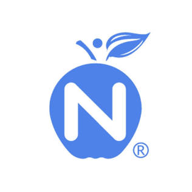<br><strong>Nutrimind</strong><br><em></em></td>
<td align="center"><br><strong>Nutrium</strong><br><em></em></td>
<td align="center"><br><strong>MacroFactor</strong><br><em></em></td>
</tr>
<tr>
<td rowspan="2">Perfil</td>
<td>Overview</td>
<td>Aplicación móvil que conecta al paciente en tratamiento nutricional con su nutricionista, enfocada en capturar de forma fiel el consumo diario durante el periodo que transcurre entre consultas.</td>
<td>Software de nutrición clínica en línea con amplia adopción entre profesionales de Latinoamérica, orientado a gestionar el expediente clínico, la antropometría y el diseño de planes alimentarios.</td>
<td>Plataforma de gestión de la práctica nutricional con presencia internacional, que integra evaluación, planificación de menús, agenda de citas y comunicación con el paciente en un solo lugar.</td>
<td>Aplicación de seguimiento nutricional dirigida al consumidor final, que ajusta de forma automática las metas calóricas mediante un algoritmo basado en la tendencia de peso del usuario.</td>
</tr>
<tr>
<td>Ventaja competitiva<br><em>¿Qué valor ofrece a los clientes?</em></td>
<td>Registra el consumo mediante fotografía con estimación asistida, protocoliza el autopesaje mostrando solo la tendencia y genera un índice de consistencia que el profesional interpreta sin juzgar al paciente.</td>
<td>Ofrece un expediente clínico completo y un cálculo dietético maduro, respaldados por una base de alimentos regionalizada y una adopción muy extendida entre profesionales latinoamericanos.</td>
<td>Integra la gestión completa de la práctica profesional en una sola plataforma, complementada con una aplicación móvil que facilita el diario de alimentos y la comunicación directa con el paciente.</td>
<td>Ajusta las metas energéticas con precisión mediante un algoritmo que aprende del comportamiento real del usuario, en lugar de aplicar fórmulas estáticas de cálculo calórico.</td>
</tr>
<tr>
<td rowspan="2">Perfil de Marketing</td>
<td>Mercado objetivo</td>
<td>Nutricionistas de clínica o centro de salud con carteras reducidas de pacientes, y pacientes adultos que siguen un tratamiento nutricional activo bajo seguimiento profesional vigente.</td>
<td>Nutriólogos, dietistas y estudiantes de nutrición que ejercen consulta clínica, deportiva o educativa en distintos países de Latinoamérica y España.</td>
<td>Nutricionistas y dietistas que gestionan una práctica presencial o en línea, distribuidos en un amplio número de países a nivel internacional.</td>
<td>Personas que siguen un proceso estructurado de pérdida de grasa o ganancia muscular, con perfil analítico y disposición a registrar su alimentación de forma constante.</td>
</tr>
<tr>
<td>Estrategias de marketing</td>
<td>Marketing de contenido en redes sociales dirigido de forma diferenciada a ambos segmentos, reforzado con alianzas con nutricionistas en ejercicio que actúan como puerta de entrada de sus pacientes.</td>
<td>Adopción institucional en universidades, clínicas y centros de nutrición, sostenida por la recomendación entre pares dentro de la comunidad profesional.</td>
<td>Presencia en directorios y plataformas de comparación de software profesional, con periodo de prueba gratuito como principal mecanismo de captación de nuevos usuarios.</td>
<td>Autoridad editorial construida sobre su vínculo con divulgadores de nutrición y entrenamiento basados en evidencia, reforzada con recomendación orgánica en comunidades especializadas.</td>
</tr>
<tr>
<td rowspan="3">Perfil de Producto</td>
<td>Productos &amp; Servicios</td>
<td>Aplicación móvil con dos experiencias según el rol, que incluye vinculación por código QR, evaluación y prescripción para el profesional, y registro por foto, autopesaje y expediente unificado para el paciente.</td>
<td>Expediente clínico, antropometría, cálculo de requerimientos, diseño de planes por equivalentes, base de alimentos y aplicación de seguimiento para el paciente.</td>
<td>Evaluación nutricional, planificación de menús con recetario, agenda de citas, mensajería segura y aplicación móvil de seguimiento para el paciente.</td>
<td>Registro de ingesta con base de datos verificada y lector de código de barras, cálculo adaptativo del gasto energético y analítica detallada de adherencia.</td>
</tr>
<tr>
<td>Precios &amp; Costos</td>
<td>Acceso gratuito para pacientes y nutricionistas en esta etapa, como supuesto de negocio pendiente de validación; el modelo de monetización se definirá tras validar la disposición a pagar del segmento profesional.</td>
<td>Modelo de pago único por licencia, sin suscripción recurrente, con funciones adicionales disponibles mediante suscripción opcional.</td>
<td>Modelo de suscripción mensual o anual dirigido al profesional, con periodo de prueba gratuito previo a la contratación del servicio.</td>
<td>Suscripción de once dólares con noventa y nueve centavos al mes o setenta y un dólares con noventa y nueve centavos al año, sin plan gratuito permanente.</td>
</tr>
<tr>
<td>Canales de distribución<br><em>(Web y/o Móvil)</em></td>
<td>Aplicación móvil multiplataforma desarrollada en Flutter como canal principal para ambos roles, dado que las funcionalidades diferenciales dependen de la cámara y del funcionamiento sin conexión.</td>
<td>Plataforma en línea accesible desde navegador, complementada con una aplicación móvil de seguimiento para el paciente.</td>
<td>Plataforma web para el profesional y aplicación móvil para el paciente, disponible en las principales tiendas de aplicaciones.</td>
<td>Aplicación móvil disponible en las tiendas de iOS y Android como canal exclusivo de distribución.</td>
</tr>
<tr>
<td rowspan="5">Análisis SWOT</td>
<td colspan="5">Realice esto para su startup y sus competidores. Sus fortalezas deberían apoyar sus oportunidades y contribuir a lo que ustedes definen como su posible ventaja competitiva.</td>
</tr>
<tr>
<td>Fortalezas</td>
<td>La captura entre consultas es el núcleo del producto y no un módulo accesorio. El registro por fotografía reduce el costo de reportar frente al relato verbal actual, y el funcionamiento sin conexión permite registrar en el momento del consumo.</td>
<td>Base instalada muy amplia entre profesionales latinoamericanos y familiaridad consolidada con la herramienta, confirmada por uno de los nutricionistas entrevistados. Profundidad del cálculo dietético y de la evaluación antropométrica.</td>
<td>Integración completa de la gestión profesional en una sola plataforma, con alcance internacional y una aplicación móvil que reduce la dispersión de la comunicación con el paciente.</td>
<td>Precisión superior en el ajuste de metas energéticas gracias al aprendizaje sobre datos reales del usuario, con una interfaz depurada y libre de elementos de gamificación.</td>
</tr>
<tr>
<td>Debilidades</td>
<td>Marca sin reconocimiento previo y sin base instalada frente a competidores consolidados. La estimación por fotografía es aproximada y no clínica, y la adopción depende de que el profesional invite primero al paciente.</td>
<td>El periodo entre consultas sigue dependiendo del relato del paciente, sin un mecanismo que contraste lo declarado con la respuesta corporal observable.</td>
<td>Comparte con Nutrimind la dependencia del relato del paciente entre consultas, y su enfoque integral la aleja del problema específico de la calidad del dato de ingesta.</td>
<td>Ausencia total del profesional en el circuito y sin registro mediante fotografía, lo que traslada al usuario toda la carga de la búsqueda manual de alimentos.</td>
</tr>
<tr>
<td>Oportunidades</td>
<td>El seguimiento actual se apoya en canales no diseñados para ese fin, y la disposición del paciente a registrar mediante fotografía valida el mecanismo central de la propuesta.</td>
<td>Ampliar su aplicación de seguimiento hacia mecanismos de contraste entre lo declarado y la respuesta corporal, aprovechando su base instalada de profesionales.</td>
<td>Expandirse hacia mercados latinoamericanos donde su presencia es menor que la de Nutrimind, profundizando la adherencia mediante su aplicación para el paciente.</td>
<td>Incorporar una figura profesional dentro del circuito y adoptar el registro por fotografía para reducir la fricción del registro manual actual.</td>
</tr>
<tr>
<td>Amenazas</td>
<td>Nutrimind y Nutrium podrían incorporar un índice de consistencia sobre las fotografías que ya reciben, y la adopción depende de un profesional conforme con su herramienta actual.</td>
<td>Aparición de soluciones enfocadas específicamente en el periodo entre consultas que desplacen su aplicación de seguimiento hacia un rol secundario.</td>
<td>Competencia directa de Nutrimind en el mercado latinoamericano, donde este último cuenta con una adopción superior entre profesionales.</td>
<td>Regulaciones más estrictas sobre recomendaciones de salud sin intervención profesional, y entrada de plataformas que combinen precisión algorítmica con supervisión clínica.</td>
</tr>
</table>

### 2.1.2. Estrategias y tácticas frente a competidores

El análisis competitivo revela que los actores establecidos poseen ventajas claras en base instalada de profesionales, profundidad del expediente clínico y familiaridad con su herramienta. Sin embargo, ninguno ha resuelto la fidelidad del dato capturado durante el periodo que transcurre entre una consulta y la siguiente, que constituye el espacio diferencial que Healthify busca ocupar.

**Frente a Nutrimind: convivir antes que desplazar**

Nutrimind es la herramienta que uno de los nutricionistas entrevistados utiliza actualmente y respecto de la cual no manifiesta insatisfacción. Desplazarla exigiría igualar años de desarrollo de expediente clínico y cálculo dietético, esfuerzo que no resulta viable ni necesario en esta etapa. El posicionamiento apunta a que Healthify se integre como la pieza que resuelve el periodo que Nutrimind no cubre. Para los profesionales que no usan software clínico, como la segunda nutricionista entrevistada, que reparte la información entre la historia clínica, Excel y WhatsApp, Healthify ofrece además un lugar único donde ordenar el seguimiento que hoy está disperso. Como táctica concreta, la comunicación dirigida al profesional se construirá alrededor de una pregunta que su herramienta actual no puede responder, referida a qué comió realmente el paciente durante las semanas previas a la consulta. El contenido en redes sociales ilustrará escenarios donde un paciente no progresa sin causa aparente, mostrando de qué manera un índice de consistencia ofrece una señal previa a esa situación. Paralelamente, el proceso de vinculación mediante código QR se diseñará para integrarse al flujo de trabajo existente sin exigir la migración de información histórica.

**Frente a Nutrium: competir en profundidad y no en amplitud**

Igualar la amplitud de Nutrium en gestión de agenda, planificación y comunicación no resulta estratégicamente necesario. La apuesta es profundizar de manera deliberada en un solo problema y resolverlo con un nivel de calidad que una plataforma de propósito general difícilmente alcanza. En términos tácticos, se comunicará de forma explícita el conjunto de decisiones de diseño que sostienen la calidad del dato, tales como la exhibición permanente de la confianza y la procedencia de cada estimación, la separación entre la ausencia de registro y el incumplimiento del plan, y la existencia de un mecanismo mediante el cual el paciente reporta un consumo fuera del plan sin recibir penalización visual alguna.

**Frente a MacroFactor: reubicar el algoritmo dentro del vínculo clínico**

MacroFactor demuestra que el contraste entre ingesta declarada y tendencia de peso es técnicamente viable, pero lo aplica prescindiendo por completo del profesional. Healthify no compite por el mismo usuario, dado que su segmento se define por la existencia de un tratamiento supervisado vigente. La estrategia consiste en apropiarse del mecanismo sin apropiarse de su filosofía, comunicando con claridad la distinción entre automatizar lo mecánico y automatizar el juicio clínico. El sistema propone metas mediante un cálculo determinista y auditable, mientras que el profesional acepta o sobrescribe con una razón que queda registrada, en línea con la afirmación de los nutricionistas entrevistados de que cada plan debe ser individualizado.

**Estrategia transversal en redes sociales**

Dado que el modelo de adopción de Healthify es asimétrico, ya que el paciente solo ingresa cuando el profesional lo invita, la estrategia en redes sociales opera en dos frentes diferenciados. El frente dirigido al segmento profesional se orienta a comunidades de nutricionistas, con contenido centrado en la calidad del dato de ingesta y en la interpretación de la brecha entre lo declarado y la respuesta corporal, priorizando la construcción de autoridad técnica antes que la promoción de funcionalidades. El frente dirigido al segmento de pacientes se orienta a plataformas de consumo masivo, contrastando la práctica actual de enviar fotografías y redactar explicaciones por mensajería con la posibilidad de registrar mediante un solo toque, con el propósito de generar demanda hacia el profesional. Como táctica de refuerzo se contempla el establecimiento de alianzas con nutricionistas en ejercicio y con centros de salud, quienes actúan simultáneamente como usuarios del segmento profesional y como canal de acceso a sus propias carteras de pacientes.

## 2.2. Entrevistas

### 2.2.1. Diseño de entrevistas

Las entrevistas se diseñaron como guías semiestructuradas y diferenciadas para cada segmento objetivo. Se organizaron en bloques temáticos que van del perfil del entrevistado a su proceso actual y a la reacción frente a las hipótesis de la solución. El entrevistador podía cambiar el orden o reformular preguntas según el curso de la conversación, pero siempre con preguntas abiertas y pidiendo casos concretos en lugar de opiniones generales. Así se buscó reducir el sesgo de respuesta y obtener evidencia de comportamientos reales.

#### Segmento 1 - Nutricionista (28 - 55 años)

**Bloque 1: Perfil profesional**

1. Cuéntame tu edad, dónde atiendes y cuántos años llevas ejerciendo. ¿Trabajas de forma independiente, en una clínica o en un centro de salud?
2. ¿Cuántos pacientes activos manejas hoy? ¿Cobras por consulta suelta o por paquete de seguimiento?

**Bloque 2: Proceso de atención**

3. Llévame por lo que pasa desde que llega un paciente nuevo que quiere bajar de peso hasta que le entregas su plan.
4. Todo lo que me contaste (datos de evaluación, análisis, antecedentes, ajustes posteriores), ¿dónde queda guardado?

**Bloque 3: El periodo entre consultas**

5. Cuando el paciente vuelve a las dos semanas, ¿cómo sabes qué comió en ese tiempo? ¿Cuánto de la consulta se te va en reconstruirlo?
6. ¿Te ha pasado sospechar que un paciente no te está contando todo lo que come? Cuéntame de la última vez. ¿Cómo te diste cuenta?
7. ¿Qué haces cuando alguien no progresa y no encuentras la razón?

**Bloque 4: Herramientas actuales**

8. ¿Qué usas hoy para todo esto (software, Excel, papel, WhatsApp)? ¿Qué es lo que más te cuesta de trabajar así?

**Bloque 5: Validación de hipótesis**

9. Si tu paciente registrara sus comidas con una foto y el sistema propusiera una estimación, ¿la revisarías antes de que entre al expediente o preferirías no tener ese dato?
10. Si el sistema te avisara que lo que un paciente registra no cuadra con cómo evoluciona su peso, ¿te serviría o eso ya lo intuyes por tu cuenta?

**Bloque 6: Cierre**

11. Si pudieras cambiar una sola cosa de cómo haces el seguimiento hoy, ¿cuál sería?

#### Segmento 2 - Paciente en tratamiento nutricional activo (18 - 59 años)

**Bloque 1: Perfil y antecedentes**

1. Cuéntame tu edad, en qué distrito vives, a qué te dedicas y con quién vives. ¿Quién cocina en tu casa?
2. ¿Cómo llegaste a ir donde un nutricionista y desde cuándo? ¿Lo habías intentado antes por tu cuenta? ¿Qué pasó esa vez?

**Bloque 2: Ubicación de la información**

3. ¿Dónde tienes tu plan nutricional ahora mismo?
4. Cuando te toman medidas o te mandan análisis, ¿dónde termina eso? ¿Lo tienes tú o solo tu nutricionista?

**Bloque 3: Comportamiento actual**

5. Descríbeme cómo fue tu día de ayer en comidas, desde que te levantaste.
6. ¿Cómo sabes si cumpliste tu plan un día cualquiera? ¿Anotas algo en algún lado?
7. Cuéntame de la última vez que comiste algo que no estaba en el plan. ¿Qué pasó ese día? ¿Se lo contaste a tu nutricionista?

**Bloque 4: Relación entre consultas**

8. Entre una consulta y la otra, ¿tienen contacto? ¿Por dónde y quién escribe primero?
9. ¿Cada cuánto te pesas y quién decidió esa frecuencia?

**Bloque 5: Tecnología**

10. ¿Qué apps has probado para registrar comidas? ¿Cuánto tiempo las usaste y por qué las dejaste?

**Bloque 6: Validación de hipótesis**

11. Si registrar una comida fuera solo tomarle una foto y confirmar lo que el sistema propone, ¿lo harías a diario? ¿Qué te haría dejar de hacerlo?
12. Si hubiera un botón para decir "hoy comí fuera del plan" sin tener que explicar qué comiste, y tu nutricionista lo viera, ¿lo usarías?

**Bloque 7: Cierre**

13. Si pudieras cambiar una sola cosa de cómo llevas esto hoy, ¿cuál sería?

<div style="page-break-after: always"></div>

### 2.2.2. Registro de entrevistas

<p class="caption"><strong>Tabla 17</strong><br><em>Registro de la entrevista #1 al segmento nutricionista</em></p>

| Segmento: Nutricionista | Entrevista #1 |
| --- | --- |
| Nombres y Apellidos | Willyan Guerrero Ortega |
| Edad | 30 años |
| Distrito | Barranca, Lima |
| Ocupación | Nutricionista (Centro de Salud La Rama y atención en clínicas) |
| Entrevistador | Angel Villarreal |
| Timing | 0:03 - 5:22 |
| Duración | 5:19 minutos |
| URL | [Video entrevista](https://upcedupe-my.sharepoint.com/:v:/g/personal/u202411669_upc_edu_pe/IQD9NblIA-faSrv30-7eGre8ATug1LRzIfWImsD2kLDoWS8?e=tHYgYe&nav=eyJyZWZlcnJhbEluZm8iOnsicmVmZXJyYWxBcHAiOiJTdHJlYW1XZWJBcHAiLCJyZWZlcnJhbFZpZXciOiJTaGFyZURpYWxvZy1MaW5rIiwicmVmZXJyYWxBcHBQbGF0Zm9ybSI6IldlYiIsInJlZmVycmFsTW9kZSI6InZpZXcifSwicGxheWJhY2tPcHRpb25zIjp7InN0YXJ0VGltZUluU2Vjb25kcyI6My4yN319) |
| Screenshot |  |
| Resumen | Willyan tiene 30 años y cuatro de ejercicio profesional. Trabaja en el Centro de Salud La Rama y antes trabajó en EsSalud en Huaraz. En clínicas atiende entre cinco y seis pacientes activos. Con un paciente nuevo sigue las fases de la consulta nutricional: evaluación (hábitos alimentarios, antecedentes médicos, actividad física, peso, talla, perímetro abdominal, pliegues y análisis bioquímicos como perfil lipídico y glucosa), diagnóstico, intervención con un plan de alimentación personalizado y, por último, monitoreo y seguimiento. Entre consultas hace el monitoreo de forma virtual, con una frecuencia que ajusta a cada paciente, y en algunos casos lo sigue día por día. Cuando el paciente regresa, para saber qué consumió debe hacerle **nuevamente una entrevista sobre sus hábitos**. En ese periodo los pacientes también le consultan sustituciones por antojos, y él les responde con equivalencias en gramos y calorías (por ejemplo, cambiar camote por papa, yuca u olluco). Si un paciente no progresa, hace ajustes, vuelve a preguntar y, según la evaluación, lo deriva a un endocrinólogo, porque los factores hormonales pueden influir. No considera repetitivo su trabajo, ya que cada plan es individualizado. Usa Nutrimind, un software con app en su celular, para diseñar el régimen alimentario y registrar datos y medidas del paciente. Sin embargo, lo que el paciente come entre consultas lo sigue obteniendo mediante entrevista y contacto virtual. |

<div style="page-break-after: always"></div>

<p class="caption"><strong>Tabla 18</strong><br><em>Registro de la entrevista #2 al segmento nutricionista</em></p>

| Segmento: Nutricionista | Entrevista #2 |
| --- | --- |
| Nombres y Apellidos | Tatiana Mozombite |
| Edad | 28 años |
| Distrito | Iquitos, Loreto |
| Ocupación | Nutricionista (Hospital Regional de Loreto y consulta particular) |
| Entrevistador | Olenka Del Aguila |
| Timing | 5:23 - 10:40 |
| Duración | 5:17 minutos |
| URL | [Video entrevista](https://upcedupe-my.sharepoint.com/:v:/g/personal/u202411669_upc_edu_pe/IQD9NblIA-faSrv30-7eGre8ATug1LRzIfWImsD2kLDoWS8?e=qVeikN&nav=eyJyZWZlcnJhbEluZm8iOnsicmVmZXJyYWxBcHAiOiJTdHJlYW1XZWJBcHAiLCJyZWZlcnJhbFZpZXciOiJTaGFyZURpYWxvZy1MaW5rIiwicmVmZXJyYWxBcHBQbGF0Zm9ybSI6IldlYiIsInJlZmVycmFsTW9kZSI6InZpZXcifSwicGxheWJhY2tPcHRpb25zIjp7InN0YXJ0VGltZUluU2Vjb25kcyI6MzIzLjQ4fX0%3D) |
| Screenshot |  |
| Resumen | Tatiana tiene 28 años y tres de ejercicio. Trabaja en el Hospital Regional de Loreto y atiende de forma particular los fines de semana. En su consulta particular tiene entre 8 y 10 pacientes activos y trabaja con paquetes mensuales de dos o tres controles para dar un seguimiento más cercano. Su evaluación inicial incluye entrevista de hábitos y enfermedades de base, peso, talla, perímetro abdominal y análisis clínicos. Con eso diseña un plan basado en alimentos accesibles de la zona, como pescado, plátano y frutas locales. Su información está repartida en tres lugares: la historia clínica física y el sistema del hospital (limitado a datos generales), un Excel por paciente en su laptop y WhatsApp, donde quedan los ajustes que envía. Reconoció que por esto **"a veces pierde el hilo" de lo último que le indicó a un paciente**. Reconstruir lo que el paciente comió entre consultas le consume **aproximadamente un tercio de la cita**, preguntando día por día. Contó que el proceso mejora cuando el paciente lleva un cuaderno o envía fotos, pero que la mayoría no lo hace. Relató el caso de una paciente que durante tres semanas no bajó de peso pese a afirmar que cumplía el plan; al preguntarle por los fines de semana, descubrió que no consideraba "comida" las salidas familiares de los sábados. Ante un estancamiento, primero revisa la adherencia real y luego deriva al médico para descartar problemas hormonales, sobre todo de tiroides. Sobre el registro por foto, indicó que la estimación debe ser confiable, pues corregir cada plato (por ejemplo, un tacacho o un juane) le quitaría tiempo que no tiene. Valoró mucho la alerta por inconsistencias entre registro y peso, sobre todo en pacientes que ve cada uno o tres meses, porque le evitaría esperar a la siguiente cita para detectar un problema. Lo que más le gustaría cambiar es tener toda la información del paciente en un solo lugar. |

<div style="page-break-after: always"></div>

<p class="caption"><strong>Tabla 19</strong><br><em>Registro de la entrevista #1 al segmento paciente en tratamiento nutricional activo</em></p>

| Segmento: Paciente en tratamiento nutricional activo | Entrevista #1 |
| --- | --- |
| Nombres y Apellidos | Evelyn Del Aguila |
| Edad | 52 años |
| Distrito | Iquitos, Loreto |
| Ocupación | Docente universitaria |
| Entrevistador | Olenka Del Aguila |
| Timing | 10:44 - 16:16 |
| Duración | 5:32 minutos |
| URL | [Video entrevista](https://upcedupe-my.sharepoint.com/:v:/g/personal/u202411669_upc_edu_pe/IQD9NblIA-faSrv30-7eGre8ATug1LRzIfWImsD2kLDoWS8?e=dXk5ZP&nav=eyJyZWZlcnJhbEluZm8iOnsicmVmZXJyYWxBcHAiOiJTdHJlYW1XZWJBcHAiLCJyZWZlcnJhbFZpZXciOiJTaGFyZURpYWxvZy1MaW5rIiwicmVmZXJyYWxBcHBQbGF0Zm9ybSI6IldlYiIsInJlZmVycmFsTW9kZSI6InZpZXcifSwicGxheWJhY2tPcHRpb25zIjp7InN0YXJ0VGltZUluU2Vjb25kcyI6NjQ0LjUzfX0%3D) |
| Screenshot |  |
| Resumen | Evelyn tiene 52 años, vive con su madre, quien suele cocinar, y en ocasiones piden comida por delivery. Llegó al nutricionista por recomendación tras un examen de salud ocupacional que mostró triglicéridos y glucosa elevados. Recibe su plan por WhatsApp como un cronograma semanal de tres comidas diarias, que mantiene impreso y en el celular. Su nutricionista le pide **enviar todos los días, de lunes a domingo, la foto de su desayuno, almuerzo y cena** para evaluar lo que consume. Ese chat de WhatsApp es el único registro de su alimentación y el lugar donde ella misma revisa su nivel de cumplimiento. Recibe sus análisis y medidas y se los lleva al nutricionista en la cita para que los interprete. Cuando come fuera del plan por compromisos laborales o familiares (por ejemplo, makis en una reunión con colegas), igual envía la foto y explica la situación por escrito. Se pesa cada dos semanas por decisión propia. Ha usado apps de delivery con información nutricional, pero ninguna dedicada al registro de comidas. Afirmó que usaría a diario el registro por foto, "porque igual a diario tengo que enviar el reporte", siempre que la app sea eficiente. También usaría el botón de "comí fuera del plan", ya que por el trabajo le cuesta tomarse tiempo para escribirle detalles al nutricionista. Lo que más le gustaría cambiar es poder enviar sus fotos con un mensaje ya predefinido. |

<div style="page-break-after: always"></div>

<p class="caption"><strong>Tabla 20</strong><br><em>Registro de la entrevista #2 al segmento paciente en tratamiento nutricional activo</em></p>

| Segmento: Paciente en tratamiento nutricional activo | Entrevista #2 |
| --- | --- |
| Nombres y Apellidos | Larisa Ramírez |
| Edad | 19 años |
| Distrito | San Miguel, Lima |
| Ocupación | Estudiante de Administración y Marketing (UPC) |
| Entrevistador | Olenka Del Aguila |
| Timing | 16:17 - 21:29 |
| Duración | 5:12 minutos |
| URL | [Video entrevista](https://upcedupe-my.sharepoint.com/:v:/g/personal/u202411669_upc_edu_pe/IQD9NblIA-faSrv30-7eGre8ATug1LRzIfWImsD2kLDoWS8?e=nqCrYT&nav=eyJyZWZlcnJhbEluZm8iOnsicmVmZXJyYWxBcHAiOiJTdHJlYW1XZWJBcHAiLCJyZWZlcnJhbFZpZXciOiJTaGFyZURpYWxvZy1MaW5rIiwicmVmZXJyYWxBcHBQbGF0Zm9ybSI6IldlYiIsInJlZmVycmFsTW9kZSI6InZpZXcifSwicGxheWJhY2tPcHRpb25zIjp7InN0YXJ0VGltZUluU2Vjb25kcyI6OTc3LjExfX0%3D) |
| Screenshot |  |
| Resumen | Larisa tiene 19 años y vive con su prima y una persona que las ayuda en casa, quien prepara las comidas. Acudió al nutricionista para mejorar su alimentación y sentirse mejor con su cuerpo, después de intentar reducir comidas por su cuenta sin lograr constancia. Tiene su plan en WhatsApp, junto con capturas de pantalla de indicaciones puntuales. Sus medidas y resultados están repartidos entre la nutricionista, fotos en su celular y un bloc de notas, y reconoce que no tiene nada ordenado en un solo lugar. **No registra lo que come**: solo intenta recordarlo y compararlo mentalmente con el plan. La noche anterior a la entrevista comió pizza y no se lo comunicó a su nutricionista porque tiene permitido "darse un gusto" algún fin de semana y lo consideró algo puntual. El contacto con su nutricionista es por WhatsApp, esporádico y solo cuando ella tiene dudas. Se pesa una vez por semana, frecuencia indicada por su nutricionista. Probó Fitia, pero la abandonó por la flojera de buscar cada alimento e ingresar cantidades después de cada comida. Aseguró que usaría a diario el registro por foto por ser mucho más fácil, y que solo lo dejaría si el sistema se equivocara mucho o le pidiera demasiados datos manuales. Usaría el botón de "comí fuera del plan" porque es rápido y no sentiría que tiene que justificarse, y su nutricionista podría tenerlo en cuenta en la siguiente consulta. Lo que más le gustaría cambiar es tener todo en un solo lugar, con una forma fácil de registrar su alimentación y que su nutricionista pueda ver su progreso. |

<div style="page-break-after: always"></div>

### 2.2.3. Análisis de entrevistas

#### Segmento 1: Nutricionistas

**Características objetivas**

Se entrevistó a dos nutricionistas de 30 y 28 años, con cuatro y tres años de ejercicio. Ambos combinan el sector público (Centro de Salud La Rama y Hospital Regional de Loreto) con la atención privada, donde llevan el seguimiento más cercano: Willyan atiende entre cinco y seis pacientes en clínicas, y Tatiana entre 8 y 10 en su consulta particular, con paquetes mensuales de dos o tres controles.

Los dos siguen la misma secuencia de atención: evaluación (hábitos, antecedentes, antropometría y análisis bioquímicos), diagnóstico, plan de alimentación personalizado y seguimiento en citas posteriores. Las herramientas difieren. Willyan usa Nutrimind, un software móvil para diseñar planes y registrar medidas. Tatiana reparte la información entre la historia clínica y el sistema del hospital, un Excel por paciente y WhatsApp. **En ambos casos, lo que el paciente consume entre consultas no queda en ninguna herramienta**: se obtiene volviendo a entrevistar al paciente en cada cita y, en el intervalo, mediante contacto virtual informal.

**Características subjetivas**

El hallazgo central es el costo del periodo entre consultas. Tatiana dedica cerca de un tercio de cada cita a reconstruir día por día lo que comió el paciente, y Willyan describe la misma práctica al señalar que, cuando el paciente vuelve, debe "realizar nuevamente una entrevista" sobre sus hábitos. Esa reconstrucción depende de la memoria y la interpretación del paciente: Tatiana relató el caso de una paciente que pasó tres semanas sin bajar de peso porque no consideraba "comida" las salidas familiares de los sábados, un problema que solo descubrió al preguntar específicamente por los fines de semana.

Ante un paciente estancado, ambos siguen el mismo razonamiento: primero cuestionan la adherencia real al plan (ajustes y nuevas preguntas) y solo después derivan al médico o endocrinólogo para descartar causas hormonales. Esto indica que **la falta de información confiable sobre lo que comió el paciente retrasa la identificación de la causa real del estancamiento**.

Ambos valoran su criterio profesional y la personalización de los planes, y Willyan subraya que "cada paciente es distinto". Al mismo tiempo, Tatiana describe la carga operativa de trabajar con información dispersa: pierde el hilo de los ajustes que envía por WhatsApp y le cuesta armar el panorama completo del paciente antes de una cita. Frente a las hipótesis, se mostró favorable con dos condiciones claras: las estimaciones por foto deben ser confiables para no tener que corregir plato por plato, y las alertas por inconsistencia entre registro y peso le serían especialmente útiles con los pacientes que ve cada uno o tres meses. Lo que más le gustaría cambiar es tener toda la información en un solo lugar.

**Conclusión**

Los nutricionistas ya cuentan con recursos para evaluar, diagnosticar y diseñar planes (incluso software especializado, en el caso de Willyan), pero ninguno tiene visibilidad estructurada sobre lo que el paciente come entre consultas. Esa brecha consume tiempo de la consulta, permite omisiones que solo se descubren semanas después y retrasa la detección de la causa real de un estancamiento. El segmento se muestra receptivo a una herramienta que capture esa información de forma continua y la ordene junto al resto del expediente, siempre que respete su criterio clínico y no le traslade trabajo de corrección.

<div style="page-break-after: always"></div>

#### Segmento 2: Paciente en tratamiento nutricional activo

**Características objetivas**

Se entrevistó a dos pacientes con perfiles distintos: Evelyn, docente universitaria de 52 años residente en Iquitos, y Larisa, estudiante universitaria de 19 años residente en San Miguel (Lima). Llegaron al tratamiento por motivos diferentes: Evelyn por recomendación médica tras un examen ocupacional con triglicéridos y glucosa elevados, y Larisa por iniciativa propia, después de intentar mejorar su alimentación sin constancia.

Ambas reciben su plan nutricional por WhatsApp y tienen sus medidas y análisis repartidos entre el celular, documentos propios y lo que guarda el nutricionista. Sus formas de registrar lo que comen son opuestas. Evelyn envía por indicación de su nutricionista tres fotos diarias por WhatsApp, lo que deja un historial acumulado dentro del chat. Larisa no lleva ningún registro y confía en su memoria. Ninguna usa una aplicación de registro: Evelyn solo ha usado apps de delivery con información nutricional, y Larisa abandonó Fitia.

**Características subjetivas**

Los dos casos muestran las dos caras del mismo problema. Evelyn registra todo, pero a costa de un esfuerzo diario que depende de WhatsApp, y reconoce que por su trabajo le cuesta tomarse tiempo para escribirle detalles al nutricionista. Larisa no registra nada porque el único intento estructurado que probó le resultó tedioso: abandonó Fitia por la flojera de buscar cada alimento e ingresar cantidades. **En ninguno de los dos casos el nutricionista recibe información organizada**: en uno, una sucesión de fotos en un chat; en el otro, solo lo que la paciente recuerde en la consulta.

Las comidas fuera del plan confirman esta brecha. Evelyn las reporta con foto y explicación escrita. Larisa no reportó la pizza de la noche anterior porque tiene permitido darse un gusto el fin de semana, y lo consideró innecesario. Aunque esa flexibilidad es válida, el nutricionista no tiene forma de saber con qué frecuencia ocurre.

Frente a las hipótesis, ambas afirmaron que usarían a diario el registro por foto con confirmación del sistema, con condiciones parecidas: que sea eficiente, que no se equivoque demasiado y que no pida ingresar datos manualmente. Ambas usarían también el botón de "comí fuera del plan": Evelyn porque le ahorraría el tiempo de escribir detalles, y Larisa porque no sentiría que tiene que justificarse. En los cambios que más desean, Evelyn prioriza agilizar el envío de sus comidas con un mensaje predefinido, y Larisa reunir en un solo lugar su plan, sus medidas y su alimentación, y que su nutricionista pueda ver su progreso.

**Conclusión**

Las pacientes ya están dispuestas a compartir su alimentación con su nutricionista, pero los medios disponibles las obligan a elegir entre un registro manual que se abandona (Fitia) y un envío diario por chat que consume tiempo y no genera información ordenada (WhatsApp). Ambas buscan un registro rápido, basado en fotos y con mínima escritura, que les permita comunicar también las desviaciones sin sentirse juzgadas. Esto confirma que la adopción depende menos de la motivación del paciente que de reducir al mínimo el esfuerzo de cada registro.

#### Conclusión general

Los dos segmentos describen la misma brecha desde lados opuestos: el paciente no tiene una forma sencilla de registrar y comunicar lo que come, y el nutricionista no tiene una forma confiable de conocerlo sin reconstruirlo en consulta. Las entrevistas coinciden en tres necesidades: **centralizar** la información hoy repartida entre WhatsApp, Excel, notas y la memoria; **capturar** el consumo entre consultas con el mínimo esfuerzo para el paciente; y **detectar a tiempo** las inconsistencias entre lo registrado y la evolución del peso, siempre con las decisiones clínicas en manos del nutricionista.

## 2.3. Needfinding

Con el propósito de comprender de manera integral las necesidades, comportamientos y motivaciones de los usuarios de Healthify, se llevó a cabo un proceso de investigación cualitativa mediante entrevistas dirigidas a representantes de cada uno de los segmentos objetivo. Estas interacciones permitieron explorar la manera en que la información del tratamiento nutricional circula actualmente entre el profesional y su paciente, las dificultades asociadas al registro del consumo durante el periodo entre consultas y las limitaciones de los canales que ambas partes emplean hoy para sostener ese seguimiento. El proceso permitió reconocer tanto necesidades explícitas como implícitas, estableciendo una base sustentada en evidencia para el diseño de una solución centrada en el usuario.

### 2.3.1. User Personas

Esta sección presenta las fichas de User Persona elaboradas en UXPressia, una por cada segmento objetivo identificado. Los arquetipos se construyen a partir de las características observadas en el análisis de entrevistas y se articulan con los hallazgos del análisis competitivo. En particular, ambos arquetipos reflejan la limitación estructural detectada en las plataformas existentes, consistente en que el periodo entre consultas depende de lo que el paciente recuerda y decide reportar. El primer arquetipo representa al nutricionista de clínica o centro de salud que conduce el tratamiento, mientras que el segundo representa a la persona en tratamiento nutricional activo. 

#### Segmento 1: Nutricionista

<p class="caption"><strong>Figura 5</strong><br><em>User persona de Willyan</em></p>

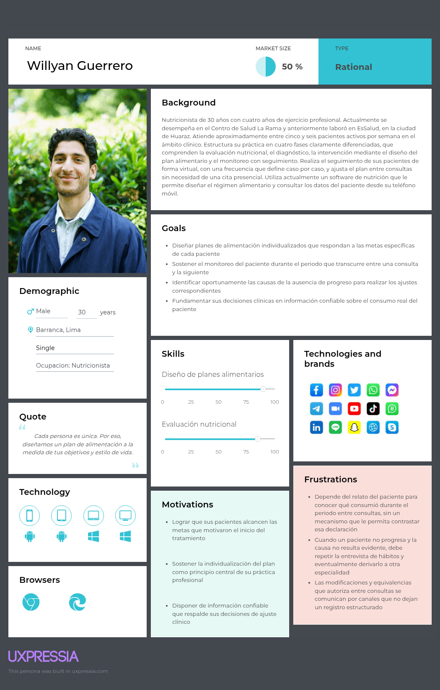

#### Segmento 2: Paciente en tratamiento nutricional activo

<p class="caption"><strong>Figura 6</strong><br><em>User persona de Evelyn</em></p>

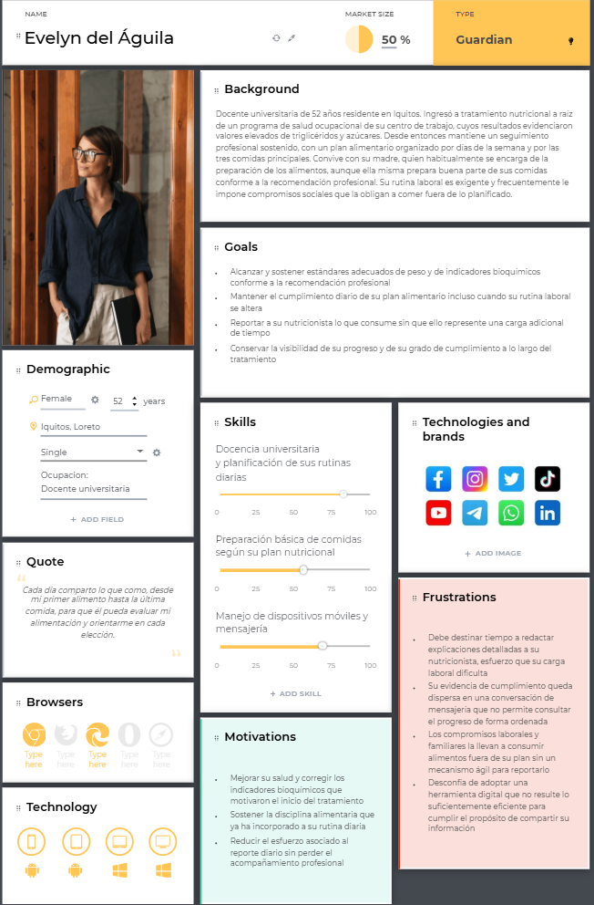

### 2.3.2. User Task Matrix

Esta sección presenta el User Task Matrix de los dos segmentos objetivo de Healthify, construido a partir de las cuatro entrevistas realizadas: Willyan Guerrero y Tatiana Mozombite, nutricionistas, y Evelyn Del Aguila y Larisa Ramírez, pacientes en tratamiento nutricional activo. La matriz concentra las tareas que cada entrevistado realiza actualmente para cumplir sus objetivos, con independencia de la existencia de la solución propuesta. Para cada tarea se consigna la frecuencia con que se ejecuta y la importancia que reviste para el usuario correspondiente.

#### Segmento 1: Nutricionista

<p class="caption"><strong>Tabla 21</strong><br><em>User Task Matrix del segmento nutricionista</em></p>

<table>
<tr>
<th rowspan="2">Task</th>
<th colspan="2">Willyan Guerrero</th>
<th colspan="2">Tatiana Mozombite</th>
</tr>
<tr>
<th>Frequency</th><th>Importance</th><th>Frequency</th><th>Importance</th>
</tr>
<tr>
<td>Evaluar nutricionalmente al paciente mediante entrevista y mediciones</td>
<td>Siempre</td><td>Alta</td><td>Siempre</td><td>Alta</td>
</tr>
<tr>
<td>Establecer el diagnóstico nutricional</td>
<td>Siempre</td><td>Alta</td><td>Siempre</td><td>Alta</td>
</tr>
<tr>
<td>Diseñar el plan de alimentación individualizado</td>
<td>Siempre</td><td>Alta</td><td>Siempre</td><td>Alta</td>
</tr>
<tr>
<td>Realizar el monitoreo del paciente entre consultas</td>
<td>Siempre</td><td>Alta</td><td>Normalmente</td><td>Alta</td>
</tr>
<tr>
<td>Reconstruir los hábitos de consumo del periodo transcurrido</td>
<td>Siempre</td><td>Alta</td><td>Siempre</td><td>Alta</td>
</tr>
<tr>
<td>Ajustar el plan alimentario sin cita presencial</td>
<td>Normalmente</td><td>Alta</td><td>Normalmente</td><td>Alta</td>
</tr>
<tr>
<td>Solicitar u otorgar equivalencias o reemplazos de alimentos</td>
<td>Normalmente</td><td>Alta</td><td>A veces</td><td>Media</td>
</tr>
<tr>
<td>Verificar el grado de cumplimiento del plan alimentario</td>
<td>Normalmente</td><td>Alta</td><td>Siempre</td><td>Alta</td>
</tr>
<tr>
<td>Programar la siguiente consulta de seguimiento</td>
<td>Siempre</td><td>Alta</td><td>Siempre</td><td>Alta</td>
</tr>
<tr>
<td>Derivar al paciente a otra especialidad ante ausencia de progreso</td>
<td>A veces</td><td>Media</td><td>A veces</td><td>Media</td>
</tr>
<tr>
<td>Compartir o revisar los resultados de análisis bioquímicos</td>
<td>A veces</td><td>Alta</td><td>Normalmente</td><td>Alta</td>
</tr>
<tr>
<td>Controlar el peso corporal del paciente de forma periódica</td>
<td>A veces</td><td>Media</td><td>Normalmente</td><td>Alta</td>
</tr>
</table>

#### Segmento 2: Paciente en tratamiento nutricional activo

<p class="caption"><strong>Tabla 22</strong><br><em>User Task Matrix del segmento paciente en tratamiento nutricional activo</em></p>

<table>
<tr>
<th rowspan="2">Task</th>
<th colspan="2">Evelyn Del Aguila</th>
<th colspan="2">Larisa Ramírez</th>
</tr>
<tr>
<th>Frequency</th><th>Importance</th><th>Frequency</th><th>Importance</th>
</tr>
<tr>
<td>Registrar y comunicar lo consumido en cada comida</td>
<td>Siempre</td><td>Alta</td><td>Nunca</td><td>Media</td>
</tr>
<tr>
<td>Consultar el plan alimentario prescrito antes de preparar los alimentos</td>
<td>Siempre</td><td>Alta</td><td>Normalmente</td><td>Alta</td>
</tr>
<tr>
<td>Verificar el grado de cumplimiento del plan alimentario</td>
<td>Siempre</td><td>Alta</td><td>Normalmente</td><td>Media</td>
</tr>
<tr>
<td>Reportar el consumo de alimentos ajenos al plan</td>
<td>A veces</td><td>Alta</td><td>Nunca</td><td>Baja</td>
</tr>
<tr>
<td>Controlar el peso corporal de forma periódica</td>
<td>Normalmente</td><td>Media</td><td>Normalmente</td><td>Media</td>
</tr>
<tr>
<td>Solicitar equivalencias o reemplazos de alimentos</td>
<td>A veces</td><td>Media</td><td>A veces</td><td>Media</td>
</tr>
<tr>
<td>Compartir los resultados de análisis bioquímicos</td>
<td>A veces</td><td>Alta</td><td>A veces</td><td>Media</td>
</tr>
<tr>
<td>Reconstruir los hábitos de consumo del periodo transcurrido en la consulta de seguimiento</td>
<td>A veces</td><td>Media</td><td>Siempre</td><td>Media</td>
</tr>
<tr>
<td>Programar la siguiente consulta de seguimiento</td>
<td>A veces</td><td>Media</td><td>A veces</td><td>Media</td>
</tr>
</table>

### Análisis de User Task Matrix

El análisis de la matriz permite identificar patrones diferenciados en el comportamiento de ambos segmentos y extraer conclusiones directamente aplicables al diseño de la solución.

En el segmento profesional, las tareas críticas se concentran en las cuatro fases del proceso de atención nutricional, con particular intensidad en la reconstrucción de los hábitos de consumo del periodo transcurrido. Ambos nutricionistas ejecutan esta tarea siempre y le asignan importancia alta, pero la resuelven mediante una entrevista retrospectiva que depende de lo que el paciente recuerda y decide contar: Willyan vuelve a entrevistar al paciente sobre sus hábitos en cada cita, y Tatiana dedica cerca de un tercio de la consulta a preguntar día por día. Las diferencias aparecen en el monitoreo entre consultas y en el control del peso. Willyan hace un seguimiento virtual que en algunos casos es diario, mientras que Tatiana trabaja con paquetes de dos o tres controles mensuales y le da más peso a la verificación del cumplimiento y a la evolución del peso para detectar un estancamiento. La matriz expone así, en términos de tareas observables, la limitación que el análisis competitivo identificó en las plataformas existentes.

En el segmento de pacientes, las dos entrevistadas muestran comportamientos opuestos frente a la misma tarea. Evelyn registra y comunica cada comida todos los días, porque su nutricionista le pide las fotos del desayuno, almuerzo y cena, y también reporta las comidas fuera del plan con foto y explicación. Larisa no registra lo que come: consulta su plan y lo compara mentalmente con lo que recuerda, y no reportó la pizza de la noche anterior porque la consideró un gusto permitido. En su caso, la reconstrucción de hábitos ocurre siempre en la consulta y depende solo de su memoria. En ambas, el control del peso tiene una frecuencia semanal o quincenal y una importancia media, por debajo del registro de comidas.

Al comparar ambos segmentos, se identifican similitudes relevantes. Nutricionistas y pacientes asignan importancia a la verificación del cumplimiento del plan, aunque el profesional la valora sobre la escala del tratamiento y la paciente la evalúa día a día. La solicitud y el otorgamiento de equivalencias es una tarea compartida que hoy se resuelve por mensajería sin registro estructurado. Sin embargo, ambos segmentos difieren en su enfoque predominante: los nutricionistas concentran su comportamiento en tareas de interpretación y decisión clínica, mientras que las pacientes concentran el suyo en tareas de captura y comunicación del dato. Esta separación es un principio de diseño explícito del proyecto, según el cual el paciente registra la realidad y el nutricionista la interpreta.

A partir de ello se derivan insights clave para el diseño de Healthify. En primer lugar, la reconstrucción retrospectiva de hábitos que hoy realizan ambos nutricionistas debe ser sustituida por información capturada en el momento del consumo, dado que es una tarea de importancia alta y de baja confiabilidad. En segundo lugar, registrar debe costar menos que omitir: el caso de Evelyn muestra que el registro diario es posible cuando el nutricionista lo exige, y el de Larisa, que sin esa exigencia y con una herramienta tediosa el registro no ocurre. En tercer lugar, el reporte de comidas fuera del plan necesita un mecanismo rápido y sin juicio, porque una paciente lo hace con esfuerzo y la otra lo omite. Por último, las tareas compartidas, como las equivalencias y el intercambio de resultados bioquímicos, requieren un espacio común de registro que hoy no existe.

En conjunto, estos hallazgos orientan el desarrollo de Healthify hacia una solución que capture el consumo en el momento en que ocurre desde el segmento de pacientes y que traduzca esa captura en información interpretable para el segmento profesional, sustituyendo la dependencia actual del relato y la memoria por evidencia registrada a lo largo del tratamiento.


### 2.3.3. User Journey Mapping

Esta sección presenta los User Journey Maps elaborados en UXPressia, uno por cada User Persona identificado. Los diagramas corresponden a la versión As Is, es decir, ilustran el recorrido que cada segmento experimenta actualmente en la situación previa a la existencia de Healthify. El recorrido representado abarca el ciclo completo del tratamiento nutricional, desde el momento en que se establece el vínculo entre el profesional y su paciente hasta la consulta de seguimiento en la que se evalúa el progreso alcanzado. La intención de estos mapas es exponer los puntos de fricción que se producen específicamente durante el periodo que transcurre entre una consulta y la siguiente, que constituye el foco del problema abordado por el proyecto.

#### Segmento 1: Nutricionista

<p class="caption"><strong>Figura 7</strong><br><em>User journey mapping de Willyan</em></p>

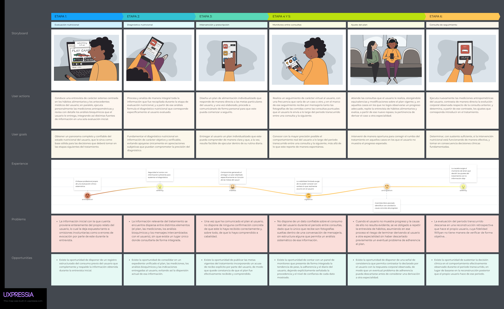

#### Segmento 2: Paciente en tratamiento nutricional activo

<p class="caption"><strong>Figura 8</strong><br><em>User journey mapping de Evelyn</em></p>

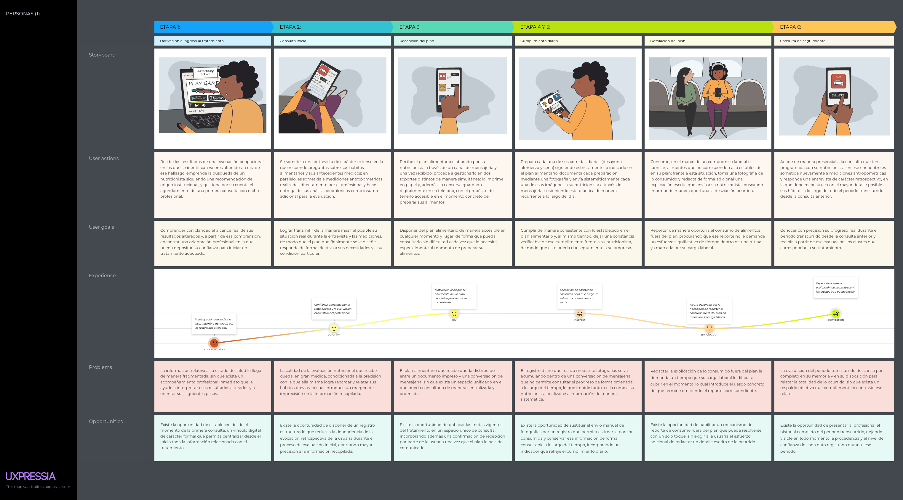

### 2.3.4. Empathy Mapping

Esta sección presenta los Empathy Maps elaborados en UXPressia para cada uno de los User Personas identificados. El proceso de elaboración se inició con la preparación de la sesión colaborativa, en la cual el equipo situó al User Persona correspondiente en el centro del artefacto y distribuyó en cada cuadrante las observaciones derivadas del análisis de entrevistas. El trabajo se orientó a responder las preguntas guía relativas a con quién se está empatizando, qué necesita hacer el usuario, qué está diciendo, qué está viendo, qué está haciendo, qué está escuchando y cómo se siente y qué piensa. Finalmente se identificaron los dolores y las ganancias a partir de las preguntas referidas a qué le preocupa, qué puede contribuir a resolver sus problemas y qué puede convencerlo de que la propuesta constituye la alternativa correcta.

#### Segmento 1: Nutricionista

<p class="caption"><strong>Figura 9</strong><br><em>Mapa de empatía de Willyan</em></p>

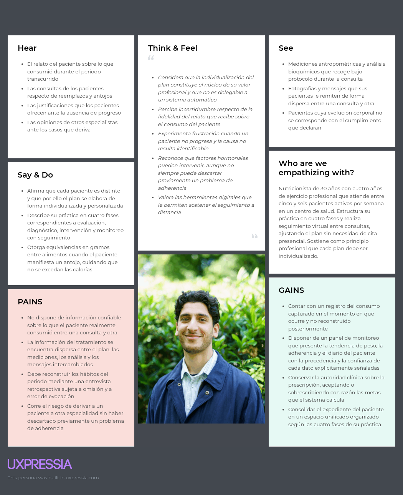

#### Segmento 2: Paciente en tratamiento nutricional activo

<p class="caption"><strong>Figura 10</strong><br><em>Mapa de empatía de Evelyn</em></p>

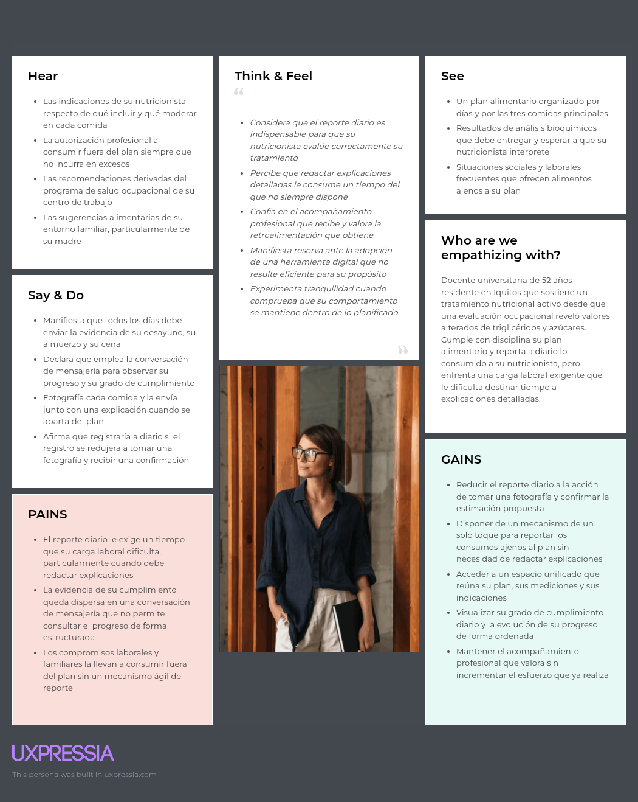

### 2.3.5. Big Picture EventStorming

Esta sección presenta el Big Picture EventStorming elaborado por el equipo en Miro. La sesión tuvo una duración aproximada de dos horas y se organizó siguiendo el Step-by-Step Guide de la técnica. El objetivo no fue diseñar el sistema, sino comprender el dominio del negocio tal como ocurre hoy: el recorrido completo de un tratamiento nutricional, desde que el profesional y el paciente establecen su vínculo hasta el alta, incluyendo el periodo entre consultas, que es donde se ubica el problema del proyecto.

El proceso se desarrolló en cuatro momentos. En el primero, el equipo realizó un chaotic exploration en el que cada integrante escribió en notas naranjas los eventos de dominio que reconocía del análisis de entrevistas y del benchmark, redactados siempre como hechos ya ocurridos y en pasado participio. En el segundo momento se ordenó la línea de tiempo de izquierda a derecha, se eliminaron los duplicados y se unificó la redacción de los eventos que describían el mismo hecho con palabras distintas. En el tercer momento se incorporaron los actores humanos en notas amarillas, distinguiendo explícitamente al `Patient` del `Practitioner`, porque ninguno de los dos origina los mismos hechos y esa asimetría resultó ser la regla estructural del producto. En el cuarto momento se marcaron con notas moradas las políticas, es decir, las reacciones automáticas del tipo "cuando ocurre X entonces sucede Y", y con notas verde claro los read models que alguien necesita consultar para decidir. Las preguntas abiertas que la sesión no logró cerrar se registraron como hotspots pendientes de validación.

**Convención de notas utilizada en el tablero:**

<p class="caption"><strong>Tabla 23</strong><br><em>Convención de notas del tablero de Big Picture EventStorming</em></p>

| Nota | Elemento | Significado en el modelo |
|---|---|---|
| Amarillo claro | Actor | `Patient` o `Practitioner`, nunca un usuario genérico |
| Naranja | Domain Event | Un hecho que ya ocurrió en el negocio |
| Morado | Policy | Reacción automática del tipo cuando X entonces Y |
| Verde claro | Read Model | Vista que alguien consulta para decidir |

<p class="caption"><strong>Figura 11</strong><br><em>Tablero completo del Big Picture EventStorming</em></p>

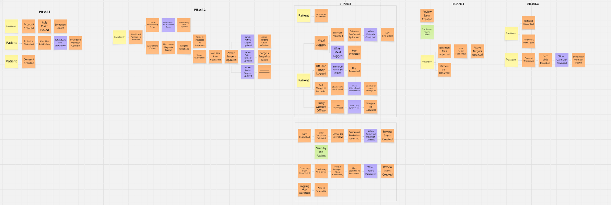

El tablero resultante quedó organizado en cinco fases narrativas, que se describen a continuación.

**Fase 1 — Vinculación, dentro de la consulta.** El profesional crea su cuenta y emite una invitación; el paciente la redime escaneando el código QR durante la consulta presencial y otorga su consentimiento. Los hechos relevantes son `Invitation Issued`, `Invitation Redeemed`, `Care Link Established` y `Consent Granted`. Aquí aparece la primera política del tablero: cuando se establece el vínculo, se abre automáticamente una ventana de evaluación para ese paciente.

<p class="caption"><strong>Figura 12</strong><br><em>Fase 1 del Big Picture EventStorming: vinculación y consentimiento</em></p>

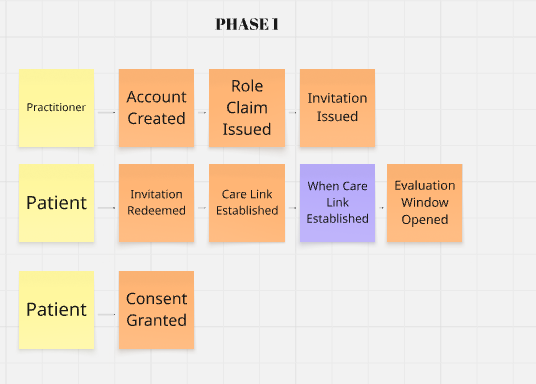

**Fase 2 — El acto clínico, dentro de la consulta.** Ocurre con un solo actor presente, el profesional, y reproduce las tres primeras fases que los nutricionistas entrevistados describieron como su proceso de trabajo: evaluación, diagnóstico e intervención. La cadena de hechos va de `Nutritional Assessment Recorded` y `Clinical Measurement Taken` hasta `Nutritional Diagnosis Issued`, `Targets Proposed`, `Targets Accepted As Proposed` o `Targets Overridden`, y culmina en `Nutrition Plan Published` y `Active Targets Updated`. Este último hecho es el que más consecuencias tiene en el resto del tablero, porque desencadena tres políticas simultáneas en zonas distintas del dominio.

<p class="caption"><strong>Figura 13</strong><br><em>Fase 2 del Big Picture EventStorming: acto clínico</em></p>

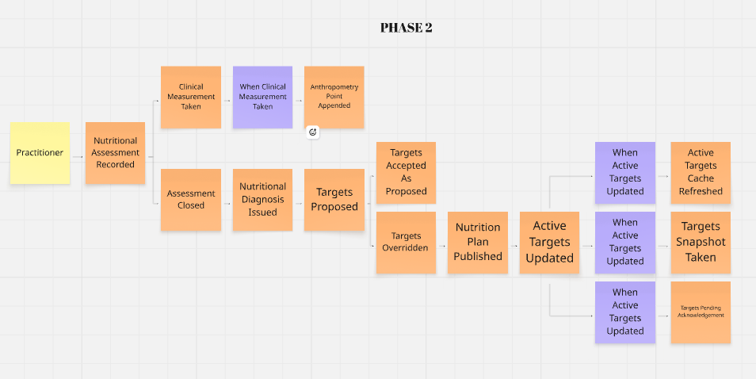

**Fase 3 — Entre consultas.** Es la zona del tablero donde vive el enunciado del problema. Participan los dos actores de manera asíncrona, sin estar en el mismo lugar ni en el mismo momento, y con conectividad intermitente. El paciente produce `Meal Logged`, `Estimate Confirmed By Patient`, `Off Plan Entry Logged`, `Self Weigh In Recorded` y `Entry Queued Offline`; el sistema reacciona con `Day Evaluated`, `Daily Compliance Computed`, `Deviation Detected`, `Sustained Deviation Detected` y `Consistency Index Recomputed`. Durante la sesión se identificó aquí una decisión de diseño que el equipo dejó explícita en el tablero: la alerta de consistencia notifica primero al paciente mediante `Patient Prompted About Consistency` y solo escala al profesional después de tres semanas sostenidas, mientras que `Logging Gap Detected` nunca escala ni cuenta como incumplimiento.

<p class="caption"><strong>Figura 14</strong><br><em>Fase 3 del Big Picture EventStorming: periodo entre consultas</em></p>

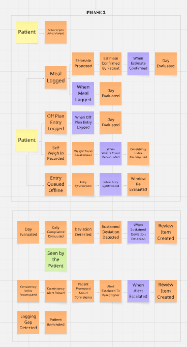

**Fase 4 — La decisión clínica.** El profesional recibe la señal en su bandeja de revisión y decide. Los hechos son `Review Item Created`, `Nutrition Plan Adjusted`, `Plan Version Superseded` y `Review Item Resolved`. La sesión hizo visible que ninguna política conecta la señal con el ajuste del plan: la automatización se detiene en la bandeja y es un humano quien continúa la cadena.

<p class="caption"><strong>Figura 15</strong><br><em>Fase 4 del Big Picture EventStorming: decisión clínica del profesional</em></p>

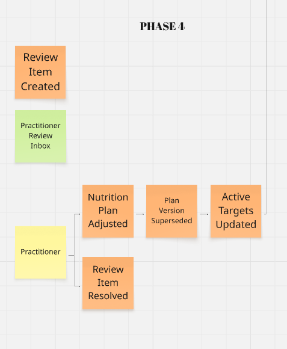

**Fase 5 — Cierre.** Comprende `Referral Recorded`, `Treatment Discharged`, `Consent Withdrawn` y `Care Link Revoked`, con la política que cierra la ventana de evaluación cuando el vínculo se revoca.

<p class="caption"><strong>Figura 16</strong><br><em>Fase 5 del Big Picture EventStorming: cierre del tratamiento</em></p>

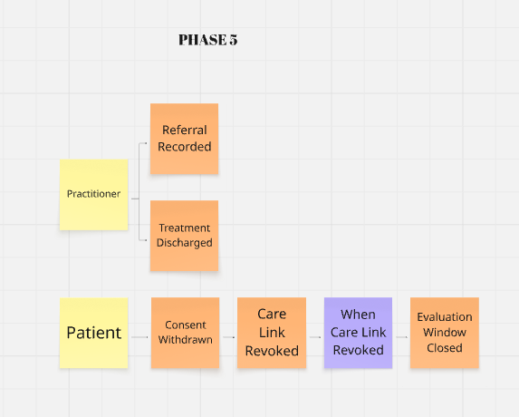

### 2.3.6. Ubiquitous Language

Esta sección presenta el glosario de términos del dominio nutricional que el equipo utiliza de manera uniforme en las entrevistas, en el modelado, en la documentación y en el código. Los términos se expresan en inglés, acompañados de su equivalente en español, y su definición corresponde al significado que tienen en el dominio del negocio y no a su implementación técnica. El glosario se construyó a partir del análisis lingüístico de las entrevistas y del Big Picture EventStorming, y es normativo: un término que aparezca en el modelo y no figure en esta tabla no existe en el dominio.

<p class="caption"><strong>Tabla 24</strong><br><em>Términos del Ubiquitous Language de Healthify</em></p>

| Término (inglés) | Equivalente en español | Definición |
|---|---|---|
| `Patient` | Paciente | Persona en tratamiento nutricional activo vinculada a un profesional mediante consentimiento vigente |
| `Practitioner` | Nutricionista | Profesional de la nutrición responsable del acto clínico. Nunca se le denomina doctor ni usuario |
| `Care Link` | Vínculo de cuidado | Relación consentida entre un paciente y un profesional que habilita el acceso a la información del tratamiento |
| `Invitation` | Invitación | Token de un solo uso, entregado como código QR durante la consulta, que permite establecer el vínculo |
| `Consent` | Consentimiento | Autorización otorgada por el paciente, siempre revocable, sin la cual el vínculo no habilita ningún acceso |
| `Discharge` | Alta del tratamiento | Cierre del vínculo por decisión clínica del profesional, con razón obligatoria |
| `Nutritional Assessment` | Evaluación nutricional | Primera fase del acto clínico: recolección de hábitos, antecedentes, actividad y mediciones |
| `Clinical Measurement` | Medición clínica | Medición antropométrica tomada por el profesional bajo protocolo; tiene autoridad clínica |
| `Nutritional Diagnosis` | Diagnóstico nutricional | Segunda fase del acto clínico: juicio profesional fundamentado sobre el estado nutricional del paciente |
| `Nutrition Plan` | Plan de alimentación | Tercera fase del acto clínico: artefacto clínico versionado que contiene metas, pautas y restricciones |
| `Calculation Basis` | Base de cálculo | Parámetros que el profesional elige antes del cálculo: ecuación, peso de referencia, factor de actividad y estrategia de déficit |
| `Target Proposal` | Propuesta de metas | Resultado del cálculo determinista, previo a la prescripción |
| `Prescribed Targets` | Metas prescritas | Metas que el profesional firma, ya sea aceptando la propuesta o sobrescribiéndola con una razón |
| `Active Targets` | Metas vigentes | Conjunto reducido de metas, pautas y restricciones que el paciente recibe. No es el plan clínico |
| `Diary Entry` | Entrada de diario | Registro de un evento de consumo realizado por el paciente |
| `Provenance` | Procedencia | Origen de una entrada de diario: fotografía, registro manual o declaración fuera del plan |
| `Proposed Estimate` | Estimación propuesta | Estimación de porción y nutrientes calculada a partir de la fotografía, siempre con su nivel de confianza y sujeta a confirmación del paciente |
| `Off Plan Entry` | Comida fuera del plan | Declaración del paciente de haber comido fuera de lo prescrito, sin detalle exigido y sin penalización |
| `Self Weigh In` | Autopesaje | Pesaje realizado por el paciente en casa, con protocolo declarado. No tiene autoridad clínica por sí solo |
| `Weight Trend` | Tendencia de peso | Suavizado estadístico de los autopesajes, único formato en que el peso del paciente se presenta como dato |
| `Evaluation Window` | Ventana de evaluación | Periodo mínimo de siete días sobre el cual se evalúa el tratamiento |
| `Daily Compliance` | Cumplimiento diario | Resultado de comparar lo registrado en un día contra las metas vigentes de ese día |
| `Treatment Adherence` | Adherencia al tratamiento | Lectura del seguimiento del plan a escala de la ventana de evaluación o del tratamiento, construida a partir de los cumplimientos diarios. La interpreta el profesional y nunca se deduce de un solo día |
| `Deviation` | Desviación | Diferencia sostenida entre lo prescrito y lo realmente registrado |
| `Logging Gap` | Vacío de registro | Días sin ninguna entrada de diario. No constituye desviación ni incumplimiento |
| `Consistency Index` | Índice de consistencia | Contraste entre la tendencia de peso y la ingesta registrada, utilizado como señal de calidad del dato |
| `Review Item` | Ítem de revisión | Señal de seguimiento recibida por el profesional que espera una decisión humana |
| `Referral` | Derivación | Envío del paciente a otro especialista, con especialidad y razón registradas |
| `Scheduled Follow Up` | Seguimiento programado | Próxima consulta acordada con el paciente |
| `Reference Food` | Alimento de referencia | Ítem del catálogo nutricional traducido al dominio desde una fuente externa |

Del análisis lingüístico surgieron además cinco expresiones que el equipo decidió prohibir porque introducen ambigüedad o contradicen decisiones de producto ya tomadas.

<p class="caption"><strong>Tabla 25</strong><br><em>Expresiones prohibidas del Ubiquitous Language</em></p>

| Expresión prohibida | Razón | Término que la reemplaza |
|---|---|---|
| `Weight` | Designa dos realidades con autoridad clínica distinta | `Clinical Measurement` o `Self Weigh In` |
| `Food` | Confunde el ítem del catálogo con el evento de consumo | `Reference Food` o `Diary Entry` |
| `Plan` del lado del paciente | El paciente nunca recibe el plan clínico completo | `Active Targets` |
| `Compliance` sin granularidad | El día y el tratamiento son escalas distintas | `Daily Compliance` o `Treatment Adherence` |
| `Cheat`, `Fail`, `Violation` | Vocabulario de castigo, contrario a las decisiones éticas del producto | `Off Plan Entry` |

## 2.4. Requirements Specification

### 2.4.1. User Stories

En esta sección se presentan las User Stories, Technical Stories y Spike Stories identificadas para Healthify a partir de las necesidades de los segmentos objetivo y de los requisitos funcionales y técnicos de la solución. Las User Stories describen las capacidades que permiten al Paciente y al Nutricionista realizar el seguimiento del tratamiento nutricional, así como las funcionalidades transversales de acceso a la plataforma y aquellas dirigidas al Visitante mediante el Landing Page.

Adicionalmente, se consideran Technical Stories para representar capacidades técnicas necesarias para soportar las funcionalidades del producto que no corresponden a una interacción directa con los usuarios finales. Finalmente, se incluyen Spike Stories destinadas a reducir la incertidumbre asociada con componentes cuya viabilidad, integración o reglas requieren investigación previa a su implementación.

Los criterios de aceptación se expresan mediante escenarios Given–When–Then y describen comportamientos verificables del sistema sin establecer detalles específicos de presentación de la interfaz.

<p class="caption"><strong>Tabla 26</strong><br><em>Épicas del producto</em></p>

| Epic ID | Title | Description |
|---|---|---|
| **EP01** | Gestión de la Relación de Cuidado | Agrupa las capacidades necesarias para establecer, mantener y finalizar el vínculo entre un Paciente y un Nutricionista, incluyendo invitaciones, consentimiento y control del acceso a la información. |
| **EP02** | Gestión de Ingesta Alimentaria | Agrupa las funcionalidades relacionadas con el registro de alimentos consumidos mediante fotografía, estimación de porciones, registro manual y declaración de consumos fuera del plan. |
| **EP03** | Seguimiento de Respuesta Corporal | Comprende el registro de autopesajes y el seguimiento de la evolución corporal del Paciente durante el tratamiento nutricional. |
| **EP04** | Monitoreo y Seguimiento del Plan Nutricional | Agrupa las capacidades destinadas a evaluar cómo el paciente sigue el plan nutricional, calcular el cumplimiento diario, identificar señales de consistencia y apoyar la revisión profesional. |
| **EP05** | Expediente y Continuidad del Cuidado | Comprende la consulta consolidada de la información del tratamiento y el registro de acciones que permiten mantener la continuidad de la atención. |
| **EP06** | Evaluación y Diagnóstico Nutricional | Agrupa el registro de evaluaciones, mediciones clínicas y diagnósticos nutricionales realizados por el Nutricionista. |
| **EP07** | Prescripción y Gestión del Plan Nutricional | Comprende el cálculo de metas, la publicación del plan nutricional y el control de sus ajustes y versiones durante el tratamiento. |
| **EP08** | Identidad y Acceso | Agrupa las capacidades relacionadas con creación de cuentas, autenticación, autorización y administración de sesiones. |
| **EP09** | Offline y Sincronización | Comprende la continuidad del registro cuando no existe conectividad y la posterior sincronización segura de los datos. |
| **EP10** | Landing Page | Agrupa las funcionalidades públicas destinadas a presentar Healthify, informar sobre sus capacidades y facilitar el acceso y contacto con la solución. |
| **EP11** | Asistencia con IA | Agrupa las funcionalidades que utilizan IA como apoyo, siempre con consentimiento del paciente y sin sustituir la decisión del profesional: resumen semanal, ideas de comidas y preguntas sugeridas. |
| **EP_TS** | RESTful API — Technical Stories | Agrupa las Technical Stories necesarias para implementar los servicios RESTful que soportan las funcionalidades de Healthify y permiten la comunicación entre las aplicaciones cliente y el backend. |
| **EP_SS** | Spike Stories | Agrupa las investigaciones, análisis y pruebas de viabilidad técnica necesarias para reducir incertidumbre antes de implementar funcionalidades o integraciones de Healthify. |

### EP01 — Gestión de la Relación de Cuidado

<p class="caption"><strong>Tabla 27</strong><br><em>Historia de usuario US01: Vinculación mediante invitación QR</em></p>

<table>
  <tr>
    <th colspan="2">Story ID</th>
    <th colspan="2">User</th>
    <th colspan="2">Priority</th>
    <th colspan="2">Epic</th>
  </tr>
  <tr>
    <td colspan="2">US01</td>
    <td colspan="2">Paciente</td>
    <td colspan="2">Alta</td>
    <td colspan="2">EP01</td>
  </tr>
  <tr>
    <th colspan="2">Title</th>
    <td colspan="6">Vinculación mediante invitación QR</td>
  </tr>
  <tr>
    <th colspan="8">Description</th>
  </tr>
  <tr>
    <td colspan="8">Como paciente, deseo utilizar la invitación generada por mi nutricionista para vincularme con él en Healthify, para que mi tratamiento pueda ser gestionado y monitoreado de manera autorizada.</td>
  </tr>
  <tr>
    <th colspan="8">Acceptance Criteria</th>
  </tr>
  <tr>
    <td colspan="8"><strong>Escenario 1: Vinculación exitosa</strong><br>Dado que el paciente posee una invitación válida y vigente emitida por un nutricionista<br>Cuando el paciente utiliza la invitación<br>Entonces el sistema establece el vínculo entre ambas cuentas.<br><br><strong>Escenario 2: Invitación vencida</strong><br>Dado que el paciente posee una invitación que ha superado su periodo de vigencia<br>Cuando el paciente intenta utilizarla<br>Entonces el sistema rechaza la vinculación e identifica la invitación como vencida.<br><br><strong>Escenario 3: Invitación previamente utilizada</strong><br>Dado que el paciente dispone de una invitación que ya ha sido utilizada<br>Cuando el paciente intenta utilizar nuevamente la invitación<br>Entonces el sistema rechaza la operación y conserva el vínculo previamente establecido.</td>
  </tr>
</table>

<p class="caption"><strong>Tabla 28</strong><br><em>Historia de usuario US02: Otorgamiento de consentimiento para compartir información</em></p>

<table>
  <tr>
    <th colspan="2">Story ID</th>
    <th colspan="2">User</th>
    <th colspan="2">Priority</th>
    <th colspan="2">Epic</th>
  </tr>
  <tr>
    <td colspan="2">US02</td>
    <td colspan="2">Paciente</td>
    <td colspan="2">Alta</td>
    <td colspan="2">EP01</td>
  </tr>
  <tr>
    <th colspan="2">Title</th>
    <td colspan="6">Otorgamiento de consentimiento para compartir información</td>
  </tr>
  <tr>
    <th colspan="8">Description</th>
  </tr>
  <tr>
    <td colspan="8">Como paciente, deseo otorgar mi consentimiento para compartir con mi nutricionista la información necesaria de mi tratamiento, para mantener el control sobre el acceso profesional a mis datos.</td>
  </tr>
  <tr>
    <th colspan="8">Acceptance Criteria</th>
  </tr>
  <tr>
    <td colspan="8"><strong>Escenario 1: Consentimiento otorgado</strong><br>Dado que el paciente tiene un vínculo de cuidado pendiente de autorización<br>Cuando el paciente otorga su consentimiento<br>Entonces el sistema registra el consentimiento vigente asociado al vínculo.<br><br><strong>Escenario 2: Acceso con consentimiento vigente</strong><br>Dado que el paciente mantiene un vínculo de cuidado activo y ha otorgado su consentimiento<br>Cuando el nutricionista solicita acceder a la información autorizada del paciente<br>Entonces el sistema permite el acceso según los permisos correspondientes.<br><br><strong>Escenario 3: Ausencia de consentimiento</strong><br>Dado que el paciente mantiene un vínculo de cuidado sin consentimiento vigente<br>Cuando el nutricionista solicita acceder a información protegida del paciente<br>Entonces el sistema rechaza el acceso.</td>
  </tr>
</table>

<p class="caption"><strong>Tabla 29</strong><br><em>Historia de usuario US03: Revocación del consentimiento</em></p>

<table>
  <tr>
    <th colspan="2">Story ID</th>
    <th colspan="2">User</th>
    <th colspan="2">Priority</th>
    <th colspan="2">Epic</th>
  </tr>
  <tr>
    <td colspan="2">US03</td>
    <td colspan="2">Paciente</td>
    <td colspan="2">Media</td>
    <td colspan="2">EP01</td>
  </tr>
  <tr>
    <th colspan="2">Title</th>
    <td colspan="6">Revocación del consentimiento</td>
  </tr>
  <tr>
    <th colspan="8">Description</th>
  </tr>
  <tr>
    <td colspan="8">Como paciente, deseo revocar el consentimiento otorgado para el acceso a mi información, para conservar el control sobre los datos compartidos durante mi tratamiento.</td>
  </tr>
  <tr>
    <th colspan="8">Acceptance Criteria</th>
  </tr>
  <tr>
    <td colspan="8"><strong>Escenario 1: Revocación exitosa</strong><br>Dado que el paciente mantiene un consentimiento vigente<br>Cuando el paciente revoca el consentimiento<br>Entonces el sistema registra el consentimiento como no vigente y revoca el vínculo de cuidado, conservando su historial.<br><br><strong>Escenario 2: Acceso posterior a la revocación</strong><br>Dado que el paciente ha revocado previamente el consentimiento asociado al vínculo<br>Cuando el nutricionista solicita acceder a nueva información protegida del paciente<br>Entonces el sistema rechaza el acceso autorizado por dicho consentimiento.</td>
  </tr>
</table>

<p class="caption"><strong>Tabla 30</strong><br><em>Historia de usuario US04: Generación de invitación QR para un nuevo paciente</em></p>

<table>
  <tr>
    <th colspan="2">Story ID</th>
    <th colspan="2">User</th>
    <th colspan="2">Priority</th>
    <th colspan="2">Epic</th>
  </tr>
  <tr>
    <td colspan="2">US04</td>
    <td colspan="2">Nutricionista</td>
    <td colspan="2">Alta</td>
    <td colspan="2">EP01</td>
  </tr>
  <tr>
    <th colspan="2">Title</th>
    <td colspan="6">Generación de invitación QR para un nuevo paciente</td>
  </tr>
  <tr>
    <th colspan="8">Description</th>
  </tr>
  <tr>
    <td colspan="8">Como nutricionista, deseo generar una invitación con la vigencia que elija, para iniciar de forma controlada la vinculación de un paciente en Healthify.</td>
  </tr>
  <tr>
    <th colspan="8">Acceptance Criteria</th>
  </tr>
  <tr>
    <td colspan="8"><strong>Escenario 1: Invitación generada</strong><br>Dado que el nutricionista se encuentra autorizado<br>Cuando el nutricionista solicita una nueva invitación<br>Entonces el sistema genera una invitación única asociada al nutricionista y con vigencia limitada.<br><br><strong>Escenario 2: Invitación canjeada</strong><br>Dado que un paciente canjeó la invitación del nutricionista<br>Cuando el nutricionista consulta su cartera de pacientes<br>Entonces el sistema muestra al paciente como pendiente de consentimiento.<br><br><strong>Escenario 3: Invitación vencida</strong><br>Dado que la invitación superó su vigencia sin ser canjeada<br>Cuando el nutricionista la consulta<br>Entonces el sistema la identifica como vencida y permite generar una nueva.</td>
  </tr>
</table>

<p class="caption"><strong>Tabla 31</strong><br><em>Historia de usuario US05: Consulta de pacientes con vínculo activo</em></p>

<table>
  <tr>
    <th colspan="2">Story ID</th>
    <th colspan="2">User</th>
    <th colspan="2">Priority</th>
    <th colspan="2">Epic</th>
  </tr>
  <tr>
    <td colspan="2">US05</td>
    <td colspan="2">Nutricionista</td>
    <td colspan="2">Alta</td>
    <td colspan="2">EP01</td>
  </tr>
  <tr>
    <th colspan="2">Title</th>
    <td colspan="6">Consulta de pacientes con vínculo activo</td>
  </tr>
  <tr>
    <th colspan="8">Description</th>
  </tr>
  <tr>
    <td colspan="8">Como nutricionista, deseo consultar los pacientes con los que mantengo un vínculo de cuidado activo, para acceder al seguimiento de los tratamientos que tengo a cargo.</td>
  </tr>
  <tr>
    <th colspan="8">Acceptance Criteria</th>
  </tr>
  <tr>
    <td colspan="8"><strong>Escenario 1: Existen pacientes vinculados</strong><br>Dado que el nutricionista mantiene vínculos activos<br>Cuando el nutricionista consulta sus pacientes<br>Entonces el sistema devuelve únicamente los pacientes asociados mediante vínculos vigentes.<br><br><strong>Escenario 2: No existen vínculos activos</strong><br>Dado que el nutricionista no mantiene vínculos activos<br>Cuando el nutricionista consulta sus pacientes<br>Entonces el sistema devuelve un resultado vacío.<br><br><strong>Escenario 3: Paciente sin vínculo vigente</strong><br>Dado que el nutricionista tiene un vínculo que ha sido finalizado o revocado<br>Cuando el nutricionista consulta sus pacientes activos<br>Entonces el sistema no considera a dicho paciente parte de la cartera activa.</td>
  </tr>
</table>

<p class="caption"><strong>Tabla 32</strong><br><em>Historia de usuario US06: Alta del paciente al finalizar el tratamiento</em></p>

<table>
  <tr>
    <th colspan="2">Story ID</th>
    <th colspan="2">User</th>
    <th colspan="2">Priority</th>
    <th colspan="2">Epic</th>
  </tr>
  <tr>
    <td colspan="2">US06</td>
    <td colspan="2">Nutricionista</td>
    <td colspan="2">Media</td>
    <td colspan="2">EP01</td>
  </tr>
  <tr>
    <th colspan="2">Title</th>
    <td colspan="6">Alta del paciente al finalizar el tratamiento</td>
  </tr>
  <tr>
    <th colspan="8">Description</th>
  </tr>
  <tr>
    <td colspan="8">Como nutricionista, deseo registrar el alta de un paciente cuando su tratamiento concluye, para cerrar formalmente el vínculo de cuidado manteniendo la trazabilidad histórica.</td>
  </tr>
  <tr>
    <th colspan="8">Acceptance Criteria</th>
  </tr>
  <tr>
    <td colspan="8"><strong>Escenario 1: Alta registrada</strong><br>Dado que el nutricionista mantiene un vínculo de cuidado activo<br>Cuando el nutricionista registra el alta del paciente indicando el motivo clínico<br>Entonces el sistema finaliza el vínculo por cierre clínico y conserva su historial.<br><br><strong>Escenario 2: Acceso posterior al alta</strong><br>Dado que el nutricionista ha registrado previamente el alta del paciente<br>Cuando el nutricionista consulta el estado del vínculo después de registrar el alta<br>Entonces el sistema no considera activo el vínculo finalizado por alta.<br><br><strong>Escenario 3: Efectos del alta</strong><br>Dado que el nutricionista ha registrado el alta de un paciente que tenía consultas futuras agendadas y funciones con IA habilitadas<br>Cuando el sistema cierra el vínculo por alta<br>Entonces el sistema cancela las consultas futuras del paciente y desactiva las funciones con IA asociadas a ese vínculo.</td>
  </tr>
</table>

<p class="caption"><strong>Tabla 33</strong><br><em>Historia de usuario US07: Cambio de nutricionista</em></p>

<table>
  <tr>
    <th colspan="2">Story ID</th>
    <th colspan="2">User</th>
    <th colspan="2">Priority</th>
    <th colspan="2">Epic</th>
  </tr>
  <tr>
    <td colspan="2">US07</td>
    <td colspan="2">Paciente</td>
    <td colspan="2">Media</td>
    <td colspan="2">EP01</td>
  </tr>
  <tr>
    <th colspan="2">Title</th>
    <td colspan="6">Cambio de nutricionista</td>
  </tr>
  <tr>
    <th colspan="8">Description</th>
  </tr>
  <tr>
    <td colspan="8">Como paciente, deseo vincularme con otro nutricionista cuando decida cambiar de profesional, para continuar mi seguimiento sin mantener dos vínculos activos al mismo tiempo.</td>
  </tr>
  <tr>
    <th colspan="8">Acceptance Criteria</th>
  </tr>
  <tr>
    <td colspan="8"><strong>Escenario 1: Cambio confirmado</strong><br>Dado que el paciente mantiene un vínculo activo con un nutricionista y posee una invitación válida de otro nutricionista<br>Cuando el paciente confirma de forma explícita que desea cambiar de nutricionista y utiliza la nueva invitación<br>Entonces el sistema revoca el vínculo anterior, conserva su historial y establece el vínculo con el nuevo nutricionista.<br><br><strong>Escenario 2: Cambio sin confirmación</strong><br>Dado que el paciente mantiene un vínculo activo y utiliza la invitación de otro nutricionista<br>Cuando el paciente no confirma que desea reemplazar su vínculo actual<br>Entonces el sistema rechaza la operación y conserva el vínculo vigente.<br><br><strong>Escenario 3: Acceso del nutricionista anterior</strong><br>Dado que el paciente ha cambiado de nutricionista<br>Cuando el nutricionista anterior solicita acceder a información protegida del paciente<br>Entonces el sistema rechaza el acceso mediante el vínculo revocado.</td>
  </tr>
</table>
<br>

### EP02 — Gestión de Ingesta Alimentaria

<p class="caption"><strong>Tabla 34</strong><br><em>Historia de usuario US08: Registro de comida por fotografía</em></p>

<table>
  <tr>
    <th colspan="2">Story ID</th>
    <th colspan="2">User</th>
    <th colspan="2">Priority</th>
    <th colspan="2">Epic</th>
  </tr>
  <tr>
    <td colspan="2">US08</td>
    <td colspan="2">Paciente</td>
    <td colspan="2">Alta</td>
    <td colspan="2">EP02</td>
  </tr>
  <tr>
    <th colspan="2">Title</th>
    <td colspan="6">Registro de comida por fotografía</td>
  </tr>
  <tr>
    <th colspan="8">Description</th>
  </tr>
  <tr>
    <td colspan="8">Como paciente, deseo registrar una comida mediante una fotografía, para reducir el esfuerzo requerido para documentar mi alimentación cotidiana.</td>
  </tr>
  <tr>
    <th colspan="8">Acceptance Criteria</th>
  </tr>
  <tr>
    <td colspan="8"><strong>Escenario 1: Fotografía procesable</strong><br>Dado que el paciente proporciona una fotografía válida de una comida<br>Cuando el paciente solicita procesar la fotografía de la comida<br>Entonces el sistema genera una propuesta de alimentos y porciones estimadas para su confirmación.<br><br><strong>Escenario 2: Estimación con procedencia</strong><br>Dado que el paciente tiene una estimación generada a partir de una fotografía<br>Cuando el paciente revisa la propuesta generada a partir de la fotografía<br>Entonces el sistema conserva la procedencia y nivel de confianza asociados a la estimación.<br><br><strong>Escenario 3: Fotografía no procesable</strong><br>Dado que el paciente proporciona una fotografía cuya información no permite obtener una estimación utilizable<br>Cuando el paciente solicita procesar una fotografía que no permite obtener una estimación válida<br>Entonces el sistema informa que no se obtuvo una estimación válida y permite continuar mediante registro manual.<br><br><strong>Escenario 4: Reconocimiento sujeto al consentimiento de IA</strong><br>Dado que el paciente no ha otorgado el consentimiento para funciones con IA o ha desactivado el reconocimiento de comidas por fotografía<br>Cuando el paciente solicita procesar una fotografía de una comida<br>Entonces el sistema no procesa la fotografía y permite continuar mediante registro manual.<br><br><strong>Escenario 5: Protección de la fotografía</strong><br>Dado que el paciente ha enviado una fotografía para su reconocimiento<br>Cuando el sistema finaliza el procesamiento<br>Entonces el sistema no conserva la fotografía ni la procesa con datos que identifiquen al paciente.</td>
  </tr>
</table>

<p class="caption"><strong>Tabla 35</strong><br><em>Historia de usuario US09: Confirmación o ajuste de estimación de porción</em></p>

<table>
  <tr>
    <th colspan="2">Story ID</th>
    <th colspan="2">User</th>
    <th colspan="2">Priority</th>
    <th colspan="2">Epic</th>
  </tr>
  <tr>
    <td colspan="2">US09</td>
    <td colspan="2">Paciente</td>
    <td colspan="2">Alta</td>
    <td colspan="2">EP02</td>
  </tr>
  <tr>
    <th colspan="2">Title</th>
    <td colspan="6">Confirmación o ajuste de estimación de porción</td>
  </tr>
  <tr>
    <th colspan="8">Description</th>
  </tr>
  <tr>
    <td colspan="8">Como paciente, deseo confirmar o ajustar la porción estimada de una comida registrada mediante fotografía, para que el registro represente mejor la cantidad que consumí.</td>
  </tr>
  <tr>
    <th colspan="8">Acceptance Criteria</th>
  </tr>
  <tr>
    <td colspan="8"><strong>Escenario 1: Confirmación sin cambios</strong><br>Dado que el paciente tiene una estimación pendiente de confirmación<br>Cuando el paciente confirma los alimentos y porciones estimados<br>Entonces el sistema registra la ingesta conservando la procedencia de la estimación.<br><br><strong>Escenario 2: Ajuste de la porción</strong><br>Dado que el paciente considera que la porción estimada no representa lo consumido<br>Cuando el paciente proporciona y confirma la cantidad corregida de la porción<br>Entonces el sistema registra la cantidad corregida y conserva la información de la estimación original como procedencia.<br><br><strong>Escenario 3: Estimación no confirmada</strong><br>Dado que el paciente tiene una propuesta de ingesta sin confirmar<br>Cuando el paciente finaliza el proceso sin confirmar la propuesta<br>Entonces el sistema no considera la propuesta como una ingesta confirmada.</td>
  </tr>
</table>

<p class="caption"><strong>Tabla 36</strong><br><em>Historia de usuario US10: Registro manual de comida mediante catálogo</em></p>

<table>
  <tr>
    <th colspan="2">Story ID</th>
    <th colspan="2">User</th>
    <th colspan="2">Priority</th>
    <th colspan="2">Epic</th>
  </tr>
  <tr>
    <td colspan="2">US10</td>
    <td colspan="2">Paciente</td>
    <td colspan="2">Alta</td>
    <td colspan="2">EP02</td>
  </tr>
  <tr>
    <th colspan="2">Title</th>
    <td colspan="6">Registro manual de comida mediante catálogo</td>
  </tr>
  <tr>
    <th colspan="8">Description</th>
  </tr>
  <tr>
    <td colspan="8">Como paciente, deseo buscar un alimento en el catálogo y registrar manualmente la cantidad consumida, para documentar una comida cuando el registro por fotografía no sea adecuado o no esté disponible.</td>
  </tr>
  <tr>
    <th colspan="8">Acceptance Criteria</th>
  </tr>
  <tr>
    <td colspan="8"><strong>Escenario 1: Búsqueda con coincidencias</strong><br>Dado que el paciente proporciona un término de búsqueda válido<br>Cuando el paciente realiza la búsqueda en el catálogo<br>Entonces el sistema devuelve los alimentos que coinciden con el criterio de búsqueda.<br><br><strong>Escenario 2: Registro manual</strong><br>Dado que el paciente selecciona un alimento y proporciona una cantidad válida<br>Cuando el paciente confirma el alimento y la cantidad consumida<br>Entonces el sistema almacena la ingesta con procedencia manual.<br><br><strong>Escenario 3: Alimento no encontrado</strong><br>Dado que el paciente realiza una búsqueda cuyo criterio no coincide con alimentos disponibles<br>Cuando el paciente completa una búsqueda sin coincidencias<br>Entonces el sistema informa que no existen coincidencias.<br><br><strong>Escenario 4: Datos disponibles sin conectividad</strong><br>Dado que el paciente no dispone de conexión y existen datos del catálogo almacenados localmente<br>Cuando el paciente realiza una búsqueda<br>Entonces el sistema utiliza la información local disponible.</td>
  </tr>
</table>

<p class="caption"><strong>Tabla 37</strong><br><em>Historia de usuario US11: Indicación de adherencia al plan en un registro</em></p>

<table>
  <tr>
    <th colspan="2">Story ID</th>
    <th colspan="2">User</th>
    <th colspan="2">Priority</th>
    <th colspan="2">Epic</th>
  </tr>
  <tr>
    <td colspan="2">US11</td>
    <td colspan="2">Paciente</td>
    <td colspan="2">Alta</td>
    <td colspan="2">EP02</td>
  </tr>
  <tr>
    <th colspan="2">Title</th>
    <td colspan="6">Indicación de adherencia al plan en un registro</td>
  </tr>
  <tr>
    <th colspan="8">Description</th>
  </tr>
  <tr>
    <td colspan="8">Como paciente, deseo indicar si una comida que registro estaba dentro de mi plan, sin tener que justificarme, para mantener un registro honesto de mi alimentación.</td>
  </tr>
  <tr>
    <th colspan="8">Acceptance Criteria</th>
  </tr>
  <tr>
    <td colspan="8"><strong>Escenario 1: Indicación al registrar</strong><br>Dado que el paciente confirma una comida registrada por fotografía o la registra manualmente<br>Cuando el paciente indica si la comida estaba dentro o fuera de su plan<br>Entonces el sistema conserva la indicación junto con la ingesta registrada.<br><br><strong>Escenario 2: Indicación obligatoria</strong><br>Dado que el paciente confirma o registra una comida<br>Cuando el paciente intenta guardarla sin indicar si estaba dentro de su plan<br>Entonces el sistema rechaza el registro e identifica la información faltante.<br><br><strong>Escenario 3: Tratamiento no punitivo</strong><br>Dado que el paciente tiene registradas comidas indicadas como fuera de su plan<br>Cuando el paciente consulta posteriormente sus registros<br>Entonces el sistema conserva el dato sin asignarle una valoración punitiva.<br><br><strong>Escenario 4: Sugerencia de respuesta</strong><br>Dado que el paciente tiene un plan publicado y elige un alimento del catálogo<br>Cuando registra la comida<br>Entonces el sistema preselecciona si la comida estaba dentro del plan según sus restricciones y la energía restante del día, sin usar IA, y el paciente puede cambiar la respuesta antes de guardar.</td>
  </tr>
</table>

<p class="caption"><strong>Tabla 38</strong><br><em>Historia de usuario US44: Alimentos locales del catálogo</em></p>

<table>
  <tr>
    <th colspan="2">Story ID</th>
    <th colspan="2">User</th>
    <th colspan="2">Priority</th>
    <th colspan="2">Epic</th>
  </tr>
  <tr>
    <td colspan="2">US44</td>
    <td colspan="2">Nutricionista</td>
    <td colspan="2">Baja</td>
    <td colspan="2">EP02</td>
  </tr>
  <tr>
    <th colspan="2">Title</th>
    <td colspan="6">Alimentos locales del catálogo</td>
  </tr>
  <tr>
    <th colspan="8">Description</th>
  </tr>
  <tr>
    <td colspan="8">Como nutricionista, deseo consultar el catálogo de alimentos y agregar alimentos locales cuando no exista el que necesito, para que el registro de mis pacientes refleje los platos que realmente consumen.</td>
  </tr>
  <tr>
    <th colspan="8">Acceptance Criteria</th>
  </tr>
  <tr>
    <td colspan="8"><strong>Escenario 1: Consulta del catálogo</strong><br>Dado que el nutricionista consulta el catálogo de alimentos<br>Cuando el nutricionista busca un alimento por nombre<br>Entonces el sistema presenta los alimentos que coinciden con sus valores nutricionales por cada 100 g.<br><br><strong>Escenario 2: Alimento local agregado</strong><br>Dado que el nutricionista no encuentra un alimento en el catálogo<br>Cuando el nutricionista registra un alimento local con su nombre y sus valores de energía y macronutrientes<br>Entonces el sistema lo incorpora al catálogo y evita que una actualización posterior de las fuentes externas lo sobrescriba.<br><br><strong>Escenario 3: Datos inválidos o duplicados</strong><br>Dado que el nutricionista registra un alimento local<br>Cuando omite el nombre o los valores nutricionales, o el nombre ya existe como alimento local<br>Entonces el sistema rechaza el registro e identifica el motivo.</td>
  </tr>
</table>
<br>

### EP03 — Seguimiento de Respuesta Corporal

<p class="caption"><strong>Tabla 39</strong><br><em>Historia de usuario US12: Registro de autopesaje</em></p>

<table>
  <tr>
    <th colspan="2">Story ID</th>
    <th colspan="2">User</th>
    <th colspan="2">Priority</th>
    <th colspan="2">Epic</th>
  </tr>
  <tr>
    <td colspan="2">US12</td>
    <td colspan="2">Paciente</td>
    <td colspan="2">Alta</td>
    <td colspan="2">EP03</td>
  </tr>
  <tr>
    <th colspan="2">Title</th>
    <td colspan="6">Registro de autopesaje</td>
  </tr>
  <tr>
    <th colspan="8">Description</th>
  </tr>
  <tr>
    <td colspan="8">Como paciente, deseo registrar mi peso indicando si me pesé en ayunas, para que mi tendencia se calcule solo con pesajes comparables entre sí.</td>
  </tr>
  <tr>
    <th colspan="8">Acceptance Criteria</th>
  </tr>
  <tr>
    <td colspan="8"><strong>Escenario 1: Autopesaje compatible con el protocolo</strong><br>Dado que el paciente proporciona un valor válido y cumple las condiciones requeridas por el protocolo de pesaje<br>Cuando el paciente registra el autopesaje<br>Entonces el sistema almacena el registro y lo considera elegible para la tendencia de peso.<br><br><strong>Escenario 2: Autopesaje fuera del protocolo</strong><br>Dado que el paciente registra un peso que no cumple las condiciones del protocolo<br>Cuando el paciente registra el peso<br>Entonces el sistema conserva el registro pero lo excluye del cálculo de la tendencia.<br><br><strong>Escenario 3: Valor inválido</strong><br>Dado que el paciente proporciona un valor de peso fuera del rango válido establecido<br>Cuando el paciente intenta registrar el valor de peso<br>Entonces el sistema rechaza el valor.</td>
  </tr>
</table>

<p class="caption"><strong>Tabla 40</strong><br><em>Historia de usuario US13: Visualización de tendencia de peso</em></p>

<table>
  <tr>
    <th colspan="2">Story ID</th>
    <th colspan="2">User</th>
    <th colspan="2">Priority</th>
    <th colspan="2">Epic</th>
  </tr>
  <tr>
    <td colspan="2">US13</td>
    <td colspan="2">Paciente</td>
    <td colspan="2">Alta</td>
    <td colspan="2">EP03</td>
  </tr>
  <tr>
    <th colspan="2">Title</th>
    <td colspan="6">Visualización de tendencia de peso</td>
  </tr>
  <tr>
    <th colspan="8">Description</th>
  </tr>
  <tr>
    <td colspan="8">Como paciente, deseo consultar la tendencia de mi peso a lo largo del tratamiento, para comprender mi evolución sin depender de la interpretación de un único registro diario.</td>
  </tr>
  <tr>
    <th colspan="8">Acceptance Criteria</th>
  </tr>
  <tr>
    <td colspan="8"><strong>Escenario 1: Datos suficientes</strong><br>Dado que el paciente tiene autopesajes elegibles dentro del periodo consultado<br>Cuando el paciente consulta la tendencia de su peso<br>Entonces el sistema proporciona una tendencia calculada a partir de los registros válidos.<br><br><strong>Escenario 2: Datos insuficientes</strong><br>Dado que el paciente no tiene suficientes autopesajes elegibles<br>Cuando el paciente consulta la tendencia de su peso<br>Entonces el sistema informa que aún no existe información suficiente para establecer una tendencia.</td>
  </tr>
</table>
<br>

### EP04 — Monitoreo y Seguimiento del Plan Nutricional

<p class="caption"><strong>Tabla 41</strong><br><em>Historia de usuario US14: Consulta del cumplimiento nutricional diario</em></p>

<table>
  <tr>
    <th colspan="2">Story ID</th>
    <th colspan="2">User</th>
    <th colspan="2">Priority</th>
    <th colspan="2">Epic</th>
  </tr>
  <tr>
    <td colspan="2">US14</td>
    <td colspan="2">Paciente</td>
    <td colspan="2">Alta</td>
    <td colspan="2">EP04</td>
  </tr>
  <tr>
    <th colspan="2">Title</th>
    <td colspan="6">Consulta del cumplimiento nutricional diario</td>
  </tr>
  <tr>
    <th colspan="8">Description</th>
  </tr>
  <tr>
    <td colspan="8">Como paciente, deseo conocer mi nivel de cumplimiento diario respecto de las metas vigentes de ese día, para comprender cómo estoy siguiendo mi plan nutricional.</td>
  </tr>
  <tr>
    <th colspan="8">Acceptance Criteria</th>
  </tr>
  <tr>
    <td colspan="8"><strong>Escenario 1: Día con información registrada</strong><br>Dado que el paciente cuenta con metas vigentes y registros de alimentación para un día determinado<br>Cuando el paciente consulta el cumplimiento correspondiente a ese día<br>Entonces el sistema calcula el cumplimiento utilizando las metas que estaban vigentes en esa fecha.<br><br><strong>Escenario 2: Cambio posterior del plan</strong><br>Dado que el paciente consulta un día cuyas metas fueron modificadas posteriormente por el nutricionista<br>Cuando el paciente consulta el cumplimiento correspondiente a ese día<br>Entonces el sistema conserva el resultado basado en la versión de metas que correspondía a ese día.<br><br><strong>Escenario 3: Día sin información suficiente</strong><br>Dado que el paciente no cuenta con información suficiente para evaluar el día<br>Cuando el paciente consulta el cumplimiento<br>Entonces el sistema informa que no puede determinarlo sin clasificar la ausencia de registro como incumplimiento.</td>
  </tr>
</table>

<p class="caption"><strong>Tabla 42</strong><br><em>Historia de usuario US15: Visualización de señal de consistencia</em></p>

<table>
  <tr>
    <th colspan="2">Story ID</th>
    <th colspan="2">User</th>
    <th colspan="2">Priority</th>
    <th colspan="2">Epic</th>
  </tr>
  <tr>
    <td colspan="2">US15</td>
    <td colspan="2">Paciente</td>
    <td colspan="2">Alta</td>
    <td colspan="2">EP04</td>
  </tr>
  <tr>
    <th colspan="2">Title</th>
    <td colspan="6">Visualización de señal de consistencia</td>
  </tr>
  <tr>
    <th colspan="8">Description</th>
  </tr>
  <tr>
    <td colspan="8">Como paciente, deseo recibir una señal cuando mis registros muestran un patrón que requiere revisión, para poder verificar primero si la información registrada representa correctamente lo ocurrido.</td>
  </tr>
  <tr>
    <th colspan="8">Acceptance Criteria</th>
  </tr>
  <tr>
    <td colspan="8"><strong>Escenario 1: Condición de consistencia detectada</strong><br>Dado que el paciente tiene información registrada que cumple la regla de consistencia vigente<br>Cuando el paciente consulta el seguimiento del periodo evaluado<br>Entonces el sistema genera una señal dirigida inicialmente al paciente.<br><br><strong>Escenario 2: Ausencia de información suficiente</strong><br>Dado que el paciente no tiene registros suficientes para evaluar la consistencia<br>Cuando el paciente consulta un periodo con registros insuficientes<br>Entonces el sistema no clasifica la ausencia de registros como una desviación.<br><br><strong>Escenario 3: Señal sin modificación automática</strong><br>Dado que el paciente tiene una señal de consistencia activa<br>Cuando el paciente consulta una señal de consistencia activa<br>Entonces el sistema no modifica automáticamente el plan nutricional del paciente.<br><br><strong>Escenario 4: Escalamiento profesional</strong><br>Dado que el paciente tiene una señal que cumple el criterio vigente de escalamiento<br>Cuando el paciente consulta una señal que cumple el criterio de escalamiento<br>Entonces el sistema genera una situación de revisión para el nutricionista.</td>
  </tr>
</table>

<p class="caption"><strong>Tabla 43</strong><br><em>Historia de usuario US16: Consulta del monitoreo del paciente</em></p>

<table>
  <tr>
    <th colspan="2">Story ID</th>
    <th colspan="2">User</th>
    <th colspan="2">Priority</th>
    <th colspan="2">Epic</th>
  </tr>
  <tr>
    <td colspan="2">US16</td>
    <td colspan="2">Nutricionista</td>
    <td colspan="2">Alta</td>
    <td colspan="2">EP04</td>
  </tr>
  <tr>
    <th colspan="2">Title</th>
    <td colspan="6">Consulta del monitoreo del paciente</td>
  </tr>
  <tr>
    <th colspan="8">Description</th>
  </tr>
  <tr>
    <td colspan="8">Como nutricionista, deseo consultar la información de seguimiento de un paciente entre consultas, para interpretar su evolución y disponer de datos confiables durante la toma de decisiones clínicas.</td>
  </tr>
  <tr>
    <th colspan="8">Acceptance Criteria</th>
  </tr>
  <tr>
    <td colspan="8"><strong>Escenario 1: Información disponible</strong><br>Dado que el nutricionista atiende a un paciente con vínculo activo que ha generado información de seguimiento<br>Cuando el nutricionista consulta el monitoreo del paciente<br>Entonces el sistema proporciona la tendencia de peso, cumplimiento, registros de alimentación y demás datos autorizados disponibles.<br><br><strong>Escenario 2: Procedencia de registros estimados</strong><br>Dado que el nutricionista consulta una ingesta que proviene de una estimación<br>Cuando el nutricionista consulta una ingesta estimada dentro del monitoreo<br>Entonces el sistema conserva su procedencia y nivel de confianza.<br><br><strong>Escenario 3: Ausencia de información</strong><br>Dado que el nutricionista consulta un periodo sin suficientes registros<br>Cuando el nutricionista consulta el seguimiento del periodo<br>Entonces el sistema distingue la ausencia de datos de una desviación del tratamiento.<br><br><strong>Escenario 4: Resumen del periodo con apoyo de IA</strong><br>Dado que el nutricionista consulta el seguimiento de un paciente con registros en el periodo<br>Cuando el nutricionista solicita el resumen del periodo<br>Entonces el sistema presenta los datos del periodo y, si la IA está habilitada y existe consentimiento, un texto que los resume; en caso contrario presenta solo los datos, sin error.</td>
  </tr>
</table>

<p class="caption"><strong>Tabla 44</strong><br><em>Historia de usuario US17: Revisión y resolución de señales de seguimiento</em></p>

<table>
  <tr>
    <th colspan="2">Story ID</th>
    <th colspan="2">User</th>
    <th colspan="2">Priority</th>
    <th colspan="2">Epic</th>
  </tr>
  <tr>
    <td colspan="2">US17</td>
    <td colspan="2">Nutricionista</td>
    <td colspan="2">Alta</td>
    <td colspan="2">EP04</td>
  </tr>
  <tr>
    <th colspan="2">Title</th>
    <td colspan="6">Revisión y resolución de señales de seguimiento</td>
  </tr>
  <tr>
    <th colspan="8">Description</th>
  </tr>
  <tr>
    <td colspan="8">Como nutricionista, deseo revisar las situaciones de seguimiento que requieren mi atención y registrar la decisión clínica correspondiente, para mantener el control profesional sobre los ajustes del tratamiento.</td>
  </tr>
  <tr>
    <th colspan="8">Acceptance Criteria</th>
  </tr>
  <tr>
    <td colspan="8"><strong>Escenario 1: Situación disponible para revisión</strong><br>Dado que el nutricionista tiene una condición de seguimiento que cumple la regla vigente de escalamiento<br>Cuando el nutricionista consulta los elementos pendientes de revisión<br>Entonces el sistema incluye la situación correspondiente.<br><br><strong>Escenario 2: Resolución sin cambio del plan</strong><br>Dado que el nutricionista revisa una situación y determina que no requiere modificación del tratamiento<br>Cuando el nutricionista registra su decisión<br>Entonces el sistema conserva la resolución sin alterar el plan vigente.<br><br><strong>Escenario 3: Resolución con ajuste</strong><br>Dado que el nutricionista determina que corresponde ajustar el tratamiento<br>Cuando el nutricionista resuelve la situación indicando que hubo ajuste<br>Entonces el sistema registra la decisión y el ajuste se publica aceptando la propuesta del escenario 5 o en una consulta de control (US27).<br><br><strong>Escenario 4: Ausencia de modificación automática</strong><br>Dado que el nutricionista tiene una señal de seguimiento generada por el sistema<br>Cuando el nutricionista consulta una señal de seguimiento escalada para revisión<br>Entonces el sistema mantiene el plan sin cambios hasta que exista una decisión profesional.<br><br><strong>Escenario 5: Propuesta de plan con apoyo de IA</strong><br>Dado que el nutricionista abre una señal de desviación sostenida<br>Cuando el sistema dispone de una propuesta de plan generada con IA<br>Entonces el sistema la presenta para que el nutricionista la acepte con ediciones o la descarte, sin asignarla al paciente hasta que exista su decisión.</td>
  </tr>
</table>

<p class="caption"><strong>Tabla 45</strong><br><em>Historia de usuario US39: Agenda de consultas</em></p>

<table>
  <tr>
    <th colspan="2">Story ID</th>
    <th colspan="2">User</th>
    <th colspan="2">Priority</th>
    <th colspan="2">Epic</th>
  </tr>
  <tr>
    <td colspan="2">US39</td>
    <td colspan="2">Nutricionista</td>
    <td colspan="2">Alta</td>
    <td colspan="2">EP04</td>
  </tr>
  <tr>
    <th colspan="2">Title</th>
    <td colspan="6">Agenda de consultas</td>
  </tr>
  <tr>
    <th colspan="8">Description</th>
  </tr>
  <tr>
    <td colspan="8">Como nutricionista, deseo agendar, reprogramar y cancelar las consultas de mis pacientes, para organizar el seguimiento entre consultas y preparar cada atención.</td>
  </tr>
  <tr>
    <th colspan="8">Acceptance Criteria</th>
  </tr>
  <tr>
    <td colspan="8"><strong>Escenario 1: Consulta agendada</strong><br>Dado que el nutricionista mantiene un vínculo activo con el paciente<br>Cuando el nutricionista agenda una consulta en una fecha y hora futuras, con su modalidad e indicaciones de preparación<br>Entonces el sistema registra la consulta en la agenda del nutricionista y la deja visible para el paciente.<br><br><strong>Escenario 2: Fecha no futura</strong><br>Dado que el nutricionista intenta agendar una consulta<br>Cuando indica una fecha y hora que no son futuras<br>Entonces el sistema rechaza el registro e informa que la fecha debe ser posterior al momento actual.<br><br><strong>Escenario 3: Consulta ya agendada</strong><br>Dado que el paciente ya tiene una consulta agendada pendiente<br>Cuando el nutricionista intenta agendar otra consulta para el mismo paciente<br>Entonces el sistema rechaza la operación y conserva la consulta vigente.<br><br><strong>Escenario 4: Reprogramación o cancelación</strong><br>Dado que el nutricionista tiene una consulta agendada<br>Cuando el nutricionista la reprograma o la cancela<br>Entonces el sistema actualiza la agenda, conserva la respuesta previa del paciente cuando se reprograma y retira la consulta de las próximas cuando se cancela.<br><br><strong>Escenario 5: Consulta no acudida</strong><br>Dado que una consulta agendada ha vencido sin completarse<br>Cuando transcurre el periodo de revisión del sistema<br>Entonces el sistema la marca como no acudida y la conserva en la agenda sin finalizar el vínculo de cuidado.</td>
  </tr>
</table>

<p class="caption"><strong>Tabla 46</strong><br><em>Historia de usuario US40: Preparación y respuesta previa a la consulta</em></p>

<table>
  <tr>
    <th colspan="2">Story ID</th>
    <th colspan="2">User</th>
    <th colspan="2">Priority</th>
    <th colspan="2">Epic</th>
  </tr>
  <tr>
    <td colspan="2">US40</td>
    <td colspan="2">Paciente</td>
    <td colspan="2">Media</td>
    <td colspan="2">EP04</td>
  </tr>
  <tr>
    <th colspan="2">Title</th>
    <td colspan="6">Preparación y respuesta previa a la consulta</td>
  </tr>
  <tr>
    <th colspan="8">Description</th>
  </tr>
  <tr>
    <td colspan="8">Como paciente, deseo conocer cómo prepararme para mi próxima consulta y contarle a mi nutricionista cómo me ha ido antes de ella, para aprovechar mejor la cita.</td>
  </tr>
  <tr>
    <th colspan="8">Acceptance Criteria</th>
  </tr>
  <tr>
    <td colspan="8"><strong>Escenario 1: Indicaciones de preparación</strong><br>Dado que el paciente tiene una próxima consulta agendada<br>Cuando el paciente consulta los detalles de su próxima consulta<br>Entonces el sistema presenta la fecha, la modalidad y las indicaciones de preparación definidas por el nutricionista, o informa que no existen indicaciones.<br><br><strong>Escenario 2: Respuesta previa enviada</strong><br>Dado que el paciente tiene una consulta pendiente<br>Cuando el paciente indica cómo se sintió, las dificultades que tuvo y hasta tres preguntas propias, y las envía<br>Entonces el sistema conserva una sola respuesta para esa consulta y la deja visible para el nutricionista.<br><br><strong>Escenario 3: Edición hasta la hora de la consulta</strong><br>Dado que el paciente ha enviado su respuesta previa<br>Cuando el paciente intenta editarla antes o después de la hora de la consulta<br>Entonces el sistema permite la edición mientras la consulta no haya llegado a su hora y la rechaza después.<br><br><strong>Escenario 4: Respuesta sin señal</strong><br>Dado que el paciente ha enviado su respuesta previa<br>Cuando el sistema la registra<br>Entonces el sistema no genera una señal de seguimiento a partir de la respuesta.</td>
  </tr>
</table>
<br>

### EP05 — Expediente y Continuidad del Cuidado

<p class="caption"><strong>Tabla 47</strong><br><em>Historia de usuario US18: Acceso al expediente personal unificado</em></p>

<table>
  <tr>
    <th colspan="2">Story ID</th>
    <th colspan="2">User</th>
    <th colspan="2">Priority</th>
    <th colspan="2">Epic</th>
  </tr>
  <tr>
    <td colspan="2">US18</td>
    <td colspan="2">Paciente</td>
    <td colspan="2">Media</td>
    <td colspan="2">EP05</td>
  </tr>
  <tr>
    <th colspan="2">Title</th>
    <td colspan="6">Acceso al expediente personal unificado</td>
  </tr>
  <tr>
    <th colspan="8">Description</th>
  </tr>
  <tr>
    <td colspan="8">Como paciente, deseo consultar en un mismo expediente la información de mi tratamiento que me corresponde conocer, para mantener una referencia continua de las indicaciones y evolución registradas.</td>
  </tr>
  <tr>
    <th colspan="8">Acceptance Criteria</th>
  </tr>
  <tr>
    <td colspan="8"><strong>Escenario 1: Expediente disponible</strong><br>Dado que el paciente mantiene información registrada durante su tratamiento<br>Cuando el paciente solicita consultar su expediente personal<br>Entonces el sistema proporciona la información autorizada correspondiente a su tratamiento.<br><br><strong>Escenario 2: Información consolidada</strong><br>Dado que el paciente tiene metas, mediciones, pautas, restricciones o derivaciones registradas<br>Cuando el paciente consulta su expediente<br>Entonces el sistema consolida la información disponible sin modificar sus registros originales.<br><br><strong>Escenario 3: Protección de información clínica restringida</strong><br>Dado que el paciente consulta un expediente que contiene información reservada al ámbito profesional<br>Cuando el paciente solicita consultar su expediente personal<br>Entonces el sistema excluye la información que no corresponde a sus permisos.<br><br><strong>Escenario 4: Descarga de mis datos</strong><br>Dado que el paciente tiene una sesión activa<br>Cuando solicita descargar sus datos<br>Entonces el sistema le entrega un archivo con su información registrada, sin incluir datos de otros pacientes.</td>
  </tr>
</table>

<p class="caption"><strong>Tabla 48</strong><br><em>Historia de usuario US19: Registro de derivación a otro especialista</em></p>

<table>
  <tr>
    <th colspan="2">Story ID</th>
    <th colspan="2">User</th>
    <th colspan="2">Priority</th>
    <th colspan="2">Epic</th>
  </tr>
  <tr>
    <td colspan="2">US19</td>
    <td colspan="2">Nutricionista</td>
    <td colspan="2">Baja</td>
    <td colspan="2">EP05</td>
  </tr>
  <tr>
    <th colspan="2">Title</th>
    <td colspan="6">Registro de derivación a otro especialista</td>
  </tr>
  <tr>
    <th colspan="8">Description</th>
  </tr>
  <tr>
    <td colspan="8">Como nutricionista, deseo registrar la derivación de un paciente a otro especialista cuando el caso lo requiera, para mantener documentada la continuidad de su atención.</td>
  </tr>
  <tr>
    <th colspan="8">Acceptance Criteria</th>
  </tr>
  <tr>
    <td colspan="8"><strong>Escenario 1: Derivación válida</strong><br>Dado que el nutricionista atiende a un paciente con tratamiento activo<br>Cuando el nutricionista registra una derivación con el motivo correspondiente<br>Entonces el sistema conserva la derivación asociada al expediente del paciente.<br><br><strong>Escenario 2: Consulta histórica</strong><br>Dado que el nutricionista ha registrado una derivación<br>Cuando el nutricionista consulta posteriormente el expediente autorizado del paciente<br>Entonces el sistema conserva la derivación como parte del historial.<br><br><strong>Escenario 3: Cierre de la derivación</strong><br>Dado que el nutricionista tiene una derivación abierta de un paciente<br>Cuando el nutricionista registra el cierre de la derivación<br>Entonces el sistema marca la derivación como cerrada y conserva su historial.</td>
  </tr>
</table>

<p class="caption"><strong>Tabla 49</strong><br><em>Historia de usuario US20: Acceso al expediente unificado del paciente</em></p>

<table>
  <tr>
    <th colspan="2">Story ID</th>
    <th colspan="2">User</th>
    <th colspan="2">Priority</th>
    <th colspan="2">Epic</th>
  </tr>
  <tr>
    <td colspan="2">US20</td>
    <td colspan="2">Nutricionista</td>
    <td colspan="2">Alta</td>
    <td colspan="2">EP05</td>
  </tr>
  <tr>
    <th colspan="2">Title</th>
    <td colspan="6">Acceso al expediente unificado del paciente</td>
  </tr>
  <tr>
    <th colspan="8">Description</th>
  </tr>
  <tr>
    <td colspan="8">Como nutricionista, deseo consultar de manera consolidada la información clínica y de seguimiento del paciente que tengo autorizado a atender, para disponer de una visión continua de su tratamiento.</td>
  </tr>
  <tr>
    <th colspan="8">Acceptance Criteria</th>
  </tr>
  <tr>
    <td colspan="8"><strong>Escenario 1: Acceso autorizado</strong><br>Dado que el nutricionista mantiene un vínculo activo con el paciente y existe consentimiento vigente<br>Cuando el nutricionista solicita consultar el expediente del paciente<br>Entonces el sistema proporciona la información clínica y de seguimiento autorizada.<br><br><strong>Escenario 2: Información histórica</strong><br>Dado que el nutricionista atiende a un paciente con información clínica y de seguimiento registrada<br>Cuando el nutricionista consulta el expediente unificado del paciente<br>Entonces el sistema conserva y proporciona la trazabilidad de la información correspondiente.<br><br><strong>Escenario 3: Acceso no autorizado</strong><br>Dado que el nutricionista no cuenta con un vínculo activo o consentimiento vigente<br>Cuando el nutricionista solicita consultar el expediente del paciente<br>Entonces el sistema rechaza el acceso.</td>
  </tr>
</table>
<br>

### EP06 — Evaluación y Diagnóstico Nutricional

<p class="caption"><strong>Tabla 50</strong><br><em>Historia de usuario US21: Registro y finalización de la evaluación nutricional</em></p>

<table>
  <tr>
    <th colspan="2">Story ID</th>
    <th colspan="2">User</th>
    <th colspan="2">Priority</th>
    <th colspan="2">Epic</th>
  </tr>
  <tr>
    <td colspan="2">US21</td>
    <td colspan="2">Nutricionista</td>
    <td colspan="2">Alta</td>
    <td colspan="2">EP06</td>
  </tr>
  <tr>
    <th colspan="2">Title</th>
    <td colspan="6">Registro y finalización de la evaluación nutricional</td>
  </tr>
  <tr>
    <th colspan="8">Description</th>
  </tr>
  <tr>
    <td colspan="8">Como nutricionista, deseo registrar y completar la evaluación nutricional del paciente, incluyendo la información clínica y mediciones necesarias, para disponer de una base documentada antes de establecer el diagnóstico y tratamiento.</td>
  </tr>
  <tr>
    <th colspan="8">Acceptance Criteria</th>
  </tr>
  <tr>
    <td colspan="8"><strong>Escenario 1: Creación de evaluación</strong><br>Dado que el nutricionista mantiene un vínculo de cuidado activo y autorizado con el paciente<br>Cuando el nutricionista inicia una nueva evaluación nutricional<br>Entonces el sistema registra una nueva evaluación asociada al paciente.<br><br><strong>Escenario 2: Incorporación de mediciones</strong><br>Dado que el nutricionista tiene una evaluación abierta<br>Cuando el nutricionista registra una medición clínica válida<br>Entonces el sistema incorpora la medición clínica a la evaluación nutricional.<br><br><strong>Escenario 3: Cierre de evaluación</strong><br>Dado que el nutricionista completó la información requerida de la medición<br>Cuando guarda el paso de medición de la consulta guiada<br>Entonces el sistema registra la evaluación como cerrada y habilita el paso de diagnóstico.<br><br><strong>Escenario 4: Modificación posterior al cierre</strong><br>Dado que el nutricionista tiene una evaluación cerrada<br>Cuando el nutricionista intenta modificar una evaluación cerrada<br>Entonces el sistema conserva la evaluación cerrada sin alteraciones y requiere un nuevo registro para una corrección posterior.<br><br><strong>Escenario 5: Datos base del paciente</strong><br>Dado que el nutricionista atiende a un paciente que aún no tiene datos base<br>Cuando el nutricionista registra los datos base del paciente, como fecha de nacimiento, sexo, talla y antecedentes<br>Entonces el sistema los conserva una sola vez y los reutiliza en las evaluaciones posteriores sin volver a solicitarlos.<br><br><strong>Escenario 6: Evaluación reanudable</strong><br>Dado que el nutricionista tiene una consulta en curso que ha interrumpido<br>Cuando el nutricionista vuelve a la consulta del paciente<br>Entonces el sistema le permite reanudarla desde el paso en que quedó, sin perder la información ingresada.</td>
  </tr>
</table>

<p class="caption"><strong>Tabla 51</strong><br><em>Historia de usuario US22: Emisión del diagnóstico nutricional</em></p>

<table>
  <tr>
    <th colspan="2">Story ID</th>
    <th colspan="2">User</th>
    <th colspan="2">Priority</th>
    <th colspan="2">Epic</th>
  </tr>
  <tr>
    <td colspan="2">US22</td>
    <td colspan="2">Nutricionista</td>
    <td colspan="2">Alta</td>
    <td colspan="2">EP06</td>
  </tr>
  <tr>
    <th colspan="2">Title</th>
    <td colspan="6">Emisión del diagnóstico nutricional</td>
  </tr>
  <tr>
    <th colspan="8">Description</th>
  </tr>
  <tr>
    <td colspan="8">Como nutricionista, deseo registrar el diagnóstico nutricional junto con su fundamento clínico, para documentar la interpretación profesional que sustentará el tratamiento del paciente.</td>
  </tr>
  <tr>
    <th colspan="8">Acceptance Criteria</th>
  </tr>
  <tr>
    <td colspan="8"><strong>Escenario 1: Diagnóstico con fundamento</strong><br>Dado que el nutricionista dispone de una evaluación del paciente<br>Cuando el nutricionista registra un diagnóstico con su justificación<br>Entonces el sistema conserva ambos elementos asociados al tratamiento.<br><br><strong>Escenario 2: Diagnóstico sin fundamento requerido</strong><br>Dado que el nutricionista registra un diagnóstico que requiere justificación clínica<br>Cuando el nutricionista intenta registrar el diagnóstico sin proporcionar la justificación clínica requerida<br>Entonces el sistema rechaza el registro.<br><br><strong>Escenario 3: Conservación histórica</strong><br>Dado que el nutricionista tiene un diagnóstico previamente registrado<br>Cuando el nutricionista registra una nueva evaluación o un nuevo diagnóstico<br>Entonces el sistema conserva los antecedentes anteriores.<br><br><strong>Escenario 4: Sugerencia de diagnóstico</strong><br>Dado que el nutricionista ha registrado la medición de la consulta<br>Cuando el nutricionista solicita una sugerencia de diagnóstico<br>Entonces el sistema propone un diagnóstico apoyado en la medición y, si la IA no está disponible, en una regla determinista, sin registrarlo hasta que el nutricionista lo acepte y se conserve su origen.</td>
  </tr>
</table>
<br>

### EP07 — Prescripción y Gestión del Plan Nutricional

<p class="caption"><strong>Tabla 52</strong><br><em>Historia de usuario US23: Visualización de metas nutricionales vigentes</em></p>

<table>
  <tr>
    <th colspan="2">Story ID</th>
    <th colspan="2">User</th>
    <th colspan="2">Priority</th>
    <th colspan="2">Epic</th>
  </tr>
  <tr>
    <td colspan="2">US23</td>
    <td colspan="2">Paciente</td>
    <td colspan="2">Alta</td>
    <td colspan="2">EP07</td>
  </tr>
  <tr>
    <th colspan="2">Title</th>
    <td colspan="6">Visualización de metas nutricionales vigentes</td>
  </tr>
  <tr>
    <th colspan="8">Description</th>
  </tr>
  <tr>
    <td colspan="8">Como paciente, deseo consultar las metas nutricionales vigentes establecidas por mi nutricionista, para conocer las referencias que debo seguir durante el tratamiento.</td>
  </tr>
  <tr>
    <th colspan="8">Acceptance Criteria</th>
  </tr>
  <tr>
    <td colspan="8"><strong>Escenario 1: Existen metas vigentes</strong><br>Dado que el paciente posee un plan nutricional activo<br>Cuando el paciente consulta sus metas<br>Entonces el sistema proporciona las metas correspondientes a la versión vigente del plan.<br><br><strong>Escenario 2: No existe plan activo</strong><br>Dado que el paciente no posee un plan nutricional activo<br>Cuando el paciente solicita sus metas<br>Entonces el sistema informa que no existen metas vigentes.<br><br><strong>Escenario 3: Protección de las metas prescritas</strong><br>Dado que el paciente tiene metas prescritas por el nutricionista<br>Cuando el paciente consulta la información<br>Entonces el sistema no permite que el paciente modifique los valores prescritos.<br><br><strong>Escenario 4: Versiones anteriores del plan</strong><br>Dado que el paciente tiene un plan con versiones anteriores a la vigente<br>Cuando el paciente consulta las versiones anteriores de su plan<br>Entonces el sistema las presenta como historial de solo lectura, distinguiéndolas de la versión vigente.</td>
  </tr>
</table>

<p class="caption"><strong>Tabla 53</strong><br><em>Historia de usuario US24: Confirmación de recepción de nuevas metas nutricionales</em></p>

<table>
  <tr>
    <th colspan="2">Story ID</th>
    <th colspan="2">User</th>
    <th colspan="2">Priority</th>
    <th colspan="2">Epic</th>
  </tr>
  <tr>
    <td colspan="2">US24</td>
    <td colspan="2">Paciente</td>
    <td colspan="2">Alta</td>
    <td colspan="2">EP07</td>
  </tr>
  <tr>
    <th colspan="2">Title</th>
    <td colspan="6">Confirmación de recepción de nuevas metas nutricionales</td>
  </tr>
  <tr>
    <th colspan="8">Description</th>
  </tr>
  <tr>
    <td colspan="8">Como paciente, deseo confirmar que he recibido las nuevas metas establecidas por mi nutricionista, para dejar constancia de que conozco la actualización de mi tratamiento.</td>
  </tr>
  <tr>
    <th colspan="8">Acceptance Criteria</th>
  </tr>
  <tr>
    <td colspan="8"><strong>Escenario 1: Confirmación de una nueva versión</strong><br>Dado que el paciente tiene una versión vigente de metas pendiente de confirmación<br>Cuando el paciente confirma la recepción de la versión actualizada de sus metas nutricionales<br>Entonces el sistema registra el acuse asociado a dicha versión.<br><br><strong>Escenario 2: El acuse no modifica el tratamiento</strong><br>Dado que el paciente confirma la recepción de las metas<br>Cuando el paciente confirma la recepción de las metas actualizadas<br>Entonces el sistema mantiene las metas y el plan nutricional sin modificaciones.</td>
  </tr>
</table>

<p class="caption"><strong>Tabla 54</strong><br><em>Historia de usuario US25: Obtención de propuesta de metas nutricionales calculadas</em></p>

<table>
  <tr>
    <th colspan="2">Story ID</th>
    <th colspan="2">User</th>
    <th colspan="2">Priority</th>
    <th colspan="2">Epic</th>
  </tr>
  <tr>
    <td colspan="2">US25</td>
    <td colspan="2">Nutricionista</td>
    <td colspan="2">Alta</td>
    <td colspan="2">EP07</td>
  </tr>
  <tr>
    <th colspan="2">Title</th>
    <td colspan="6">Obtención de propuesta de metas nutricionales calculadas</td>
  </tr>
  <tr>
    <th colspan="8">Description</th>
  </tr>
  <tr>
    <td colspan="8">Como nutricionista, deseo obtener una propuesta de metas nutricionales a partir de los parámetros clínicos que selecciono, para utilizar el cálculo como apoyo antes de establecer las metas definitivas del paciente.</td>
  </tr>
  <tr>
    <th colspan="8">Acceptance Criteria</th>
  </tr>
  <tr>
    <td colspan="8"><strong>Escenario 1: Cálculo con parámetros completos</strong><br>Dado que el nutricionista proporciona la ecuación, peso de referencia, factor de actividad y demás parámetros requeridos<br>Cuando el nutricionista solicita el cálculo<br>Entonces el sistema genera una propuesta y conserva la base utilizada para obtenerla.<br><br><strong>Escenario 2: Parámetros insuficientes</strong><br>Dado que el nutricionista no ha proporcionado un parámetro obligatorio para el cálculo<br>Cuando el nutricionista solicita la propuesta<br>Entonces el sistema no genera las metas e identifica la información faltante.<br><br><strong>Escenario 3: Modificación profesional del resultado</strong><br>Dado que el nutricionista decide utilizar valores distintos a los calculados<br>Cuando el nutricionista registra valores distintos a los calculados<br>Entonces el sistema requiere y conserva la razón del cambio.</td>
  </tr>
</table>

<p class="caption"><strong>Tabla 55</strong><br><em>Historia de usuario US26: Prescripción y publicación del plan nutricional</em></p>

<table>
  <tr>
    <th colspan="2">Story ID</th>
    <th colspan="2">User</th>
    <th colspan="2">Priority</th>
    <th colspan="2">Epic</th>
  </tr>
  <tr>
    <td colspan="2">US26</td>
    <td colspan="2">Nutricionista</td>
    <td colspan="2">Alta</td>
    <td colspan="2">EP07</td>
  </tr>
  <tr>
    <th colspan="2">Title</th>
    <td colspan="6">Prescripción y publicación del plan nutricional</td>
  </tr>
  <tr>
    <th colspan="8">Description</th>
  </tr>
  <tr>
    <td colspan="8">Como nutricionista, deseo prescribir y publicar el plan nutricional del paciente, para establecer formalmente las metas, pautas y restricciones que regirán su tratamiento.</td>
  </tr>
  <tr>
    <th colspan="8">Acceptance Criteria</th>
  </tr>
  <tr>
    <td colspan="8"><strong>Escenario 1: Publicación válida</strong><br>Dado que el nutricionista atiende a un paciente que cuenta con diagnóstico y base de cálculo requeridos<br>Cuando el nutricionista publica el plan nutricional<br>Entonces el sistema registra una versión activa con sus metas, pautas y restricciones.<br><br><strong>Escenario 2: Ausencia de diagnóstico</strong><br>Dado que el nutricionista atiende a un paciente que no cuenta con el diagnóstico requerido<br>Cuando el nutricionista intenta publicar el plan nutricional<br>Entonces el sistema rechaza la publicación.<br><br><strong>Escenario 3: Ausencia de base de cálculo</strong><br>Dado que el nutricionista no ha registrado la base de cálculo necesaria para sustentar las metas<br>Cuando el nutricionista intenta publicar el plan nutricional<br>Entonces el sistema rechaza la publicación.<br><br><strong>Escenario 4: Única versión activa</strong><br>Dado que el nutricionista tiene una versión activa del plan<br>Cuando el nutricionista publica una nueva versión válida del plan<br>Entonces el sistema mantiene una sola versión como vigente y conserva las versiones anteriores en el historial.<br><br><strong>Escenario 5: Indicaciones sugeridas</strong><br>Dado que el nutricionista ha registrado el diagnóstico de la consulta<br>Cuando el nutricionista solicita indicaciones sugeridas para el plan<br>Entonces el sistema propone indicaciones de un catálogo cerrado, o de una tabla predefinida si la IA no está disponible, que el nutricionista puede modificar antes de publicar.</td>
  </tr>
</table>

<p class="caption"><strong>Tabla 56</strong><br><em>Historia de usuario US27: Ajuste del plan nutricional entre consultas</em></p>

<table>
  <tr>
    <th colspan="2">Story ID</th>
    <th colspan="2">User</th>
    <th colspan="2">Priority</th>
    <th colspan="2">Epic</th>
  </tr>
  <tr>
    <td colspan="2">US27</td>
    <td colspan="2">Nutricionista</td>
    <td colspan="2">Alta</td>
    <td colspan="2">EP07</td>
  </tr>
  <tr>
    <th colspan="2">Title</th>
    <td colspan="6">Ajuste del plan nutricional entre consultas</td>
  </tr>
  <tr>
    <th colspan="8">Description</th>
  </tr>
  <tr>
    <td colspan="8">Como nutricionista, deseo ajustar el plan nutricional entre consultas, mediante una consulta de control o aceptando la propuesta de una situación de revisión, para responder a la evolución del paciente sin perder la trazabilidad del tratamiento.</td>
  </tr>
  <tr>
    <th colspan="8">Acceptance Criteria</th>
  </tr>
  <tr>
    <td colspan="8"><strong>Escenario 1: Ajuste en consulta de control</strong><br>Dado que el paciente tiene un plan activo<br>Cuando el nutricionista publica el plan en una consulta de control<br>Entonces el sistema genera una nueva versión con el motivo de nueva consulta.<br><br><strong>Escenario 2: Ajuste desde una situación de revisión</strong><br>Dado que existe una propuesta de plan para una situación de revisión<br>Cuando el nutricionista la acepta, con o sin ediciones<br>Entonces el sistema genera una nueva versión con el motivo de ajuste por señal y resuelve la situación.<br><br><strong>Escenario 3: Conservación histórica</strong><br>Dado que el nutricionista ha publicado una nueva versión del plan<br>Cuando el nutricionista consulta el historial después de publicar una nueva versión<br>Entonces el sistema conserva las versiones anteriores sin reescribir los datos históricos calculados con ellas.</td>
  </tr>
</table>
<br>

### EP08 — Identidad y Acceso

<p class="caption"><strong>Tabla 57</strong><br><em>Historia de usuario US28: Creación de cuenta</em></p>

<table>
  <tr>
    <th colspan="2">Story ID</th>
    <th colspan="2">User</th>
    <th colspan="2">Priority</th>
    <th colspan="2">Epic</th>
  </tr>
  <tr>
    <td colspan="2">US28</td>
    <td colspan="2">Paciente / Nutricionista</td>
    <td colspan="2">Alta</td>
    <td colspan="2">EP08</td>
  </tr>
  <tr>
    <th colspan="2">Title</th>
    <td colspan="6">Creación de cuenta</td>
  </tr>
  <tr>
    <th colspan="8">Description</th>
  </tr>
  <tr>
    <td colspan="8">Como paciente o nutricionista, deseo crear una cuenta en Healthify con el rol que me corresponde, para acceder a las funcionalidades disponibles para mi perfil.</td>
  </tr>
  <tr>
    <th colspan="8">Acceptance Criteria</th>
  </tr>
  <tr>
    <td colspan="8"><strong>Escenario 1: Registro válido</strong><br>Dado que el paciente o el nutricionista proporciona los datos obligatorios válidos y un correo no registrado<br>Cuando el paciente o el nutricionista solicita crear la cuenta<br>Entonces el sistema crea la cuenta asociada al rol seleccionado.<br><br><strong>Escenario 2: Correo previamente registrado</strong><br>Dado que el paciente o el nutricionista proporciona un correo que ya pertenece a una cuenta existente<br>Cuando el paciente o el nutricionista intenta registrar nuevamente una cuenta con el mismo correo<br>Entonces el sistema rechaza la creación de una cuenta duplicada.<br><br><strong>Escenario 3: Información obligatoria inválida</strong><br>Dado que el paciente o el nutricionista proporciona datos incompletos o inválidos<br>Cuando el paciente o el nutricionista intenta registrar la cuenta con datos incompletos o inválidos<br>Entonces el sistema rechaza la solicitud e identifica la información que debe corregirse.</td>
  </tr>
</table>

<p class="caption"><strong>Tabla 58</strong><br><em>Historia de usuario US29: Inicio de sesión</em></p>

<table>
  <tr>
    <th colspan="2">Story ID</th>
    <th colspan="2">User</th>
    <th colspan="2">Priority</th>
    <th colspan="2">Epic</th>
  </tr>
  <tr>
    <td colspan="2">US29</td>
    <td colspan="2">Paciente / Nutricionista</td>
    <td colspan="2">Alta</td>
    <td colspan="2">EP08</td>
  </tr>
  <tr>
    <th colspan="2">Title</th>
    <td colspan="6">Inicio de sesión</td>
  </tr>
  <tr>
    <th colspan="8">Description</th>
  </tr>
  <tr>
    <td colspan="8">Como paciente o nutricionista, deseo iniciar sesión en Healthify, para acceder a las funcionalidades correspondientes a mi rol.</td>
  </tr>
  <tr>
    <th colspan="8">Acceptance Criteria</th>
  </tr>
  <tr>
    <td colspan="8"><strong>Escenario 1: Credenciales válidas</strong><br>Dado que el paciente o el nutricionista posee una cuenta activa con credenciales válidas<br>Cuando el paciente o el nutricionista proporciona las credenciales correctas<br>Entonces el sistema autentica la cuenta y habilita las operaciones correspondientes al rol asociado.<br><br><strong>Escenario 2: Credenciales inválidas</strong><br>Dado que el paciente o el nutricionista proporciona credenciales no válidas<br>Cuando el paciente o el nutricionista solicita la autenticación con credenciales no válidas<br>Entonces el sistema rechaza el inicio de sesión sin crear una sesión autorizada.<br><br><strong>Escenario 3: Operación no permitida por rol</strong><br>Dado que el paciente o el nutricionista tiene una cuenta autenticada<br>Cuando el paciente o el nutricionista intenta realizar una operación no permitida para su rol<br>Entonces el sistema rechaza la operación.<br><br><strong>Escenario 4: Renovación de la sesión</strong><br>Dado que el paciente o el nutricionista tiene una sesión vencida y una credencial de renovación vigente<br>Cuando la aplicación solicita renovar la sesión<br>Entonces el sistema emite una nueva sesión sin solicitar de nuevo las credenciales y, si la credencial de renovación no es válida, exige iniciar sesión otra vez.<br><br><strong>Escenario 5: Cuenta bloqueada</strong><br>Dado que el paciente o el nutricionista ha excedido el número permitido de intentos fallidos<br>Cuando intenta iniciar sesión<br>Entonces el sistema rechaza el inicio de sesión e informa que la cuenta está bloqueada temporalmente.<br><br><strong>Escenario 6: Recuperación de contraseña</strong><br>Dado que el paciente o el nutricionista olvidó su contraseña<br>Cuando solicita recuperarla con su correo e ingresa el código que recibe<br>Entonces el sistema le permite definir una nueva contraseña.</td>
  </tr>
</table>

<p class="caption"><strong>Tabla 59</strong><br><em>Historia de usuario US30: Cierre de sesión</em></p>

<table>
  <tr>
    <th colspan="2">Story ID</th>
    <th colspan="2">User</th>
    <th colspan="2">Priority</th>
    <th colspan="2">Epic</th>
  </tr>
  <tr>
    <td colspan="2">US30</td>
    <td colspan="2">Paciente / Nutricionista</td>
    <td colspan="2">Media</td>
    <td colspan="2">EP08</td>
  </tr>
  <tr>
    <th colspan="2">Title</th>
    <td colspan="6">Cierre de sesión</td>
  </tr>
  <tr>
    <th colspan="8">Description</th>
  </tr>
  <tr>
    <td colspan="8">Como paciente o nutricionista, deseo cerrar mi sesión en Healthify, para finalizar de manera segura mi acceso a la plataforma.</td>
  </tr>
  <tr>
    <th colspan="8">Acceptance Criteria</th>
  </tr>
  <tr>
    <td colspan="8"><strong>Escenario 1: Cierre de sesión exitoso</strong><br>Dado que el paciente o el nutricionista mantiene una sesión autenticada<br>Cuando el paciente o el nutricionista solicita cerrar sesión<br>Entonces el sistema finaliza el acceso asociado a la sesión.<br><br><strong>Escenario 2: Acceso posterior</strong><br>Dado que el paciente o el nutricionista ha finalizado previamente su sesión<br>Cuando el paciente o el nutricionista intenta acceder a una operación que requiere autenticación<br>Entonces el sistema exige una nueva autenticación.</td>
  </tr>
</table>

<p class="caption"><strong>Tabla 60</strong><br><em>Historia de usuario US43: Preferencias de la cuenta: idioma y recordatorios</em></p>

<table>
  <tr>
    <th colspan="2">Story ID</th>
    <th colspan="2">User</th>
    <th colspan="2">Priority</th>
    <th colspan="2">Epic</th>
  </tr>
  <tr>
    <td colspan="2">US43</td>
    <td colspan="2">Paciente / Nutricionista</td>
    <td colspan="2">Media</td>
    <td colspan="2">EP08</td>
  </tr>
  <tr>
    <th colspan="2">Title</th>
    <td colspan="6">Preferencias de la cuenta: idioma y recordatorios</td>
  </tr>
  <tr>
    <th colspan="8">Description</th>
  </tr>
  <tr>
    <td colspan="8">Como paciente o nutricionista, deseo elegir el idioma de mi cuenta y, como paciente, configurar recordatorios de registro, para usar Healthify en el idioma que prefiero y no olvidar mis registros.</td>
  </tr>
  <tr>
    <th colspan="8">Acceptance Criteria</th>
  </tr>
  <tr>
    <td colspan="8"><strong>Escenario 1: Cambio de idioma de la cuenta</strong><br>Dado que el paciente o el nutricionista tiene una sesión iniciada<br>Cuando el paciente o el nutricionista selecciona español o inglés como idioma<br>Entonces el sistema muestra la aplicación en ese idioma y conserva la preferencia en la cuenta.<br><br><strong>Escenario 2: Preferencia sin conexión</strong><br>Dado que el paciente o el nutricionista cambia el idioma sin conexión a Internet<br>Cuando la conexión se restablece<br>Entonces el sistema registra la preferencia en la cuenta sin que el usuario deba repetir la acción.<br><br><strong>Escenario 3: Recordatorios de registro</strong><br>Dado que el paciente ha autorizado las notificaciones del dispositivo<br>Cuando el paciente configura un recordatorio de registro<br>Entonces el sistema programa el aviso en el dispositivo sin enviar información a servicios externos.<br><br><strong>Escenario 4: Recordatorios sin autorización</strong><br>Dado que el paciente no ha autorizado las notificaciones del dispositivo<br>Cuando el paciente intenta activar un recordatorio<br>Entonces el sistema solicita la autorización y, si no se concede, no programa el aviso.</td>
  </tr>
</table>
<br>

### EP09 — Offline y Sincronización

<p class="caption"><strong>Tabla 61</strong><br><em>Historia de usuario US31: Registro y sincronización sin conexión</em></p>

<table>
  <tr>
    <th colspan="2">Story ID</th>
    <th colspan="2">User</th>
    <th colspan="2">Priority</th>
    <th colspan="2">Epic</th>
  </tr>
  <tr>
    <td colspan="2">US31</td>
    <td colspan="2">Paciente</td>
    <td colspan="2">Alta</td>
    <td colspan="2">EP09</td>
  </tr>
  <tr>
    <th colspan="2">Title</th>
    <td colspan="6">Registro y sincronización sin conexión</td>
  </tr>
  <tr>
    <th colspan="8">Description</th>
  </tr>
  <tr>
    <td colspan="8">Como paciente, deseo registrar mi alimentación y autopesaje aunque no tenga conexión a Internet y sincronizar la información cuando la conexión se restablezca, para mantener la continuidad de mi seguimiento.</td>
  </tr>
  <tr>
    <th colspan="8">Acceptance Criteria</th>
  </tr>
  <tr>
    <td colspan="8"><strong>Escenario 1: Registro sin conexión</strong><br>Dado que el paciente utiliza Healthify sin conexión a Internet<br>Cuando el paciente registra una ingesta o autopesaje válido<br>Entonces el sistema conserva el registro localmente como pendiente de sincronización.<br><br><strong>Escenario 2: Recuperación de conectividad</strong><br>Dado que el paciente tiene registros pendientes de sincronización<br>Cuando el paciente vuelve a disponer de conexión a Internet<br>Entonces el sistema inicia la sincronización de los registros pendientes.<br><br><strong>Escenario 3: Sincronización exitosa</strong><br>Dado que el paciente tiene un registro pendiente aceptado por el servicio remoto<br>Cuando el paciente consulta el estado del registro después de la sincronización<br>Entonces el sistema lo considera sincronizado.<br><br><strong>Escenario 4: Reintento sin duplicación</strong><br>Dado que el paciente tiene una sincronización pendiente debido a una interrupción previa<br>Cuando el paciente reintenta la sincronización del mismo registro<br>Entonces el sistema evita crear una segunda copia del mismo registro.</td>
  </tr>
</table>
<br>

### EP10 — Landing Page

<p class="caption"><strong>Tabla 62</strong><br><em>Historia de usuario US32: Visualización de la propuesta de valor de Healthify</em></p>

<table>
  <tr>
    <th colspan="2">Story ID</th>
    <th colspan="2">User</th>
    <th colspan="2">Priority</th>
    <th colspan="2">Epic</th>
  </tr>
  <tr>
    <td colspan="2">US32</td>
    <td colspan="2">Visitante</td>
    <td colspan="2">Alta</td>
    <td colspan="2">EP10</td>
  </tr>
  <tr>
    <th colspan="2">Title</th>
    <td colspan="6">Visualización de la propuesta de valor de Healthify</td>
  </tr>
  <tr>
    <th colspan="8">Description</th>
  </tr>
  <tr>
    <td colspan="8">Como visitante, deseo conocer la propuesta de valor de Healthify, para comprender qué problema aborda la solución y cómo contribuye al seguimiento del tratamiento nutricional.</td>
  </tr>
  <tr>
    <th colspan="8">Acceptance Criteria</th>
  </tr>
  <tr>
    <td colspan="8"><strong>Escenario 1: Información principal disponible</strong><br>Dado que el visitante accede al Landing Page<br>Cuando el visitante consulta la información principal de Healthify<br>Entonces el sistema proporciona contenido que describe el problema abordado y la propuesta de valor de Healthify.<br><br><strong>Escenario 2: Segmentos objetivo identificados</strong><br>Dado que el visitante consulta la propuesta de Healthify<br>Cuando el visitante revisa la información del producto<br>Entonces el sistema proporciona contenido que identifica el valor ofrecido tanto a pacientes como a nutricionistas.<br><br><strong>Escenario 3: Testimonios</strong><br>Dado que el visitante consulta el Landing Page<br>Cuando revisa la sección de testimonios<br>Entonces el sistema presenta testimonios de una nutricionista y de una paciente que autorizaron su publicación.</td>
  </tr>
</table>

<p class="caption"><strong>Tabla 63</strong><br><em>Historia de usuario US33: Consulta de las principales funcionalidades de Healthify</em></p>

<table>
  <tr>
    <th colspan="2">Story ID</th>
    <th colspan="2">User</th>
    <th colspan="2">Priority</th>
    <th colspan="2">Epic</th>
  </tr>
  <tr>
    <td colspan="2">US33</td>
    <td colspan="2">Visitante</td>
    <td colspan="2">Alta</td>
    <td colspan="2">EP10</td>
  </tr>
  <tr>
    <th colspan="2">Title</th>
    <td colspan="6">Consulta de las principales funcionalidades de Healthify</td>
  </tr>
  <tr>
    <th colspan="8">Description</th>
  </tr>
  <tr>
    <td colspan="8">Como visitante, deseo conocer las principales funcionalidades de Healthify, para evaluar si la solución responde a mis necesidades de seguimiento nutricional.</td>
  </tr>
  <tr>
    <th colspan="8">Acceptance Criteria</th>
  </tr>
  <tr>
    <td colspan="8"><strong>Escenario 1: Funcionalidades disponibles</strong><br>Dado que el visitante consulta la información del producto<br>Cuando el visitante solicita conocer sus principales capacidades<br>Entonces el sistema proporciona una descripción de las funcionalidades más relevantes de Healthify.<br><br><strong>Escenario 2: Funcionalidades de ambos segmentos</strong><br>Dado que el visitante consulta información de Healthify dirigida a pacientes y nutricionistas<br>Cuando el visitante consulta las capacidades de la solución<br>Entonces el sistema proporciona información que permite distinguir el valor ofrecido a cada segmento.<br><br><strong>Escenario 3: Funcionamiento del proceso</strong><br>Dado que el visitante consulta la información del producto<br>Cuando el visitante solicita conocer cómo funciona Healthify<br>Entonces el sistema describe la consulta guiada en cuatro pasos y el seguimiento que continúa entre consultas.</td>
  </tr>
</table>

<p class="caption"><strong>Tabla 64</strong><br><em>Historia de usuario US34: Conocimiento de la startup, misión y visión</em></p>

<table>
  <tr>
    <th colspan="2">Story ID</th>
    <th colspan="2">User</th>
    <th colspan="2">Priority</th>
    <th colspan="2">Epic</th>
  </tr>
  <tr>
    <td colspan="2">US34</td>
    <td colspan="2">Visitante</td>
    <td colspan="2">Media</td>
    <td colspan="2">EP10</td>
  </tr>
  <tr>
    <th colspan="2">Title</th>
    <td colspan="6">Conocimiento de la startup, misión y visión</td>
  </tr>
  <tr>
    <th colspan="8">Description</th>
  </tr>
  <tr>
    <td colspan="8">Como visitante, deseo conocer la startup responsable de Healthify, junto con su misión y visión, para comprender el propósito que orienta el desarrollo de la solución.</td>
  </tr>
  <tr>
    <th colspan="8">Acceptance Criteria</th>
  </tr>
  <tr>
    <td colspan="8"><strong>Escenario 1: Información de la startup</strong><br>Dado que el visitante solicita información sobre la organización responsable de Healthify<br>Cuando el visitante consulta el contenido correspondiente<br>Entonces el sistema proporciona una descripción de la startup responsable de Healthify.<br><br><strong>Escenario 2: Misión y visión</strong><br>Dado que el visitante consulta la información institucional<br>Cuando el visitante accede al contenido de propósito de la startup<br>Entonces el sistema proporciona la misión y visión vigentes.</td>
  </tr>
</table>

<p class="caption"><strong>Tabla 65</strong><br><em>Historia de usuario US35: Cambio de idioma del Landing Page</em></p>

<table>
  <tr>
    <th colspan="2">Story ID</th>
    <th colspan="2">User</th>
    <th colspan="2">Priority</th>
    <th colspan="2">Epic</th>
  </tr>
  <tr>
    <td colspan="2">US35</td>
    <td colspan="2">Visitante</td>
    <td colspan="2">Media</td>
    <td colspan="2">EP10</td>
  </tr>
  <tr>
    <th colspan="2">Title</th>
    <td colspan="6">Cambio de idioma del Landing Page</td>
  </tr>
  <tr>
    <th colspan="8">Description</th>
  </tr>
  <tr>
    <td colspan="8">Como visitante, deseo consultar el Landing Page en español o inglés, para comprender la información de Healthify en el idioma que prefiera.</td>
  </tr>
  <tr>
    <th colspan="8">Acceptance Criteria</th>
  </tr>
  <tr>
    <td colspan="8"><strong>Escenario 1: Contenido en español</strong><br>Dado que el visitante selecciona español como idioma<br>Cuando el visitante solicita contenido del Landing Page<br>Entonces el sistema proporciona el contenido disponible en español.<br><br><strong>Escenario 2: Contenido en inglés</strong><br>Dado que el visitante selecciona inglés como idioma<br>Cuando el visitante solicita contenido del Landing Page<br>Entonces el sistema proporciona el contenido disponible en inglés.<br><br><strong>Escenario 3: Persistencia durante la navegación</strong><br>Dado que el visitante ha seleccionado un idioma<br>Cuando el visitante consulta distintas secciones durante la misma sesión de navegación<br>Entonces el sistema conserva el idioma seleccionado.</td>
  </tr>
</table>

<p class="caption"><strong>Tabla 66</strong><br><em>Historia de usuario US36: Acceso al inicio de uso de Healthify desde el Landing Page</em></p>

<table>
  <tr>
    <th colspan="2">Story ID</th>
    <th colspan="2">User</th>
    <th colspan="2">Priority</th>
    <th colspan="2">Epic</th>
  </tr>
  <tr>
    <td colspan="2">US36</td>
    <td colspan="2">Visitante</td>
    <td colspan="2">Alta</td>
    <td colspan="2">EP10</td>
  </tr>
  <tr>
    <th colspan="2">Title</th>
    <td colspan="6">Acceso al inicio de uso de Healthify desde el Landing Page</td>
  </tr>
  <tr>
    <th colspan="8">Description</th>
  </tr>
  <tr>
    <td colspan="8">Como visitante, deseo identificar desde el Landing Page cómo comenzar a usar Healthify según mi rol, para acceder a la solución cuando decida utilizarla.</td>
  </tr>
  <tr>
    <th colspan="8">Acceptance Criteria</th>
  </tr>
  <tr>
    <td colspan="8"><strong>Escenario 1: Nutricionista interesado</strong><br>Dado que el visitante consulta el Landing Page y es nutricionista<br>Cuando el visitante selecciona la opción dirigida a nutricionistas<br>Entonces el sistema le muestra el enlace de descarga de la aplicación y los pasos para crear su cuenta como nutricionista e invitar a su primer paciente.<br><br><strong>Escenario 2: Paciente invitado</strong><br>Dado que el visitante consulta el Landing Page y fue invitado por su nutricionista<br>Cuando el visitante selecciona la opción dirigida a pacientes invitados<br>Entonces el sistema le presenta la información dirigida al paciente sobre cómo registrar su alimentación y vincularse con su invitación.</td>
  </tr>
</table>

<p class="caption"><strong>Tabla 67</strong><br><em>Historia de usuario US37: Envío de consulta mediante formulario de contacto</em></p>

<table>
  <tr>
    <th colspan="2">Story ID</th>
    <th colspan="2">User</th>
    <th colspan="2">Priority</th>
    <th colspan="2">Epic</th>
  </tr>
  <tr>
    <td colspan="2">US37</td>
    <td colspan="2">Visitante</td>
    <td colspan="2">Media</td>
    <td colspan="2">EP10</td>
  </tr>
  <tr>
    <th colspan="2">Title</th>
    <td colspan="6">Envío de consulta mediante formulario de contacto</td>
  </tr>
  <tr>
    <th colspan="8">Description</th>
  </tr>
  <tr>
    <td colspan="8">Como visitante, deseo enviar una consulta al equipo responsable de Healthify, para solicitar información adicional sobre la solución.</td>
  </tr>
  <tr>
    <th colspan="8">Acceptance Criteria</th>
  </tr>
  <tr>
    <td colspan="8"><strong>Escenario 1: Consulta válida</strong><br>Dado que el visitante proporciona los datos requeridos y un mensaje válido<br>Cuando el visitante envía el formulario de contacto con la consulta<br>Entonces el sistema valida la información y muestra la confirmación con el correo ingresado.<br><br><strong>Escenario 2: Información obligatoria incompleta</strong><br>Dado que el visitante no ha completado al menos un dato obligatorio del formulario de contacto<br>Cuando el visitante intenta enviar el formulario de contacto<br>Entonces el sistema rechaza el envío e identifica la información faltante.<br><br><strong>Escenario 3: Correo inválido</strong><br>Dado que el visitante ha proporcionado un correo que no cumple un formato válido<br>Cuando el visitante intenta enviar el formulario de contacto<br>Entonces el sistema rechaza el envío hasta que se proporcione un correo válido.</td>
  </tr>
</table>

<p class="caption"><strong>Tabla 68</strong><br><em>Historia de usuario US38: Consulta de términos y políticas de Healthify</em></p>

<table>
  <tr>
    <th colspan="2">Story ID</th>
    <th colspan="2">User</th>
    <th colspan="2">Priority</th>
    <th colspan="2">Epic</th>
  </tr>
  <tr>
    <td colspan="2">US38</td>
    <td colspan="2">Visitante</td>
    <td colspan="2">Alta</td>
    <td colspan="2">EP10</td>
  </tr>
  <tr>
    <th colspan="2">Title</th>
    <td colspan="6">Consulta de términos y políticas de Healthify</td>
  </tr>
  <tr>
    <th colspan="8">Description</th>
  </tr>
  <tr>
    <td colspan="8">Como visitante, deseo consultar los términos y políticas aplicables a Healthify, para conocer las condiciones relacionadas con el uso de la solución y el tratamiento de la información antes de registrarme.</td>
  </tr>
  <tr>
    <th colspan="8">Acceptance Criteria</th>
  </tr>
  <tr>
    <td colspan="8"><strong>Escenario 1: Documentos vigentes disponibles</strong><br>Dado que el visitante solicita consultar los términos o políticas<br>Cuando el visitante accede a la información legal<br>Entonces el sistema proporciona la versión vigente de los documentos disponibles.<br><br><strong>Escenario 2: Correspondencia con el idioma activo</strong><br>Dado que el visitante ha seleccionado un idioma para el que existe una versión del documento<br>Cuando el visitante solicita consultar el documento<br>Entonces el sistema proporciona el documento correspondiente a dicho idioma.</td>
  </tr>
</table>

<p class="caption"><strong>Tabla 69</strong><br><em>Historia de usuario US45: Consulta de preguntas frecuentes</em></p>

<table>
  <tr>
    <th colspan="2">Story ID</th>
    <th colspan="2">User</th>
    <th colspan="2">Priority</th>
    <th colspan="2">Epic</th>
  </tr>
  <tr>
    <td colspan="2">US45</td>
    <td colspan="2">Visitante</td>
    <td colspan="2">Media</td>
    <td colspan="2">EP10</td>
  </tr>
  <tr>
    <th colspan="2">Title</th>
    <td colspan="6">Consulta de preguntas frecuentes</td>
  </tr>
  <tr>
    <th colspan="8">Description</th>
  </tr>
  <tr>
    <td colspan="8">Como visitante, deseo consultar las preguntas frecuentes de Healthify por tema, para resolver mis dudas sobre el uso, la privacidad y la IA antes de contactar al equipo.</td>
  </tr>
  <tr>
    <th colspan="8">Acceptance Criteria</th>
  </tr>
  <tr>
    <td colspan="8"><strong>Escenario 1: Preguntas disponibles</strong><br>Dado que el visitante consulta el Landing Page<br>Cuando el visitante accede a las preguntas frecuentes<br>Entonces el sistema presenta las preguntas con su respuesta, que el visitante puede abrir o cerrar.<br><br><strong>Escenario 2: Filtro por tema</strong><br>Dado que el visitante consulta las preguntas frecuentes<br>Cuando el visitante selecciona un tema, como pacientes, nutricionistas, privacidad o IA<br>Entonces el sistema muestra solo las preguntas del tema seleccionado.<br><br><strong>Escenario 3: Duda no resuelta</strong><br>Dado que el visitante no encuentra la respuesta que busca<br>Cuando el visitante selecciona la opción para escribir al equipo<br>Entonces el sistema lo dirige al formulario de contacto.</td>
  </tr>
</table>
<br>

### EP11 — Asistencia con IA

<p class="caption"><strong>Tabla 70</strong><br><em>Historia de usuario US41: Control de las funciones con IA</em></p>

<table>
  <tr>
    <th colspan="2">Story ID</th>
    <th colspan="2">User</th>
    <th colspan="2">Priority</th>
    <th colspan="2">Epic</th>
  </tr>
  <tr>
    <td colspan="2">US41</td>
    <td colspan="2">Paciente</td>
    <td colspan="2">Alta</td>
    <td colspan="2">EP11</td>
  </tr>
  <tr>
    <th colspan="2">Title</th>
    <td colspan="6">Control de las funciones con IA</td>
  </tr>
  <tr>
    <th colspan="8">Description</th>
  </tr>
  <tr>
    <td colspan="8">Como paciente, deseo decidir si autorizo el uso de IA sobre mis datos y qué funciones con IA utilizo, para mantener el control sobre cómo se procesa mi información.</td>
  </tr>
  <tr>
    <th colspan="8">Acceptance Criteria</th>
  </tr>
  <tr>
    <td colspan="8"><strong>Escenario 1: Consentimiento de IA otorgado</strong><br>Dado que el paciente tiene un vínculo activo con su nutricionista<br>Cuando el paciente otorga su consentimiento para las funciones con IA, al consentir el vínculo o después<br>Entonces el sistema habilita las funciones con IA y activa sus preferencias, que el paciente puede modificar una por una.<br><br><strong>Escenario 2: Activación sin consentimiento</strong><br>Dado que el paciente no ha otorgado el consentimiento para las funciones con IA<br>Cuando el paciente intenta activar una función con IA<br>Entonces el sistema rechaza la activación e informa que requiere su consentimiento.<br><br><strong>Escenario 3: Desactivación de una función</strong><br>Dado que el paciente tiene una función con IA activa<br>Cuando el paciente la desactiva<br>Entonces el sistema deja de generar ese contenido y elimina el que ya se había generado.<br><br><strong>Escenario 4: Retiro del consentimiento o alta</strong><br>Dado que el paciente retira su consentimiento, se revoca el vínculo o el nutricionista registra el alta<br>Cuando el sistema cierra el acceso del vínculo<br>Entonces el sistema desactiva las funciones con IA de ese vínculo y elimina el contenido generado a partir de los datos del paciente.</td>
  </tr>
</table>

<p class="caption"><strong>Tabla 71</strong><br><em>Historia de usuario US42: Resumen semanal, ideas de comidas y preguntas sugeridas con IA</em></p>

<table>
  <tr>
    <th colspan="2">Story ID</th>
    <th colspan="2">User</th>
    <th colspan="2">Priority</th>
    <th colspan="2">Epic</th>
  </tr>
  <tr>
    <td colspan="2">US42</td>
    <td colspan="2">Paciente</td>
    <td colspan="2">Media</td>
    <td colspan="2">EP11</td>
  </tr>
  <tr>
    <th colspan="2">Title</th>
    <td colspan="6">Resumen semanal, ideas de comidas y preguntas sugeridas con IA</td>
  </tr>
  <tr>
    <th colspan="8">Description</th>
  </tr>
  <tr>
    <td colspan="8">Como paciente, deseo recibir un resumen de mi semana, ideas de comidas acordes a mi plan y preguntas sugeridas para mi consulta, para entender mi progreso y decidir qué comer sin presión.</td>
  </tr>
  <tr>
    <th colspan="8">Acceptance Criteria</th>
  </tr>
  <tr>
    <td colspan="8"><strong>Escenario 1: Resumen semanal disponible</strong><br>Dado que el paciente tiene el consentimiento de IA y registros suficientes en la semana terminada<br>Cuando el paciente consulta su resumen semanal<br>Entonces el sistema presenta un resumen con un tono de invitación, cuyas cifras provienen de sus registros y no de la IA, sin diagnósticos ni juicios.<br><br><strong>Escenario 2: Datos insuficientes</strong><br>Dado que el paciente tiene menos de tres días registrados en la semana<br>Cuando el paciente consulta su resumen semanal<br>Entonces el sistema informa que aún no existe información suficiente para generarlo.<br><br><strong>Escenario 3: Ideas de comidas acordes al plan</strong><br>Dado que el paciente tiene metas activas y energía restante en el día<br>Cuando el paciente solicita ideas de comidas<br>Entonces el sistema propone ideas que caben en lo restante del día y respetan sus restricciones.<br><br><strong>Escenario 4: Registro desde una idea</strong><br>Dado que el paciente tiene ideas de comidas disponibles<br>Cuando el paciente registra una de ellas<br>Entonces el sistema crea las entradas manuales de sus ingredientes en una sola operación y evalúa el día una vez.<br><br><strong>Escenario 5: Preguntas sugeridas para la consulta</strong><br>Dado que el paciente tiene una consulta agendada y registros en el periodo<br>Cuando el paciente solicita preguntas sugeridas<br>Entonces el sistema propone preguntas con tono de invitación que el paciente puede llevar a su respuesta previa.<br><br><strong>Escenario 6: Función no disponible</strong><br>Dado que la IA no está habilitada o el paciente no ha dado su consentimiento<br>Cuando el paciente intenta usar una función con IA<br>Entonces el sistema informa que la función no está disponible sin afectar el resto de sus registros.</td>
  </tr>
</table>
<br>

### EP_TS — RESTful API — Technical Stories

<p class="caption"><strong>Tabla 72</strong><br><em>Historia técnica TS01: Servicios de registro, autenticación y autorización</em></p>

<table>
  <tr>
    <th colspan="2">Story ID</th>
    <th colspan="2">User</th>
    <th colspan="2">Priority</th>
    <th colspan="2">Epic</th>
  </tr>
  <tr>
    <td colspan="2">TS01</td>
    <td colspan="2">Developer</td>
    <td colspan="2">Alta</td>
    <td colspan="2">EP_TS</td>
  </tr>
  <tr>
    <th colspan="2">Title</th>
    <td colspan="6">Servicios de registro, autenticación y autorización</td>
  </tr>
  <tr>
    <th colspan="8">Description</th>
  </tr>
  <tr>
    <td colspan="8">Como Developer, deseo disponer de servicios RESTful para registrar cuentas, autenticar credenciales y autorizar operaciones según el rol, para que las aplicaciones cliente accedan de forma controlada a los recursos de Healthify.</td>
  </tr>
  <tr>
    <th colspan="8">Acceptance Criteria</th>
  </tr>
  <tr>
    <td colspan="8"><strong>Escenario 1: Registro exitoso</strong><br>Dado que el Developer dispone de datos de registro válidos y un correo no registrado<br>Cuando el Developer envía una solicitud de registro con datos válidos y un correo disponible<br>Entonces el sistema responde 201 Created con la identificación de la cuenta creada y su rol.<br><br><strong>Escenario 2: Cuenta duplicada</strong><br>Dado que el Developer dispone de un correo previamente registrado<br>Cuando el Developer envía una solicitud de registro con un correo previamente registrado<br>Entonces el sistema responde 409 Conflict sin crear una segunda cuenta.<br><br><strong>Escenario 3: Autenticación válida</strong><br>Dado que el Developer dispone de credenciales válidas de una cuenta existente<br>Cuando el Developer envía una solicitud de autenticación con credenciales válidas<br>Entonces el sistema responde 200 OK con una credencial de acceso que identifica el rol autorizado.<br><br><strong>Escenario 4: Operación no autorizada</strong><br>Dado que el Developer dispone de una credencial válida asociada a un rol sin permiso para la operación solicitada<br>Cuando el Developer envía una solicitud para una operación no permitida por el rol autenticado<br>Entonces el sistema responde 403 Forbidden.<br><br><strong>Escenario 5: Renovación de sesión</strong><br>Dado que el Developer dispone de una credencial de renovación vigente<br>Cuando el Developer envía una solicitud de renovación de la sesión<br>Entonces el sistema responde 200 OK con una nueva credencial de acceso y rota la credencial de renovación; si la credencial ya fue usada fuera del periodo de gracia, el sistema termina la sesión.<br><br><strong>Escenario 6: Cuenta bloqueada</strong><br>Dado que el Developer dispone de una cuenta que excedió el número permitido de intentos fallidos<br>Cuando el Developer envía una solicitud de autenticación mientras dura el bloqueo temporal<br>Entonces el sistema responde 401 Unauthorized con el código AccountLocked.<br><br><strong>Escenario 7: Recuperación de contraseña</strong><br>Dado que el Developer dispone de un correo registrado<br>Cuando el Developer envía la solicitud de recuperación, verifica el código recibido y envía la nueva contraseña<br>Entonces el sistema responde 202 Accepted a la solicitud, 200 OK a la verificación y 204 No Content al cambio, y rechaza con 400 Bad Request un código incorrecto.</td>
  </tr>
</table>

<p class="caption"><strong>Tabla 73</strong><br><em>Historia técnica TS02: Servicios de gestión de vínculos de cuidado</em></p>

<table>
  <tr>
    <th colspan="2">Story ID</th>
    <th colspan="2">User</th>
    <th colspan="2">Priority</th>
    <th colspan="2">Epic</th>
  </tr>
  <tr>
    <td colspan="2">TS02</td>
    <td colspan="2">Developer</td>
    <td colspan="2">Alta</td>
    <td colspan="2">EP_TS</td>
  </tr>
  <tr>
    <th colspan="2">Title</th>
    <td colspan="6">Servicios de gestión de vínculos de cuidado</td>
  </tr>
  <tr>
    <th colspan="8">Description</th>
  </tr>
  <tr>
    <td colspan="8">Como Developer, deseo disponer de servicios RESTful para gestionar invitaciones, vínculos y consentimiento, para soportar de manera segura la relación de cuidado entre pacientes y nutricionistas.</td>
  </tr>
  <tr>
    <th colspan="8">Acceptance Criteria</th>
  </tr>
  <tr>
    <td colspan="8"><strong>Escenario 1: Creación de invitación</strong><br>Dado que el Developer dispone de una solicitud autenticada de un Nutricionista autorizado para generar una invitación<br>Cuando el Developer envía una solicitud válida para generar una invitación<br>Entonces el sistema responde 201 Created con una invitación única y vigente.<br><br><strong>Escenario 2: Canje válido</strong><br>Dado que el Developer dispone de una invitación válida, vigente y no utilizada<br>Cuando el Developer envía una solicitud para canjear una invitación válida y no utilizada<br>Entonces el sistema responde con éxito y establece el vínculo correspondiente.<br><br><strong>Escenario 3: Invitación inválida o reutilizada</strong><br>Dado que el Developer dispone de una invitación vencida, ya utilizada o inválida<br>Cuando el Developer envía una solicitud para canjear una invitación vencida, inválida o ya utilizada<br>Entonces el sistema rechaza la operación sin crear un nuevo vínculo.<br><br><strong>Escenario 4: Acceso sin consentimiento vigente</strong><br>Dado que el Developer recibe una solicitud de acceso sin un vínculo activo y consentimiento vigente<br>Cuando el Developer envía una solicitud de acceso a información protegida sin consentimiento vigente<br>Entonces el sistema responde 403 Forbidden.<br><br><strong>Escenario 5: Retiro del consentimiento</strong><br>Dado que el Developer dispone de un vínculo activo con consentimiento vigente del paciente<br>Cuando el Developer envía la solicitud de retiro del consentimiento<br>Entonces el sistema responde 204 No Content, revoca el vínculo y desactiva las funciones con IA asociadas.<br><br><strong>Escenario 6: Alta clínica</strong><br>Dado que el Developer dispone de un vínculo activo y de una solicitud de alta del nutricionista<br>Cuando el Developer envía la solicitud de alta con su motivo clínico, o sin él<br>Entonces el sistema responde 200 OK, cierra el vínculo, cancela las consultas futuras y desactiva la IA, y responde 400 Bad Request si falta el motivo.<br><br><strong>Escenario 7: Reemplazo del vínculo</strong><br>Dado que el Developer dispone de la invitación de otro nutricionista para un paciente con vínculo activo<br>Cuando el Developer envía el canje sin indicar el reemplazo, o indicándolo de forma explícita<br>Entonces el sistema responde 409 Conflict sin el reemplazo explícito y, con él, responde 201 Created y revoca el vínculo anterior.</td>
  </tr>
</table>

<p class="caption"><strong>Tabla 74</strong><br><em>Historia técnica TS03: Servicios de evaluación y diagnóstico nutricional</em></p>

<table>
  <tr>
    <th colspan="2">Story ID</th>
    <th colspan="2">User</th>
    <th colspan="2">Priority</th>
    <th colspan="2">Epic</th>
  </tr>
  <tr>
    <td colspan="2">TS03</td>
    <td colspan="2">Developer</td>
    <td colspan="2">Alta</td>
    <td colspan="2">EP_TS</td>
  </tr>
  <tr>
    <th colspan="2">Title</th>
    <td colspan="6">Servicios de evaluación y diagnóstico nutricional</td>
  </tr>
  <tr>
    <th colspan="8">Description</th>
  </tr>
  <tr>
    <td colspan="8">Como Developer, deseo disponer de servicios RESTful para conducir la consulta guiada, con los datos base, la evaluación, las mediciones y el diagnóstico, para que el backend mantenga la información clínica y sus reglas de integridad.</td>
  </tr>
  <tr>
    <th colspan="8">Acceptance Criteria</th>
  </tr>
  <tr>
    <td colspan="8"><strong>Escenario 1: Creación de evaluación</strong><br>Dado que el Developer dispone de una solicitud autenticada con datos válidos para crear una evaluación nutricional<br>Cuando el Developer envía una solicitud válida para crear una evaluación nutricional<br>Entonces el sistema responde 201 Created con la evaluación registrada.<br><br><strong>Escenario 2: Cierre de evaluación</strong><br>Dado que el Developer dispone de una evaluación abierta que contiene la información requerida<br>Cuando el Developer envía una solicitud para cerrar una evaluación que contiene la información requerida<br>Entonces el sistema confirma el cambio de estado y conserva la evaluación como inmutable.<br><br><strong>Escenario 3: Modificación de evaluación cerrada</strong><br>Dado que el Developer dispone de una evaluación nutricional que ya se encuentra cerrada<br>Cuando el Developer envía una solicitud para modificar una evaluación cerrada<br>Entonces el sistema rechaza la operación.<br><br><strong>Escenario 4: Registro de diagnóstico</strong><br>Dado que el Developer dispone de un diagnóstico válido acompañado de su fundamento clínico<br>Cuando el Developer envía una solicitud para registrar un diagnóstico con su fundamento requerido<br>Entonces el sistema responde 200 OK y conserva el diagnóstico como pendiente de la consulta; solo pasa a ser el diagnóstico activo cuando se publica el plan.<br><br><strong>Escenario 5: Datos base del paciente</strong><br>Dado que el Developer dispone de datos base válidos de un paciente con vínculo activo<br>Cuando el Developer envía la solicitud de registro de datos base<br>Entonces el sistema responde 201 Created y, si los datos base ya existen, responde 409 Conflict y admite su corrección mediante una actualización.<br><br><strong>Escenario 6: Una consulta en curso por paciente</strong><br>Dado que el Developer dispone de un paciente con una consulta en curso<br>Cuando el Developer solicita iniciar otra consulta para el mismo paciente<br>Entonces el sistema responde 409 Conflict y permite consultar y retomar la consulta en curso.</td>
  </tr>
</table>

<p class="caption"><strong>Tabla 75</strong><br><em>Historia técnica TS04: Servicios de prescripción y gestión del plan nutricional</em></p>

<table>
  <tr>
    <th colspan="2">Story ID</th>
    <th colspan="2">User</th>
    <th colspan="2">Priority</th>
    <th colspan="2">Epic</th>
  </tr>
  <tr>
    <td colspan="2">TS04</td>
    <td colspan="2">Developer</td>
    <td colspan="2">Alta</td>
    <td colspan="2">EP_TS</td>
  </tr>
  <tr>
    <th colspan="2">Title</th>
    <td colspan="6">Servicios de prescripción y gestión del plan nutricional</td>
  </tr>
  <tr>
    <th colspan="8">Description</th>
  </tr>
  <tr>
    <td colspan="8">Como Developer, deseo disponer de servicios RESTful para calcular propuestas de metas, publicar planes y gestionar sus versiones, para soportar la prescripción nutricional realizada por el profesional.</td>
  </tr>
  <tr>
    <th colspan="8">Acceptance Criteria</th>
  </tr>
  <tr>
    <td colspan="8"><strong>Escenario 1: Solicitud de cálculo válida</strong><br>Dado que el Developer dispone de todos los parámetros requeridos para calcular las metas nutricionales<br>Cuando el Developer envía una solicitud de cálculo con todos los parámetros requeridos<br>Entonces el sistema responde 200 OK con los valores calculados y su base de cálculo.<br><br><strong>Escenario 2: Publicación válida del plan</strong><br>Dado que el Developer dispone de un diagnóstico y una base de cálculo válidos para el paciente<br>Cuando el Developer envía una solicitud para publicar un plan con diagnóstico y base de cálculo válidos<br>Entonces el sistema registra una nueva versión activa del plan.<br><br><strong>Escenario 3: Publicación sin requisitos clínicos</strong><br>Dado que el Developer recibe una solicitud de publicación sin diagnóstico o sin la base de cálculo requerida<br>Cuando el Developer envía una solicitud para publicar un plan sin diagnóstico o base de cálculo requeridos<br>Entonces el sistema rechaza la solicitud.<br><br><strong>Escenario 4: Ajuste del plan</strong><br>Dado que el Developer tiene un plan activo<br>Cuando el Developer envía una solicitud de ajuste del plan con el motivo requerido<br>Entonces el sistema crea una nueva versión y conserva las anteriores.<br><br><strong>Escenario 5: Publicación con clave de idempotencia</strong><br>Dado que el Developer envía la publicación de una consulta con una clave de idempotencia<br>Cuando el Developer reenvía la misma publicación con la misma clave, o con una clave inválida<br>Entonces el sistema procesa la publicación una sola vez sin crear una segunda versión, y rechaza la clave inválida con 400 Bad Request.<br><br><strong>Escenario 6: Versiones del plan para el paciente</strong><br>Dado que el Developer dispone de un paciente con versiones anteriores de su plan<br>Cuando el Developer solicita el historial de versiones como Paciente<br>Entonces el sistema responde 200 OK con las versiones sin el diagnóstico ni la base de cálculo.</td>
  </tr>
</table>

<p class="caption"><strong>Tabla 76</strong><br><em>Historia técnica TS05: Servicios de registro de ingesta alimentaria</em></p>

<table>
  <tr>
    <th colspan="2">Story ID</th>
    <th colspan="2">User</th>
    <th colspan="2">Priority</th>
    <th colspan="2">Epic</th>
  </tr>
  <tr>
    <td colspan="2">TS05</td>
    <td colspan="2">Developer</td>
    <td colspan="2">Alta</td>
    <td colspan="2">EP_TS</td>
  </tr>
  <tr>
    <th colspan="2">Title</th>
    <td colspan="6">Servicios de registro de ingesta alimentaria</td>
  </tr>
  <tr>
    <th colspan="8">Description</th>
  </tr>
  <tr>
    <td colspan="8">Como Developer, deseo disponer de servicios RESTful para registrar y consultar las ingestas alimentarias del paciente y el catálogo de alimentos con que se registran, para soportar los registros manuales y estimados, con su adherencia al plan, sin perder su procedencia.</td>
  </tr>
  <tr>
    <th colspan="8">Acceptance Criteria</th>
  </tr>
  <tr>
    <td colspan="8"><strong>Escenario 1: Registro válido de ingesta</strong><br>Dado que el Developer dispone de datos válidos para registrar una ingesta alimentaria<br>Cuando el Developer envía una solicitud válida para registrar una ingesta<br>Entonces el sistema responde 201 Created y conserva fecha, hora y procedencia del registro.<br><br><strong>Escenario 2: Confirmación de estimación</strong><br>Dado que el Developer dispone de una estimación de ingesta pendiente de confirmación<br>Cuando el Developer envía una solicitud con los valores confirmados o corregidos de una estimación<br>Entonces el sistema registra la ingesta confirmada conservando la procedencia de la estimación.<br><br><strong>Escenario 3: Adherencia al plan</strong><br>Dado que el Developer dispone de una solicitud de registro de ingesta que indica si la comida estaba dentro del plan<br>Cuando el Developer envía una solicitud sin la indicación de adherencia al plan<br>Entonces el sistema responde 400 Bad Request e identifica la información faltante.<br><br><strong>Escenario 4: Eliminación del historial</strong><br>Dado que el Developer dispone de una entrada histórica de ingesta confirmada<br>Cuando el Developer intenta eliminar la entrada<br>Entonces el sistema no expone una operación de eliminación y conserva la entrada.<br><br><strong>Escenario 5: Análisis de fotografía</strong><br>Dado que el Developer dispone de una fotografía de una comida en formato admitido<br>Cuando el Developer envía la fotografía para su análisis<br>Entonces el sistema responde 201 Created con la propuesta de estimación, y rechaza con 413 Payload Too Large una fotografía que supera el tamaño permitido o con 400 Bad Request un formato no admitido.<br><br><strong>Escenario 6: Reenvío idempotente</strong><br>Dado que el Developer reenvía un registro con el mismo identificador de cliente<br>Cuando el sistema recibe el registro<br>Entonces el sistema devuelve la misma entrada sin duplicarla y responde con conflicto si el identificador pertenece a otro paciente.<br><br><strong>Escenario 7: Registro por lote desde una idea de comida</strong><br>Dado que el Developer dispone de entre 1 y 10 ingredientes de una idea de comida<br>Cuando el Developer envía el lote de registros manuales<br>Entonces el sistema responde 201 Created, crea las entradas como un solo grupo y rechaza el lote con cantidades fuera de ese rango.<br><br><strong>Escenario 8: Búsqueda en el catálogo</strong><br>Dado que el Developer dispone de un criterio de búsqueda<br>Cuando el Developer consulta el catálogo de alimentos<br>Entonces el sistema responde 200 OK con los alimentos coincidentes y sus valores por cada 100 g.<br><br><strong>Escenario 9: Alimento local</strong><br>Dado que el Developer dispone de un alimento local válido registrado por un Nutricionista<br>Cuando una importación posterior de fuentes externas actualiza el catálogo<br>Entonces el sistema conserva el alimento local sin sobrescribirlo, responde 201 Created al crearlo y 409 Conflict si ya existe uno con el mismo nombre.<br><br><strong>Escenario 10: Sugerencia de adherencia</strong><br>Dado que el Developer dispone de un paciente con un plan publicado<br>Cuando el Developer consulta si un alimento y su porción caben en el plan<br>Entonces el sistema responde 200 OK con una sugerencia calculada sin IA, o 404 Not Found si aún no hay metas publicadas.</td>
  </tr>
</table>

<p class="caption"><strong>Tabla 77</strong><br><em>Historia técnica TS06: Servicios de autopesaje y seguimiento corporal</em></p>

<table>
  <tr>
    <th colspan="2">Story ID</th>
    <th colspan="2">User</th>
    <th colspan="2">Priority</th>
    <th colspan="2">Epic</th>
  </tr>
  <tr>
    <td colspan="2">TS06</td>
    <td colspan="2">Developer</td>
    <td colspan="2">Alta</td>
    <td colspan="2">EP_TS</td>
  </tr>
  <tr>
    <th colspan="2">Title</th>
    <td colspan="6">Servicios de autopesaje y seguimiento corporal</td>
  </tr>
  <tr>
    <th colspan="8">Description</th>
  </tr>
  <tr>
    <td colspan="8">Como Developer, deseo disponer de servicios RESTful para registrar autopesajes y consultar tendencias de peso, para proporcionar información corporal comparable durante el tratamiento.</td>
  </tr>
  <tr>
    <th colspan="8">Acceptance Criteria</th>
  </tr>
  <tr>
    <td colspan="8"><strong>Escenario 1: Autopesaje válido</strong><br>Dado que el Developer dispone de un autopesaje con valor válido y condiciones de protocolo cumplidas<br>Cuando el Developer envía una solicitud de autopesaje con valor válido y condiciones de protocolo cumplidas<br>Entonces el sistema responde 201 Created y lo clasifica como elegible para la tendencia.<br><br><strong>Escenario 2: Registro fuera del protocolo</strong><br>Dado que el Developer dispone de un autopesaje con valor válido que no cumple las condiciones del protocolo<br>Cuando el Developer envía una solicitud de autopesaje válido que no cumple el protocolo<br>Entonces el sistema conserva el registro y lo marca como no elegible para el cálculo de tendencia.<br><br><strong>Escenario 3: Consulta de tendencia</strong><br>Dado que el Developer dispone de suficientes registros elegibles para calcular la tendencia de peso<br>Cuando el Developer envía una solicitud para consultar la tendencia de peso del periodo<br>Entonces el sistema responde 200 OK con los datos derivados de los registros elegibles.<br><br><strong>Escenario 4: Tendencia sin datos suficientes</strong><br>Dado que el Developer no dispone de registros elegibles suficientes para calcular la tendencia<br>Cuando el Developer envía una solicitud para consultar la tendencia de peso<br>Entonces el sistema responde 404 Not Found e indica que aún no existe una tendencia.<br><br><strong>Escenario 5: Valor de peso implausible</strong><br>Dado que el Developer dispone de un autopesaje con un valor fuera del rango plausible<br>Cuando el Developer envía la solicitud de autopesaje<br>Entonces el sistema responde 400 Bad Request y no registra el valor.</td>
  </tr>
</table>

<p class="caption"><strong>Tabla 78</strong><br><em>Historia técnica TS07: Servicios de monitoreo y expediente del paciente</em></p>

<table>
  <tr>
    <th colspan="2">Story ID</th>
    <th colspan="2">User</th>
    <th colspan="2">Priority</th>
    <th colspan="2">Epic</th>
  </tr>
  <tr>
    <td colspan="2">TS07</td>
    <td colspan="2">Developer</td>
    <td colspan="2">Alta</td>
    <td colspan="2">EP_TS</td>
  </tr>
  <tr>
    <th colspan="2">Title</th>
    <td colspan="6">Servicios de monitoreo y expediente del paciente</td>
  </tr>
  <tr>
    <th colspan="8">Description</th>
  </tr>
  <tr>
    <td colspan="8">Como Developer, deseo proporcionar servicios RESTful para consultar de manera autorizada la información consolidada del tratamiento y seguimiento del paciente, para que las aplicaciones cliente obtengan los datos correspondientes a cada rol.</td>
  </tr>
  <tr>
    <th colspan="8">Acceptance Criteria</th>
  </tr>
  <tr>
    <td colspan="8"><strong>Escenario 1: Consulta autorizada del nutricionista</strong><br>Dado que el Developer recibe una solicitud autenticada de un Nutricionista con vínculo activo y consentimiento vigente<br>Cuando el Developer envía una solicitud autorizada para consultar la información del paciente como Nutricionista<br>Entonces el sistema responde 200 OK con la información clínica y de seguimiento correspondiente.<br><br><strong>Escenario 2: Consulta autorizada del paciente</strong><br>Dado que el Developer recibe una solicitud autenticada del Paciente para consultar su propio expediente<br>Cuando el Developer envía una solicitud autenticada para consultar el expediente como Paciente<br>Entonces el sistema responde 200 OK con la información permitida para el rol Paciente.<br><br><strong>Escenario 3: Consulta sin autorización</strong><br>Dado que el Developer recibe una solicitud para consultar un expediente sin autorización vigente<br>Cuando el Developer envía una solicitud de expediente sin autorización vigente<br>Entonces el sistema responde 403 Forbidden.<br><br><strong>Escenario 4: Resolución de una situación de revisión</strong><br>Dado que el Developer dispone de una situación de seguimiento pendiente de revisión profesional<br>Cuando el Developer envía una solicitud para registrar la resolución de una situación de revisión<br>Entonces el sistema conserva la decisión sin modificar automáticamente el plan nutricional.<br><br><strong>Escenario 5: Indicador de consistencia y acuse</strong><br>Dado que el Developer dispone de un paciente con un aviso de consistencia pendiente de mostrar<br>Cuando el Developer consulta el indicador y envía el acuse de que el paciente lo vio<br>Entonces el sistema responde 200 OK con el indicador y 204 No Content al acuse, que habilita la escalación al profesional solo después de ese aviso.<br><br><strong>Escenario 6: Cartera y resumen de pacientes</strong><br>Dado que el Developer recibe una solicitud autenticada de un Nutricionista con pacientes vinculados<br>Cuando el Developer envía la solicitud de la cartera o del resumen de un paciente<br>Entonces el sistema responde 200 OK solo con los pacientes y datos del nutricionista autenticado.<br><br><strong>Escenario 7: Registro y cierre de derivación</strong><br>Dado que el Developer recibe una solicitud de un Nutricionista con vínculo activo<br>Cuando el Developer registra una derivación con especialidad y motivo, y luego la cierra<br>Entonces el sistema responde 201 Created al registro, 200 OK al cierre y 409 Conflict a un segundo cierre.<br><br><strong>Escenario 8: Exportación de datos del paciente</strong><br>Dado que el Developer recibe una solicitud autenticada del Paciente<br>Cuando el Developer solicita la exportación de sus datos<br>Entonces el sistema responde 200 OK con un archivo ZIP, y 403 Forbidden si la solicitud corresponde a otro paciente.</td>
  </tr>
</table>

<p class="caption"><strong>Tabla 79</strong><br><em>Historia técnica TS08: Sincronización de registros offline</em></p>

<table>
  <tr>
    <th colspan="2">Story ID</th>
    <th colspan="2">User</th>
    <th colspan="2">Priority</th>
    <th colspan="2">Epic</th>
  </tr>
  <tr>
    <td colspan="2">TS08</td>
    <td colspan="2">Developer</td>
    <td colspan="2">Alta</td>
    <td colspan="2">EP_TS</td>
  </tr>
  <tr>
    <th colspan="2">Title</th>
    <td colspan="6">Sincronización de registros offline</td>
  </tr>
  <tr>
    <th colspan="8">Description</th>
  </tr>
  <tr>
    <td colspan="8">Como Developer, deseo disponer de un mecanismo de sincronización para los registros creados sin conexión, para que la aplicación móvil pueda transferir información pendiente al backend sin producir duplicados ni pérdida de datos.</td>
  </tr>
  <tr>
    <th colspan="8">Acceptance Criteria</th>
  </tr>
  <tr>
    <td colspan="8"><strong>Escenario 1: Sincronización de registros pendientes</strong><br>Dado que el Developer dispone de registros locales válidos pendientes de sincronización<br>Cuando el Developer envía una solicitud con registros locales pendientes válidos, ya sean comidas o autopesajes<br>Entonces el sistema responde con el estado de sincronización correspondiente a cada registro.<br><br><strong>Escenario 2: Reenvío del mismo registro</strong><br>Dado que el Developer recibe nuevamente una operación de sincronización que ya fue procesada<br>Cuando el Developer reenvía una operación que ya fue procesada previamente<br>Entonces el sistema evita crear un registro duplicado y devuelve un resultado consistente.<br><br><strong>Escenario 3: Fallo parcial</strong><br>Dado que el Developer recibe una solicitud de sincronización que contiene registros válidos y registros que no pueden ser procesados<br>Cuando el Developer envía una solicitud de sincronización que contiene registros válidos y registros con error<br>Entonces el sistema identifica los registros sincronizados y aquellos que permanecen pendientes.<br><br><strong>Escenario 4: Conflicto de información</strong><br>Dado que el Developer recibe una solicitud de sincronización con un conflicto entre la versión local y la información disponible en el servidor<br>Cuando el Developer envía una solicitud de sincronización que presenta un conflicto con la información del servidor<br>Entonces el sistema aplica la política de resolución de conflictos vigente, en la que la última escritura prevalece solo sobre la estimación y el momento declarado por el paciente nunca se reescribe, y devuelve el resultado al cliente.</td>
  </tr>
</table>

<p class="caption"><strong>Tabla 80</strong><br><em>Historia técnica TS09: Servicios de asistencia con IA</em></p>

<table>
  <tr>
    <th colspan="2">Story ID</th>
    <th colspan="2">User</th>
    <th colspan="2">Priority</th>
    <th colspan="2">Epic</th>
  </tr>
  <tr>
    <td colspan="2">TS09</td>
    <td colspan="2">Developer</td>
    <td colspan="2">Alta</td>
    <td colspan="2">EP_TS</td>
  </tr>
  <tr>
    <th colspan="2">Title</th>
    <td colspan="6">Servicios de asistencia con IA</td>
  </tr>
  <tr>
    <th colspan="8">Description</th>
  </tr>
  <tr>
    <td colspan="8">Como Developer, deseo disponer de un módulo técnico de IA con controles de uso, para que las funciones con IA se ofrezcan solo con consentimiento, con salidas validadas y sin exponer datos identificatorios.</td>
  </tr>
  <tr>
    <th colspan="8">Acceptance Criteria</th>
  </tr>
  <tr>
    <td colspan="8"><strong>Escenario 1: Funciones deshabilitadas por defecto</strong><br>Dado que el Developer opera el backend con la IA deshabilitada<br>Cuando el Developer solicita una función con IA del paciente<br>Entonces el sistema responde 503 Service Unavailable, y las funciones del nutricionista responden con su alternativa determinista.<br><br><strong>Escenario 2: Consentimiento verificado</strong><br>Dado que el paciente no ha otorgado el consentimiento o desactivó la función<br>Cuando el Developer solicita la función con IA<br>Entonces el sistema responde 403 Forbidden sin invocar al proveedor de IA.<br><br><strong>Escenario 3: Salida validada</strong><br>Dado que el proveedor de IA devuelve una salida que no cumple el formato o las reglas definidas<br>Cuando el sistema valida la salida<br>Entonces el sistema responde 502 Bad Gateway, no guarda el contenido y registra el rechazo.<br><br><strong>Escenario 4: Límite de uso</strong><br>Dado que el usuario ha agotado su cuota de generaciones<br>Cuando el Developer solicita una nueva generación<br>Entonces el sistema responde 429 Too Many Requests.</td>
  </tr>
</table>

<p class="caption"><strong>Tabla 81</strong><br><em>Historia técnica TS10: Servicios de agenda y respuesta previa a la consulta</em></p>

<table>
  <tr>
    <th colspan="2">Story ID</th>
    <th colspan="2">User</th>
    <th colspan="2">Priority</th>
    <th colspan="2">Epic</th>
  </tr>
  <tr>
    <td colspan="2">TS10</td>
    <td colspan="2">Developer</td>
    <td colspan="2">Media</td>
    <td colspan="2">EP_TS</td>
  </tr>
  <tr>
    <th colspan="2">Title</th>
    <td colspan="6">Servicios de agenda y respuesta previa a la consulta</td>
  </tr>
  <tr>
    <th colspan="8">Description</th>
  </tr>
  <tr>
    <td colspan="8">Como Developer, deseo disponer de servicios RESTful para gestionar la agenda de consultas y la respuesta previa del paciente, para que las aplicaciones cliente organicen el seguimiento entre consultas.</td>
  </tr>
  <tr>
    <th colspan="8">Acceptance Criteria</th>
  </tr>
  <tr>
    <td colspan="8"><strong>Escenario 1: Consulta agendada</strong><br>Dado que el Developer dispone de una solicitud válida con una fecha futura para un paciente con vínculo activo<br>Cuando el Developer envía la solicitud de agendamiento<br>Entonces el sistema responde 201 Created y registra la consulta en estado programado.<br><br><strong>Escenario 2: Fecha no futura o consulta duplicada</strong><br>Dado que el Developer envía una solicitud con una fecha no futura o para un paciente que ya tiene una consulta agendada<br>Cuando el sistema valida la solicitud<br>Entonces el sistema rechaza la operación y conserva la agenda sin cambios.<br><br><strong>Escenario 3: Respuesta previa fuera de plazo</strong><br>Dado que el Developer envía la respuesta previa de una consulta cuya hora ya pasó<br>Cuando el sistema valida la solicitud<br>Entonces el sistema responde 409 Conflict y conserva la respuesta anterior.<br><br><strong>Escenario 4: Reprogramación y cancelación</strong><br>Dado que el Developer dispone de una consulta agendada del nutricionista autenticado<br>Cuando el Developer envía la solicitud de reprogramación o de cancelación<br>Entonces el sistema responde 200 OK con la nueva fecha en la reprogramación y 204 No Content en la cancelación, conservando la respuesta previa del paciente.</td>
  </tr>
</table>
<br>

### EP_SS — Spike Stories

<p class="caption"><strong>Tabla 82</strong><br><em>Spike SS01: Investigación de tecnologías para el reconocimiento de alimentos</em></p>

<table>
  <tr>
    <th colspan="2">Story ID</th>
    <th colspan="2">User</th>
    <th colspan="2">Priority</th>
    <th colspan="2">Epic</th>
  </tr>
  <tr>
    <td colspan="2">SS01</td>
    <td colspan="2">Equipo de desarrollo</td>
    <td colspan="2">Alta</td>
    <td colspan="2">EP_SS</td>
  </tr>
  <tr>
    <th colspan="2">Title</th>
    <td colspan="6">Investigación de tecnologías para el reconocimiento de alimentos</td>
  </tr>
  <tr>
    <th colspan="8">Description</th>
  </tr>
  <tr>
    <td colspan="8">Como equipo de desarrollo, deseamos investigar y prototipar el uso de Google Gemini y de modelos de IA generativa para apoyar el reconocimiento de alimentos a partir de fotografías, para determinar su viabilidad, limitaciones y el esfuerzo requerido antes de implementar el registro fotográfico de comidas en Healthify.</td>
  </tr>
  <tr>
    <th colspan="8">Acceptance Criteria</th>
  </tr>
  <tr>
    <td colspan="8"><strong>Escenario 1: Revisión técnica</strong><br>Dado que el equipo de desarrollo necesita conocer las capacidades de Google Gemini y de los modelos de IA generativa relevantes para el procesamiento de imágenes<br>Cuando el equipo de desarrollo revisa la documentación y las restricciones técnicas aplicables de ambas alternativas<br>Entonces el equipo de desarrollo documenta las capacidades, dependencias y limitaciones identificadas.<br><br><strong>Escenario 2: Prueba de concepto</strong><br>Dado que el equipo de desarrollo ha identificado las capacidades potencialmente aplicables de ambas alternativas<br>Cuando el equipo de desarrollo implementa una prueba de concepto con fotografías representativas<br>Entonces el equipo de desarrollo registra los resultados obtenidos y los casos en los que el reconocimiento no resulta suficiente.<br><br><strong>Escenario 3: Estrategia de contingencia</strong><br>Dado que el equipo de desarrollo ha identificado que el reconocimiento puede producir resultados incompletos o inciertos<br>Cuando el equipo de desarrollo analiza los resultados obtenidos en la prueba de concepto<br>Entonces el equipo de desarrollo documenta una alternativa funcional que permita al paciente confirmar, corregir o registrar manualmente la información.<br><br><strong>Escenario 4: Conclusión del Spike</strong><br>Dado que el equipo de desarrollo ha finalizado la investigación y la prueba de concepto<br>Cuando el equipo de desarrollo consolida los hallazgos de la investigación y del prototipo<br>Entonces el equipo de desarrollo documenta una recomendación sobre viabilidad, riesgos y esfuerzo estimado para la implementación: el reconocimiento de comidas se realiza en el servidor con un modelo de IA generativa, y ML Kit  se destina a la lectura del código QR de invitación.</td>
  </tr>
</table>

<p class="caption"><strong>Tabla 83</strong><br><em>Spike SS02: Investigación de Open Food Facts y USDA para el catálogo de alimentos</em></p>

<table>
  <tr>
    <th colspan="2">Story ID</th>
    <th colspan="2">User</th>
    <th colspan="2">Priority</th>
    <th colspan="2">Epic</th>
  </tr>
  <tr>
    <td colspan="2">SS02</td>
    <td colspan="2">Equipo de desarrollo</td>
    <td colspan="2">Alta</td>
    <td colspan="2">EP_SS</td>
  </tr>
  <tr>
    <th colspan="2">Title</th>
    <td colspan="6">Investigación de Open Food Facts y USDA para el catálogo de alimentos</td>
  </tr>
  <tr>
    <th colspan="8">Description</th>
  </tr>
  <tr>
    <td colspan="8">Como equipo de desarrollo, deseamos investigar la integración de Open Food Facts y de USDA FoodData Central como fuentes externas del catálogo nutricional, para determinar su cobertura, calidad de información y adecuación para los alimentos relevantes para los usuarios de Healthify.</td>
  </tr>
  <tr>
    <th colspan="8">Acceptance Criteria</th>
  </tr>
  <tr>
    <td colspan="8"><strong>Escenario 1: Revisión de la API</strong><br>Dado que el equipo de desarrollo necesita evaluar Open Food Facts como fuente externa de alimentos<br>Cuando el equipo de desarrollo revisa la documentación disponible de Open Food Facts<br>Entonces el equipo de desarrollo documenta los recursos, campos, restricciones y condiciones de uso relevantes para Healthify.<br><br><strong>Escenario 2: Evaluación de cobertura</strong><br>Dado que el equipo de desarrollo necesita evaluar la cobertura de alimentos relevantes para el contexto peruano<br>Cuando el equipo de desarrollo consulta una muestra representativa de alimentos relevantes para el contexto peruano<br>Entonces el equipo de desarrollo documenta la disponibilidad, completitud y principales vacíos encontrados.<br><br><strong>Escenario 3: Prueba de integración</strong><br>Dado que el equipo de desarrollo ha identificado los recursos necesarios de Open Food Facts<br>Cuando el equipo de desarrollo implementa una prueba de concepto de consulta y transformación de datos<br>Entonces el equipo de desarrollo demuestra que la información puede convertirse al modelo utilizado por Healthify sin depender directamente de los términos internos del proveedor.<br><br><strong>Escenario 4: Conclusión del Spike</strong><br>Dado que el equipo de desarrollo ha evaluado la cobertura y la integración de Open Food Facts<br>Cuando el equipo de desarrollo consolida los resultados de cobertura e integración<br>Entonces el equipo de desarrollo documenta si Open Food Facts resulta suficiente, requiere una fuente complementaria, como USDA FoodData Central, o necesita una estrategia local adicional, como los alimentos locales que agrega el nutricionista.</td>
  </tr>
</table>

<p class="caption"><strong>Tabla 84</strong><br><em>Spike SS03: Investigación y definición de la lógica de la señal de consistencia</em></p>

<table>
  <tr>
    <th colspan="2">Story ID</th>
    <th colspan="2">User</th>
    <th colspan="2">Priority</th>
    <th colspan="2">Epic</th>
  </tr>
  <tr>
    <td colspan="2">SS03</td>
    <td colspan="2">Equipo de desarrollo</td>
    <td colspan="2">Alta</td>
    <td colspan="2">EP_SS</td>
  </tr>
  <tr>
    <th colspan="2">Title</th>
    <td colspan="6">Investigación y definición de la lógica de la señal de consistencia</td>
  </tr>
  <tr>
    <th colspan="8">Description</th>
  </tr>
  <tr>
    <td colspan="8">Como equipo de desarrollo, deseamos investigar y validar una lógica para determinar la señal de consistencia del seguimiento, para establecer reglas comprensibles y comprobables sin interpretar automáticamente la ausencia de información como incumplimiento ni sustituir el criterio del nutricionista.</td>
  </tr>
  <tr>
    <th colspan="8">Acceptance Criteria</th>
  </tr>
  <tr>
    <td colspan="8"><strong>Escenario 1: Identificación de variables relevantes</strong><br>Dado que el equipo de desarrollo necesita definir qué información registrada a lo largo del tiempo puede intervenir en la señal de consistencia<br>Cuando el equipo de desarrollo analiza los datos disponibles y las reglas del dominio relacionadas con la consistencia<br>Entonces el equipo de desarrollo documenta qué variables pueden formar parte de la evaluación y cuáles deben excluirse.<br><br><strong>Escenario 2: Tratamiento de información faltante</strong><br>Dado que el equipo de desarrollo ha identificado que pueden existir días con registros incompletos o ausentes<br>Cuando el equipo de desarrollo define reglas candidatas para tratar registros incompletos o ausentes<br>Entonces el equipo de desarrollo documenta cómo se tratarán esos periodos sin clasificarlos automáticamente como desviación.<br><br><strong>Escenario 3: Validación con casos representativos</strong><br>Dado que el equipo de desarrollo dispone de una propuesta de lógica para la señal de consistencia<br>Cuando el equipo de desarrollo aplica la lógica propuesta a casos de prueba representativos<br>Entonces el equipo de desarrollo documenta los resultados, falsos positivos potenciales y situaciones ambiguas identificadas.<br><br><strong>Escenario 4: Conclusión del Spike</strong><br>Dado que el equipo de desarrollo ha evaluado las alternativas propuestas para la señal de consistencia<br>Cuando el equipo de desarrollo consolida las alternativas evaluadas y los resultados de la investigación<br>Entonces el equipo de desarrollo documenta la regla recomendada, sus parámetros pendientes de validación y las condiciones bajo las cuales una señal se muestra primero al paciente y solo después puede escalarse para revisión profesional, sin modificar automáticamente el tratamiento.</td>
  </tr>
</table>

<p class="caption"><strong>Tabla 85</strong><br><em>Spike SS04: Investigación de los controles de uso de la IA generativa</em></p>

<table>
  <tr>
    <th colspan="2">Story ID</th>
    <th colspan="2">User</th>
    <th colspan="2">Priority</th>
    <th colspan="2">Epic</th>
  </tr>
  <tr>
    <td colspan="2">SS04</td>
    <td colspan="2">Equipo de desarrollo</td>
    <td colspan="2">Alta</td>
    <td colspan="2">EP_SS</td>
  </tr>
  <tr>
    <th colspan="2">Title</th>
    <td colspan="6">Investigación de los controles de uso de la IA generativa</td>
  </tr>
  <tr>
    <th colspan="8">Description</th>
  </tr>
  <tr>
    <td colspan="8">Como equipo de desarrollo, deseamos investigar cómo usar un modelo de IA generativa de forma controlada, para definir las reglas de consentimiento, validación de salidas, privacidad y límites de uso antes de implementar las funciones con IA de Healthify.</td>
  </tr>
  <tr>
    <th colspan="8">Acceptance Criteria</th>
  </tr>
  <tr>
    <td colspan="8"><strong>Escenario 1: Revisión de requisitos de privacidad</strong><br>Dado que el equipo de desarrollo necesita enviar información a un proveedor externo de IA<br>Cuando el equipo de desarrollo revisa qué datos se necesitan y cuáles pueden omitirse<br>Entonces el equipo de desarrollo documenta los datos que pueden enviarse sin identificar al paciente y las condiciones de consentimiento necesarias.<br><br><strong>Escenario 2: Validación de salidas</strong><br>Dado que el equipo de desarrollo ha identificado que una salida de IA puede ser incorrecta o inadecuada<br>Cuando el equipo de desarrollo prueba el formato esperado y las reglas de contenido con casos representativos<br>Entonces el equipo de desarrollo documenta qué salidas se aceptan, cuáles se rechazan y qué alternativa determinista se usa cuando la IA no está disponible.<br><br><strong>Escenario 3: Límites de uso y costo</strong><br>Dado que el equipo de desarrollo necesita acotar el uso del proveedor de IA<br>Cuando el equipo de desarrollo estima el volumen de generaciones por usuario<br>Entonces el equipo de desarrollo documenta las cuotas, el almacenamiento temporal de resultados y la forma de desactivar las funciones.<br><br><strong>Escenario 4: Conclusión del Spike</strong><br>Dado que el equipo de desarrollo ha finalizado la investigación<br>Cuando el equipo de desarrollo consolida los hallazgos<br>Entonces el equipo de desarrollo documenta una recomendación sobre las reglas que deben cumplir todas las funciones con IA.</td>
  </tr>
</table>

<div style="page-break-after: always"></div>

### 2.4.2. Impact Mapping

### Impact Mapping - Paciente

<p class="caption"><strong>Figura 17</strong><br><em>Impact Mapping del paciente</em></p>

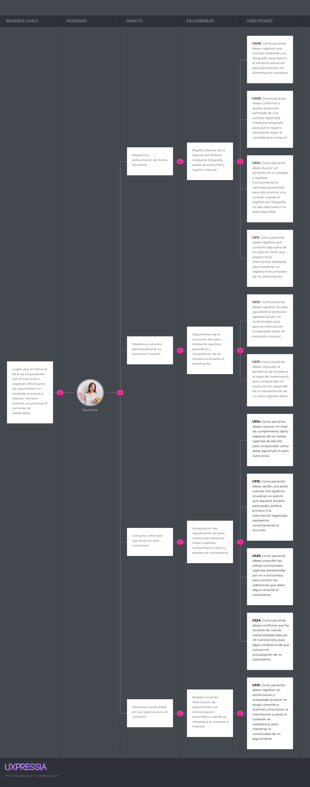

El Impact Mapping del paciente se orienta a promover un registro continuo de información durante el tratamiento nutricional. Para alcanzar este objetivo, se consideran como impactos principales el registro frecuente de la alimentación, el seguimiento de la evolución corporal, la consulta del seguimiento del plan nutricional y la continuidad de los registros sin conexión. Estos comportamientos se apoyan en los Deliverables y User Stories definidos previamente.
<br>

### Impact Mapping - Nutricionista

<p class="caption"><strong>Figura 18</strong><br><em>Impact Mapping del nutricionista</em></p>

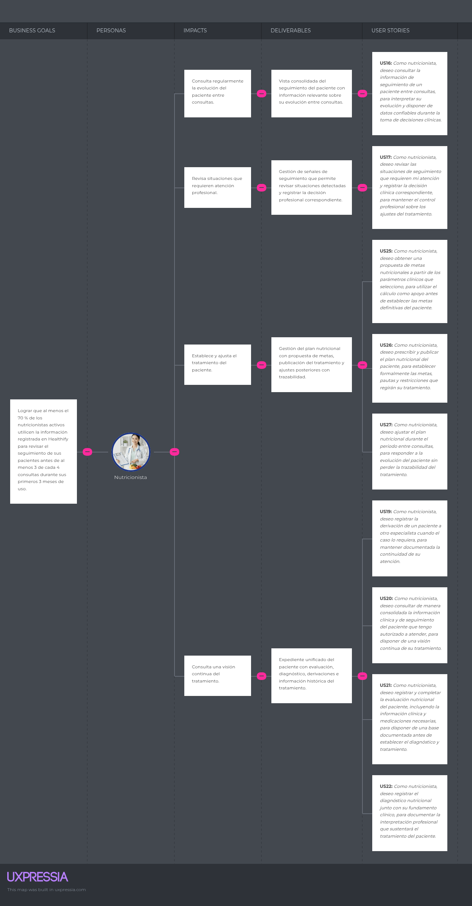

El Impact Mapping del nutricionista se orienta al uso recurrente de la información registrada para el seguimiento de los pacientes entre consultas. Los impactos considerados comprenden la consulta de la evolución del paciente, la revisión de situaciones que requieren atención profesional, la gestión del plan nutricional y la consulta de una visión continua del tratamiento.

<div style="page-break-after: always"></div>

### 2.4.3. Product Backlog

<p class="caption"><strong>Tabla 86</strong><br><em>Product Backlog priorizado de Healthify</em></p>

| **# Order** | **User Story ID** | **Title** | **Story Points** <br>**(1/2/3/5/8)** | **Sprint** |
| :--- | :--- | :--- | :--- | :--- |
| 1 | US08 | Registro de comida por fotografía | 8 | Sprint 1 |
| 2 | SS01 | Investigación de tecnologías para el reconocimiento de alimentos | 3 | Sprint 1 |
| 3 | SS04 | Investigación de los controles de uso de la IA generativa | 3 | Sprint 1 |
| 4 | TS09 | Servicios de asistencia con IA | 8 | Sprint 1 |
| 5 | TS05 | Servicios de registro de ingesta alimentaria | 8 | Sprint 1 |
| 6 | US10 | Registro manual de comida mediante catálogo | 5 | Sprint 1 |
| 7 | SS02 | Investigación de Open Food Facts y USDA para el catálogo de alimentos | 3 | Sprint 1 |
| 8 | US09 | Confirmación o ajuste de estimación de porción | 3 | Sprint 1 |
| 9 | US11 | Indicación de adherencia al plan en un registro | 2 | Sprint 1 |
| 10 | US23 | Visualización de metas nutricionales vigentes | 3 | Sprint 1 |
| 11 | US26 | Prescripción y publicación del plan nutricional | 8 | Sprint 2 |
| 12 | US25 | Obtención de propuesta de metas nutricionales calculadas | 5 | Sprint 2 |
| 13 | TS04 | Servicios de prescripción y gestión del plan nutricional | 8 | Sprint 1 |
| 14 | US14 | Consulta del cumplimiento nutricional diario | 5 | Sprint 2 |
| 15 | US16 | Consulta del monitoreo del paciente | 5 | Sprint 2 |
| 16 | TS07 | Servicios de monitoreo y expediente del paciente | 8 | Sprint 2 |
| 17 | US21 | Registro y finalización de la evaluación nutricional | 5 | Sprint 2 |
| 18 | US22 | Emisión del diagnóstico nutricional | 5 | Sprint 2 |
| 19 | TS03 | Servicios de evaluación y diagnóstico nutricional | 5 | Sprint 1 |
| 20 | US01 | Vinculación mediante invitación QR | 5 | Sprint 1 |
| 21 | US04 | Generación de invitación QR para un nuevo paciente | 5 | Sprint 1 |
| 22 | US02 | Otorgamiento de consentimiento para compartir información | 3 | Sprint 1 |
| 23 | TS02 | Servicios de gestión de vínculos de cuidado | 5 | Sprint 1 |
| 24 | US12 | Registro de autopesaje | 3 | Sprint 2 |
| 25 | US13 | Visualización de tendencia de peso | 5 | Sprint 2 |
| 26 | TS06 | Servicios de autopesaje y seguimiento corporal | 5 | Sprint 1 |
| 27 | US20 | Acceso al expediente unificado del paciente | 5 | Sprint 2 |
| 28 | US44 | Alimentos locales del catálogo | 2 | Sprint 2 |
| 29 | US05 | Consulta de pacientes con vínculo activo | 3 | Sprint 2 |
| 30 | US39 | Agenda de consultas | 5 | Sprint 2 |
| 31 | TS10 | Servicios de agenda y respuesta previa a la consulta | 5 | Sprint 2 |
| 32 | US17 | Revisión y resolución de señales de seguimiento | 5 | Sprint 3 |
| 33 | SS03 | Investigación y definición de la lógica de la señal de consistencia | 3 | Sprint 3 |
| 34 | US15 | Visualización de señal de consistencia | 8 | Sprint 3 |
| 35 | US27 | Ajuste del plan nutricional entre consultas | 5 | Sprint 3 |
| 36 | US41 | Control de las funciones con IA | 5 | Sprint 2 |
| 37 | US42 | Resumen semanal, ideas de comidas y preguntas sugeridas con IA | 8 | Sprint 3 |
| 38 | US31 | Registro y sincronización sin conexión | 8 | Sprint 2 |
| 39 | TS08 | Sincronización de registros offline | 8 | Sprint 2 |
| 40 | US18 | Acceso al expediente personal unificado | 5 | Sprint 3 |
| 41 | US40 | Preparación y respuesta previa a la consulta | 3 | Sprint 3 |
| 42 | US24 | Confirmación de recepción de nuevas metas nutricionales | 2 | Sprint 2 |
| 43 | US19 | Registro de derivación a otro especialista | 2 | Sprint 3 |
| 44 | US06 | Alta del paciente al finalizar el tratamiento | 2 | Sprint 3 |
| 45 | US07 | Cambio de nutricionista | 2 | Sprint 3 |
| 46 | US03 | Revocación del consentimiento | 2 | Sprint 3 |
| 47 | US28 | Creación de cuenta | 3 | Sprint 1 |
| 48 | US29 | Inicio de sesión | 3 | Sprint 1 |
| 49 | US30 | Cierre de sesión | 1 | Sprint 1 |
| 50 | US43 | Preferencias de la cuenta: idioma y recordatorios | 3 | Sprint 2 |
| 51 | TS01 | Servicios de registro, autenticación y autorización | 5 | Sprint 1 |
| 52 | US32 | Visualización de la propuesta de valor de Healthify | 2 | Sprint 1 |
| 53 | US33 | Consulta de las principales funcionalidades de Healthify | 2 | Sprint 1 |
| 54 | US36 | Acceso al inicio de uso de Healthify desde el Landing Page | 2 | Sprint 1 |
| 55 | US38 | Consulta de términos y políticas de Healthify | 2 | Sprint 1 |
| 56 | US45 | Consulta de preguntas frecuentes | 2 | Sprint 3 |
| 57 | US35 | Cambio de idioma del Landing Page | 3 | Sprint 1 |
| 58 | US37 | Envío de consulta mediante formulario de contacto | 3 | Sprint 3 |
| 59 | US34 | Conocimiento de la startup, misión y visión | 1 | Sprint 3 |

A continuación, se presenta el Product Backlog elaborado en Trello:

<p class="caption"><strong>Figura 19</strong><br><em>Product Backlog de Healthify</em></p>

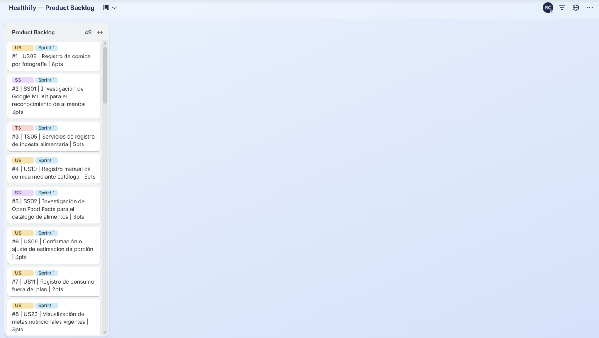

*Product Backlog URL:* [Healthify Product Backlog](https://trello.com/b/u2pRzwEi/healthify-product-backlog)

<div style="page-break-after: always"></div>

## 2.5. Strategic-Level Domain-Driven Design

Esta sección documenta el proceso de diseño estratégico con el que el equipo descompuso Healthify en subconjuntos con límites naturales. El punto de partida fue el Big Picture EventStorming presentado en la sección 2.3.5, que se profundizó hasta el nivel de diseño para identificar comandos, agregados y reglas de negocio; sobre ese modelo se realizó el descubrimiento de contextos candidatos, se representaron los flujos de mensajes entre ellos mediante Domain Storytelling, se detalló cada contexto en su Bounded Context Canvas y finalmente se elaboró el Context Map con los patrones de relación que gobiernan cada integración. El criterio de frontera que el equipo aplicó de manera transversal es que un bounded context no es un módulo ni una pantalla ni una fase de un proceso, sino una frontera dentro de la cual cada término significa exactamente una cosa.

### 2.5.1. EventStorming

Esta sección documenta la segunda sesión de EventStorming, realizada por el equipo en Miro con una duración aproximada de dos horas, orientada a alcanzar el mayor nivel de detalle posible sobre el dominio ya explorado. Mientras que la sesión de Big Picture se limitó a actores, eventos, políticas y algunos read models, esta sesión incorporó los elementos que permiten pasar del relato del negocio a un modelo accionable. Después de implementar el backend, el equipo actualizó el tablero para alinearlo con la versión 1.6.0 del código: cada comando, agregado, evento y política del tablero corresponde a un elemento del backend, y las reglas de negocio se derivan de los errores de dominio que validan los agregados.

El trabajo consistió en recorrer la línea de tiempo del tablero anterior y, para cada evento de dominio, reconstruir hacia atrás la cadena completa que lo produce. Para cada hecho el equipo se preguntó qué intención humana o automática lo desencadenó, lo que dio origen a los comandos en notas azules; qué pieza del modelo es responsable de aceptarlo o rechazarlo, lo que dio origen a los agregados en notas amarillo intenso; qué regla protege ese agregado, lo que dio origen a las reglas de negocio en notas rosadas; y qué vista necesita alguien para tomar la siguiente decisión, lo que dio origen a los read models en notas verdes. Adicionalmente se marcaron en notas rosa claro los servicios externos, que en el tablero son cinco: el proveedor de autenticación, Gemini en Vertex AI, Open Food Facts y USDA Food Data Central como fuentes del catálogo, y el servidor SMTP que envía los códigos de recuperación de contraseña. El proveedor de autenticación se conserva en el tablero como registro de la sesión original, pero no se integró como un servicio de terceros: quedó resuelto dentro de `IAM` mediante hashing con BCrypt y emisión propia de tokens JWT. La estimación de porción tampoco se hace en el dispositivo, como se planteó en la sesión; la foto se envía al servidor, donde Gemini la analiza en memoria sin guardarla, y la cámara se reservó para leer el código QR de invitación. Los servicios externos de la solución son, por tanto, Open Food Facts, USDA Food Data Central, Gemini en Vertex AI y el servidor SMTP.

**Convención de composición.** El equipo acordó una regla de encadenamiento que se respeta en todo el tablero y que facilita después la traducción a código:

```
Actor ──► Command ──► Aggregate ──► Business Rules ──► Domain Event ──► Read Model
Policy ──► Command ──► Aggregate ──► Business Rules ──► Domain Event ──► Read Model
```

Las reglas de negocio cuelgan siempre del agregado, porque es el agregado quien las hace cumplir; los servicios externos cuelgan del agregado y nunca inician un flujo por sí solos; y las políticas que dependen del tiempo se nombran con la forma `When <condición> Due`, porque en el backend las ejecuta un proceso programado y no un evento, como `When Invitation Expiry Due` o `When Weekly Summary Due`. Algunos comandos cambian el estado de un agregado sin que el backend publique un evento de dominio, por ejemplo `Analyze Meal Photo`, `Abandon Consultation` o `Save Consultation Publication Draft`. Para no romper la cadena, el tablero cierra esos flujos con un evento implícito (`Meal Photo Analyzed`, `Consultation Abandoned`, `Publication Draft Saved`).

Entre contextos existen dos tipos de conexión. La línea continua une un evento de dominio con la política del contexto que lo consume, por ejemplo `Nutrition Plan Published` con `When Active Targets Updated` en `Intake & Body Response`, o `Sustained Deviation Detected` con la política de `Nutritional Care` que abre un ítem de revisión. La línea punteada azul representa una consulta síncrona a la fachada de otro contexto (ACL) y no lleva evento. `IAM` y `Food Catalog` se integran solo de esta forma: sus eventos se consumen dentro de su propio contexto, mientras que los demás contextos consultan `IIamContextFacade` (`IsPractitioner`, `GetPreferredLanguage`, `GetUsersByIds`) e `IFoodCatalogContextFacade` (`GetReferenceFoodById`, `ResolveByNameWithProviders`, `CreateAiEstimatedFood`).

Enlace del Event-Storming: [https://miro.com/welcomeonboard/MU44Nlk4L2dlOVFveWtDZ05SOTU5cThreUNlUUM1SytYY1lJZ29UeU9uWStqbEY4RVBQWWxxNXoxWjhqTXYvMkhIeFVQR1FFNUN2NEtSVWZRVVlDdzd6U0hDZUFBcjhESm5VZ3pkSHh2cEdHRWRJVTVWR3ZEclhJN3hucXdsZzF0R2lncW1vRmFBVnlLcVJzTmdFdlNRPT0hdjE=?share_link_id=478718202765](https://miro.com/welcomeonboard/MU44Nlk4L2dlOVFveWtDZ05SOTU5cThreUNlUUM1SytYY1lJZ29UeU9uWStqbEY4RVBQWWxxNXoxWjhqTXYvMkhIeFVQR1FFNUN2NEtSVWZRVVlDdzd6U0hDZUFBcjhESm5VZ3pkSHh2cEdHRWRJVTVWR3ZEclhJN3hucXdsZzF0R2lncW1vRmFBVnlLcVJzTmdFdlNRPT0hdjE=?share_link_id=478718202765)

<p class="caption"><strong>Figura 20</strong><br><em>Tablero completo del Design Level EventStorming</em></p>

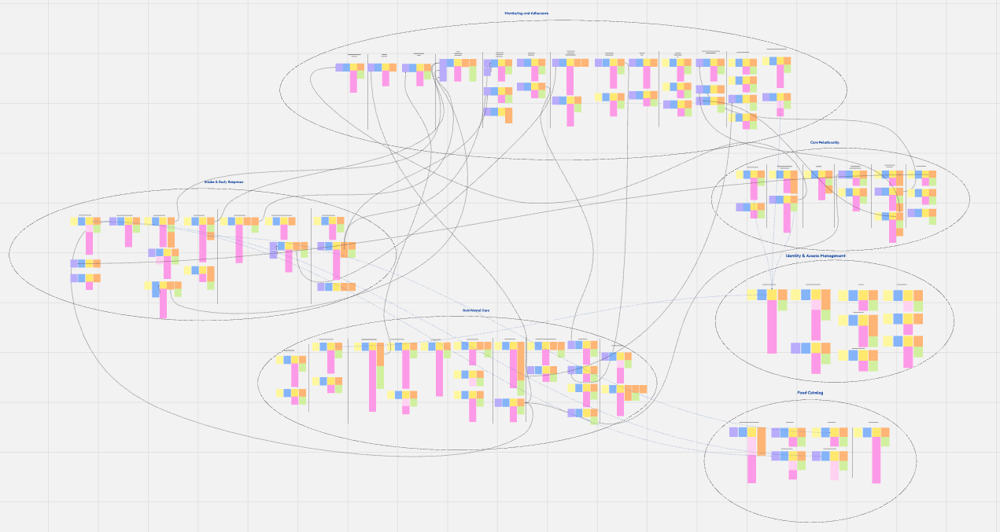

El modelo resultante quedó organizado en cuarenta y ocho subflujos distribuidos en seis contextos, con ochenta y nueve comandos, veinticuatro agregados, ciento ochenta y ocho reglas de negocio, noventa y seis eventos de dominio y cuarenta y cuatro políticas. Los comandos, agregados, eventos y políticas se cuentan sin repetir nombres dentro de un mismo contexto; las reglas se cuentan por nota. El cambio más grande respecto de la primera versión del tablero está en `Nutritional Care`: la evaluación, el diagnóstico, la propuesta de metas y la publicación del plan dejaron de ser flujos sueltos y pasaron a ser pasos ordenados del agregado `Consultation`, y se agregaron `Patient Baseline` y las propuestas de ajuste de plan generadas con IA dentro de `Review Item`.

<p class="caption"><strong>Tabla 87</strong><br><em>Resumen del Design Level EventStorming por bounded context</em></p>

| Bounded context | Agregados | Comandos | Reglas | Eventos | Políticas |
|---|---|---:|---:|---:|---:|
| `Identity & Access Management (IAM)` | 3 | 9 | 17 | 9 | 1 |
| `Care Relationship` | 3 | 13 | 24 | 12 | 5 |
| `Nutritional Care` | 6 | 19 | 53 | 25 | 6 |
| `Intake & Body Response` | 4 | 16 | 39 | 18 | 7 |
| `Monitoring & Adherence` | 7 | 26 | 44 | 25 | 21 |
| `Food Catalog` | 1 | 6 | 11 | 7 | 4 |
| **Total** | **24** | **89** | **188** | **96** | **44** |

<p class="caption"><strong>Figura 21</strong><br><em>Detalle de un subflujo del Design Level EventStorming</em></p>

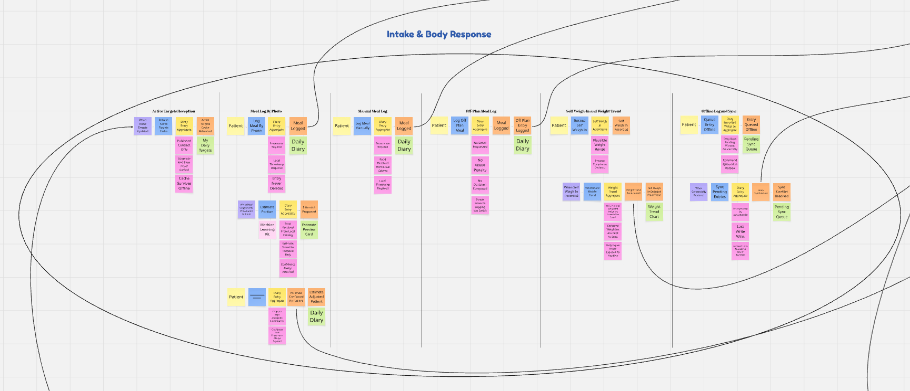


#### 2.5.1.1. Candidate Context Discovery

Esta sección documenta la sesión en la que el equipo identificó los bounded contexts candidatos a partir del dominio modelado. La sesión tuvo una duración aproximada de dos horas y se aplicó la técnica look-for-pivotal-events, complementada al final con start-with-value para clasificar los contextos resultantes.

El equipo recorrió la línea de tiempo buscando los eventos que cambian el estado del proceso de manera irreversible y que hacen que lo que ocurre después obedezca a reglas distintas de lo que ocurría antes. Se identificaron cuatro eventos pivote: `Care Link Established`, porque antes de él no existe relación alguna y después de él existe una relación consentida con obligaciones de acceso; `Nutrition Plan Published`, porque antes de él el profesional delibera y después existe un contrato que el paciente debe poder consultar; `Active Targets Updated`, porque es el hecho que cruza la frontera del consultorio hacia el periodo entre consultas; y `Sustained Deviation Detected`, porque devuelve el control al profesional después de un periodo enteramente asíncrono.

El corte más importante quedó entre las fases 2 y 3 del tablero. El equipo verificó que a cada lado de esa línea cambian simultáneamente el número de actores, el requisito de consistencia y el modo de conectividad, lo que confirma que se trata de una frontera real y no de un cambio de pantalla. Sobre esa base se dibujaron las agrupaciones candidatas y cada una se sometió a cinco pruebas.

<p class="caption"><strong>Tabla 88</strong><br><em>Pruebas aplicadas para descubrir los bounded contexts candidatos</em></p>

| # | Prueba | Pregunta que responde |
|---|---|---|
| 1 | Lingüística | ¿Alguna palabra significa dos cosas distintas a cada lado de la línea? |
| 2 | Invariante | ¿Qué regla protege este contexto que ningún otro puede proteger? |
| 3 | Consistencia | ¿Exige consistencia fuerte inmediata o tolera consistencia eventual? |
| 4 | Volatilidad | ¿A qué ritmo cambian el modelo y los datos? |
| 5 | Competitiva | ¿Es aquí donde el producto se diferencia o donde solo debe estar a la altura? |

La prueba lingüística fue la más productiva, porque cada ambigüedad encontrada justifica por sí sola una frontera: el término peso designa la medición clínica del profesional y también el autopesaje del paciente, que solo significa algo como tendencia; el término alimento designa el ítem del catálogo externo y también el evento de consumo de una persona concreta; y el término plan designa el artefacto clínico versionado y también el conjunto de metas del día. La primera ambigüedad separa `Nutritional Care` de `Intake & Body Response`, la segunda justifica el Anticorruption Layer sobre `Food Catalog` y la tercera justifica publicar un contrato reducido en lugar de exponer el plan completo.

El resultado de la sesión fueron seis bounded contexts, clasificados por su aporte a la diferenciación del producto.

<p class="caption"><strong>Tabla 89</strong><br><em>Bounded contexts resultantes y su clasificación</em></p>

| Clasificación | Bounded context | Responsabilidad | Consistencia |
|---|---|---|---|
| **Core** | `Intake & Body Response` | Capturar fielmente qué comió el paciente y cómo responde su cuerpo | Eventual, offline-first |
| **Core** | `Monitoring & Adherence` | Comparar lo prescrito contra lo real e interpretar la diferencia | Eventual, ventana mínima de siete días |
| Supporting | `Nutritional Care` | El acto clínico completo: evaluación, diagnóstico y prescripción | Fuerte, transaccional |
| Supporting | `Care Relationship` | Quién puede ver a quién y con qué consentimiento | Fuerte, transaccional |
| Generic | `Food Catalog` | Traducir el catálogo externo al dominio y cachearlo localmente | Eventual, cacheable |
| Generic | `Identity & Access Management (IAM)` | Autenticación y emisión del claim de rol | Fuerte, transaccional (autenticación propia) |

La clasificación de `Nutritional Care` como Supporting merece justificación explícita, porque es el contexto donde ocurre el acto profesional completo. El criterio de DDD no es la importancia sino la diferenciación: el expediente clínico, el diagnóstico y la prescripción versionada son exactamente el terreno que Nutrimind y Nutrium ya cubren, de modo que allí el objetivo es estar a la altura. Las tres piezas que constituyen la diferencia competitiva de Healthify son el registro por fotografía, el autopesaje expuesto como tendencia y el índice de consistencia; dos viven en `Intake & Body Response` y una en `Monitoring & Adherence`.

La sesión también descartó explícitamente siete contextos candidatos, decisión que quedó registrada junto con la condición que los haría reaparecer.

<p class="caption"><strong>Tabla 90</strong><br><em>Contextos candidatos descartados y su razón</em></p>

| Candidato descartado | Razón del descarte |
|---|---|
| `Patient Record` | Es un read model compuesto que une tres contextos y se compone en el módulo `ReadModels` de la API; confundir una vista con un contexto es uno de los errores más frecuentes en DDD |
| `Assessment` como contexto propio | Acoplamiento máximo con diagnóstico e intervención y ninguna ambigüedad lingüística en la frontera |
| `Portion Estimation / AI` | Es una capacidad técnica, no un lenguaje distinto. En la implementación quedó como un módulo técnico de IA en `Shared`, desactivado por defecto, que los contextos invocan; `Intake & Body Response` lo usa para reconocer el plato |
| `Target Calculation` | Es aritmética determinista con parámetros elegidos por un humano; son reglas del agregado `Nutrition Plan` |
| `Notifications` | Infraestructura genérica frente a la cual el sistema es conformista |
| `Scheduling` | Demasiado delgado; se absorbe como el agregado `Scheduled Follow Up` |
| `Gamification` | No existe por decisión ética del producto; convertirlo en contexto institucionalizaría algo que el equipo prohibió |

<p class="caption"><strong>Figura 22</strong><br><em>Agrupación de contextos candidatos sobre el EventStorming</em></p>

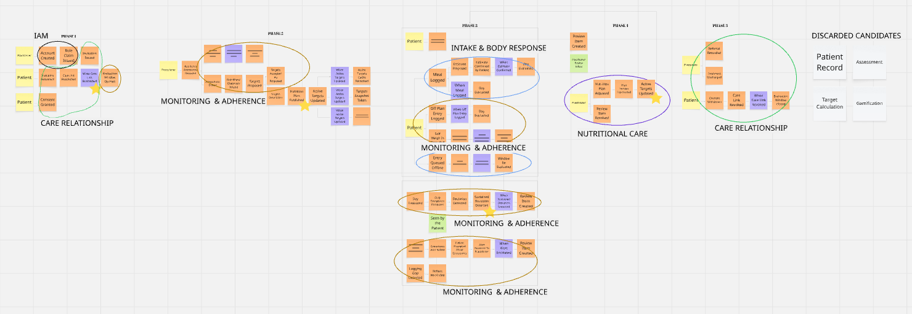

#### 2.5.1.2. Domain Message Flows Modeling

Esta sección documenta cómo colaboran los bounded contexts para resolver los casos de negocio relevantes. Para ello el equipo aplicó Domain Storytelling, elaborando un diagrama por escenario en el que cada actor y cada contexto aparece como un participante, y cada mensaje se numera en el orden en que ocurre. El propósito de estos diagramas es verificar que las fronteras definidas en la sección anterior resisten los flujos reales del negocio y que ningún escenario obliga a un contexto a conocer el modelo interno de otro.

Se modelaron cuatro escenarios, elegidos por ser los que más fronteras atraviesan.

**Escenario 1 — Vinculación del paciente durante la consulta.** El profesional emite la invitación, el paciente la redime escaneando el código QR y otorga su consentimiento; `Care Relationship` publica `Care Link Established` y `Monitoring & Adherence` reacciona abriendo la ventana de evaluación. El escenario demuestra que el vínculo es condición previa de todo lo demás.

<p class="caption"><strong>Figura 23</strong><br><em>Domain Message Flow: vinculación del paciente</em></p>

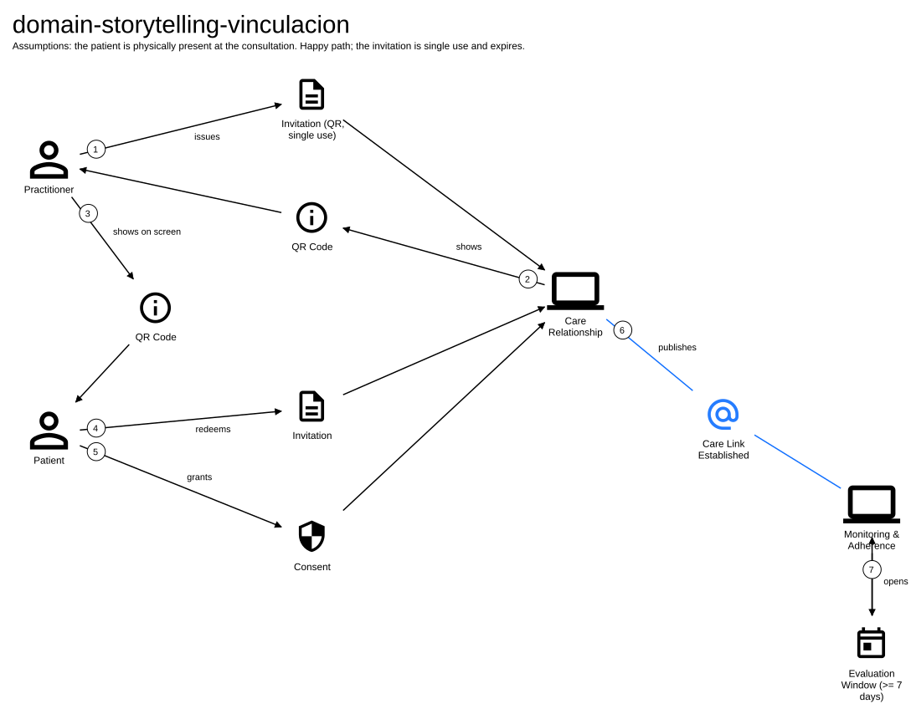

**Escenario 2 — Prescripción y publicación de metas.** El profesional registra la evaluación, emite el diagnóstico, elige la base de cálculo, prescribe las metas y publica el plan; `Nutritional Care` publica `Active Targets Updated`, que es consumido simultáneamente por `Intake & Body Response` para refrescar su caché de metas, por `Monitoring & Adherence` para tomar el snapshot del día y por `Care Relationship` para marcar las metas como pendientes de acuse de recibo. El escenario evidencia que lo que cruza la frontera es el contrato reducido y no el plan clínico: el diagnóstico y la base de cálculo nunca salen de `Nutritional Care`.

<p class="caption"><strong>Figura 24</strong><br><em>Domain Message Flow: prescripción y publicación de metas</em></p>

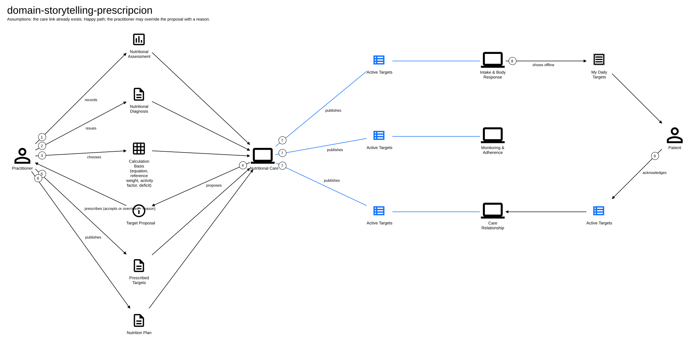

**Escenario 3 — Registro de comida entre consultas, con y sin conexión.** El paciente fotografía su comida, el servidor propone la estimación con un modelo de IA a partir de la foto (que no se conserva), el paciente la confirma o la ajusta y `Intake & Body Response` publica `Meal Logged` y `Estimate Confirmed By Patient`; `Monitoring & Adherence` evalúa el día contra el snapshot correspondiente. La variante sin conexión, que por no disponer de la IA se resuelve con registro manual, muestra la entrada encolada y el reprocesamiento de la ventana tras `Entry Synchronized`. El escenario demuestra que el profesional no participa en ningún paso de la cadena.

<p class="caption"><strong>Figura 25</strong><br><em>Domain Message Flow: registro de comida y sincronización</em></p>

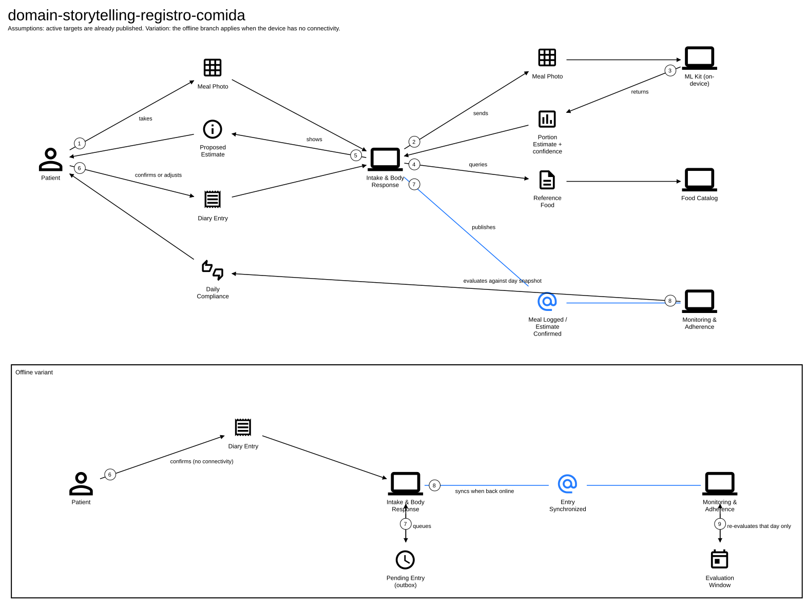

**Escenario 4 — Detección de desviación y decisión del profesional.** `Monitoring & Adherence` detecta la desviación sostenida y publica la señal; `Nutritional Care` la recibe mediante una política, crea un ítem de revisión y lo deposita en la bandeja del profesional, quien decide si ajusta el plan o cierra el ítem sin ajustarlo. El escenario es el que más se discutió en la sesión, porque hace visible la decisión de diseño más importante del modelo: la cadena automática entra por una política y muere en una bandeja de entrada, de manera que ningún algoritmo modifica un plan clínico.

<p class="caption"><strong>Figura 26</strong><br><em>Domain Message Flow: detección de desviación y decisión clínica</em></p>

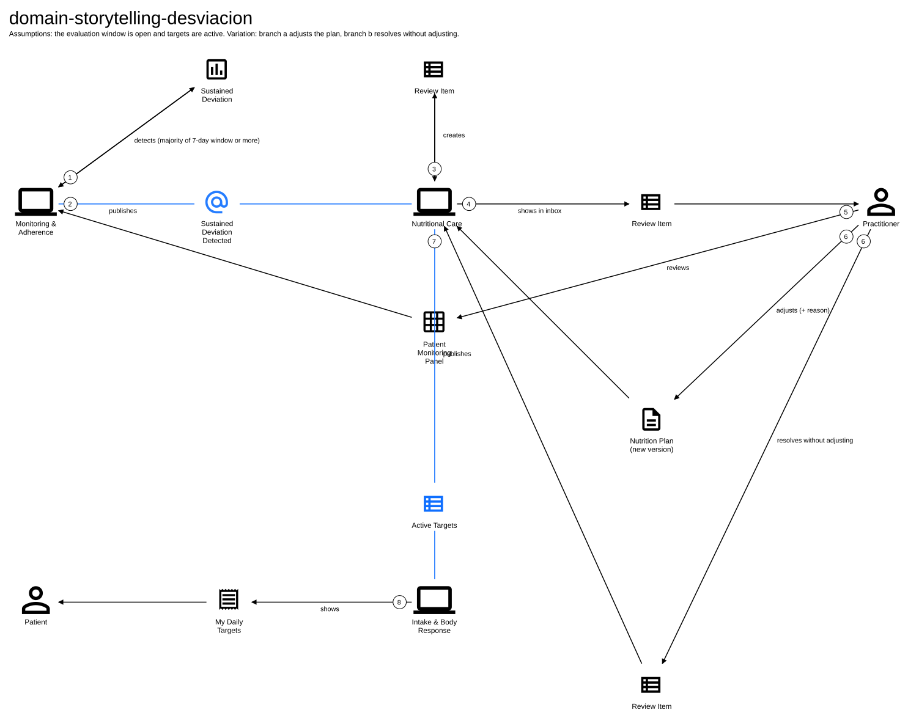

#### 2.5.1.3. Bounded Context Canvases

Esta sección presenta el Bounded Context Canvas de cada uno de los seis contextos identificados. La elaboración siguió el proceso iterativo propuesto por la técnica: se definió primero el Context Overview con el propósito y la clasificación estratégica del contexto, se destilaron después las reglas de negocio y el lenguaje ubicuo propio del contexto, se analizaron sus capabilities distinguiendo los comandos que recibe, las consultas que atiende y los eventos que publica, se capturaron sus dependencias entrantes y salientes con el patrón de relación correspondiente, y finalmente se sometió cada canvas a una crítica de diseño en la que el equipo buscó señales de frontera mal trazada, como un número desproporcionado de dependencias o un lenguaje que se repite en dos contextos.

Los canvases se elaboraron en el orden de importancia estratégica de cada contexto, comenzando por los dos contextos Core. Cada canvas sigue la versión 5 de la plantilla del DDD Crew (Name, Purpose, Strategic Classification, Domain Roles, Inbound y Outbound Communication, Ubiquitous Language, Business Decisions, Assumptions, Verification Metrics y Open Questions). En las comunicaciones, los mensajes se agrupan por colaborador y se colorean según su tipo: azul para comandos, verde para consultas y amarillo para eventos. Cada grupo de mensajes lleva el patrón de relación de su integración, escrito igual en los dos canvases que la comparten: lo que un contexto declara enviar aparece en el Inbound del otro con la misma etiqueta. Las aplicaciones, el módulo `ReadModels` y el módulo de IA de `Shared` figuran como colaboradores, pero no son bounded contexts. El contenido de los canvases se contrastó con las fachadas ACL, los controladores REST y los manejadores de eventos de `healthify-platform`, y el script que los genera (`docs/bounded-context-canvas/v5/generate.py`) rechaza cualquier mensaje que no aparezca en los dos extremos.

**`Intake & Body Response` (Core).** Su propósito es capturar fielmente lo que el paciente come y cómo responde su cuerpo, sin emitir ningún juicio sobre ello. Es de escritura exclusiva del paciente: no existe ningún comando del profesional en este contexto. El profesional ve la información a través del read model, y `Monitoring & Adherence` y `Nutritional Care` la leen con consultas a su fachada, sin poder modificarla. Sus reglas más características son que una entrada nunca se elimina, que la procedencia y la marca de tiempo local son obligatorias, que la estimación de la fotografía se almacena solo como propuesta junto con su nivel de confianza, y que el valor diario del autopesaje nunca se expone como titular sino como tendencia.

<p class="caption"><strong>Figura 27</strong><br><em>Bounded Context Canvas de Intake &amp; Body Response</em></p>

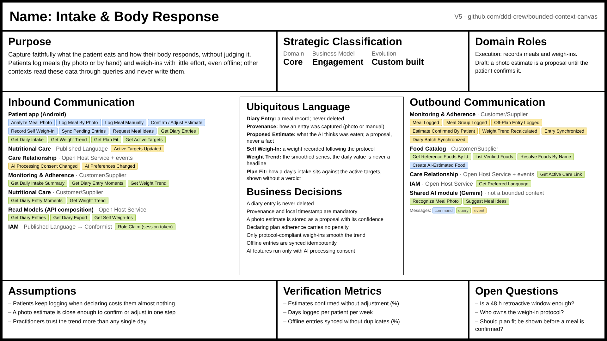

**`Monitoring & Adherence` (Core).** Su propósito es comparar lo prescrito contra lo realmente registrado e interpretar la diferencia. Es el contexto que concentra dieciséis de las treinta políticas del modelo, lo que confirma su naturaleza reactiva: casi nadie lo invoca directamente, sino que actúa a partir de lo que ocurre en los demás contextos. Sus reglas más características son que ningún día se evalúa contra metas distintas de las vigentes ese día, que una ventana menor a siete días nunca produce desviación, y que el vacío de registro se excluye del cálculo de desviación y nunca escala al profesional.

<p class="caption"><strong>Figura 28</strong><br><em>Bounded Context Canvas de Monitoring &amp; Adherence</em></p>

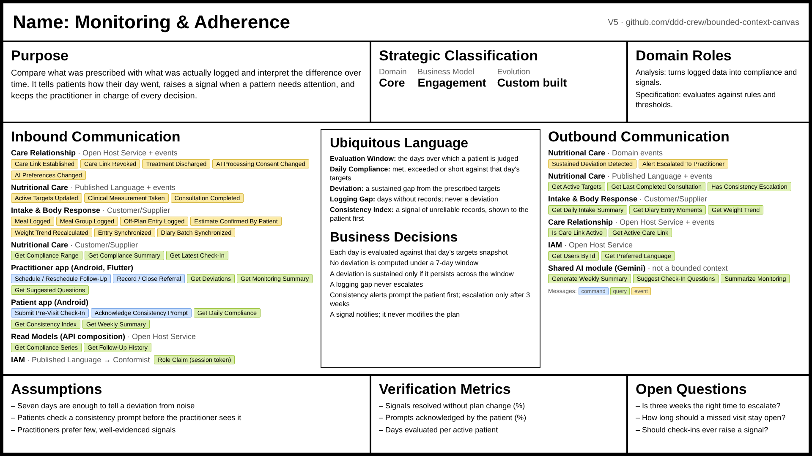

**`Nutritional Care` (Supporting).** Su propósito es sostener el acto clínico completo: evaluación, diagnóstico, prescripción y ajuste del plan entre consultas. Sus reglas más características son que una evaluación cerrada es inmutable y su corrección genera una evaluación nueva, que no existe plan sin diagnóstico vigente, que todo ajuste exige una razón y que la versión anterior se supersede pero nunca se elimina. Es también el contexto que define el Published Language `Active Targets`. Para preparar un ajuste del plan consulta los momentos de registro y la tendencia de peso en `Intake & Body Response` y el cumplimiento en `Monitoring & Adherence`. El diagnóstico y la base de cálculo no forman parte de ningún contrato de integración; solo los lee el expediente del paciente.

<p class="caption"><strong>Figura 29</strong><br><em>Bounded Context Canvas de Nutritional Care</em></p>

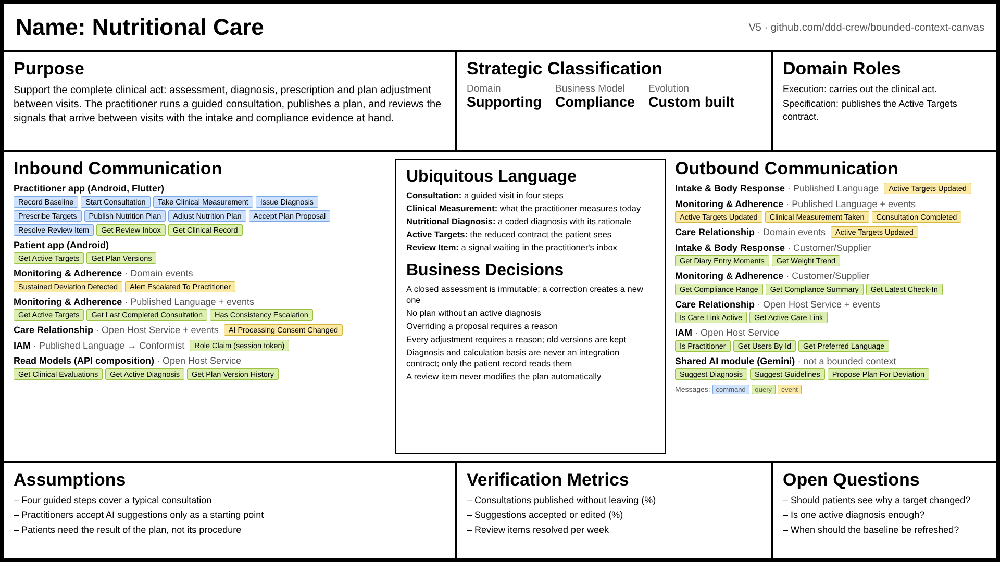

**`Care Relationship` (Supporting).** Su propósito es determinar quién puede ver a quién y con qué consentimiento. Responde dos preguntas al resto del sistema, si existe un vínculo activo entre un paciente y un profesional (`Is Care Link Active`) y cuál es el vínculo vigente de un paciente (`Get Active Care Link`), y es donde se hace cumplir técnicamente el principio de asimetría entre los dos roles. También guarda el consentimiento para el procesamiento con IA y las preferencias de IA del paciente, y avisa de sus cambios a los tres contextos que usan IA. Sus reglas más características son que la invitación es de un solo uso y con vencimiento, que el paciente no puede autovincularse, que el vínculo nace inactivo hasta que exista consentimiento y que el consentimiento es siempre revocable sin justificación.

<p class="caption"><strong>Figura 30</strong><br><em>Bounded Context Canvas de Care Relationship</em></p>

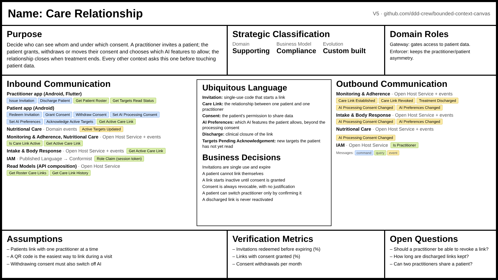

**`Food Catalog` (Generic).** Su propósito es traducir el catálogo nutricional externo al dominio y mantenerlo disponible localmente. Sus reglas más características son que ningún identificador externo entra al dominio, que la traducción de taxonomía es obligatoria y que la búsqueda cae en la caché local cuando no hay conexión. Un alimento estimado por IA se guarda con su origen marcado como tal.

<p class="caption"><strong>Figura 31</strong><br><em>Bounded Context Canvas de Food Catalog</em></p>

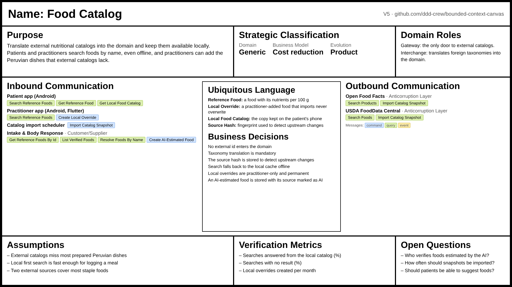

**`Identity & Access Management (IAM)` (Generic).** Su propósito es autenticar y emitir el claim de rol. Es el único contexto que no publica ningún evento hacia los demás, porque el claim viaja dentro del token de sesión, que es infraestructura y no dominio. Sus reglas más características son que el rol se declara en el registro, que es inmutable durante la sesión y que cambiar de rol exige volver a autenticarse. Aparte del claim, su fachada responde consultas puntuales de los demás contextos: si un usuario es profesional, su nombre y su idioma preferido.

<p class="caption"><strong>Figura 32</strong><br><em>Bounded Context Canvas de IAM</em></p>

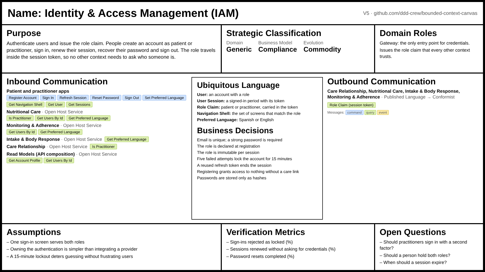

### 2.5.2. Context Mapping

Esta sección documenta la elaboración del Context Map, que representa las relaciones estructurales entre los seis bounded contexts. El equipo revisó la información recolectada en los canvases y, antes de fijar el mapa, evaluó explícitamente cuatro alternativas mediante las preguntas propias de la técnica: si convenía redistribuir capabilities entre contextos, si alguno debía dividirse, si alguna capability debía duplicarse y si hacía falta crear servicios compartidos.

De esa discusión surgieron cuatro decisiones. La primera fue no trasladar el cálculo del índice de consistencia a `Intake & Body Response` pese a que allí están sus dos insumos, porque si el contexto que registra también juzga, el registro deja de ser un lugar seguro para declarar y se incentiva exactamente la omisión selectiva que el producto busca eliminar. La segunda fue mantener la tendencia de peso dentro de `Intake & Body Response`, porque es un suavizado de los datos del propio paciente que no necesita el plan y debe estar disponible sin conexión, a diferencia de la desviación y del índice, que sí requieren el plan y umbrales de interpretación. La tercera fue no crear un contexto compartido de expediente, ya que `Patient Record` es un read model compuesto que se arma en el módulo `ReadModels` de la API a partir de las fachadas ACL de los contextos involucrados. La cuarta fue reducir el shared kernel al mínimo deliberado: únicamente los identificadores `PatientId`, `PractitionerId`, `CareLinkId` y `PlanId`, y las unidades de medida, bajo el criterio de que un shared kernel grande es un bounded context que no se llegó a dibujar.

<p class="caption"><strong>Figura 33</strong><br><em>Context Map de Healthify</em></p>

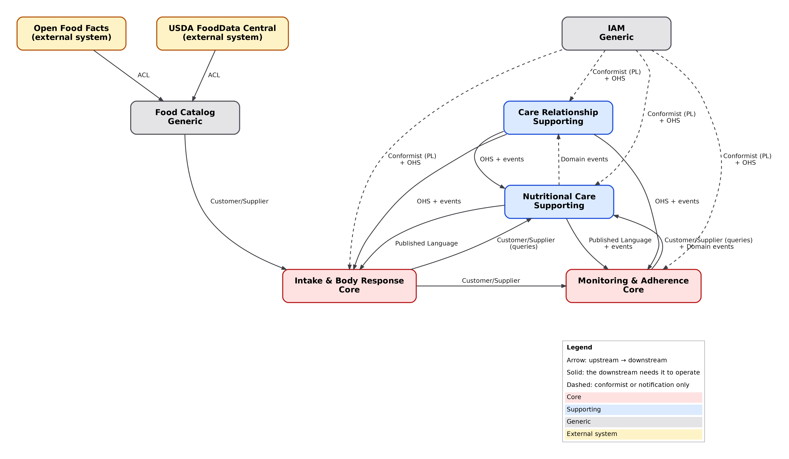

El mapa se lee de upstream a downstream en el sentido de las flechas, y cada contexto conserva el color de su clasificación estratégica: rojo para los dos contextos Core, azul para los Supporting, gris para los Generic y amarillo para el sistema externo. Las líneas continuas representan dependencias de las que el contexto downstream necesita para operar, ya sea un contrato consultado o datos que alimentan su modelo; las líneas punteadas representan acoplamientos deliberadamente débiles, en los que el downstream solo se conforma con un modelo ajeno o reacciona a una notificación sin depender de ella para funcionar.

Los patrones de relación seleccionados para cada integración son los siguientes.

<p class="caption"><strong>Tabla 91</strong><br><em>Patrones de relación del Context Map</em></p>

| Relación | Patrón | Justificación |
|---|---|---|
| `IAM` → `Care Relationship`, `Nutritional Care`, `Intake & Body Response`, `Monitoring & Adherence` | Conformist (Published Language) + Open Host Service | El claim de rol viaja en el token JWT y cada contexto lo adopta sin traducción para autorizar sus endpoints: es infraestructura y no dominio. La fachada de `IAM` responde además consultas puntuales, como si un usuario es profesional, su nombre o su idioma preferido. Lo que distingue a los contextos del paciente es que, además del rol, dependen del vínculo que resuelve `Care Relationship` para decidir quién puede ver sus datos |
| `Care Relationship` → `Nutritional Care` | Open Host Service + eventos | `Nutritional Care` consulta `Is Care Link Active` antes de evaluar, diagnosticar o prescribir sobre un paciente, y deja de usar la IA cuando recibe `AI Processing Consent Changed` |
| `Care Relationship` → `Intake & Body Response` | Open Host Service + eventos | `Intake & Body Response` obtiene el vínculo vigente para refrescar su caché de metas y apaga las funciones de IA cuando el paciente retira el consentimiento o cambia sus preferencias de IA |
| `Care Relationship` → `Monitoring & Adherence` | Open Host Service + eventos | Además de consultar el vínculo, `Monitoring` abre la ventana de evaluación con `Care Link Established`, deja de evaluar con `Care Link Revoked` o `Treatment Discharged` y ajusta sus resúmenes de IA al consentimiento y a las preferencias del paciente |
| `Nutritional Care` → `Intake & Body Response` | Published Language | El plan clínico no se expone entero; se publica `Active Targets`, un contrato reducido y versionado que `Intake & Body Response` cachea para operar sin conexión. El diagnóstico y la base de cálculo nunca cruzan la frontera |
| `Nutritional Care` → `Monitoring & Adherence` | Published Language + eventos | `Monitoring` consume `Active Targets Updated`, `Clinical Measurement Taken` y `Consultation Completed` para tomar el snapshot de metas vigentes del día, de modo que ningún día se evalúe contra metas distintas de las que regían entonces. Al armar sus resúmenes consulta también las metas vigentes y la fecha de la última consulta |
| `Nutritional Care` ⇢ `Care Relationship` | Integración por eventos | `Care Relationship` reacciona a `Active Targets Updated` marcando las metas como pendientes de acuse de recibo por el paciente; es una notificación y no una dependencia de datos |
| `Intake & Body Response` → `Monitoring & Adherence` | Customer/Supplier | `Monitoring` consume ingesta y tendencia de peso como cliente con voz: si necesita un dato nuevo, lo negocia con el proveedor. Recibe siete eventos de registro y sincronización, y consulta la ingesta diaria y la tendencia de peso. El contexto que registra no juzga, y el que juzga no registra |
| `Intake & Body Response` → `Nutritional Care` | Customer/Supplier | Al preparar un ajuste del plan, `Nutritional Care` lee los momentos de registro del diario y la tendencia de peso. Solo consulta: el diario sigue siendo de escritura exclusiva del paciente |
| `Monitoring & Adherence` → `Nutritional Care` | Customer/Supplier | `Nutritional Care` lee el cumplimiento de un rango de días y el último check-in previo a la consulta, para mostrar esa evidencia junto a cada ítem de revisión y en la propuesta de ajuste |
| `Monitoring & Adherence` ⇢ `Nutritional Care` | Integración por eventos, nunca por comandos | Modelarlo como comando crearía un ciclo de dependencia y permitiría que un algoritmo modificara un plan clínico. `Monitoring` publica la señal de desviación, `Nutritional Care` la convierte en un ítem de revisión y el profesional decide |
| Open Food Facts / USDA → `Food Catalog` | Anticorruption Layer | La taxonomía externa es inestable, incompleta para el mercado peruano y responde a un lenguaje conceptual distinto; ningún identificador externo entra al dominio |
| `Food Catalog` → `Intake & Body Response` | Customer/Supplier | El registro necesita el alimento en el momento del uso y no cuando el catálogo se actualice, por lo que `Intake & Body Response` define qué búsquedas y qué datos nutricionales debe garantizar el catálogo, incluida su disponibilidad en caché local |

`Care Relationship` es upstream de los tres contextos que manejan información del paciente, porque el vínculo consentido es condición previa de todo lo demás. Entre `Nutritional Care` y los dos contextos Core hay dependencias en ambos sentidos: `Nutritional Care` publica las metas que ellos usan y, a la vez, consulta lo que registran y evalúan para decidir un ajuste. Ninguna de esas dependencias transporta comandos. Las consultas leen datos sin cambiar estado, y la señal que viaja de `Monitoring & Adherence` hacia `Nutritional Care` es un evento que termina en la bandeja del profesional. Por eso ningún contexto modifica el estado de otro y ningún algoritmo cambia un plan clínico. El módulo `ReadModels` no aparece en el mapa porque no es un contexto: compone vistas a partir de las fachadas de los demás.

El mapa resultante contiene veintidós integraciones por evento originadas en diecisiete eventos distintos. El backend implementa ochenta y dos eventos de dominio, así que cerca del setenta y nueve por ciento permanece dentro de un solo contexto. El equipo usa esa proporción como control: un evento de integración nuevo tiene que aparecer en el Context Map y en los canvases de los dos contextos, y si surge sin una relación que lo explique, alguna frontera está filtrando responsabilidades.

### 2.5.3. Software Architecture

La arquitectura de software de Healthify se representa mediante el modelo C4, aplicando tres de sus niveles de abstracción — Contexto, Contenedores y Componentes — sobre la solución completa: la aplicación móvil Flutter, el backend ASP\.NET Core 10, el Landing Page estático y la base de datos MySQL 8.4. El diseño sigue los seis Bounded Contexts identificados en el proceso estratégico de Domain-Driven Design (2.5.1 y 2.5.2), materializados aquí como módulos concretos tanto en el cliente como en el servidor. Estos tres niveles se detallan en las secciones 2.5.3.1 a 2.5.3.3; adicionalmente, se presenta en la sección 2.5.3.4 el Deployment Diagram, diagrama suplementario del modelo C4 que describe la distribución física de la solución sobre la infraestructura.

#### 2.5.3.1. Software Architecture Context Level Diagrams

El Diagrama de Contexto (Nivel 1 del modelo C4) representa a Healthify como un sistema centralizado y detalla su interacción con los dos actores principales y los sistemas externos con los que se integra. Este diagrama permite visualizar el alcance global de la solución y los límites del sistema frente a servicios de terceros.

**Elementos:**

- **Healthify:** Sistema central que provee el seguimiento nutricional entre consultas, la comunicación entre paciente y nutricionista, y el monitoreo de adherencia al plan.
- **Patient:** Persona que registra sus comidas y peso entre consultas, y sigue el plan prescrito por su nutricionista.
- **Practitioner:** Persona que realiza el acto clínico (evaluación, diagnóstico, prescripción) y revisa las señales de adherencia de sus pacientes.
- **External Systems:**
	- `AI Provider (Gemini):` Modelo de IA generativa al que el servidor envía la foto de la comida, a través del módulo técnico de IA, para obtener el plato, la porción estimada y su nivel de confianza. La foto se procesa en memoria y no se conserva. Gemini se usa únicamente en el dispositivo para leer el código QR de invitación.
	- `Nutritional Data Providers:` Fuentes externas de catálogo nutricional (Open Food Facts, USDA) consultadas a través del Anticorruption Layer de Food Catalog.

<p class="caption"><strong>Figura 34</strong><br><em>Diagrama de contexto de Healthify (C4, nivel 1)</em></p>

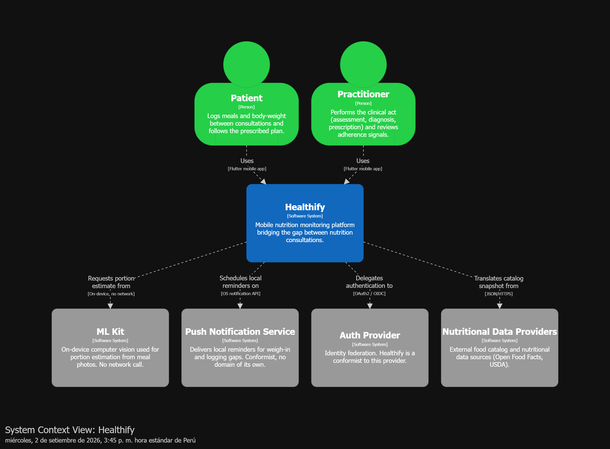

#### 2.5.3.2. Software Architecture Container Level Diagrams

El Diagrama de Contenedores (Nivel 2 del modelo C4) desglosa el sistema Healthify en sus principales unidades lógicas de ejecución. En este nivel se especifican las responsabilidades de cada contenedor, las tecnologías elegidas para su implementación y los protocolos de comunicación que permiten la interacción entre ellos y con los sistemas externos.

**Elementos:**

- **Landing Page:** Sitio web estático que presenta la propuesta de valor de Healthify y dirige a los usuarios hacia la descarga de la aplicación.
   - **Tecnología:** `HTML5 + CSS3 + JavaScript`.
- **Mobile Application:** Frontend donde Patient y Practitioner interactúan con la plataforma. Aplicación Flutter única con dos navigation shells seleccionados según el claim de rol, que agrupa internamente los seis Bounded Contexts del cliente. Programa además los recordatorios locales de pesaje y de vacíos de registro mediante la API de notificaciones del sistema operativo, sin depender de un servicio externo.
   - **Tecnología:** `Flutter`.
- **API Application:** Backend que maneja la lógica de negocio de los seis Bounded Contexts, expuesta vía una API RESTful.
   - **Tecnología:** `ASP.NET Core 10 (C#)`.
- **Database:** Almacena usuarios, vínculos de cuidado, evaluaciones, diagnósticos, planes, entradas del diario y ventanas de monitoreo.
   - **Tecnología:** `MySQL 8.4`.
- **External Systems:** APIs de terceros que se integran con el backend y con el cliente para extender las capacidades del sistema.
   - **Tecnología:** `JSON/HTTPS (REST)` para el backend; las llamadas al proveedor de IA y a los catálogos nutricionales las hace el backend. ML Kit se ejecuta en el dispositivo, sin red, solo para leer el código QR.

<p class="caption"><strong>Figura 35</strong><br><em>Diagrama de contenedores de Healthify (C4, nivel 2)</em></p>

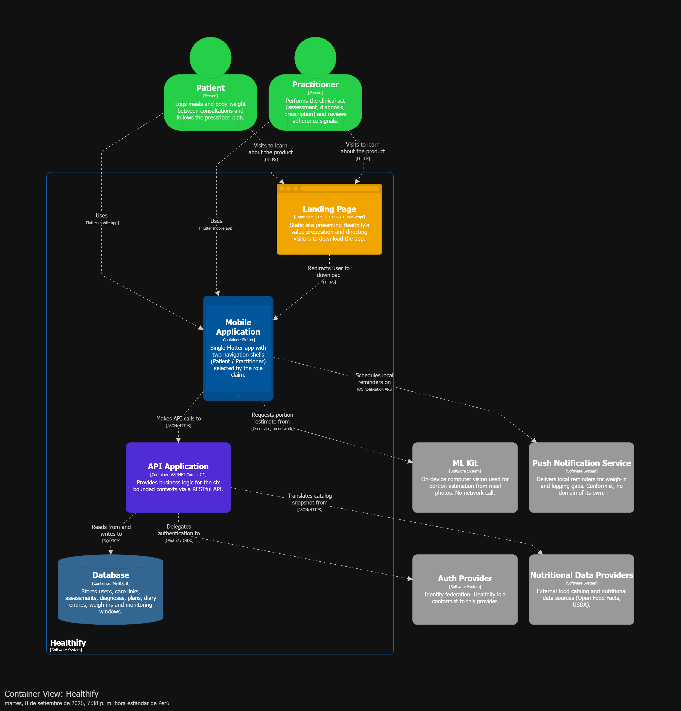

<p class="caption"><strong>Figura 36</strong><br><em>Diagrama de contenedores resumido de Healthify</em></p>

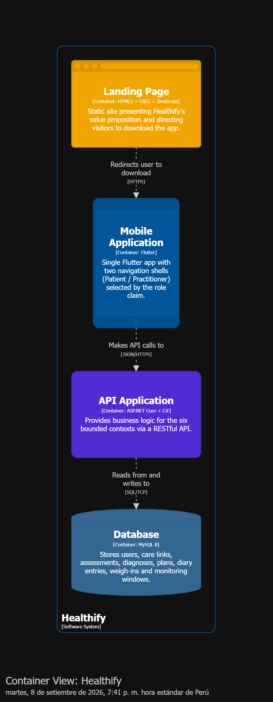

#### 2.5.3.3. Software Architecture Components Diagrams

El Diagrama de Componentes (Nivel 3 del modelo C4) describe la estructura interna de los contenedores principales de Healthify. En esta sección se detallan las capas DDD de cada contenedor, sus responsabilidades específicas y las tecnologías utilizadas.

**A. Mobile Application Components (Frontend)**

La aplicación Flutter se organiza en 6 Bounded Contexts, cada uno con 4 capas siguiendo el patrón de arquitectura del Domain-Driven Design. Además, se tiene un Frontend Shared con 3 capas siguiendo también el patrón de arquitectura del Domain-Driven Design.

El diagrama a continuación muestra todos los componentes de la arquitectura en un único bloque.

<p class="caption"><strong>Figura 37</strong><br><em>Diagrama de componentes del frontend móvil</em></p>

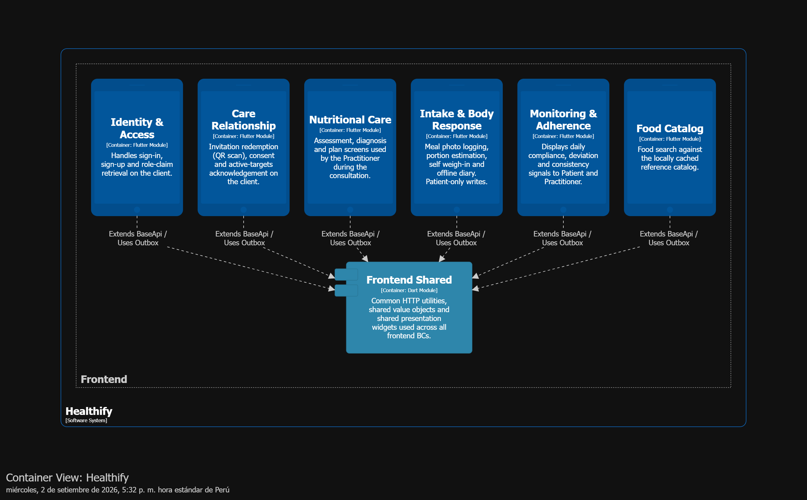

Cada Bounded Context contiene una capa de Presentation con las pantallas y widgets de Flutter, una capa de Application con los servicios Dart que orquestan la lógica del cliente, una capa de Domain con los modelos del lado cliente, y una capa de Infrastructure con el cliente HTTP Dio que se comunica con el API Application. Todos los BCs del frontend utilizan el Frontend Shared, que provee las utilidades BaseApi, el cliente de Outbox y almacenamiento local, los objetos de valor compartidos como units.record y active-targets-cache.record, y los widgets de presentación transversales como el app shell y el selector de navigation shell.

Para apreciar la separación por capas Domain-Driven Design de cada Bounded Context y del Frontend Shared, se presenta a continuación un diagrama de detalle individual por cada uno.

**Frontend Shared:**

Módulo transversal utilizado por todos los Bounded Contexts del frontend que agrupa las utilidades HTTP base, el almacenamiento local, la cola de sincronización Outbox y los widgets de presentación reutilizables. Se organiza en 3 capas DDD: Presentation, Domain e Infrastructure. No contiene lógica de negocio propia.

<p class="caption"><strong>Figura 38</strong><br><em>Diagrama de componentes del módulo Shared del frontend</em></p>

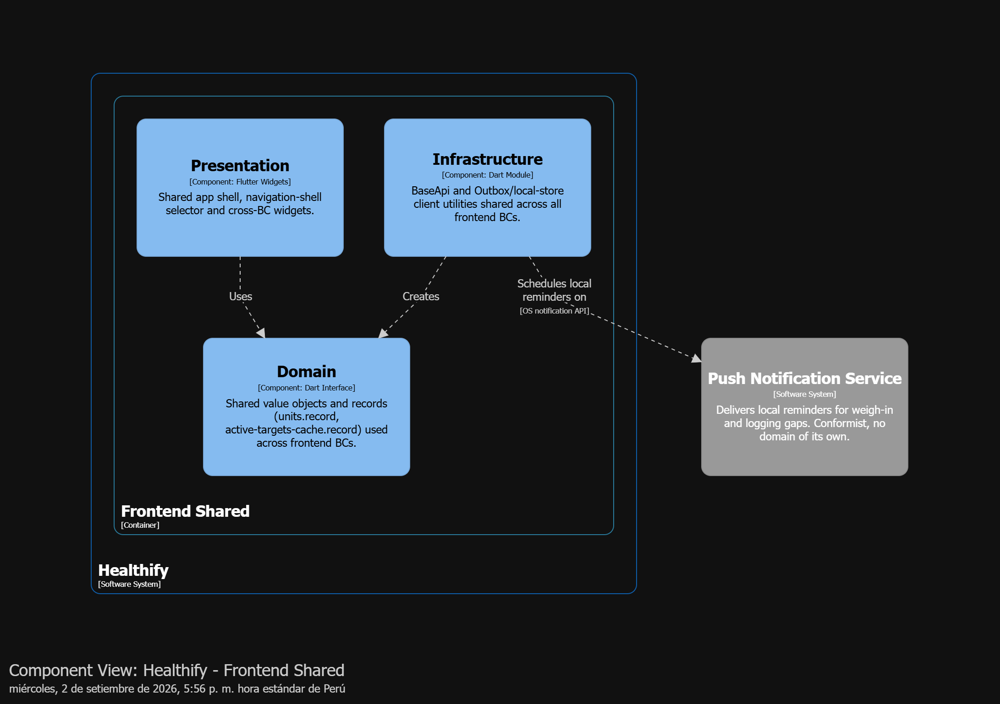

La capa Presentation del Frontend Shared agrupa las vistas y componentes Flutter reutilizables a lo largo de toda la aplicación. El detalle de sus vistas y componentes se presenta a continuación:

 - **Views:**

   <p class="caption"><strong>Figura 39</strong><br><em>Diagrama de componentes del módulo Shared del frontend: vistas</em></p>

   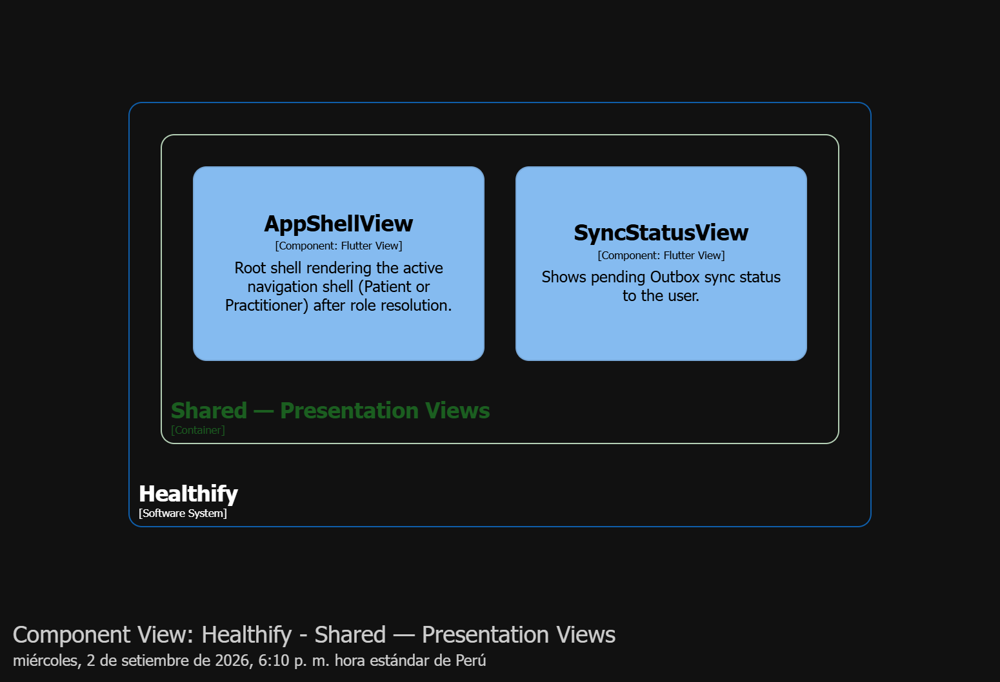

 - **Components:**

   <p class="caption"><strong>Figura 40</strong><br><em>Diagrama de componentes del módulo Shared del frontend: componentes</em></p>

   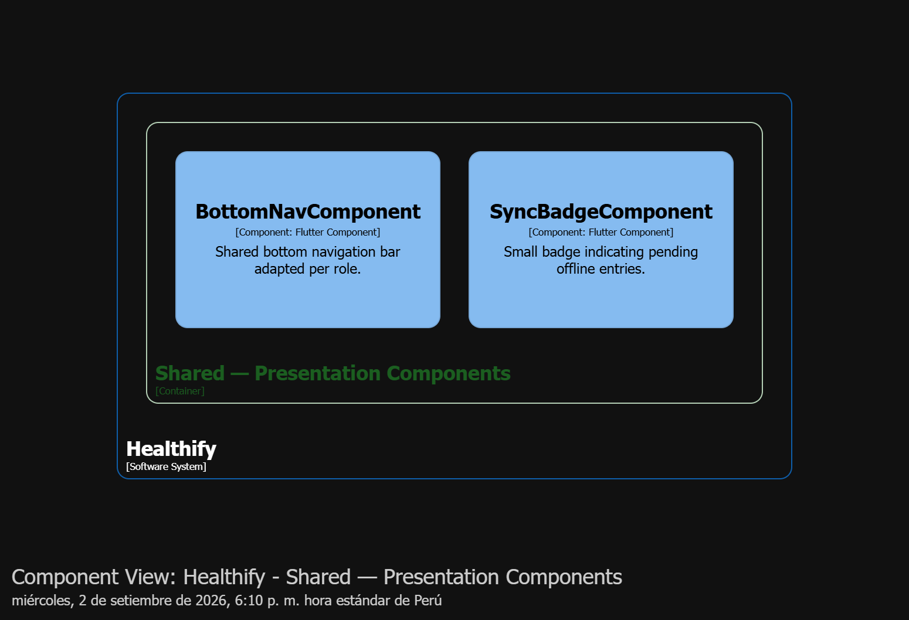

**Bounded Contexts:**

 - **IAM:** Gestiona las pantallas de inicio de sesión y registro.

   <p class="caption"><strong>Figura 41</strong><br><em>Diagrama de componentes del frontend del bounded context IAM</em></p>

   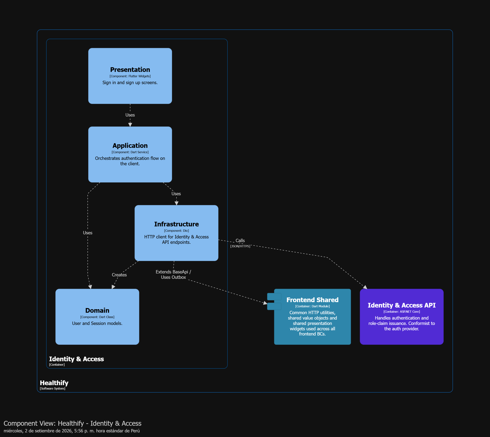

   La capa Presentation contiene únicamente vistas Flutter para este Bounded Context. El detalle de sus vistas se presenta a continuación:

   - **Views:**

     <p class="caption"><strong>Figura 42</strong><br><em>Diagrama de vistas de la capa Presentation del bounded context IAM</em></p>

     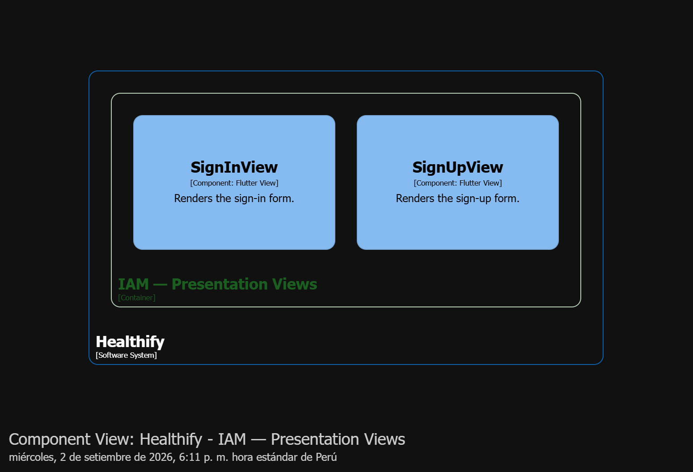

 - **Care Relationship:** Gestiona el escaneo del código QR de invitación, el consentimiento del paciente y el reconocimiento de metas activas.

   <p class="caption"><strong>Figura 43</strong><br><em>Diagrama de componentes del frontend del bounded context Care Relationship</em></p>

   

   La capa Presentation contiene vistas y componentes Flutter para este Bounded Context. El detalle de sus vistas y componentes se presenta a continuación:

   - **Views:**

     <p class="caption"><strong>Figura 44</strong><br><em>Diagrama de vistas de la capa Presentation del bounded context Care Relationship</em></p>

     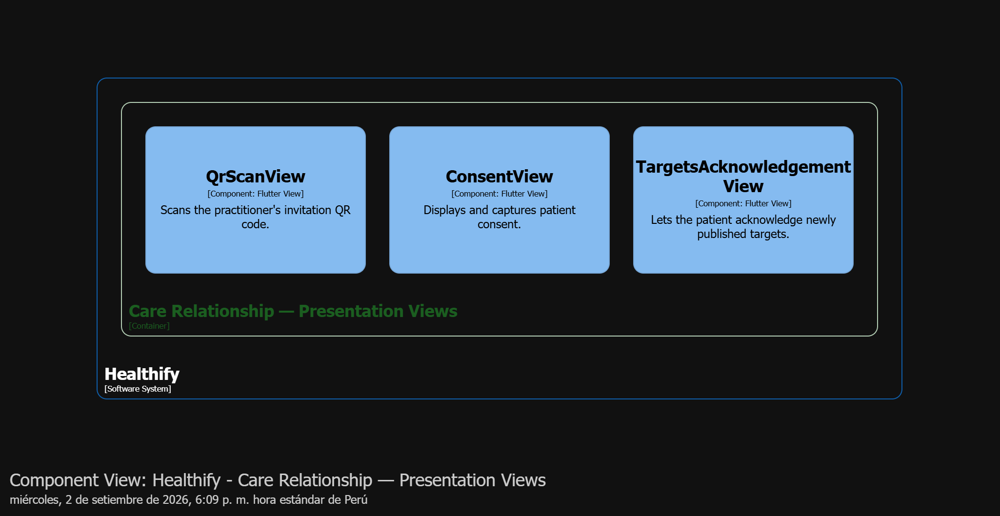

   - **Components:**

     <p class="caption"><strong>Figura 45</strong><br><em>Diagrama de componentes de la capa Presentation del bounded context Care Relationship</em></p>

     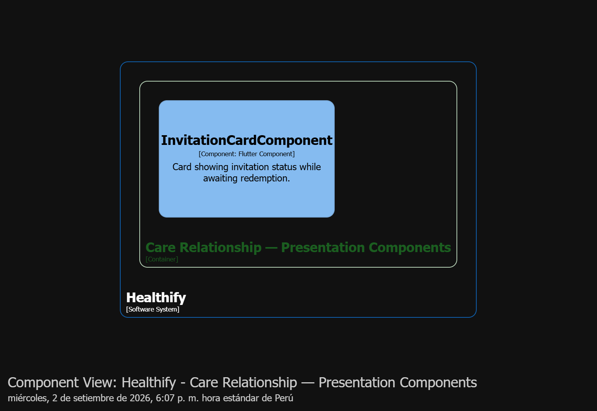

 - **Nutritional Care:** Gestiona las pantallas de evaluación, diagnóstico y prescripción del plan, usadas por el Practitioner durante la consulta.

   <p class="caption"><strong>Figura 46</strong><br><em>Diagrama de componentes del frontend del bounded context Nutritional Care</em></p>

   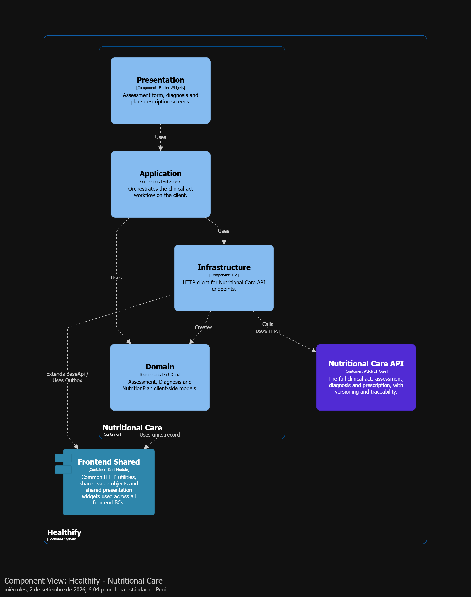

   La capa Presentation contiene vistas y componentes Flutter para este Bounded Context. El detalle de sus vistas y componentes se presenta a continuación:

   - **Views:**

     <p class="caption"><strong>Figura 47</strong><br><em>Diagrama de vistas de la capa Presentation del bounded context Nutritional Care</em></p>

     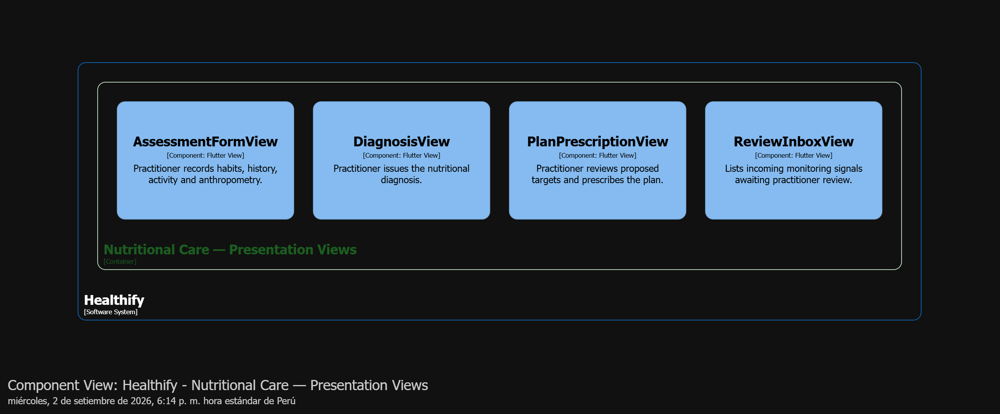

   - **Components:**

     <p class="caption"><strong>Figura 48</strong><br><em>Diagrama de componentes de la capa Presentation del bounded context Nutritional Care</em></p>

     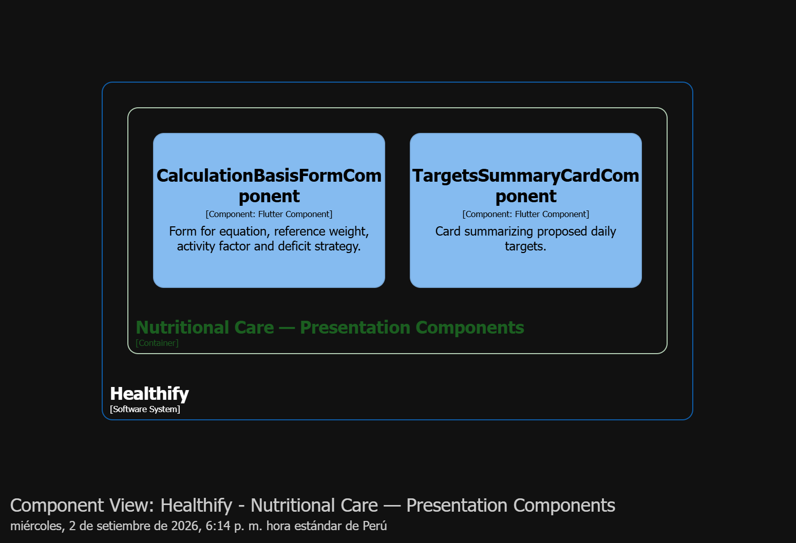

 - **Intake & Body Response:** Gestiona el registro de comidas por foto, la estimación de porción, el autopesaje y el diario offline. Escritura exclusiva del Patient.

   <p class="caption"><strong>Figura 49</strong><br><em>Diagrama de componentes del frontend del bounded context Intake &amp; Body Response</em></p>

   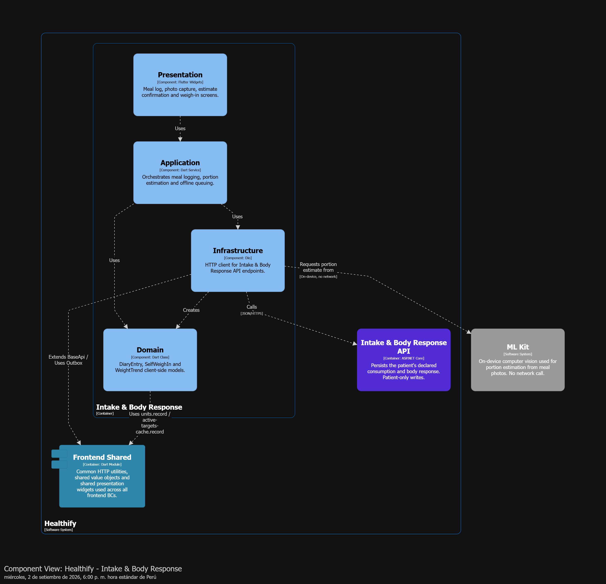

   La capa Presentation contiene vistas y componentes Flutter para este Bounded Context. El detalle de sus vistas y componentes se presenta a continuación:

   - **Views:**

     <p class="caption"><strong>Figura 50</strong><br><em>Diagrama de vistas de la capa Presentation del bounded context Intake &amp; Body Response</em></p>

     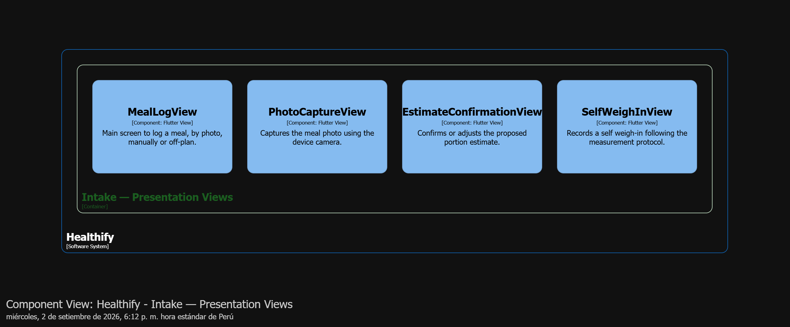

   - **Components:**

     <p class="caption"><strong>Figura 51</strong><br><em>Diagrama de componentes de la capa Presentation del bounded context Intake &amp; Body Response</em></p>

     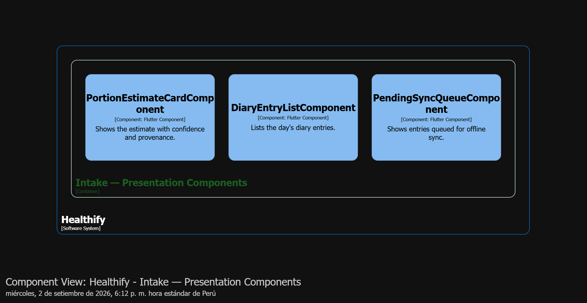

 - **Monitoring & Adherence:** Gestiona el indicador de cumplimiento diario y el panel de monitoreo del paciente.

   <p class="caption"><strong>Figura 52</strong><br><em>Diagrama de componentes del frontend del bounded context Monitoring &amp; Adherence</em></p>

   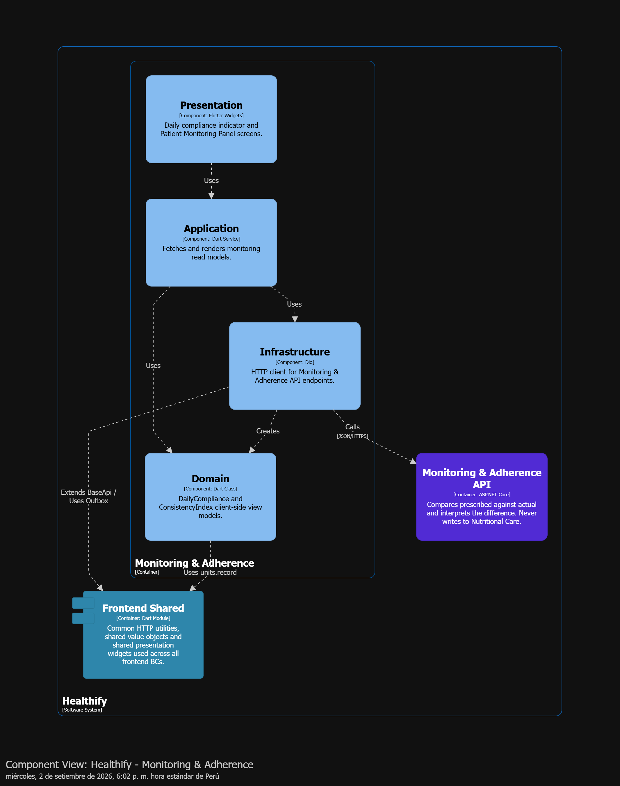

   La capa Presentation contiene vistas y componentes Flutter para este Bounded Context. El detalle de sus vistas y componentes se presenta a continuación:

   - **Views:**

     <p class="caption"><strong>Figura 53</strong><br><em>Diagrama de vistas de la capa Presentation del bounded context Monitoring &amp; Adherence</em></p>

     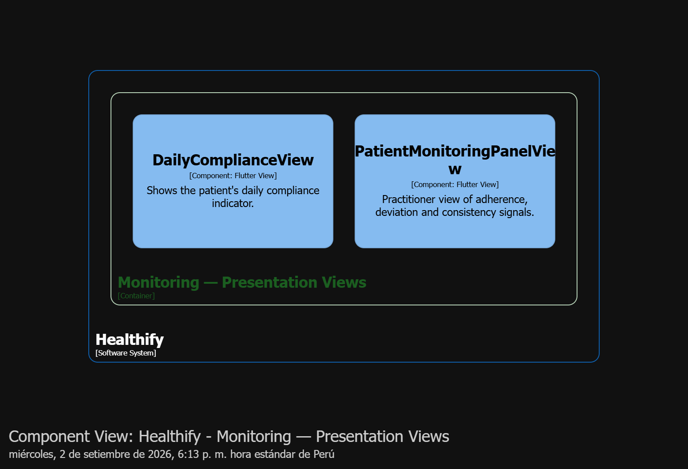

   - **Components:**

     <p class="caption"><strong>Figura 54</strong><br><em>Diagrama de componentes de la capa Presentation del bounded context Monitoring &amp; Adherence</em></p>

     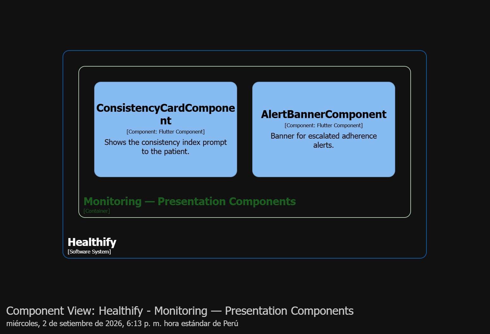

 - **Food Catalog:** Gestiona la búsqueda de alimentos contra el catálogo de referencia cacheado localmente.

   <p class="caption"><strong>Figura 55</strong><br><em>Diagrama de componentes del frontend del bounded context Food Catalog</em></p>

   

   La capa Presentation contiene vistas y componentes Flutter para este Bounded Context. El detalle de sus vistas y componentes se presenta a continuación:

   - **Views:**

     <p class="caption"><strong>Figura 56</strong><br><em>Diagrama de vistas de la capa Presentation del bounded context Food Catalog</em></p>

     

   - **Components:**

     <p class="caption"><strong>Figura 57</strong><br><em>Diagrama de componentes de la capa Presentation del bounded context Food Catalog</em></p>

     

**B. API Application Components (Backend)**

El backend se organiza en 6 Bounded Contexts y un Shared Kernel, cada uno siguiendo el patrón de arquitectura del Domain-Driven Design. Todos los Bounded Contexts comparten una única base de datos MySQL 8.4, accedida a través de los repositorios de Entity Framework Core 10 en la capa de Infrastructure de cada uno.

El diagrama a continuación muestra todos los componentes de la arquitectura en un único bloque.

<p class="caption"><strong>Figura 58</strong><br><em>Diagrama de componentes del backend</em></p>


Cada Bounded Context contiene una capa de Interfaces con los Controllers de ASP.NET Core que reciben las peticiones HTTP y, cuando corresponde, las fachadas ACL que exponen contratos a otros Bounded Contexts; una capa de Application con los servicios y comandos que orquestan los casos de uso; una capa de Domain con los agregados y entidades del dominio; y una capa de Infrastructure con los repositorios de Entity Framework Core. Todos los BCs del backend utilizan el Shared Kernel a través de su capa Application.

Para apreciar la separación por capas Domain-Driven Design de cada Bounded Context y del Shared Kernel, se presenta a continuación un diagrama de detalle individual por cada uno.

El detalle individual se acota a la capa de Interfaces porque es la única que expone la comunicación entre Bounded Contexts: las fachadas ACL representan los contratos que un contexto ofrece a los demás y los Controllers REST definen los puntos de entrada hacia el exterior. Las capas de Application, Domain e Infrastructure encapsulan lógica interna a cada contexto y no forman parte de su frontera de integración, por lo que su descomposición no aporta a la lectura de las relaciones inter-BC en este nivel; dicho detalle interno corresponde a niveles más profundos del modelo C4.

**Shared Kernel:**

Componente transversal utilizado por todos los Bounded Contexts del backend. Es mínimo y deliberado: solo agrupa identificadores (PatientId, PractitionerId, CareLinkId, PlanId) y unidades de medida. No contiene lógica de negocio propia ni acceso a base de datos.

<p class="caption"><strong>Figura 59</strong><br><em>Diagrama de componentes del Shared Kernel</em></p>


**Read Models compuestos (`ReadModels`):**

Módulo de la API que arma las vistas que necesitan datos de más de un Bounded Context. No es un contenedor aparte ni un Bounded Context: no tiene dominio, comandos ni tablas propias, y solo lee a través de las fachadas ACL de los contextos. Se organiza en dos capas:

- **Interfaces:** `PatientRecordController` expone `GET /api/v1/patients/{patientId}/record` (read model Patient Record, para el paciente y su nutricionista vinculado) y `PatientMonitoringPanelController` expone `GET /api/v1/patients/{patientId}/monitoring-panel` (read model Patient Monitoring Panel, solo para el rol `Practitioner`). Ambos verifican el vínculo activo con `ICareRelationshipContextFacade` antes de responder.
- **Application:** `PatientRecordComposer` combina las fachadas de IAM, Care Relationship, Nutritional Care, Intake & Body Response y Monitoring & Adherence; `PatientMonitoringPanelComposer` combina las de Nutritional Care, Intake & Body Response y Monitoring & Adherence.

**Bounded Contexts:**

 - **IAM:** Maneja la autenticación y la emisión del role claim mediante hashing con BCrypt y tokens JWT propios, sin proveedor de identidad externo.

   <p class="caption"><strong>Figura 60</strong><br><em>Diagrama de componentes del backend del bounded context IAM</em></p>

   

   La capa Interfaces contiene un contrato ACL (`IIamContextFacade`, con el que los demás Bounded Contexts resuelven identidades y roles puntuales) y endpoints REST para este Bounded Context. El detalle de los endpoints REST se presenta a continuación:

   - **REST:**

     <p class="caption"><strong>Figura 61</strong><br><em>Diagrama de componentes REST del bounded context IAM</em></p>

     

 - **Care Relationship:** Única fuente de verdad sobre quién puede ver a quién. Aplica el principio de asimetría entre paciente y profesional.

   <p class="caption"><strong>Figura 62</strong><br><em>Diagrama de componentes del backend del bounded context Care Relationship</em></p>

   

   La capa Interfaces contiene un contrato ACL y endpoints REST para este Bounded Context. El detalle se presenta a continuación:

   - **ACL:**

     <p class="caption"><strong>Figura 63</strong><br><em>Diagrama de componentes ACL del bounded context Care Relationship</em></p>

     

   - **REST:**

     <p class="caption"><strong>Figura 64</strong><br><em>Diagrama de componentes REST del bounded context Care Relationship</em></p>

     

 - **Nutritional Care:** Ejecuta el acto clínico completo: evaluación, diagnóstico y prescripción, con versionado y trazabilidad.

   <p class="caption"><strong>Figura 65</strong><br><em>Diagrama de componentes del backend del bounded context Nutritional Care</em></p>

   

   La capa Interfaces contiene un contrato ACL y endpoints REST para este Bounded Context. El detalle se presenta a continuación:

   - **ACL:**

     <p class="caption"><strong>Figura 66</strong><br><em>Diagrama de componentes ACL del bounded context Nutritional Care</em></p>

     

   - **REST:**

     <p class="caption"><strong>Figura 67</strong><br><em>Diagrama de componentes REST del bounded context Nutritional Care</em></p>

     

 - **Intake & Body Response:** Persiste el consumo declarado del paciente y su respuesta corporal. Escritura exclusiva del paciente.

   <p class="caption"><strong>Figura 68</strong><br><em>Diagrama de componentes del backend del bounded context Intake &amp; Body Response</em></p>

   

   La capa Interfaces contiene un contrato ACL y endpoints REST para este Bounded Context. El detalle se presenta a continuación:

   - **ACL:**

     <p class="caption"><strong>Figura 69</strong><br><em>Diagrama de componentes ACL del bounded context Intake &amp; Body Response</em></p>

     

   - **REST:**

     <p class="caption"><strong>Figura 70</strong><br><em>Diagrama de componentes REST del bounded context Intake &amp; Body Response</em></p>

     

 - **Monitoring & Adherence:** Compara lo prescrito contra lo real e interpreta la diferencia. Nunca escribe directamente sobre Nutritional Care.

   <p class="caption"><strong>Figura 71</strong><br><em>Diagrama de componentes del backend del bounded context Monitoring &amp; Adherence</em></p>

   

   La capa Interfaces contiene un contrato ACL y endpoints REST para este Bounded Context. El detalle se presenta a continuación:

   - **ACL:**

     <p class="caption"><strong>Figura 72</strong><br><em>Diagrama de componentes ACL del bounded context Monitoring &amp; Adherence</em></p>

     

   - **REST:**

     <p class="caption"><strong>Figura 73</strong><br><em>Diagrama de componentes REST del bounded context Monitoring &amp; Adherence</em></p>

     

 - **Food Catalog:** Traduce el catálogo externo hacia el dominio y lo cachea. Aplica Anticorruption Layer frente a Open Food Facts y USDA.

   <p class="caption"><strong>Figura 74</strong><br><em>Diagrama de componentes del backend del bounded context Food Catalog</em></p>

   

   La capa Interfaces contiene un contrato ACL y endpoints REST para este Bounded Context. El detalle se presenta a continuación:

   - **ACL:**

     <p class="caption"><strong>Figura 75</strong><br><em>Diagrama de componentes ACL del bounded context Food Catalog</em></p>

     

   - **REST:**

     <p class="caption"><strong>Figura 76</strong><br><em>Diagrama de componentes REST del bounded context Food Catalog</em></p>

     

#### 2.5.3.4. Software Architecture Deployment Diagram

El Deployment Diagram (diagrama suplementario del modelo C4) muestra la distribución física de Healthify sobre la infraestructura y los entornos de ejecución: los dispositivos, servidores y contenedores que alojan cada artefacto de software, y los protocolos con que se comunican. El fuente está en `docs/c4-diagrams/deployment.puml`.

**Elementos:**

- **Patient's / Practitioner's Android Device:** Dispositivo del paciente o del nutricionista, con Android 7.0 (API 24) o superior. Ejecuta la aplicación nativa `Healthify` (Kotlin y Jetpack Compose, paquete `pe.edu.upc.healthify`), que atiende a ambos roles.
- **Practitioner's Android Device:** Dispositivo del nutricionista que ejecuta `Healthify Practitioner` (Flutter y Dart, paquete `pe.edu.upc.healthify.practitioner`), una aplicación solo para el rol nutricionista.
- **Firebase App Distribution:** Servicio de Google Cloud que guarda los APK firmados de ambas aplicaciones y los entrega al grupo de prueba `qa`.
- **GitHub:** Organización `upc-pre-202620-1acc0238-13981-nutrisync`, con dos nodos:
   - **GitHub Pages:** Aloja el `Landing Page` (HTML5, CSS3 y JavaScript) en `landing.healthify.lat`.
   - **GitHub Actions:** Ejecuta los flujos `CI`, `Distribute` y `Release`: análisis estático, pruebas, compilación firmada y versiones en GitHub.
- **Oracle Cloud Infrastructure:** Nodo de nube que agrupa la infraestructura del backend en `platform.healthify.lat`.
   - **Compute Instance:** Máquina virtual que hospeda el `Docker Engine`.
   - **Docker Engine:** Entorno de contenedores orquestado con Docker Compose, con dos contenedores:
      - **healthify-api:** Imagen `mcr.microsoft.com/dotnet/aspnet:10.0` en el puerto 8080, que aloja el `Healthify Platform API` (ASP.NET Core 10) con su API REST `/api/v1` y Swagger.
      - **healthify-mysql:** Imagen `mysql:8.4` con volumen persistente, que aloja la base de datos `healthify`.
- **Sistemas externos:** Google Gemini API (funciones de IA, apagadas por defecto), Open Food Facts y USDA FoodData Central (catálogos de alimentos) y un servidor SMTP (correo de recuperación de contraseña).

**Relaciones:**

- `Healthify → Healthify Platform API` y `Healthify Practitioner → Healthify Platform API` (`JSON/HTTPS`): ambas aplicaciones consumen la API RESTful del backend.
- `GitHub Actions → Firebase App Distribution` (`HTTPS`): el flujo `Distribute` de cada aplicación sube el APK firmado en cada push a `main`.
- `Firebase App Distribution → dispositivos Android` (`HTTPS`): los usuarios del grupo `qa` instalan el APK desde la invitación de Firebase.
- `Landing Page → Firebase App Distribution` (`HTTPS`): los botones de descarga del landing page enlazan a esa invitación.
- `Healthify Platform API → Healthify Database` (`SQL/TCP 3306`): la API se conecta a MySQL por la red interna de Docker, aunque corren en contenedores distintos.
- `Healthify Platform API → sistemas externos`: genera texto con Gemini y busca alimentos en Open Food Facts y USDA (`JSON/HTTPS`), y envía los códigos de recuperación por SMTP (puerto 587).

<p class="caption"><strong>Figura 77</strong><br><em>Diagrama de despliegue de Healthify</em></p>


## 2.6. Tactical-Level Domain-Driven Design

### 2.6.1. Bounded Context: Intake & Body Response

#### 2.6.1.1. Domain Layer

El bounded context Intake & Body Response, implementado en `Healthify.Platform.IntakeBodyResponse`, es el diario del paciente: guarda las comidas que declara haber consumido, los autopesajes que se toma en casa y una copia local de los objetivos que le publicó su nutricionista. Su Domain Layer tiene cinco aggregate roots (`ActiveTargetsCache`, `DiaryEntry`, `SelfWeighIn`, `WeightTrend` y `MealPhotoAnalysis`), sus value objects, 16 commands, 13 queries, 15 domain events, el enum `IntakeError` y cinco abstracciones de repositorio. El contexto registra y no evalúa: ningún atributo ni método habla de cumplimiento, desviación o racha. La comparación entre lo prescrito y lo comido le corresponde a Monitoring & Adherence.

**Aggregates (Aggregate Roots)**

`ActiveTargetsCache` es la copia que el paciente guarda del contrato publicado por el profesional. Hay un caché por paciente, que actúa como raíz y como clave, y se reemplaza en el sitio cada vez que llega una versión nueva del plan. Gracias a esa copia la app puede mostrar los objetivos del día sin conexión.

<p class="caption"><strong>Tabla 92</strong><br><em>Atributos de ActiveTargetsCache</em></p>

| Atributo | Tipo | Scope | Descripción |
|---|---|---|---|
| `PatientId` | `int` | `public get / private set` | Identidad del agregado y clave primaria. |
| `PlanVersion` | `int` | `public get / private set` | Versión del contrato cacheado. |
| `ValidFrom` | `DateTimeOffset` | `public get / private set` | Vigencia declarada por el contrato. |
| `EnergyKcal`, `ProteinG`, `CarbG`, `FatG` | `decimal` | `public get / private set` | Objetivos diarios de energía y macronutrientes. |
| `RefreshedAt` | `DateTimeOffset` | `public get / private set` | Momento del último refresco. |
| `Guidelines`, `Restrictions` | `IReadOnlyList<string>` | `public` (computada) | Indicaciones y restricciones como texto, que este contexto no interpreta. |
| `GuidelineItems` | `IReadOnlyList<CachedGuideline>` | `public` (computada) | Indicaciones que distinguen un código del catálogo de un texto propio del profesional. |
| `LegacyRestrictions` | `IReadOnlyList<string>` | `public` (computada) | Restricciones en texto libre anteriores a la lista cerrada, que el paciente sigue viendo. |
| `ChangesFromPrevious` | `IReadOnlyList<CachedPlanChange>?` | `public` (computada) | Cambios respecto de la versión anterior del plan. |
| `PatientMessage` | `string?` | `public get / private set` | Mensaje del nutricionista para el paciente. |

<p class="caption"><strong>Tabla 93</strong><br><em>Métodos de ActiveTargetsCache</em></p>

| Método | Scope | Descripción |
|---|---|---|
| `ActiveTargetsCache(RefreshActiveTargetsCacheCommand)` | `public` | Constructor que delega en `Apply`. |
| `Refresh(RefreshActiveTargetsCacheCommand)` | `public` | Reemplaza el caché cuando llega una versión más nueva del contrato. |
| `Apply(RefreshActiveTargetsCacheCommand)` | `private` | Valida que versión y energía sean positivas, redondea y normaliza las listas. |

Las reglas *Published Contract Only* y *Diagnosis And Basis Never Cached* se cumplen por la forma de la clase: no tiene campos para el diagnóstico, el razonamiento clínico, la ecuación ni el déficit, así que esa información no puede llegar al caché.

`DiaryEntry` es el registro de un consumo declarado por el paciente y es el agregado central del contexto.

<p class="caption"><strong>Tabla 94</strong><br><em>Atributos de DiaryEntry</em></p>

| Atributo | Tipo | Scope | Descripción |
|---|---|---|---|
| `Id` | `DiaryEntryId` | `public get / private set` | Identidad tipada. |
| `PatientId` | `int` | `public get / private set` | Referencia cross-context. |
| `LocalTimestamp` | `DateTime` | `public get / private set` | Fecha y hora local del dispositivo en el momento del registro. |
| `LocalUtcOffsetMinutes` | `int` | `public get / private set` | Offset declarado por el dispositivo. |
| `DeclaredLocalTimestamp` | `DateTimeOffset` | `public` (computada) | El momento reconstruido, que el servidor nunca reescribe. |
| `Provenance` | `Provenance` | `public get / private set` | `Photo`, `Manual` u `OffPlan`; este último solo existe para entradas antiguas. |
| `PlanAdherence` | `PlanAdherence` | `public get / private set` | Lo que el paciente declaró sobre si la comida estaba en su plan: `InPlan`, `OffPlan` o `NotAnswered`. |
| `PhotoRef` | `string?` | `public get / private set` | Referencia a la foto que conserva el cliente; el servidor no guarda imágenes. |
| `ProposedReferenceFoodId`, `ProposedPortionGrams`, `ProposedConfidence`, `ProposedEstimatedAt` | nullable | `public get / private set` | Columnas planas del VO `ProposedEstimate`. |
| `ConfirmedReferenceFoodId`, `ConfirmedPortionGrams`, `ConfirmedAt` | nullable | `public get / private set` | Columnas planas del VO `ConfirmedEstimate`. |
| `SyncState` | `SyncState` | `public get / private set` | `Pending`, `Synced` o `Conflicted`. |
| `ClientEntryId` | `Guid?` | `public get / private set` | Identificador generado por el dispositivo, que vuelve idempotente el registro y la sincronización. |
| `MealGroupId` | `Guid?` | `public get / private set` | Agrupa los alimentos registrados como una sola comida. |
| `Origin` | `EntryOrigin?` | `public get / private set` | Origen del grupo, por ejemplo `MealIdea`. |
| `MealPhotoAnalysisId`, `ProposedAiGenerationId` | `Guid?`, `long?` | `public get / private set` | Análisis de foto y generación de IA de los que salió la propuesta. |
| `ProposedEstimate`, `ConfirmedEstimate` | VO nullable | `public` (computada) | Los VO reconstruidos desde las columnas planas. |
| `HasProposedEstimate`, `HasConfirmedEstimate` | `bool` | `public` (computada) | Indican si hay propuesta o confirmación. |
| `LocalDate` | `DateOnly` | `public` (computada) | El día de calendario del paciente, no el del servidor. |

<p class="caption"><strong>Tabla 95</strong><br><em>Métodos de DiaryEntry</em></p>

| Método | Scope | Reglas que aplica |
|---|---|---|
| `DiaryEntry(int, LocalTimestamp, Provenance, SyncState, string?, Guid?)` | `public` | *Local Timestamp Required* y *Provenance Required*. Rechaza `Provenance.OffPlan` para entradas nuevas. |
| `LegacyOffPlan(int, LocalTimestamp, SyncState, Guid?)` | `public static` | Crea una entrada `OffPlan` sin alimento ni porción. Solo la usa la sincronización de clientes antiguos. |
| `ProposeEstimate(ProposedEstimate)` | `public` | *Estimate Stored As Proposal Only*: una propuesta no puede llegar después de que el paciente se pronunció. |
| `ConfirmProposedEstimate(PlanAdherence)` | `public` | *Proposal Kept Alongside Confirmation*: copia la propuesta como confirmación sin tocar sus columnas. Exige respuesta de adherencia. |
| `AdjustProposedEstimate(int, decimal, PlanAdherence)` | `public` | Escribe la corrección al lado de la propuesta, de modo que el tamaño de la corrección queda visible. |
| `ConfirmDirectly(ConfirmedEstimate, PlanAdherence)` | `public` | Registro manual, donde lo que el paciente teclea ya es una confirmación. |
| `ConfirmFromLegacySync(ConfirmedEstimate)` | `public` | Confirma entradas de clientes antiguos que no envían adherencia. |
| `JoinMealGroup(Guid, EntryOrigin?)` | `public` | Asocia la entrada a un grupo de comida. |
| `RecordPhotoAnalysis(Guid, long)` | `public` | Guarda de qué análisis de foto y de qué generación de IA salió la propuesta. |
| `MarkSynchronized()` / `MarkConflicted()` | `public` | Transiciones de sincronización. |
| `ResolveWithLatest(int, decimal, DateTimeOffset, PlanAdherence?) : bool` | `public` | *Last Write Wins* sobre el estimado; el momento declarado no se puede cambiar desde aquí. |
| `RefuseLegacyOffPlan(Provenance)`, `RequireAnswer(PlanAdherence)`, `StoreConfirmation(int, decimal)` | `private` | Guardas internas y aplanado del VO confirmado en columnas. |

El agregado no tiene método para eliminar entradas. Así se aplica *Diary Entry Cannot Be Deleted*: el historial se conserva completo para que el seguimiento se pueda interpretar.

`SelfWeighIn` es una lectura de peso que el paciente se tomó a sí mismo, sin supervisión y en una báscula desconocida. El contexto no la trata como medición clínica y guarda junto a ella lo que el paciente declaró sobre las condiciones de la toma.

<p class="caption"><strong>Tabla 96</strong><br><em>Atributos de SelfWeighIn</em></p>

| Atributo | Tipo | Scope | Descripción |
|---|---|---|---|
| `Id` | `SelfWeighInId` | `public get / private set` | Identidad tipada. |
| `PatientId` | `int` | `public get / private set` | Referencia cross-context. |
| `ValueKg` | `decimal` | `public get / private set` | La lectura declarada. |
| `ClientEntryId` | `Guid?` | `public get / private set` | Identificador del dispositivo para la sincronización idempotente. |
| `LocalTimestamp` / `LocalUtcOffsetMinutes` | `DateTime` / `int` | `public get / private set` | Mismo tratamiento que en `DiaryEntry`. |
| `ProtocolFastedState` | `bool` | `public get / private set` | Si la toma fue en ayunas. |
| `ProtocolSameTimeOfDay`, `ProtocolSameScale` | `bool?` | `public get / private set` | Condiciones opcionales; quedan en `null` si el cliente no las envía. |
| `ProtocolCompliance` | `ProtocolCompliance` | `public` (computada) | El VO reconstruido desde las tres columnas. |
| `FollowsProtocol` | `bool` | `public` (computada) | Cumplimiento según el protocolo por defecto, que solo exige ayuno. |
| `DeclaredLocalTimestamp`, `LocalDate` | `DateTimeOffset`, `DateOnly` | `public` (computada) | Momento y día locales reconstruidos. |

El método `FollowsProtocolUnder(SelfWeighInProtocol)` evalúa la lectura contra el protocolo configurado. Por la regla *Excluded Weigh Ins Are Kept As Data*, una lectura fuera de protocolo se guarda completa aunque no entre en la tendencia.

`WeightTrend` es la serie de peso suavizada del paciente y la forma en que este contexto publica el peso corporal. El paciente es la raíz.

<p class="caption"><strong>Tabla 97</strong><br><em>Atributos de WeightTrend</em></p>

| Atributo | Tipo | Scope | Descripción |
|---|---|---|---|
| `DefaultWindowSize` | `const int = 7` | `public` | Siete días absorben el ritmo semanal sin ocultar un cambio real. |
| `PatientId` | `int` | `public get / private set` | Clave primaria. |
| `WindowSize` | `int` | `public get / private set` | Largo de la media móvil. |
| `LastRecalculatedAt` | `DateTimeOffset` | `public get / private set` | Momento del último cálculo. |
| `Points` | `IReadOnlyList<WeightTrendPoint>` | `public` (computada) | La serie suavizada, de lo más antiguo a lo más reciente. |
| `HasPoints` | `bool` | `public` (computada) | Indica si la serie tiene al menos un punto. |

<p class="caption"><strong>Tabla 98</strong><br><em>Métodos de WeightTrend</em></p>

| Método | Scope | Descripción |
|---|---|---|
| `WeightTrend(int patientId, int windowSize = DefaultWindowSize)` | `public` | Exige una ventana positiva. |
| `Recalculate(IReadOnlyList<SelfWeighIn>, SelfWeighInProtocol? = null) : IReadOnlyList<int>` | `public` | Separa las lecturas que no cumplen el protocolo (por defecto, solo ayuno) y devuelve sus identificadores, toma la última lectura de cada día, calcula la media móvil y reconstruye la serie completa. Se reconstruye en lugar de anexar porque una lectura tardía cambia los puntos que la rodean. |
| `SummarizeLastWeeks(DateOnly, int, IEnumerable<SelfWeighIn>, SelfWeighInProtocol?) : WeightTrendRange` | `public` | Resume las últimas semanas: pendiente, cambio y cantidad de lecturas excluidas. |
| `SummarizeBetween(DateOnly, DateOnly, IEnumerable<SelfWeighIn>, SelfWeighInProtocol?) : WeightTrendRange` | `public` | El mismo resumen para un rango fijo de fechas. |
| `SummarizeSince(DateOnly) : WeightTrendSummary` | `public` | Pendiente y cambio desde una fecha. |

El filtrado vive dentro del agregado, que recibe todas las lecturas y devuelve las que excluyó; el servicio de aplicación nunca decide qué cuenta.

`MealPhotoAnalysis` guarda por un tiempo limitado el resultado del análisis de una foto de comida: `ReferenceFoodId` del plato reconocido, `EstimatedGrams`, `Confidence`, hasta `MaximumAlternatives = 3` alternativas (`MealPhotoAlternative`), `AiGenerationId` y `ExpiresAt`. Su identidad es un `Guid`. Expone `BelongsTo(int)`, `IsExpiredAt(DateTimeOffset)` y `ToProposal(DateTimeOffset)`, que convierte el análisis en un `ProposedEstimate`. La foto no se almacena, y un análisis vencido no sirve para registrar una comida.

**Value Objects**

<p class="caption"><strong>Tabla 99</strong><br><em>Value objects y clases auxiliares de la capa Domain de Intake &amp; Body Response</em></p>

| Clase | Propósito | Reglas y miembros |
|---|---|---|
| `ProposedEstimate` | Lo que el estimador propone que se comió. Es una propuesta, no un hecho. | `ReferenceFoodId > 0`, `PortionGrams > 0`, `Confidence` y `EstimatedAt`. |
| `ConfirmedEstimate` | Lo que el paciente dijo que comió. | `ReferenceFoodId`, `PortionGrams` y `ConfirmedAt`, sin nivel de confianza. |
| `ProtocolCompliance` | Las condiciones que el paciente declaró en un autopesaje. | `FastedState` obligatorio, `SameTimeOfDay` y `SameScale` opcionales; `FollowsUnder(SelfWeighInProtocol)`. |
| `SelfWeighInProtocol` | Las condiciones que exige el protocolo vigente. | Constantes `Fasted`, `SameTimeOfDay` y `SameScale`; `Default` solo exige `Fasted`; `IsFollowedBy(ProtocolCompliance)`. |
| `WeightTrendPoint` | Un punto de la serie suavizada. | `Date : DateOnly` y `SmoothedValueKg > 0`. |
| `WeightTrendSummary`, `WeightTrendRange` | Resumen de la tendencia en un período. | `SlopeKgPerWeek`, `ChangeKg`, `PointCount`; el rango agrega `From`, `To`, `Weeks` y `ExcludedReadingsCount`, con `DefaultWeeks`, `MaxWeeks` y `ClampWeeks(int?)`. |
| `LocalTimestamp` | El único timestamp que el servidor no posee. | Tolera hasta 24 h de desfase hacia el futuro, porque los relojes de los dispositivos derivan. |
| `Confidence` | Seguridad del estimador, en una escala de 0 a 1. | Sostiene *Confidence Always Attached*. |
| `WeightKg` | Un peso corporal plausible. | `Minimum = 20` y `Maximum = 400`, sobre todo para detectar errores de digitación. |
| `Provenance` | Cómo llegó a existir una entrada. | `Photo`, `Manual` y `OffPlan`. |
| `SyncState` | Estado de la entrada entre el dispositivo y el servidor. | `Pending`, `Synced` y `Conflicted`. |
| `PlanAdherence` | Respuesta del paciente sobre si la comida estaba en el plan. | `InPlan`, `OffPlan` y `NotAnswered`. |
| `EntryOrigin` | De dónde salió un grupo de comida. | `MealIdea`, con `MaximumLength`. |
| `CachedGuideline`, `CachedPlanChange` | Indicaciones y cambios del plan tal como se guardan en el caché. | `Code` / `Custom`; `Type`, `Code`, `Custom`, `Macro`, `From` y `To`. |
| `DailyIntake`, `RemainingTargets` | Totales del día frente a los objetivos y lo que queda. | `RemainingTargets.Of(...)`, `LeavesRoomForAMeal`, `MinimumForAMealKcal = 150` y `EnergyBucketKcal = 50`. |
| `MealIdea`, `MealIdeaIngredient` | Una idea de comida y sus ingredientes. | Nombre, energía, macros, ingredientes con `ReferenceFoodId` opcional, `Why` y `NutrientsFromCatalog`. |
| `MealPhoto`, `MealPhotoAlternative`, `MealPhotoPortion` | La foto recibida, una alternativa reconocida y los límites de porción. | `MealPhoto` acepta JPEG o WebP (`DetectFormat`); `MealPhotoPortion` va de 5 g a 2000 g. |
| `PlanFit`, `PlanFitCandidate`, `PlanFitReason` | Sugerencia de si un alimento cabe en el plan. | `SuggestedAdherence`, `ViolatedRestrictions`, `Reason` (`Fits`, `BreaksRestriction`, `ExceedsRemaining`). |
| `DiaryEntryId`, `SelfWeighInId` | Identidades tipadas. | `Value : int > 0`, `internal static FromRaw(int)` y operadores de conversión. |

**Commands**

Los 16 commands viven en `IntakeCommands.cs`. Para el diario: `LogMealByPhotoCommand`, `EstimatePortionCommand`, `ConfirmEstimateCommand`, `AdjustEstimateCommand`, `LogMealManuallyCommand`, `LogMealGroupManuallyCommand` y `SyncPendingEntriesCommand`. Para el peso: `RecordSelfWeighInCommand`, `SyncSelfWeighInsCommand` y `RecalculateWeightTrendCommand`. Para el plan y la IA: `RefreshActiveTargetsCacheCommand`, `AnalyzeMealPhotoCommand`, `GenerateMealIdeasCommand`, `PurgeMealIdeasCommand`, `PurgeMealPhotoAnalysesCommand` y `PurgeExpiredMealPhotoAnalysesCommand`. Los registros auxiliares `PhotoConfirmation`, `PendingDiaryEntry`, `PendingSelfWeighIn`, `MealGroupOrigin` y `MealGroupItem` acompañan a esos commands. Ya no existe un command para registrar una comida fuera del plan: el paciente lo declara con `PlanAdherence` al confirmar o registrar.

**Queries**

Las 13 queries viven en `IntakeQueries.cs`: `GetActiveTargetsByPatientIdQuery`, `GetDiaryEntriesByPatientIdQuery`, `GetDiaryEntriesByPatientIdBetweenQuery`, `GetDiaryEntryByIdQuery`, `GetWeightTrendByPatientIdQuery`, `GetWeightTrendRangeByPatientIdQuery`, `GetWeightTrendBetweenByPatientIdQuery`, `GetPendingSyncQueueByPatientIdQuery`, `GetFoodNamesQuery`, `GetPlanFitsQuery`, `GetDailyIntakeQuery`, `GetSelfWeighInsByPatientIdQuery` y `GetPatientIdsWithSelfWeighInsQuery`.

**Domain Events**

Los 15 domain events viven en `IntakeEvents.cs` y heredan de `DomainEventBase`: `ActiveTargetsCacheRefreshed`, `MealLogged`, `EstimateProposed`, `EstimateConfirmedByPatient`, `EstimateAdjustedByPatient`, `MealGroupLogged`, `OffPlanEntryLogged`, `SelfWeighInRecorded`, `SelfWeighInBatchSynchronized`, `WeightTrendRecalculated`, `SelfWeighInExcludedFromTrend`, `EntryQueuedOffline`, `EntrySynchronized`, `DiaryBatchSynchronized` y `SyncConflictResolved`. `EstimateProposed` no lo escucha ningún otro contexto: una propuesta no es ingesta, y si cruzara la frontera la conjetura de un modelo se evaluaría como si la hubiera dicho el paciente. `OffPlanEntryLogged` solo se emite para entradas antiguas sincronizadas.

**Errors**

El enum `IntakeError` tiene 34 valores. Además de los del diario (`ReferenceFoodNotResolved`, `RetroactiveLoggingWindowExceeded`, `DuplicatedClientEntryId`, `LocalTimestampCannotBeRewritten`, `DiaryEntryCannotBeDeleted`), incluye los de adherencia (`PlanAdherenceRequired`, `InvalidPlanAdherence`, `InvalidEstimateConfirmation`), los de grupos de comida (`InvalidMealGroupItems`, `InvalidEntryOrigin`, `ClientEntryIdRequired`) y los de foto e ideas (`PhotoRequired`, `UnsupportedPhotoFormat`, `PhotoTooLarge`, `PhotoNotRecognized`, `MealPhotoAnalysisNotFound`, `MealPhotoAnalysisExpired`, `NotEnoughRemaining`, `InvalidLocalDate`). Ninguno califica la cantidad consumida.

**Repositories (abstracciones)**

Las cinco interfaces viven en `IntakeRepositories.cs` y derivan de `IBaseRepository<T>`: `IActiveTargetsCacheRepository`, `IDiaryEntryRepository`, `ISelfWeighInRepository`, `IWeightTrendRepository` e `IMealPhotoAnalysisRepository`. Entre sus operaciones están `FindByClientEntryIdAsync(Guid)`, que hace idempotente la sincronización, `ListUnreconciledByPatientIdAsync(int)`, que alimenta la cola de pendientes, `ListByPatientIdBetweenAsync(int, DateOnly, DateOnly)`, `FindByMealPhotoAnalysisIdAsync(Guid)` y, en el repositorio de análisis, `DeleteByPatientIdAsync(int)` y `DeleteExpiredAsync(DateTimeOffset)`.

**Domain Services**

`IPhotoMetadataStripper.Strip(MealPhoto)` quita los metadatos de la foto antes de enviarla al modelo. `IRestrictionLexicon` detecta restricciones violadas y términos prohibidos en un texto. `ISelfWeighInProtocolProvider` entrega el protocolo de pesaje configurado. `MealIdeaRules` filtra las ideas de comida (mínimo 2, máximo 3 mostradas, tolerancia de 15 % frente al catálogo) y declara el registro `MealNutrients`. `PlanFitRules.Evaluate(...)` decide si un alimento cabe en el plan, con una tolerancia de 100 kcal sobre lo que resta del día.

**Relaciones entre clases:** `DiaryEntry` compone `DiaryEntryId`, `Provenance`, `PlanAdherence` y `SyncState`, y reconstruye 0..1 `ProposedEstimate` y 0..1 `ConfirmedEstimate` desde columnas planas. `SelfWeighIn` compone `SelfWeighInId` y reconstruye `ProtocolCompliance`. `WeightTrend` agrega 0..* `WeightTrendPoint` y usa `SelfWeighIn` solo como parámetro de `Recalculate` y de los métodos de resumen. `MealPhotoAnalysis` agrega 0..3 `MealPhotoAlternative`. Los cinco agregados se refieren entre sí con identificadores planos (`PatientId`, `MealPhotoAnalysisId`) y nunca navegan de una raíz a otra.

#### 2.6.1.2. Interface Layer

La Interface Layer de Intake & Body Response expone el diario a la app móvil del paciente y publica un contrato de solo lectura para los demás bounded contexts. Los cinco controllers llevan `[Authorize(Roles = "Patient")]` y `[Tags("Intake and Body Response")]`, porque el diario lo escribe solo el paciente.

**Controllers**

`DiaryEntriesController` se publica bajo `[Route("api/v1/diary-entries")]`. Recibe las escrituras del diario y traduce `Result<T, IntakeError>` a respuestas HTTP.

<p class="caption"><strong>Tabla 100</strong><br><em>Endpoints de DiaryEntriesController (Intake &amp; Body Response)</em></p>

| Verbo / Ruta | Acción | Respuestas |
|---|---|---|
| `POST /photo-logs` | `LogMealByPhoto(LogMealByPhotoResource)` | 201 · 400 · 401 · 403 · 404 · 409 · 422 |
| `POST /manual-logs` | `LogMealManually(LogMealManuallyResource)` | 201 · 400 · 401 · 403 · 409 · 422 |
| `POST /manual-logs/batch` | `LogMealGroup(LogMealGroupResource)` | 201 `MealGroupLogResource` · 400 · 401 · 403 · 409 · 422 · 500 |
| `POST /{diaryEntryId:int}/estimate-confirmation` | `ConfirmEstimate(int, EstimateConfirmationResource?)` | 200 · 400 · 401 · 403 · 404 · 409 · 422 |
| `POST /{diaryEntryId:int}/estimate-adjustment` | `AdjustEstimate(int, AdjustEstimateResource)` | 200 · 400 · 401 · 403 · 404 · 409 · 422 |
| `POST /synchronization` | `SyncPendingEntries(SyncPendingEntriesResource)` | 200 `SyncOutcomeResource` · 401 · 403 |

`photo-logs` acepta `analysisId` (la propuesta sale del análisis hecho en el servidor), `confirmation`, `planAdherence` y `clientEntryId`. `manual-logs` acepta `planAdherence` y `clientEntryId`. `manual-logs/batch` registra de 1 a 10 alimentos (`MaximumMealGroupItems = 10`) como una sola comida, todos o ninguno. El controller tiene además los métodos privados `FoodNameOf(...)` y `PatientWriteOnly()`. No hay verbo `DELETE`, y `EstimatePortionCommand` no tiene endpoint: solo lo emite la política del subflujo 4.2.

`PatientIntakeController`, bajo `[Route("api/v1/patients")]`, sirve los read models del paciente. Aunque la ruta lleva el `patientId`, la identidad que se confía es siempre la del token.

<p class="caption"><strong>Tabla 101</strong><br><em>Endpoints de PatientIntakeController (Intake &amp; Body Response)</em></p>

| Verbo / Ruta | Acción | Read Model |
|---|---|---|
| `GET /{patientId:int}/active-targets` | `GetActiveTargets(int)` | My Daily Targets |
| `GET /{patientId:int}/diary-entries?date=` | `GetDiaryEntries(int, DateOnly?)` | Daily Diary |
| `GET /{patientId:int}/weight-trend?weeks=` | `GetWeightTrend(int, int weeks = WeightTrendRange.DefaultWeeks)` | Weight Trend Chart |
| `GET /{patientId:int}/pending-sync-queue` | `GetPendingSyncQueue(int)` | Pending Sync Queue |
| `GET /{patientId:int}/daily-intake?date=` | `GetDailyIntake(int, DateOnly)` | Totales del día frente a los objetivos |
| `GET /{patientId:int}/plan-fit?referenceFoodId=&grams=&date=` | `GetPlanFit(int, int, decimal, DateOnly?)` | Sugerencia de si un alimento cabe en el plan |

**Resources**

Las clases de entrada viven en `IntakeResources.cs`: `LogMealByPhotoResource`, `PhotoConfirmationResource`, `LogMealManuallyResource`, `EstimateConfirmationResource`, `AdjustEstimateResource`, `RecordSelfWeighInResource`, `PendingDiaryEntryResource`, `PendingSelfWeighInResource`, `SyncPendingEntriesResource`, `SyncSelfWeighInsResource`, `GenerateMealIdeasResource`, `LogMealGroupResource`, `MealGroupItemResource` y `MealGroupOriginResource`. Las de salida viven en `IntakeReadResources.cs`: `ActiveTargetsResource`, `ActiveGuidelineResource`, `ActivePlanChangeResource`, `DiaryEntryResource`, `SelfWeighInResource`, `WeightTrendPointResource`, `WeightTrendResource`, `SyncedEntryOutcomeResource`, `SyncOutcomeResource`, `SyncedSelfWeighInOutcomeResource`, `SelfWeighInSyncOutcomeResource`, `MealIdeaIngredientResource`, `MealIdeaResource`, `MealIdeasResource`, `MealPhotoAnalysisResource`, `MealPhotoAlternativeResource`, `DailyIntakeResource`, `PlanFitResource` y `MealGroupLogResource`. `WeightTrendResource` no tiene campo para la última lectura ni para el peso de hoy, con lo que aplica *Daily Figure Never Exposed As Headline*; expone la serie, `ExcludedReadingsCount`, `ChangeKgOverRange` y `SlopeKgPerWeek`. `DiaryEntryResource` lleva siempre `Provenance` y `Confidence`, según *Confidence And Provenance Always Exposed*, además de `PlanAdherence` e `IsCountedTowardsTargets`.

**Transform / Assemblers**

`IntakeAssemblers.cs` reúne los command assemblers `LogMealByPhotoCommandAssembler`, `LogMealManuallyCommandAssembler`, `ConfirmEstimateCommandAssembler`, `AdjustEstimateCommandAssembler`, `RecordSelfWeighInCommandAssembler`, `SyncSelfWeighInsCommandAssembler`, `SyncPendingEntriesCommandAssembler` y `LogMealGroupCommandAssembler`; los resource assemblers `ActiveTargetsResourceAssembler`, `DiaryEntryResourceAssembler`, `SelfWeighInResourceAssembler`, `WeightTrendResourceAssembler`, `SyncOutcomeResourceAssembler`, `SelfWeighInSyncOutcomeResourceAssembler`, `MealPhotoAnalysisResourceAssembler`, `DailyIntakeResourceAssembler` y `PlanFitResourceAssembler`; y `MealIdeasResourceAssembler`, que construye el command y el resource de las ideas de comida. Todo command assembler recibe el `patientId` de la sesión autenticada, no del payload.

`IntakeActionResultAssembler.cs` traduce los resultados a HTTP con `ToDiaryEntryResult`, `ToSelfWeighInResult`, `ToSyncResult`, `ToMealGroupResult`, `ToSelfWeighInSyncResult`, `ToNotFoundResult`, `ToAiFailureResult`, `ToAiFunctionResult<T>` y el privado `FailureResult`.

<p class="caption"><strong>Tabla 102</strong><br><em>Mapeo de errores de dominio a códigos HTTP en Intake &amp; Body Response</em></p>

| Errores | Status |
|---|---|
| `ActiveTargetsCacheNotFound`, `DiaryEntryNotFound`, `SelfWeighInNotFound`, `WeightTrendNotFound`, `MealPhotoAnalysisNotFound` | **404** |
| `PatientWriteOnly`, `ActiveCareLinkRequired`; `AiConsentRequired` (de `AiError`) | **403** |
| `EstimateAlreadyConfirmed`, `DuplicatedClientEntryId`, `LocalTimestampCannotBeRewritten`, `DiaryEntryCannotBeDeleted` | **409** |
| `ProvenanceRequired`, `LocalTimestampRequired`, `ConfidenceRequired`, `ImplausibleWeightValue`, `ProtocolComplianceRequired`, `PublishedContractOnly`, `PlanAdherenceRequired`, `InvalidPlanAdherence`, `InvalidEstimateConfirmation`, `ClientEntryIdRequired`, `InvalidLocalDate`, `InvalidMealGroupItems`, `InvalidEntryOrigin`, `PhotoRequired`, `UnsupportedPhotoFormat` | **400** |
| `PhotoTooLarge` | **413** |
| `RetroactiveLoggingWindowExceeded`, `ReferenceFoodNotResolved`, `EstimateNotProposed`, `NotEnoughRemaining`, `PhotoNotRecognized`, `MealPhotoAnalysisExpired` | **422** |
| `AiRateLimited` | **429** |
| `AiOutputRejected` | **502** |
| `AiFeatureDisabled`, `AiProviderUnavailable` | **503** |
| `UnexpectedError` (por defecto) | **500** |

**Endpoints de IA y de autopesaje**

<p class="caption"><strong>Tabla 103</strong><br><em>Endpoints adicionales de Intake &amp; Body Response</em></p>

| Endpoint | Controller | Respuesta | Descripción |
|---|---|---|---|
| `POST /api/v1/patients/{patientId:int}/meal-photo-analyses` | `PatientMealPhotoAnalysesController.AnalyzeMealPhoto(int, IFormFile?, DateOnly?)` | 201 · 400 · 401 · 403 · 413 · 422 · 429 · 500 · 503 | Recibe la foto como `multipart/form-data` (JPEG o WebP, hasta 2 MB por defecto) y devuelve la propuesta con hasta tres alternativas y su `PlanFit`. Usa la política de rate limiting `ai-photo`. |
| `POST /api/v1/patients/{patientId:int}/meal-ideas` | `PatientMealIdeasController.GenerateMealIdeas(int, GenerateMealIdeasResource?)` | 200 · 400 · 401 · 403 · 404 · 422 · 429 · 500 · 502 · 503 | Propone ideas de comida que caben en lo que resta del día. Usa la misma política `ai-photo`. |
| `POST /api/v1/self-weigh-ins` | `SelfWeighInsController.RecordSelfWeighIn(RecordSelfWeighInResource)` | 201 · 400 · 401 · 403 | Registra un autopesaje. |
| `POST /api/v1/self-weigh-ins/synchronization` | `SelfWeighInsController.SyncSelfWeighIns(SyncSelfWeighInsResource)` | 200 `SelfWeighInSyncOutcomeResource` · 401 · 403 | Sincroniza los autopesajes registrados sin conexión. |

`RecalculateWeightTrendCommand` no tiene endpoint: lo dispara la política que escucha `SelfWeighInRecorded`.

**ACL Contract**

`IIntakeContextFacade` declara los DTO `DailyIntakeSummaryItem`, `WeightTrendPointItem`, `WeightTrendSummaryItem`, `DiaryEntryItem`, `DiaryEntryMomentItem`, `DiaryExportEntryItem` y `SelfWeighInExportItem`, y ocho operaciones: `GetDailyIntakeSummary(int, DateOnly)`, `GetWeightTrendPoints(int, int)`, `GetWeightTrendSummary(int, int)`, `GetWeightTrendSummaryBetween(int, DateOnly, DateOnly)`, `GetDiaryEntries(int, DateOnly)`, `GetDiaryEntryMoments(int, DateOnly, DateOnly)`, `GetDiaryExport(int)` y `GetSelfWeighIns(int)`. Es un contrato de solo lectura: ningún otro contexto puede escribir en el diario a través de él. `DailyIntakeSummaryItem` no trae cumplimiento; su campo `HasAnyEntry` permite distinguir un día sin registros de un día registrado que sumó poco, y `OffPlanEntryCount` y `OffPlanEnergyKcal` reportan lo declarado fuera del plan.

**Localización**

Los mensajes localizados se declaran en `IntakeBodyResponse/Resources/IntakeMessages.cs`, clase marcador de los archivos `.resx` en inglés y español. Los errores de IA usan `AiMessages`, de `Shared`.

#### 2.6.1.3. Application Layer

La Application Layer orquesta los subflujos del contexto (4.1 a 4.6) con command services, query services y event handlers que implementan las políticas. Las interfaces públicas viven en `Application/CommandServices/IIntakeCommandServices.cs` y `Application/QueryServices/IIntakeQueryServices.cs`; las implementaciones, en `Application/Internal/...`.

**Command Services**

`ActiveTargetsCacheCommandService` implementa `IActiveTargetsCacheCommandService` y depende de `IActiveTargetsCacheRepository`, `IUnitOfWork`, `ICareRelationshipContextFacade`, `ILogger<...>` e `IMediator`. Su método `Handle(RefreshActiveTargetsCacheCommand)` implementa el subflujo 4.1: valida *Published Contract Only*, exige un `CareLink` activo y, si el vínculo ya no existe, deja el caché como está en lugar de borrarlo. Publica `ActiveTargetsCacheRefreshed`. Este servicio no consulta a Nutritional Care; solo recibe lo que trae el evento publicado.

`DiaryEntryCommandService` implementa `IDiaryEntryCommandService` y depende de `IDiaryEntryRepository`, `IUnitOfWork`, `IFoodCatalogContextFacade`, `IConfiguration`, `ILogger<...>`, `IMediator`, `IMealPhotoAnalysisRepository` y `TimeProvider`. Declara `DefaultRetroactiveLoggingWindowHours = 48` y `MaximumMealGroupItems = 10`.

<p class="caption"><strong>Tabla 104</strong><br><em>Métodos de DiaryEntryCommandService</em></p>

| Método | Subflujo | Comportamiento |
|---|---|---|
| `Handle(LogMealByPhotoCommand)` | 4.2 | Con `AnalysisId`, toma la propuesta del `MealPhotoAnalysis` del paciente y rechaza el análisis vencido; sin él, usa lo que envió el dispositivo. Si llega la confirmación, guarda la entrada ya confirmada con su `PlanAdherence`. Con `ClientEntryId`, un reenvío devuelve la entrada existente. Publica `MealLogged`. |
| `Handle(EstimatePortionCommand)` | 4.2 | Solo lo invoca la política. Resuelve el alimento en Food Catalog (*Food Resolved From Local Catalog*) y llama a `ProposeEstimate`. Publica `EstimateProposed`. |
| `Handle(ConfirmEstimateCommand)` | 4.2 | Verifica, en orden, que la entrada exista, pertenezca al paciente, tenga propuesta y no esté confirmada, y exige `PlanAdherence`. Publica `EstimateConfirmedByPatient`. |
| `Handle(AdjustEstimateCommand)` | 4.2 | Las mismas guardas más la resolución del alimento. Publica `EstimateAdjustedByPatient` y `EstimateConfirmedByPatient`. |
| `Handle(LogMealManuallyCommand)` | 4.3 | Crea la entrada con `Provenance.Manual` y `ConfirmDirectly(...)`. Publica `MealLogged` y `EstimateConfirmedByPatient`. |
| `Handle(LogMealGroupManuallyCommand)` | 4.3 | Registra de 1 a 10 alimentos con la misma hora y el mismo `MealGroupId` en una sola transacción. Una comida que viene de una idea sugerida cuenta como dentro del plan salvo que el paciente diga lo contrario. Publica `MealLogged` y `EstimateConfirmedByPatient` por cada alimento y `MealGroupLogged` para el grupo. |
| `Handle(SyncPendingEntriesCommand)` | 4.6 | Reconcilia el lote que encoló el dispositivo sin conexión y publica `EntrySynchronized`, `SyncConflictResolved`, `EntryQueuedOffline` y, al final, `DiaryBatchSynchronized`. |

Los métodos privados principales son `ReconcileAsync(...)`, núcleo de la sincronización, que verifica el propietario, exige que el `DeclaredLocalTimestamp` coincida y resuelve los conflictos con `ResolveWithLatest`; `MarkSynchronizedAsync(...)`; `ReplayAsync(...)` y `ReplayGroupAsync(...)`, que devuelven lo ya guardado cuando se repite un `ClientEntryId`; `SaveOrFindWinnerAsync(...)`, que resuelve la carrera entre dos envíos iguales; y `BuildLocalTimestamp(...)`, que aplica la ventana retroactiva de `Intake:RetroactiveLoggingWindowHours`. Cada elemento del lote se confirma por separado, así que una entrada rechazada no impide sincronizar las demás.

`SelfWeighInCommandService` depende de `ISelfWeighInRepository`, `ISelfWeighInProtocolProvider`, `IUnitOfWork`, `ILogger<...>` e `IMediator`. `Handle(RecordSelfWeighInCommand)` (subflujo 4.5) valida el rango de peso, construye `ProtocolCompliance` y publica `SelfWeighInRecorded`. `Handle(SyncSelfWeighInsCommand)` registra el lote de forma idempotente por `ClientEntryId` y publica `SelfWeighInBatchSynchronized`. Ninguno rechaza una lectura por inconveniente.

`WeightTrendCommandService`, en el mismo archivo, depende de `IWeightTrendRepository`, `ISelfWeighInRepository`, `ISelfWeighInProtocolProvider`, `IUnitOfWork`, `ILogger<...>` e `IMediator`. `Handle(RecalculateWeightTrendCommand)` carga todas las lecturas, delega en `trend.Recalculate(...)` con el protocolo configurado y publica `WeightTrendRecalculated` y un `SelfWeighInExcludedFromTrend` por cada lectura excluida.

`MealPhotoAnalysisCommandService` implementa `IMealPhotoAnalysisCommandService`. `Handle(AnalyzeMealPhotoCommand)` valida formato y tamaño (`Intake:MealPhoto:MaxBytes`, por defecto 2 MB), quita los metadatos con `IPhotoMetadataStripper`, verifica el consentimiento con `IAiConsentPolicy`, envía la foto a `IAiGenerationPipeline` con los nombres del catálogo como pista (`ICatalogNameHintsCache`), busca el plato en el catálogo local, luego en los proveedores externos y, si no aparece, lo crea como alimento estimado por IA (`CreateAiEstimatedFood`) y guarda un `MealPhotoAnalysis` que vence a las 24 horas por defecto (`Intake:MealPhoto:AnalysisLifetimeHours`). Calcula además el `PlanFit` del plato y de cada alternativa. Los otros dos `Handle` purgan los análisis de un paciente o los vencidos.

`MealIdeasCommandService` implementa `IMealIdeasCommandService`. `Handle(GenerateMealIdeasCommand)` calcula lo que resta del día con `DailyIntakeCalculator`, pide ideas al modelo y filtra cada una con `MealIdeaRules` (energía, restricciones y términos prohibidos de `IRestrictionLexicon`) antes de devolverlas. Guarda el resultado en `IMealIdeasCache` durante dos horas (`CacheLifetime`). `Handle(PurgeMealIdeasCommand)` vacía esa caché para el paciente.

Si la IA está apagada o el paciente no dio su consentimiento, estos dos servicios devuelven un `IntakeAiFailure` y la app sigue con el registro manual.

**Query Services**

`ActiveTargetsCacheQueryService`, `DiaryEntryQueryService`, `SelfWeighInQueryService`, `WeightTrendQueryService`, `DailyIntakeQueryService` y `PlanFitQueryService`, todos en `IntakeQueryServices.cs`, resuelven las 13 queries sin efectos secundarios. `DailyIntakeQueryService` y `PlanFitQueryService` consultan Food Catalog para los nutrientes y usan `TimeProvider` para el día del paciente.

**Event Handlers (políticas)**

Todos los handlers viven en `IntakeEventHandlers.cs` y abren un scope de DI propio, porque las notificaciones se procesan en paralelo y compartir el `DbContext` del request produciría un error de concurrencia.

<p class="caption"><strong>Tabla 105</strong><br><em>Event handlers de Intake &amp; Body Response</em></p>

| Handler | Escucha | Política | Emite |
|---|---|---|---|
| `OnActiveTargetsUpdatedIntakeHandler` | `ActiveTargetsUpdated`, de Nutritional Care | *When Active Targets Updated* (4.1). Es el único punto por el que entra información de Nutritional Care, y entra como evento publicado. | `RefreshActiveTargetsCacheCommand` |
| `OnMealLoggedPhotoEstimationHandler` | `MealLogged`, propio | *When Meal Logged And Provenance Is Photo* (4.2). Ignora las entradas que no son de foto y las que ya llegaron confirmadas. No llama a ningún modelo: guarda como propuesta lo que trae el evento. | `EstimatePortionCommand` |
| `OnSelfWeighInRecordedHandler` | `SelfWeighInRecorded`, propio | *When Self Weigh In Recorded* (4.5). Corre para toda lectura, incluidas las que quedan fuera de protocolo. | `RecalculateWeightTrendCommand` |
| `OnSelfWeighInBatchSynchronizedHandler` | `SelfWeighInBatchSynchronized`, propio | Recalcula la tendencia una vez por lote en lugar de una vez por lectura. | `RecalculateWeightTrendCommand` |
| `OnAiProcessingConsentChangedIntakeHandler` | `AiProcessingConsentChanged`, de Care Relationship | Cuando el paciente retira el consentimiento de IA, borra sus análisis de foto y sus ideas en caché. | `PurgeMealPhotoAnalysesCommand`, `PurgeMealIdeasCommand` |
| `OnAiPreferencesChangedIntakeHandler` | `AiPreferencesChanged`, de Care Relationship | Cuando el paciente apaga una función de IA, borra lo que esa función había dejado. | `PurgeMealPhotoAnalysesCommand`, `PurgeMealIdeasCommand` |

Los dos últimos handlers delegan en las clases internas `MealPhotoAnalysesPurge` y `MealIdeasPurge`, que abren el scope y ejecutan el command correspondiente.

**DTO y piezas auxiliares de aplicación**

`SyncOutcome` y `SyncedEntryOutcome` resumen la sincronización del diario, con los resultados `Created`, `AlreadyPresent`, `ConflictResolved` y `Rejected`; `SelfWeighInSyncOutcome` y `SyncedSelfWeighInOutcome` hacen lo mismo para los autopesajes. `MealGroupLogOutcome`, `WeightTrendView`, `MealIdeasView` y `MealPhotoAnalysisView` son las vistas que devuelven los servicios. `DailyIntakeCalculator.SumAsync(...)` suma los nutrientes del día con base de 100 g (`NutrientBasisGrams`), y `CatalogNameHintsReader` arma la lista de nombres del catálogo que se le pasa al modelo. Las salidas del modelo se reciben como `MealPhotoRecognitionOutput` y `MealIdeasOutput` y se validan con `MealPhotoRecognitionOutputValidator` y `MealIdeasOutputValidator`, que implementan `IAiOutputValidator<T>`. `ICatalogNameHintsCache` e `IMealIdeasCache` son los puertos de caché que implementa la infraestructura.

**ACL Facade**

`IntakeContextFacade` implementa `IIntakeContextFacade` sobre `IDiaryEntryQueryService`, `IWeightTrendQueryService`, `ISelfWeighInQueryService`, `ISelfWeighInProtocolProvider` e `IFoodCatalogContextFacade`. Los totales diarios se calculan aquí y no se almacenan, para no tener una segunda fuente de verdad. Solo cuentan los estimados confirmados, porque una propuesta que el paciente no confirmó no es su consumo. Si el alimento de una entrada no se puede resolver, se conserva su identificador y se omite el nombre.

#### 2.6.1.4. Infrastructure Layer

La Infrastructure Layer contiene la persistencia, el procesamiento de imágenes, las cachés y el léxico de IA, el proveedor del protocolo de pesaje y dos procesos en segundo plano. Las cinco configuraciones de EF Core viven en `IntakeEntityTypeConfigurations.cs` y los cinco repositorios en `IntakeRepositories.cs`.

**Configuraciones de EF Core**

<p class="caption"><strong>Tabla 106</strong><br><em>Configuraciones de EF Core de Intake &amp; Body Response</em></p>

| Clase | Tabla | Decisiones de mapeo |
|---|---|---|
| `ActiveTargetsCacheEntityTypeConfiguration` | `active_targets_caches` | `HasKey(c => c.PatientId)` con `ValueGeneratedNever()`, porque el paciente es la raíz. Los objetivos son `decimal(10,2)` y `patient_message` es `varchar(500)`. Las listas `guidelines`, `restrictions`, `guideline_items`, `legacy_restrictions` y `changes_from_previous` se guardan como columnas `json` desde *backing fields*, con `ValueComparer` estáticos para que EF Core detecte los cambios. `CachedGuidelineJson` define la forma JSON de las indicaciones. |
| `DiaryEntryEntityTypeConfiguration` | `diary_entries` | La PK usa el converter `DiaryEntryId.FromRaw`. `local_timestamp` es `datetime(6)` y se llama exactamente así porque `UtcDateTimeInterceptor` excluye la propiedad `LocalTimestamp`. Conviven las columnas de propuesta (`proposed_confidence` como `decimal(6,4)`, `proposed_ai_generation_id`) y las de confirmación, más `plan_adherence`, `origin`, `meal_group_id` y `meal_photo_analysis_id`. Índices únicos sobre `client_entry_id` y `meal_photo_analysis_id` (MySQL admite varios `NULL` en un índice único), e índices sobre `patient_id`, `local_timestamp`, `meal_group_id` y `(patient_id, local_timestamp)`. |
| `MealPhotoAnalysisEntityTypeConfiguration` | `meal_photo_analyses` | PK `char(36)`. `alternatives` se guarda como `json` mediante el registro privado `AlternativeJson`. Índices sobre `patient_id` y `expires_at`, que usa la purga. |
| `SelfWeighInEntityTypeConfiguration` | `self_weigh_ins` | La PK usa `SelfWeighInId.FromRaw` y `value_kg` es `decimal(10,2)`. `protocol_fasted_state` es obligatorio y las otras dos banderas admiten `NULL`. Índices `ix_self_weigh_ins_patient_id` y el único `ix_self_weigh_ins_patient_id_client_entry_id`. |
| `WeightTrendEntityTypeConfiguration` | `weight_trends` | `HasKey(t => t.PatientId)` con `ValueGeneratedNever()`; `points` se guarda como `json` desde `_points`, con el comparador `PointListComparer`. |

Cada configuración declara `Ignore(...)` sobre las propiedades calculadas, como `DeclaredLocalTimestamp`, `LocalDate`, `ProposedEstimate`, `ConfirmedEstimate`, `HasProposedEstimate`, `ProtocolCompliance`, `FollowsProtocol`, `Points` y `HasPoints`.

**Repositorios (implementaciones)**

<p class="caption"><strong>Tabla 107</strong><br><em>Repositorios de Intake &amp; Body Response</em></p>

| Clase | Detalles de implementación |
|---|---|
| `ActiveTargetsCacheRepository` | `FindByPatientIdAsync`. Como el paciente es la clave, buscar por identificador y por paciente es la misma operación. |
| `DiaryEntryRepository` | `ListByPatientIdAsync` filtra por la fecha local y ordena de forma descendente; `ListByPatientIdBetweenAsync` hace lo mismo para un rango; `FindByClientEntryIdAsync` rechaza `Guid.Empty`; `ListUnreconciledByPatientIdAsync` devuelve las entradas `Pending` o `Conflicted`; `FindByMealPhotoAnalysisIdAsync` busca la entrada de un análisis; `ListMostLoggedReferenceFoodIdsAsync` alimenta las pistas del catálogo para la IA. No sobrescribe ni llama al `Remove` heredado. |
| `MealPhotoAnalysisRepository` | `FindByIdAsync(Guid)`, `DeleteByPatientIdAsync(int)` y `DeleteExpiredAsync(DateTimeOffset)`. |
| `SelfWeighInRepository` | `ListByPatientIdAsync` devuelve todas las lecturas en orden ascendente, porque el agregado decide qué cuenta; `FindByClientEntryIdAsync(int, Guid)` y `ListPatientIdsAsync()` sirven a la sincronización y al job de recálculo. |
| `WeightTrendRepository` | `FindByPatientIdAsync` sobre la clave primaria del paciente. |

Todos heredan de `BaseRepository<T>`; `DiaryEntryRepository`, `MealPhotoAnalysisRepository` y `SelfWeighInRepository` reimplementan de forma explícita `IBaseRepository<T>.FindByIdAsync` para que las llamadas hechas por la interfaz lleguen a la búsqueda por identidad tipada. La base de datos es MySQL 8.4 con convención `snake_case`; `AuditableEntityInterceptor` llena `created_at` y `updated_at`, y `UtcDateTimeInterceptor` normaliza las fechas a UTC salvo `local_timestamp`.

**Servicios externos e infraestructura de IA**

El único servicio externo de este contexto es el modelo de lenguaje Gemini, al que se llega por el módulo de IA de `Shared` (`IAiGenerationPipeline` sobre `GeminiLanguageModelClient`). El servidor recibe la foto, la analiza en memoria sin guardarla y persiste solo la propuesta con su confianza, junto con el identificador de la generación registrada en `ai_generations`.

- **Procesamiento de imágenes:** `PhotoMetadataStripper` implementa `IPhotoMetadataStripper` y reescribe el archivo JPEG o WebP sin EXIF, XMP ni ICC.
- **Cachés y léxico:** `InMemoryMealIdeasCache` implementa `IMealIdeasCache` e `InMemoryCatalogNameHintsCache` implementa `ICatalogNameHintsCache`. `EmbeddedRestrictionLexicon` implementa `IRestrictionLexicon` con los términos que se usan para respetar las restricciones del paciente.
- **Protocolo de pesaje:** `ConfiguredSelfWeighInProtocolProvider` lee `Intake:SelfWeighInProtocol` y, si no hay configuración válida, usa `SelfWeighInProtocol.Default`.
- **Procesos en segundo plano:** `MealPhotoAnalysisPurgeHostedService`, un `BackgroundService`, borra los análisis vencidos cada 60 minutos por defecto (`Scheduling:MealPhotoAnalysisPurgeIntervalMinutes`). `WeightTrendRecalculationJob` recalcula todas las tendencias y devuelve un `WeightTrendRecalculationReport`; se ejecuta a mano con `dotnet Healthify.Platform.dll recalculate-weight-trends`.

#### 2.6.1.5. Bounded Context Software Architecture Component Level Diagrams

**Intake & Body Response**

Component:

<p class="caption"><strong>Figura 78</strong><br><em>Diagrama de componentes del bounded context Intake &amp; Body Response</em></p>


#### 2.6.1.6. Bounded Context Software Architecture Code Level Diagrams

##### 2.6.1.6.1. Bounded Context Domain Layer Class Diagrams

**Intake & Body Response**

Domain:

<p class="caption"><strong>Figura 79</strong><br><em>Diagrama de clases de la capa Domain del bounded context Intake &amp; Body Response</em></p>


Infrastructure:

<p class="caption"><strong>Figura 80</strong><br><em>Diagrama de clases de la capa Infrastructure del bounded context Intake &amp; Body Response</em></p>


Application:

<p class="caption"><strong>Figura 81</strong><br><em>Diagrama de clases de la capa Application del bounded context Intake &amp; Body Response</em></p>


Interfaces:

<p class="caption"><strong>Figura 82</strong><br><em>Diagrama de clases de la capa Interfaces del bounded context Intake &amp; Body Response</em></p>


##### 2.6.1.6.2. Bounded Context Database Design Diagram

**Intake & Body Response**

Database:

<p class="caption"><strong>Figura 83</strong><br><em>Diagrama de base de datos del bounded context Intake &amp; Body Response</em></p>


El diagrama muestra las cinco tablas del contexto y, en gris, las tres tablas ajenas que referencia: `users` (IAM), `reference_foods` (Food Catalog) y `ai_generations` (Shared). Las relaciones con esas tablas, y las que hay entre `weight_trends`, `self_weigh_ins` y `diary_entries`, son referencias lógicas por identificador. La migración no crea ninguna clave foránea en este contexto (en todo el esquema solo hay dos, ambas en Nutritional Care), así que la integridad entre contextos la mantiene la capa de aplicación por ACL y no el motor. Por eso las líneas del diagrama van punteadas. Ninguna tabla del contexto tiene columnas de borrado lógico: los registros se eliminan físicamente. Las columnas `created_at` y `updated_at` admiten `NULL` en el esquema y las llena `AuditableEntityInterceptor`.

`diary_entries` es la tabla central, con `id` autoincremental. Cada fila guarda dos estados de la misma comida: la propuesta (`proposed_reference_food_id`, `proposed_portion_grams`, `proposed_confidence`, `proposed_estimated_at`, `proposed_ai_generation_id`) y la confirmación del paciente (`confirmed_reference_food_id`, `confirmed_portion_grams`, `confirmed_at`). Todas esas columnas admiten `NULL`, porque una entrada manual no tiene propuesta y una propuesta pendiente no tiene confirmación. `provenance`, `sync_state` y `plan_adherence` son `NOT NULL`; `origin` y `photo_ref` no. La hora se guarda como `local_timestamp` (`DATETIME(6)`) junto con `local_utc_offset_minutes`, sin normalizar a UTC, para conservar el día y la hora que vio el paciente; es la única fecha que `UtcDateTimeInterceptor` deja fuera. `meal_group_id` es un `CHAR(36)` con índice no único que agrupa las entradas de una misma comida. No apunta a ninguna tabla. Dos índices únicos sostienen reglas del dominio. `ix_diary_entries_client_entry_id` hace idempotente la sincronización: si la app reenvía una entrada, el servidor la reconoce por `client_entry_id`. `ix_diary_entries_meal_photo_analysis_id` limita cada análisis de foto a una sola entrada, de ahí la cardinalidad `0..1` entre `meal_photo_analyses` y `diary_entries`. MySQL admite varios `NULL` en un índice único, de modo que las entradas sin cliente o sin foto no chocan entre sí. Para las lecturas por día existe el índice compuesto `ix_diary_entries_patient_id_local_timestamp`.

`meal_photo_analyses` guarda el resultado de analizar una foto: `reference_food_id`, `estimated_grams`, `confidence` y la columna JSON `alternatives`, que lista los demás alimentos candidatos. Su clave es un `CHAR(36)` y `ai_generation_id` (`BIGINT`) la liga con el registro de la generación de IA. Las filas son temporales: `expires_at` tiene su propio índice porque `MealPhotoAnalysisPurgeHostedService` borra las vencidas.

`self_weigh_ins` registra los autopesajes (`value_kg`) con la misma pareja de hora local y desplazamiento que el diario. De las tres banderas del protocolo de pesaje, `protocol_fasted_state` es obligatoria y `protocol_same_time_of_day` y `protocol_same_scale` admiten `NULL`. El índice único `ix_self_weigh_ins_patient_id_client_entry_id` es compuesto: la unicidad de `client_entry_id` vale por paciente, no en toda la tabla.

`weight_trends` y `active_targets_caches` usan `patient_id` como clave primaria y no tienen identificador propio, porque hay a lo sumo una fila por paciente (`users` a `0..1`). `weight_trends` es un resultado derivado: `points` es JSON y contiene la serie suavizada que calcula `WeightTrendRecalculationJob` a partir de `self_weigh_ins`, con `window_size` y `last_recalculated_at`. Se vincula con las lecturas solo por `patient_id`. `active_targets_caches` copia los objetivos vigentes del paciente (`energy_kcal`, `protein_g`, `carb_g`, `fat_g`, `plan_version`, `valid_from`, `refreshed_at`) y los guarda con cinco columnas JSON: `guidelines`, `restrictions`, `guideline_items` y `legacy_restrictions` son `NOT NULL`, y `changes_from_previous` admite `NULL`. Guardarlas como JSON permite leer las indicaciones completas sin tablas hijas.

### 2.6.2. Bounded Context: Monitoring & Adherence

#### 2.6.2.1. Domain Layer

El bounded context Monitoring & Adherence, implementado en `Healthify.Platform.MonitoringAdherence`, es el único que compara lo prescrito con lo registrado e interpreta la diferencia. Su Domain Layer tiene siete aggregate roots (`EvaluationWindow`, `Deviation`, `ConsistencyIndex`, `Referral`, `ScheduledFollowUp`, `PreVisitCheckIn` y `WeeklySummary`), 30 commands, 19 queries, 23 domain events y el enum `MonitoringError`. La lógica de interpretación vive dentro de los agregados; los domain services se limitan al calendario clínico y a las reglas que revisan los textos generados con IA. Tres invariantes gobiernan la capa: ninguna desviación se evalúa sobre menos de siete días, el paciente recibe el aviso antes de que una alerta escale al profesional, y una señal escalada nunca modifica un plan.

**Aggregates (Aggregate Roots)**

`EvaluationWindow` es el período sobre el que se compara lo prescrito contra lo registrado. Hay una ventana por relación de cuidado: abre cuando se establece el vínculo y cierra cuando se revoca o termina el tratamiento. Dentro de ella conviven tres series que nunca se mezclan.

<p class="caption"><strong>Tabla 108</strong><br><em>Atributos de EvaluationWindow</em></p>

| Atributo | Tipo | Scope | Descripción |
|---|---|---|---|
| `MinimumDays` | `const int = 7` | `public` | Sostiene el primer invariante. El largo configurado (`Monitoring:EvaluationWindowDays`) puede ser mayor, nunca menor. |
| `Id` | `WindowId` | `public get / private set` | Identidad tipada. |
| `PatientId` / `CareLinkId` | `int` | `public get / private set` | Referencias cross-context. |
| `WindowDays` | `int` | `public get / private set` | Largo con el que abrió la ventana, guardado en la fila para que un cambio de configuración no reinterprete una ventana en curso. |
| `FromDate` / `ToDate` | `DateTime` | `public get / private set` | Extremos de la ventana, guardados a medianoche; `From` y `To` los exponen como `DateOnly`. |
| `State` / `IsOpen` | `WindowState` / `bool` | `public get / private set` | `Open` o `Closed`. |
| `ClosedAt` | `DateTimeOffset?` | `public get / private set` | Momento del cierre. |
| `LastLoggingGapFlaggedOn`, `LastPatientRemindedAt` | nullable | `public get / private set` | Permiten avisar del hueco de registro una sola vez y no en cada ciclo. |
| `TargetsSnapshots` / `TargetsSnapshot` | `IReadOnlyList<TargetsSnapshot>` / `TargetsSnapshot?` | `public` (computada) | Todos los snapshots recibidos, del más antiguo al más nuevo, y el vigente. No se elimina ninguno. |
| `DailyComplianceSeries` | `IReadOnlyList<DailyCompliance>` | `public` (computada) | El resultado día a día. |
| `AnthropometrySeries` | `IReadOnlyList<AnthropometryPoint>` | `public` (computada) | Solo mediciones clínicas; los autopesajes no entran en esta serie. |
| `LoggedDaysCount`, `IntakeSummary` | `int`, `IntakeSummary` | `public` (computada) | Se calculan desde la serie y no se almacenan. |

<p class="caption"><strong>Tabla 109</strong><br><em>Métodos de EvaluationWindow</em></p>

| Método | Scope | Reglas que aplica |
|---|---|---|
| `EvaluationWindow(OpenEvaluationWindowCommand, int, DateOnly)` | `public` | *Minimum Seven Day Window*. |
| `TakeSnapshot(TargetsSnapshot) : bool` | `public` | *Later Adjustment Never Rewrites Evaluated Days*: anexa sin tocar la serie diaria. Devuelve `false` si esa versión ya es la vigente. |
| `SnapshotInForceOn(DateOnly, IFollowUpCalendar) : TargetsSnapshot?` | `public` | *Each Day Evaluated Against That Day Snapshot*. El día en que empieza a regir un snapshot se calcula en el calendario del paciente. |
| `AppendAnthropometryPoint(AnthropometryPoint) : bool` | `public` | *Clinical Measurement Outranks Self Weigh In* y *Two Series Never Merged*; el tipo del parámetro hace cumplir la regla. |
| `RecordDayEvaluation(DailyCompliance) : bool` | `public` | *Late Entry Re Evaluates Its Own Day Only*: una entrada tardía solo reemplaza la evaluación de su día. |
| `DayEvaluation(DateOnly) : DailyCompliance?` | `public` | Devuelve la evaluación guardada de un día. |
| `MarkUnloggedDaysBefore(DateOnly, IFollowUpCalendar) : IReadOnlyList<DailyCompliance>` | `public` | *Day Without Entries Marked Unlogged Not Non Compliant*: marca los días sin entradas como no registrados. |
| `CountingThrough(DateOnly)`, `SpanDays(DateOnly)`, `HasMinimumSpan(DateOnly)` | `public` | *Closed Window Stops Counting Days* y el primer invariante. |
| `HorizonDays(DateOnly) : IReadOnlyList<DailyCompliance>` | `public` | El horizonte móvil sobre el que se juzga una desviación. |
| `LastLoggedDate() : DateOnly?` | `public` | Último día con entradas, que usa la detección de huecos. |
| `FlagLoggingGap(DateOnly) : bool` | `public` | *Gap Is Not A Deviation* y *Gap Never Escalates*: registra la fecha del hueco sin crear desviaciones. |
| `RemindPatient() : bool` | `public` | *Reminder Is Local And Non Accusatory*. |
| `Close(DateTimeOffset)` | `public` | *Evaluated Data Is Preserved*: no se borra ni se recalcula nada. |

`Deviation` modela la diferencia entre lo prescrito y lo registrado cuando supera la tolerancia y se repite en varios días de la ventana.

<p class="caption"><strong>Tabla 110</strong><br><em>Atributos de Deviation</em></p>

| Atributo | Tipo | Scope | Descripción |
|---|---|---|---|
| `Id` | `DeviationId` | `public get / private set` | Identidad tipada. |
| `WindowRef` | `WindowId` | `public get / private set` | La ventana de la que se leyó. |
| `PatientId` | `int` | `public get / private set` | Copiado de la ventana para responder el read model. |
| `MagnitudeRelativeValue`, `MagnitudeEnergyKcal` | `decimal` | `public get / private set` | Columnas planas de `DeviationMagnitude`, que se expone como `Magnitude`. |
| `Direction` | `DeviationDirection` | `public get / private set` | `Above` o `Below`. |
| `DetectedAt` | `DateTimeOffset` | `public get / private set` | Momento de la detección. |
| `IsSustained` / `SustainedAt` | `bool` / `DateTimeOffset?` | `public get / private set` | Sostienen *Sustained If Persists Across Majority Of Window*. |
| `LoggedDaysConsidered`, `DeviatingDaysConsidered` | `int` | `public get / private set` | Los dos conteos con los que se decidió la mayoría, guardados para que la evidencia no se recalcule desde una ventana que ya se movió. |

<p class="caption"><strong>Tabla 111</strong><br><em>Métodos de Deviation</em></p>

| Método | Scope | Descripción |
|---|---|---|
| `Deviation(WindowId, int, DeviationMagnitude, DeviationDirection, int, int)` | `public` | *Only Logged Days Count*. |
| `DetectFrom(WindowId, int, IReadOnlyList<DailyCompliance>) : Deviation?` | `public static` | Descarta los días no registrados, separa las desviaciones por encima de las de por debajo y devuelve `null` si ambas direcciones empatan, porque entonces no hay una tendencia clara. |
| `Restate(DeviationMagnitude, int, int) : bool` | `public` | Vuelve a enunciar la misma desviación sobre un horizonte que se movió; devuelve `false` si nada cambió. |
| `MarkSustained(decimal) : bool` | `public` | Devuelve `true` solo en la transición, así la señal cruza la frontera una sola vez. |
| `Evidence() : string` | `public` | Texto de evidencia para la bandeja del profesional, sin calificar al paciente. |

`ConsistencyIndex` mide qué tan bien concuerdan la serie de peso y la serie de ingesta registrada. El paciente es la raíz.

<p class="caption"><strong>Tabla 112</strong><br><em>Atributos de ConsistencyIndex</em></p>

| Atributo | Tipo | Scope | Descripción |
|---|---|---|---|
| `EnergyKcalPerKg` | `const decimal = 7700m` | `public` | Una regla de dedo igual para todos; sirve como chequeo de consistencia y no como predicción. |
| `PatientId` | `int` | `public get / private set` | Clave primaria. |
| `Value` | `decimal` | `public get / private set` | Movimiento de peso no explicado, en kg por semana. |
| `State` / `IsInAlert` | `ConsistencyState` / `bool` | `public get / private set` | `Normal`, `Watch` o `Alert`. |
| `FirstFlaggedAt`, `AlertSinceAt`, `EscalatedAt` | `DateTimeOffset?` | `public get / private set` | Cronología del episodio. |
| `PromptIssuedAt`, `ShownToPatientAt` | `DateTimeOffset?` | `public get / private set` | Cuándo se emitió el aviso al paciente y cuándo él confirmó haberlo visto. `ShownToPatientAt` es precondición de la escalación. |
| `IsPatientPromptPending` | `bool` | `public` (computada) | Hay un aviso emitido que el paciente todavía no vio. |
| `LastRecomputedAt` | `DateTimeOffset?` | `public get / private set` | Último cálculo. |

<p class="caption"><strong>Tabla 113</strong><br><em>Métodos de ConsistencyIndex</em></p>

| Método | Scope | Descripción |
|---|---|---|
| `ConsistencyIndex(int patientId)` | `public` | Crea el índice en `Normal`. |
| `Recompute(weightSeries, intakeSeries, decimal) : bool` | `public` | Compara el cambio de peso observado con el que implica la ingesta registrada en el período que comparten ambas series. Devuelve `true` solo cuando el índice acaba de entrar en `Alert`. |
| `CanCompute(weightSeries, intakeSeries) : bool` | `public static` | *Both Series Required*. |
| `PromptPatient() : bool` | `public` | *Patient First Always* y *Prompt Date Recorded*. |
| `MarkShownToPatient(DateTimeOffset) : bool` | `public` | Registra que el paciente vio el aviso. |
| `ShownToPatientAtLeast(int, DateTimeOffset) : bool` | `public` | Si pasaron al menos N días desde que el paciente vio el aviso. |
| `ThreeWeeksInAlertElapsed(int, DateTimeOffset) : bool`, `WeeksInAlertAt(DateTimeOffset) : int` | `public` | Reglas de tiempo de la escalación. |
| `Escalate() : bool` | `public` | Lanza una excepción si `ShownToPatientAt` es `null`. Vive en el agregado para que ningún llamador pueda saltárselo. |
| `Evidence() : string` | `public` | Texto de evidencia de la escalación. |
| `NextState(decimal)` / `MoveTo(string)` | `private` | Un umbral no configurado se lee como `Normal`. Al volver a `Normal` se limpian las fechas del episodio, de modo que un episodio posterior se mide desde su inicio y se vuelve a avisar al paciente. |

`Referral` registra la derivación del paciente a otro especialista: `Id : ReferralId`, `PatientId`, `Specialty`, `Reason`, `IssuedBy`, `IssuedAt`, `Status` (`Open` o `Closed`, con `IsOpen`) y `ClosedAt`. Su único método de transición es `Close(DateTimeOffset)`.

`ScheduledFollowUp` es una consulta en la agenda del nutricionista. Guarda `Id : FollowUpId`, `PatientId`, `PractitionerId`, `ScheduledFor`, `State : FollowUpState`, `Modality`, `Preparation`, `ScheduledAt`, `MissedAt`, `CompletedAt`, `CompletedByConsultationId`, `CancelledAt` y `CancellationReason`, con los motivos predefinidos `CancelledByPractitionerReason`, `DischargedReason` y `SwitchedPractitionerReason`. Su constructor exige una fecha futura. Sus métodos son `AcceptsCheckInAt(DateTimeOffset)`, `MarkMissed(DateTimeOffset)`, `MarkCompleted(int, DateTimeOffset)`, `Cancel(string)` y `Reschedule(DateTimeOffset, IReadOnlyList<string>?)`. Una cita perdida no cierra el vínculo de cuidado.

`PreVisitCheckIn` es la respuesta que el paciente deja antes de una consulta: `FollowUpId`, `PatientId`, `PractitionerId`, `Feeling`, `Difficulties`, `Questions` (hasta `MaximumQuestionsPerOrigin = 3` por origen), `SubmittedAt` y `EditedAt`. Hay una respuesta por consulta. `Edit(...)` la modifica, y `IsLockedFor(ScheduledFollowUp, DateTimeOffset)` la bloquea desde la hora de la cita.

`WeeklySummary` es el resumen semanal de un paciente generado con IA: `WeekStart`, `WeekEnd`, `ComplianceFacts`, `Headline`, `WentWell`, `WatchOut`, `AiGenerationId`, `Language` y `GeneratedAt`. Exige al menos `MinimumLoggedDays = 3` días registrados y limita el titular a 200 caracteres, cada punto a 240, los aciertos a 3 y las alertas a 2. `WeekStartOf(DateOnly)` e `IsWeekStart(DateOnly)` fijan la semana en lunes.

**Value Objects**

<p class="caption"><strong>Tabla 114</strong><br><em>Value objects y clases auxiliares de la capa Domain de Monitoring &amp; Adherence</em></p>

| Clase | Propósito | Reglas y miembros |
|---|---|---|
| `TargetsSnapshot` | Copia de los objetivos diarios vigentes en un momento. | `PlanVersion`, `EnergyKcal`, macros y `TakenAt`; `EffectiveFromIn(IFollowUpCalendar)` calcula el día desde el que rige. No incluye diagnóstico, razonamiento clínico ni base de cálculo. |
| `DailyCompliance` | Un día puesto al lado de los objetivos que regían ese día. | Constantes `Met`, `Exceeded`, `Short` y `Unlogged`, con `ToleranceRatio = 0.10m`. `Evaluate(...)` decide si el día está registrado por la presencia de entradas y nunca por los totales; guarda también lo declarado fuera del plan. `SaysTheSameAs(...)` resuelve la idempotencia. |
| `ComplianceSummary`, `ComplianceDay` | Conteo y detalle de un rango de días. | `Of(...)`, `DaysOf(...)`, `IsValidRange(...)` y `MaximumRangeDays`. |
| `AnthropometryPoint` | Un punto de la serie de peso clínica. | `Source` solo admite `ClinicalMeasurement`; con `FromClinicalMeasurement(...)` hace cumplir *Two Series Never Merged*. |
| `IntakeSummary` | Lo que la ventana vio hasta ahora, sumado. | Días registrados y no registrados por separado, con `From(...)`. |
| `DeviationDirection`, `DeviationMagnitude` | Hacia dónde va y qué tan grande es una desviación. | `Above` / `Below`; `RelativeValue ≥ 0` y `AbsoluteEnergyKcal ≥ 0`. |
| `ConsistencyState` | Estado del índice. | `Normal`, `Watch` y `Alert`, que describen la coherencia de los datos y no la conducta del paciente. |
| `WindowState`, `FollowUpState` | Estados de una ventana y de una consulta. | `Open` / `Closed`; `Scheduled`, `Completed`, `Missed` y `Cancelled`. |
| `Specialty`, `ReferralReason` | Destino y motivo de una derivación. | Texto libre de hasta 120 y 1000 caracteres; no hay lista cerrada, para no imponer una clasificación clínica que le toca al profesional. |
| `ConsultationModality`, `PreparationInstruction` | Modalidad e indicaciones de la consulta. | `InPerson` / `Remote`; `Fasting`, `LightClothing`, `BringBloodTests` y `EmptyBladder`. |
| `PlanFeeling`, `CheckInDifficulty`, `PatientQuestion`, `QuestionOrigin` | Contenido de la respuesta previa. | `Good`, `Fair`, `Hard`; `Dinners`, `Weekends`, `EatingOut`, `Schedules`, `Cravings`; pregunta con largo mínimo y máximo; origen `Patient` o `AiSuggested`. |
| `MonitoringPeriodFacts`, `PeriodDayFact`, `MealSlot`, `MealSlotDays` | Hechos calculados de un período, que son lo único que recibe la IA. | `Compute(...)`, `AllowedNumbers()` y `DayCounts()`; franjas `Breakfast`, `Lunch`, `Dinner` y `Other`. |
| `DeclaredOffsetCalendar` | Calendario con el offset que declaró el dispositivo del paciente. | `LocalDateOf(DateTimeOffset)`. |
| `WindowId`, `DeviationId`, `ReferralId`, `FollowUpId`, `PreVisitCheckInId`, `WeeklySummaryId` | Identidades tipadas. | `Value : int > 0` e `internal static FromRaw(int)`. |

**Commands**

Los 30 commands viven en `MonitoringCommands.cs`. Para la ventana y la evaluación: `OpenEvaluationWindowCommand`, `SnapshotActiveTargetsCommand`, `AppendAnthropometryPointCommand`, `EvaluateDayCommand`, `ReEvaluateWindowCommand` (con una sola fecha), `MarkUnloggedDaysBeforeCommand`, `ReEvaluateLoggedDaysCommand`, `FlagLoggingGapCommand`, `RemindPatientCommand` y `CloseEvaluationWindowCommand`. Para desviaciones y consistencia: `DetectDeviationCommand`, `FlagSustainedDeviationCommand`, `RecomputeConsistencyIndexCommand`, `PromptPatientCommand`, `AcknowledgeConsistencyPromptCommand` y `EscalateToPractitionerCommand`. Para derivaciones y agenda: `RecordReferralCommand`, `CloseReferralCommand`, `ScheduleFollowUpCommand`, `RescheduleFollowUpCommand`, `CancelFollowUpCommand`, `CancelFollowUpsForPatientCommand`, `CompleteFollowUpFromConsultationCommand`, `FlagMissedFollowUpCommand` y `SubmitPreVisitCheckInCommand`, con su registro auxiliar `PreVisitCheckInQuestionInput`. Para la IA: `GenerateWeeklySummaryCommand`, `SuggestQuestionsCommand`, `SummarizeMonitoringCommand`, `PurgeMonitoringAiContentCommand` y `PurgeExpiredWeeklySummariesCommand`. El contexto es sobre todo reactivo: la mayoría de estos commands los emiten políticas y no endpoints.

**Queries**

Las 19 queries viven en `MonitoringQueries.cs`. Dieciséis alimentan read models: `GetEvaluationWindowsByPatientIdQuery`, `GetCurrentEvaluationWindowByPatientIdQuery`, `GetDailyComplianceByPatientIdQuery`, `GetDailyComplianceRangeQuery`, `GetDeviationsByPatientIdQuery`, `GetConsistencyIndexByPatientIdQuery`, `GetReferralsByPatientIdQuery`, `GetScheduledFollowUpsByPractitionerIdQuery`, `GetPractitionerAgendaQuery`, `GetScheduledFollowUpsByPatientIdsQuery`, `GetNextFollowUpByPatientIdQuery`, `GetFollowUpsByPatientIdQuery`, `GetScheduledFollowUpByIdQuery`, `GetPreVisitCheckInByFollowUpIdQuery`, `GetLatestPreVisitCheckInQuery` y `GetLatestWeeklySummaryByPatientIdQuery`. Las otras tres alimentan las políticas temporales: `GetOpenEvaluationWindowsQuery`, `GetEscalatableConsistencyIndicesQuery` y `GetOverdueScheduledFollowUpsQuery`.

**Domain Events**

Los 23 domain events viven en `MonitoringEvents.cs`: `EvaluationWindowOpened`, `TargetsSnapshotTaken`, `AnthropometryPointAppended`, `DayEvaluated`, `DailyComplianceComputed`, `WindowReEvaluated`, `DeviationDetected`, `SustainedDeviationDetected`, `ConsistencyIndexRecomputed`, `ConsistencyAlertRaised`, `PatientPromptedAboutConsistency`, `ConsistencyPromptAcknowledged`, `AlertEscalatedToPractitioner`, `LoggingGapDetected`, `PatientReminded`, `ReferralRecorded`, `ReferralClosed`, `FollowUpScheduled`, `FollowUpMissed`, `FollowUpCancelled`, `FollowUpRescheduled`, `PreVisitCheckInSubmitted` y `EvaluationWindowClosed`. Solo dos cruzan la frontera, ambos hacia Nutritional Care: `SustainedDeviationDetected` y `AlertEscalatedToPractitioner`. Ninguno lleva objetivos, ajustes ni instrucciones, porque la decisión la toma el profesional. Ningún otro contexto escucha `LoggingGapDetected` ni `FollowUpMissed`, y así un hueco nunca escala y una visita perdida no cierra el vínculo.

**Errors**

El enum `MonitoringError` tiene 38 valores. Los de la evaluación describen condiciones que impiden interpretar los datos (`InsufficientWindowLength`, `NoLoggedDays`, `BothSeriesRequired`, `TargetsSnapshotMissing`, `ConsistencyThresholdNotConfigured`, `NotEnoughData`). Los demás cubren la agenda (`ScheduledForMustBeInFuture`, `FollowUpNotScheduled`, `CancellationReasonTooLong`, `UnknownConsultationModality`, `UnknownPreparationInstruction`), la respuesta previa (`CheckInLocked`, `FeelingRequired`, `TooManyQuestions`, `InvalidCheckInQuestion`), el aviso de consistencia (`ConsistencyPromptNotIssued`, `PatientAcknowledgementTooRecent`) y las derivaciones (`ReferralNotFound`, `ReferralAlreadyClosed`). Ninguno califica la conducta del paciente.

**Repositories (abstracciones)**

Las siete interfaces viven en `MonitoringRepositories.cs` y derivan de `IBaseRepository<T>`: `IEvaluationWindowRepository`, `IDeviationRepository`, `IConsistencyIndexRepository`, `IReferralRepository`, `IScheduledFollowUpRepository`, `IPreVisitCheckInRepository` e `IWeeklySummaryRepository`. Entre sus operaciones está `FindLatestByWindowAndDirectionAsync`, sin la cual una misma tendencia crearía una fila nueva con cada comida.

**Domain Services**

`IFollowUpCalendar` (`LocalDayOf`, `LocalDateOf`) convierte un instante en el día clínico. `IAiLanguageLexicon` entrega los términos que un texto generado no puede contener. `GeneratedTextRules` comprueba esos términos (`TermsIn`) y rechaza cualquier número que no esté en los hechos del período (`NumbersNotInFacts`).

**Relaciones entre clases:** `EvaluationWindow` compone `WindowId` y `WindowState` y agrega 0..* `TargetsSnapshot`, 0..* `DailyCompliance` y 0..* `AnthropometryPoint`, tres series independientes serializadas como JSON. `Deviation` referencia la ventana por `WindowRef : WindowId`, sin navegación, y compone `DeviationMagnitude` y `DeviationDirection`. `ConsistencyIndex` compone `ConsistencyState` y usa la serie diaria y la de peso solo como parámetros de `Recompute`. `Referral` compone `Specialty` y `ReferralReason`. `ScheduledFollowUp` compone `FollowUpState`, `ConsultationModality` y 0..* `PreparationInstruction`. `PreVisitCheckIn` referencia la consulta por `FollowUpId` y compone `PlanFeeling`, 0..* `CheckInDifficulty` y 0..* `PatientQuestion`. `WeeklySummary` guarda un `MonitoringPeriodFacts` en `ComplianceFacts`.

#### 2.6.2.2. Interface Layer

La Interface Layer de Monitoring & Adherence tiene poca escritura y mucha lectura, porque el contexto es reactivo. Sus siete controllers usan `[Tags("Monitoring and Adherence")]` y trasladan a la API el principio *Patient First Always*.

**Controllers**

`PatientMonitoringController` se publica bajo `[Route("api/v1/patients")] [Authorize]` y depende de `IEvaluationWindowQueryService`, `IDeviationQueryService`, `IConsistencyIndexQueryService`, `IReferralQueryService`, `ICareRelationshipContextFacade` e `IStringLocalizer<MonitoringMessages>`.

<p class="caption"><strong>Tabla 115</strong><br><em>Endpoints de PatientMonitoringController (Monitoring &amp; Adherence)</em></p>

| Verbo / Ruta | Acción | Rol | Read Model |
|---|---|---|---|
| `GET /{patientId:int}/evaluation-windows` | `GetEvaluationWindows(int)` | Ambos participantes | Patient Monitoring Panel |
| `GET /{patientId:int}/evaluation-windows/current` | `GetCurrentEvaluationWindow(int)` | Ambos participantes | Patient Monitoring Panel |
| `GET /{patientId:int}/daily-compliance?date=&from=&to=` | `GetDailyCompliance(int, DateOnly?, DateOnly?, DateOnly?)` | `Patient` | Daily Compliance Indicator; con `from` y `to` devuelve el rango y su resumen |
| `GET /{patientId:int}/deviations` | `GetDeviations(int)` | `Practitioner` | Patient Monitoring Panel, sección de desviaciones |
| `GET /{patientId:int}/consistency-index` | `GetConsistencyIndex(int)` | `Patient` | Consistency Card |
| `GET /{patientId:int}/referrals` | `GetReferrals(int)` | Ambos participantes | Patient Record, sección de derivaciones |

Los permisos son asimétricos: el paciente ve su indicador diario y su tarjeta de consistencia, y el profesional ve las desviaciones.

`ReferralsController`, bajo `[Route("api/v1/referrals")] [Authorize(Roles = "Practitioner")]`, expone `POST /` con `RecordReferral(RecordReferralResource)` y `POST /{referralId:int}/closure` con `CloseReferral(int)`.

`ScheduledFollowUpsController`, bajo `[Route("api/v1/scheduled-follow-ups")] [Authorize(Roles = "Practitioner")]`, expone `POST /` con `ScheduleFollowUp(ScheduleFollowUpResource)`, `POST /{followUpId:int}/cancellation`, `POST /{followUpId:int}/rescheduling` y `GET /api/v1/practitioners/{practitionerId:int}/scheduled-follow-ups`, que sirve la agenda del profesional con una ruta absoluta. `FlagMissedFollowUpCommand` no tiene endpoint: lo emite la política temporal.

**Resources**

`MonitoringResources.cs` contiene las clases de entrada `RecordReferralResource`, `ScheduleFollowUpResource`, `CancelFollowUpResource`, `RescheduleFollowUpResource`, `SubmitPreVisitCheckInResource` y `CheckInQuestionInputResource`. `MonitoringReadResources.cs` contiene las de salida: `DailyComplianceResource`, `DailyComplianceRangeResource`, `ComplianceDayResource`, `ComplianceSummaryResource`, `TargetsSnapshotResource`, `AnthropometryPointResource`, `IntakeSummaryResource`, `EvaluationWindowResource`, `DeviationResource`, `ConsistencyIndexResource`, `ReferralResource`, `ScheduledFollowUpResource`, `PatientFollowUpResource`, `CheckInQuestionResource`, `PreVisitCheckInResource`, `WeeklySummaryFactsResource`, `WeeklySummaryResource`, `SuggestedQuestionResource`, `SuggestedQuestionsResource`, `MonitoringSummaryFactsResource` y `MonitoringSummaryResource`.

**Transform / Assemblers**

`MonitoringAssemblers.cs` reúne los command assemblers `RecordReferralCommandAssembler`, `CloseReferralCommandAssembler`, `ScheduleFollowUpCommandAssembler`, `SubmitPreVisitCheckInCommandAssembler` y `FollowUpChangeCommandAssembler`; los query assemblers `PractitionerAgendaQueryAssembler`, `PatientFollowUpsQueryAssembler` y `DailyComplianceRangeQueryAssembler`; y los resource assemblers `DailyComplianceResourceAssembler`, `DailyComplianceRangeResourceAssembler`, `ComplianceSummaryResourceAssembler`, `TargetsSnapshotResourceAssembler`, `AnthropometryPointResourceAssembler`, `EvaluationWindowResourceAssembler`, `DeviationResourceAssembler`, `ConsistencyIndexResourceAssembler`, `ReferralResourceAssembler`, `ScheduledFollowUpResourceAssembler`, `PatientFollowUpResourceAssembler`, `PreVisitCheckInResourceAssembler`, `WeeklySummaryResourceAssembler`, `SuggestedQuestionsResourceAssembler` y `MonitoringSummaryResourceAssembler`. `MonitoringActionResultAssembler.cs` expone `ToReferralResult`, `ToScheduledFollowUpResult`, `ToPreVisitCheckInResult`, `ToNotFoundResult`, `ToAiFailureResult`, `ToAiFunctionResult<T>` y el privado `FailureResult`, y es el único lugar donde `MonitoringError` se convierte en código HTTP.

<p class="caption"><strong>Tabla 116</strong><br><em>Mapeo de errores de dominio a códigos HTTP en Monitoring &amp; Adherence</em></p>

| Errores | Status |
|---|---|
| `EvaluationWindowNotFound`, `DeviationNotFound`, `ScheduledFollowUpNotFound`, `PreVisitCheckInNotFound`, `ReferralNotFound`, `NotEnoughData` | **404** |
| `ActiveCareLinkRequired`; `AiConsentRequired` (de `AiError`) | **403** |
| `PatientAlreadyHasOpenWindow`, `PatientAlreadyHasActiveScheduledFollowUp`, `FollowUpNotScheduled`, `CheckInLocked`, `WindowClosed`, `ClosedWindowCannotBeReopened`, `DayAlreadyEvaluated`, `ReferralAlreadyClosed`, `ConsistencyPromptNotIssued` | **409** |
| `SpecialtyAndReasonRequired`, `WindowShorterThanMinimum`, `UnknownPreparationInstruction`, `UnknownConsultationModality`, `InvalidFollowUpState`, `ScheduledForMustBeInFuture`, `CancellationReasonTooLong`, `InvalidComplianceRange`, `FeelingRequired`, `TooManyQuestions`, `UnknownCheckInDifficulty`, `InvalidCheckInQuestion`, `InvalidWeekStart` | **400** |
| `TargetsSnapshotMissing`, `InsufficientWindowLength`, `NoLoggedDays`, `BothSeriesRequired`, `ConsistencyThresholdNotConfigured`, `PatientPromptRequiredBeforeEscalation`, `ThreeWeeksInAlertRequired`, `PatientAcknowledgementTooRecent` | **422** |
| `AiRateLimited` | **429** |
| `AiOutputRejected` | **502** |
| `AiFeatureDisabled`, `AiProviderUnavailable` | **503** |
| `UnexpectedError` (por defecto) | **500** |

**Endpoints de agenda, respuesta previa e IA**

<p class="caption"><strong>Tabla 117</strong><br><em>Endpoints adicionales de Monitoring &amp; Adherence</em></p>

| Endpoint | Controller | Respuesta | Descripción |
|---|---|---|---|
| `PUT /api/v1/scheduled-follow-ups/{followUpId:int}/check-in` | `FollowUpCheckInController.SubmitCheckIn` | 200 · 400 · 401 · 403 · 404 · 409 | Respuesta previa del paciente (rol `Patient`); se bloquea desde la hora de la consulta. |
| `GET /api/v1/scheduled-follow-ups/{followUpId:int}/check-in` | `FollowUpCheckInController.GetCheckIn` | 200 · 401 · 403 · 404 | La lee el paciente o el profesional. |
| `POST /api/v1/scheduled-follow-ups/{followUpId:int}/cancellation` | `ScheduledFollowUpsController.CancelFollowUp` | 204 · 400 · 401 · 403 · 404 · 409 | Cancela una consulta. |
| `POST /api/v1/scheduled-follow-ups/{followUpId:int}/rescheduling` | `ScheduledFollowUpsController.RescheduleFollowUp` | 200 · 400 · 401 · 403 · 404 · 409 | Reprograma una consulta. |
| `GET /api/v1/patients/{patientId:int}/scheduled-follow-ups` y `/next` | `PatientScheduledFollowUpsController` | 200 · 400 · 401 · 403 · 404 | Consultas del paciente, para `Patient` y `Practitioner`. |
| `POST /api/v1/patients/{patientId:int}/consistency-index/prompt-acknowledgement` | `ConsistencyPromptController.AcknowledgePrompt` | 204 · 401 · 403 · 409 · 500 | El paciente confirma haber visto el aviso de consistencia. |
| `GET /api/v1/patients/{patientId:int}/weekly-summaries/latest` | `PatientAiSummariesController.GetLatestWeeklySummary` | 200 · 401 · 403 · 404 · 503 | Último resumen semanal del paciente. |
| `GET /api/v1/patients/{patientId:int}/suggested-questions` | `PatientAiSummariesController.GetSuggestedQuestions` | 200 · 401 · 403 · 404 · 429 · 502 · 503 | Preguntas sugeridas al paciente para su próxima consulta. |
| `GET /api/v1/patients/{patientId:int}/monitoring-summary` | `PatientAiSummariesController.GetMonitoringSummary` | 200 · 400 · 401 · 403 · 429 · 502 · 503 | Resumen del período para el nutricionista. |

Los dos endpoints que generan texto con IA usan la política de rate limiting `ai-photo`. La agenda recibe `preparation` y `modality` y rechaza con 400 una fecha que no es futura.

**ACL Contract**

`IMonitoringContextFacade` declara los DTO `DailyComplianceItem`, `ConsistencyStateItem`, `AnthropometryPointItem`, `ReferralItem`, `NextFollowUpItem`, `ComplianceSummaryItem`, `ComplianceRangeItem`, `CheckInQuestionItem`, `PreVisitCheckInItem` y `FollowUpHistoryItem`, y las operaciones `GetDailyComplianceSeries`, `GetConsistencyState`, `GetAnthropometrySeries`, `GetAnthropometrySeriesPoints`, `GetReferrals`, `GetNextFollowUpsByPatientIds`, `GetComplianceSummary`, `GetComplianceRange`, `GetLatestCheckInForPatient` y `GetFollowUpHistory`. Es de solo lectura y no expone desviaciones ni su evidencia: estas cruzan la frontera solo como eventos, una vez y cuando ya son sostenidas. Así no hay un segundo camino por el que una señal llegue a una decisión clínica. `ConsistencyStateItem` incluye la fecha en que el paciente vio el aviso y la de la escalación, porque el invariante exige que la primera ocurra antes.

**Localización**

Los mensajes localizados se declaran en `MonitoringAdherence/Resources/MonitoringMessages.cs`, que incluye los textos del recordatorio y del aviso al paciente, redactados sin reproche. Los errores de IA usan `AiMessages`, de `Shared`.

#### 2.6.2.3. Application Layer

La Application Layer orquesta los subflujos 5.1 a 5.11 y es la que más event handlers tiene en la plataforma: 19 políticas disparadas por eventos, 15 de ellas por eventos de otros bounded contexts, más cinco procesos temporales en Infrastructure. Las interfaces viven en `Application/CommandServices/IMonitoringCommandServices.cs` y `Application/QueryServices/IMonitoringQueryServices.cs`.

**Command Services**

`EvaluationWindowCommandService` depende de `IEvaluationWindowRepository`, `IIntakeContextFacade`, `IUnitOfWork`, `IConfiguration`, `ILogger<...>`, `IMediator` e `IFollowUpCalendar`. Compara lo prescrito con lo registrado: lee lo registrado por el ACL de Intake & Body Response y lo prescrito desde los snapshots de la ventana, sin modificar ninguno de los dos.

<p class="caption"><strong>Tabla 118</strong><br><em>Métodos de EvaluationWindowCommandService</em></p>

| Método | Subflujo | Comportamiento |
|---|---|---|
| `Handle(OpenEvaluationWindowCommand)` | 5.1 | *Minimum Seven Day Window* y *One Open Window Per Patient*. Publica `EvaluationWindowOpened`. |
| `Handle(SnapshotActiveTargetsCommand)` | 5.2 | Construye el `TargetsSnapshot` y lo anexa sin tocar la serie diaria. Publica `TargetsSnapshotTaken`. |
| `Handle(AppendAnthropometryPointCommand)` | 5.3 | Añade el punto clínico. Publica `AnthropometryPointAppended`. |
| `Handle(EvaluateDayCommand)` | 5.4 | Evalúa un día y publica `DayEvaluated` y `DailyComplianceComputed`. |
| `Handle(ReEvaluateWindowCommand)` | 5.5 | Re-evalúa el día de una entrada sincronizada. Publica `WindowReEvaluated`. |
| `Handle(MarkUnloggedDaysBeforeCommand)` | 5.4 | Marca como no registrados los días sin entradas anteriores a una fecha. |
| `Handle(ReEvaluateLoggedDaysCommand)` | 5.5 | Re-evalúa los días con entradas de un rango; lo usa el proceso de reparación del día clínico. |
| `Handle(FlagLoggingGapCommand)` | 5.9 | Usa `Monitoring:LoggingGapThresholdDays` (3 por defecto) y publica `LoggingGapDetected`. No toca `Deviation` ni el índice de consistencia. |
| `Handle(RemindPatientCommand)` | 5.9 | Publica `PatientReminded`. |
| `Handle(CloseEvaluationWindowCommand)` | 5.11 | Publica `EvaluationWindowClosed`. |

El método privado `EvaluateSingleDay(...)` resuelve la ventana abierta, toma los objetivos que regían el día evaluado, consulta el resumen de ingesta por el ACL y construye el `DailyCompliance` a partir de `HasAnyEntry`, no de los totales. `PatientCalendarOn(...)` arma el calendario con el offset que declaró el dispositivo del paciente, y `ConfiguredWindowDays()` lee el largo de la ventana.

`DeviationCommandService` depende de `IDeviationRepository`, `IEvaluationWindowRepository`, `IUnitOfWork`, `IConfiguration`, `ILogger<...>` e `IMediator`. `Handle(DetectDeviationCommand)` exige `HasMinimumSpan`, toma el horizonte móvil, delega en `Deviation.DetectFrom(...)` y, si ya existe una desviación en esa ventana y dirección, la vuelve a enunciar en lugar de duplicarla; publica `DeviationDetected`. `Handle(FlagSustainedDeviationCommand)` aplica `Monitoring:SustainedDeviationRatio` (0.5 por defecto) y publica `SustainedDeviationDetected` solo en la transición.

`ConsistencyIndexCommandService` depende de `IConsistencyIndexRepository`, `IEvaluationWindowRepository`, `IIntakeContextFacade`, `ICareRelationshipContextFacade`, `IUnitOfWork`, `IConfiguration`, `ILogger<...>` e `IMediator`, y declara `TrendDays = 90`. No depende de los planes nutricionales, lo que hace cumplir el tercer invariante.

<p class="caption"><strong>Tabla 119</strong><br><em>Métodos de ConsistencyIndexCommandService</em></p>

| Método | Subflujo | Comportamiento |
|---|---|---|
| `Handle(RecomputeConsistencyIndexCommand)` | 5.7 | Toma la tendencia suavizada de 90 días por el ACL y la serie diaria de la ventana, con el umbral `Monitoring:ConsistencyAlertThreshold`. Publica siempre `ConsistencyIndexRecomputed` y `ConsistencyAlertRaised` solo al entrar en `Alert`. |
| `Handle(PromptPatientCommand)` | 5.7 | *Patient First Always* y *Prompt Date Recorded*. Publica `PatientPromptedAboutConsistency`. |
| `Handle(AcknowledgeConsistencyPromptCommand)` | 5.7 | El paciente confirma que vio el aviso. Publica `ConsistencyPromptAcknowledged`. |
| `Handle(EscalateToPractitionerCommand)` | 5.8 | Verifica, en orden, umbral configurado, aviso visto por el paciente hace al menos `Monitoring:EscalationDaysAfterPatientAcknowledgement` días (7 por defecto), tres semanas en alerta (`Monitoring:ConsistencyEscalationWeeks`) y `CareLink` activo. Publica `AlertEscalatedToPractitioner`. |

La guarda del aviso se comprueba aquí para devolver un error con nombre propio, y otra vez dentro del agregado para que ningún otro llamador pueda saltársela.

`ReferralCommandService` y `ScheduledFollowUpCommandService` dependen del ACL de Care Relationship y exigen un vínculo activo. El primero registra y cierra derivaciones (*Specialty And Reason Required*) y publica `ReferralRecorded` y `ReferralClosed`. El segundo programa, reprograma, cancela y completa consultas bajo *One Active Scheduled Visit Per Patient*, marca las perdidas desde la política temporal y cancela las futuras cuando termina el tratamiento; publica `FollowUpScheduled`, `FollowUpRescheduled`, `FollowUpCancelled` y `FollowUpMissed`. `PreVisitCheckInCommandService` guarda o edita la respuesta previa y publica `PreVisitCheckInSubmitted`.

Los servicios de IA viven en `MonitoringAiCommandServices.cs`. `WeeklySummaryCommandService` genera y purga los resúmenes semanales; `SuggestedQuestionsCommandService` propone preguntas para la próxima consulta y las guarda en `IMonitoringAiCache`; `MonitoringSummaryCommandService` redacta el resumen del período para el nutricionista (7 días por defecto, 28 como máximo); `MonitoringAiContentCommandService` purga ese contenido. Los tres que generan texto siguen el mismo orden: verificar el consentimiento con `IAiConsentPolicy`, reunir los hechos con `MonitoringFactsReader`, pedir el texto a `IAiGenerationPipeline`, validarlo y guardarlo. Si la IA no está disponible, el resumen del nutricionista devuelve solo los hechos.

**Query Services**

Los siete viven en `MonitoringQueryServices.cs`: `EvaluationWindowQueryService`, `DeviationQueryService`, `ConsistencyIndexQueryService`, `ReferralQueryService`, `ScheduledFollowUpQueryService` (que consulta IAM para mostrar el nombre del paciente en la agenda), `PreVisitCheckInQueryService` y `WeeklySummaryQueryService`.

**Event Handlers (políticas)**

Todos viven en `MonitoringEventHandlers.cs` y trabajan en un scope de DI propio.

<p class="caption"><strong>Tabla 120</strong><br><em>Event handlers de Monitoring &amp; Adherence</em></p>

| Handler | Escucha | Origen | Emite |
|---|---|---|---|
| `OnCareLinkEstablishedHandler` | `CareLinkEstablished` | Care Relationship | `OpenEvaluationWindowCommand`; antes cierra con `CloseEvaluationWindowCommand` la ventana de un vínculo anterior que siga abierta |
| `OnCareLinkRevokedHandler` | `CareLinkRevoked` | Care Relationship | `CloseEvaluationWindowCommand` y cancelación de las consultas futuras |
| `OnTreatmentDischargedHandler` | `TreatmentDischarged` | Care Relationship | `CloseEvaluationWindowCommand` y cancelación de las consultas futuras |
| `OnActiveTargetsUpdatedMonitoringHandler` | `ActiveTargetsUpdated` | Nutritional Care | `SnapshotActiveTargetsCommand` |
| `OnClinicalMeasurementTakenHandler` | `ClinicalMeasurementTaken` | Nutritional Care | `AppendAnthropometryPointCommand` |
| `OnConsultationCompletedHandler` | `ConsultationCompleted` | Nutritional Care | `CompleteFollowUpFromConsultationCommand` |
| `OnMealLoggedHandler` | `MealLogged` | Intake & Body Response | `EvaluateDayCommand` |
| `OnEstimateConfirmedByPatientHandler` | `EstimateConfirmedByPatient` | Intake & Body Response | `EvaluateDayCommand` |
| `OnMealGroupLoggedHandler` | `MealGroupLogged` | Intake & Body Response | `EvaluateDayCommand`, una vez por grupo |
| `OnOffPlanEntryLoggedHandler` | `OffPlanEntryLogged` | Intake & Body Response | `EvaluateDayCommand` |
| `OnEntrySynchronizedHandler` | `EntrySynchronized` | Intake & Body Response | `ReEvaluateWindowCommand`, con una sola fecha |
| `OnDiaryBatchSynchronizedHandler` | `DiaryBatchSynchronized` | Intake & Body Response | `ReEvaluateWindowCommand` por día y `MarkUnloggedDaysBeforeCommand` |
| `OnWeightTrendRecalculatedHandler` | `WeightTrendRecalculated` | Intake & Body Response | `RecomputeConsistencyIndexCommand` |
| `OnAiProcessingConsentChangedMonitoringHandler` | `AiProcessingConsentChanged` | Care Relationship | `PurgeMonitoringAiContentCommand` |
| `OnAiPreferencesChangedMonitoringHandler` | `AiPreferencesChanged` | Care Relationship | `PurgeMonitoringAiContentCommand` |
| `OnDayEvaluatedHandler` | `DayEvaluated` | Interno | `DetectDeviationCommand` |
| `OnDeviationDetectedHandler` | `DeviationDetected` | Interno | `FlagSustainedDeviationCommand` |
| `OnConsistencyAlertRaisedHandler` | `ConsistencyAlertRaised` | Interno | `PromptPatientCommand`, como único suscriptor |
| `OnLoggingGapDetectedHandler` | `LoggingGapDetected` | Interno | `RemindPatientCommand`, como único suscriptor |

Los handlers de entradas del diario usan la clase interna `MonitoringDayEvaluation`, que emite `EvaluateDayCommand(patientId, date)` con el día local que declaró el paciente y nunca con el reloj del servidor. Los dos handlers de fin de tratamiento usan `TreatmentEnd.CancelFutureFollowUps(...)`, que emite `CancelFollowUpsForPatientCommand`.

**Piezas auxiliares de aplicación**

`MonitoringFactsReader` reúne el cumplimiento, la tendencia de peso y las franjas de comida del período en un `MonitoringPeriodFacts`, de modo que la IA no calcula ninguna cifra. Las salidas del modelo llegan como `WeeklySummaryOutput`, `SuggestedQuestionsOutput` y `MonitoringSummaryOutput` y se validan con `WeeklySummaryOutputValidator`, `SuggestedQuestionsOutputValidator` y `MonitoringSummaryOutputValidator`, que usan `GeneratedTextChecks`. Las vistas devueltas son `SuggestedQuestionsView`, `MonitoringSummaryView`, `PreVisitCheckInView`, `FollowUpAgendaEntry`, `PatientFollowUpEntry` y `DailyComplianceRange`. `IMonitoringAiCache` es el puerto de caché y `MonitoringAiFailure` envuelve un `MonitoringError` o un `AiError`.

**ACL Facade**

`MonitoringContextFacade` implementa `IMonitoringContextFacade` solo con los query services propios (`IEvaluationWindowQueryService`, `IConsistencyIndexQueryService`, `IReferralQueryService`, `IScheduledFollowUpQueryService` e `IPreVisitCheckInQueryService`). Ante un fallo devuelve `null` o una lista vacía en lugar de propagar la excepción.

#### 2.6.2.4. Infrastructure Layer

La Infrastructure Layer contiene la persistencia sobre MySQL 8.4, cinco `BackgroundService`, el calendario clínico y la caché y el léxico de IA. Tiene tantos procesos temporales porque varias de sus políticas no las dispara un usuario ni un evento, sino el paso del tiempo.

**Configuraciones de EF Core**

Las siete viven en `MonitoringEntityTypeConfigurations.cs`.

<p class="caption"><strong>Tabla 121</strong><br><em>Configuraciones de EF Core de Monitoring &amp; Adherence</em></p>

| Clase | Tabla | Decisiones de mapeo |
|---|---|---|
| `EvaluationWindowEntityTypeConfiguration` | `evaluation_windows` | PK con el converter `WindowId.FromRaw`; índices `ix_evaluation_windows_patient_id` e `ix_evaluation_windows_state`, que usa la política temporal. Las columnas `json` `targets_snapshots`, `daily_compliance_series` y `anthropometry_series` se mapean desde backing fields, cada una con su `ValueComparer` estático. Las propiedades calculadas se ignoran. |
| `DeviationEntityTypeConfiguration` | `deviations` | PK con `DeviationId.FromRaw`; `window_id` con converter e índice; `magnitude_relative_value` como `decimal(10,4)` y `magnitude_energy_kcal` como `decimal(10,2)`, junto con los dos conteos de la mayoría. Índice `ix_deviations_patient_id`. |
| `ConsistencyIndexEntityTypeConfiguration` | `consistency_indices` | `HasKey(i => i.PatientId)` con `ValueGeneratedNever()`, `value` como `decimal(12,4)`, `state` con converter e índice `ix_consistency_indices_state`, y las fechas del episodio, incluidas `prompt_issued_at` y `shown_to_patient_at`. |
| `ReferralEntityTypeConfiguration` | `referrals` | PK con `ReferralId.FromRaw`; `specialty` (`varchar(120)`) y `reason` (`varchar(1000)`) toman los largos de sus value objects; `status` y `closed_at` para el cierre. |
| `ScheduledFollowUpEntityTypeConfiguration` | `scheduled_follow_ups` | PK con `FollowUpId.FromRaw`; índices sobre `patient_id` y `practitioner_id`; `state` y `modality` con converter; `preparation` como `json`; columnas de cancelación y de cierre por consulta. |
| `PreVisitCheckInEntityTypeConfiguration` | `pre_visit_check_ins` | `difficulties` y `questions` como `json`; índice único `ux_pre_visit_check_ins_follow_up_id`, que garantiza una respuesta por consulta, e índice sobre `patient_id`. |
| `WeeklySummaryEntityTypeConfiguration` | `weekly_summaries` | `compliance_facts`, `went_well` y `watch_out` como `json`; `headline` como `varchar(200)`; índice único `ux_weekly_summaries_patient_id_week_start` e índice sobre `generated_at`, que usa la purga. |

**Repositorios (implementaciones)**

Las siete clases de `MonitoringRepositories.cs` heredan de `BaseRepository<T>` y buscan por identidad tipada. Entre sus métodos están `FindOpenByPatientIdAsync` y `ListOpenAsync(int)` para las ventanas, `FindLatestByWindowAndDirectionAsync` para las desviaciones, `ListEscalatableAsync(DateTimeOffset, int)` para el índice, `FindScheduledByPatientIdAsync`, `FindOpenForDayAsync` y `ListScheduledByPatientIdsAsync` para la agenda, `FindByFollowUpIdAsync` para la respuesta previa y `FindByPatientIdAndWeekStartAsync` y `ListGeneratedBeforeAsync` para los resúmenes. Los estados y direcciones se comparan con instancias estáticas de value object, porque EF Core no traduce a SQL el acceso a un miembro de un tipo convertido. Ninguna clase usa el `Remove` heredado sobre datos evaluados; solo `weekly_summaries` se purga por antigüedad.

**Scheduling**

Los hosted services envuelven el cuerpo del ciclo en `try/catch`, resuelven sus servicios en un scope propio, propagan el `stoppingToken` y son idempotentes. Los cuatro periódicos procesan lotes de 200 (`BatchSize`); el del resumen semanal usa lotes de 5000.

<p class="caption"><strong>Tabla 122</strong><br><em>Hosted services de Monitoring &amp; Adherence</em></p>

| Hosted Service | Política implementada | Intervalo (configuración) | Flujo |
|---|---|---|---|
| `LoggingGapDetectionHostedService` | *When N Days Without Diary Entry* (5.9) | `Scheduling:LoggingGapIntervalHours`, 12 h por defecto | Lista las ventanas abiertas y emite un `FlagLoggingGapCommand` por cada una. |
| `ConsistencyEscalationHostedService` | *When Consistency Alert Sustained Three Weeks* (5.8) | `Scheduling:ConsistencyEscalationIntervalHours`, 24 h por defecto | Calcula el corte con `Monitoring:ConsistencyEscalationWeeks` (3 por defecto) y emite un `EscalateToPractitionerCommand` por cada índice escalable. |
| `MissedFollowUpHostedService` | *When Scheduled Date Passed Without Visit* (5.10) | `Scheduling:MissedFollowUpIntervalHours`, 12 h por defecto | Lista las consultas vencidas y emite un `FlagMissedFollowUpCommand` por cada una. |
| `WeeklySummaryHostedService` | *When The Week Ends* | `Ai:Features:WeeklySummary:Cron`, por defecto `0 6 * * 1` (lunes a las 06:00) en la zona horaria clínica, interpretado por `CronSchedule` | Emite un `GenerateWeeklySummaryCommand` por cada ventana abierta y luego `PurgeExpiredWeeklySummariesCommand` con la retención `Ai:RetentionDays` (180 días por defecto). |
| `ClinicalDayRepairHostedService` | Reparación del día clínico | Una vez al arrancar; `Scheduling:ClinicalDayRepairLookbackDays`, 14 días por defecto (0 lo apaga) | Emite `ReEvaluateLoggedDaysCommand` sobre los días recientes de cada ventana abierta, para corregir días que antes se evaluaron con la fecha UTC del snapshot. |

**Servicios externos e infraestructura de IA**

El único servicio externo es el modelo Gemini, al que se llega por el módulo de IA de `Shared`, para el resumen semanal, las preguntas sugeridas y el resumen del período. El cumplimiento, la desviación y la consistencia son aritmética local sobre datos propios o leídos por los ACL de Intake & Body Response y Care Relationship.

- **Calendario clínico:** `ClinicalTimeZoneFollowUpCalendar` implementa `IFollowUpCalendar` en la zona horaria clínica.
- **IA:** `InMemoryMonitoringAiCache` implementa `IMonitoringAiCache` y `EmbeddedAiLanguageLexicon` implementa `IAiLanguageLexicon` con los términos de diagnóstico o de reproche que un texto generado no puede contener.

#### 2.6.2.5. Bounded Context Software Architecture Component Level Diagrams

**Monitoring & Adherence**

Component:

<p class="caption"><strong>Figura 84</strong><br><em>Diagrama de componentes del bounded context Monitoring &amp; Adherence</em></p>


#### 2.6.2.6. Bounded Context Software Architecture Code Level Diagrams

##### 2.6.2.6.1. Bounded Context Domain Layer Class Diagrams

**Monitoring & Adherence**

Domain:

<p class="caption"><strong>Figura 85</strong><br><em>Diagrama de clases de la capa Domain del bounded context Monitoring &amp; Adherence</em></p>


Infrastructure:

<p class="caption"><strong>Figura 86</strong><br><em>Diagrama de clases de la capa Infrastructure del bounded context Monitoring &amp; Adherence</em></p>


Application:

<p class="caption"><strong>Figura 87</strong><br><em>Diagrama de clases de la capa Application del bounded context Monitoring &amp; Adherence</em></p>


Interfaces:

<p class="caption"><strong>Figura 88</strong><br><em>Diagrama de clases de la capa Interfaces del bounded context Monitoring &amp; Adherence</em></p>


##### 2.6.2.6.2. Bounded Context Database Design Diagram

**Monitoring & Adherence**

Database:

<p class="caption"><strong>Figura 89</strong><br><em>Diagrama de base de datos del bounded context Monitoring &amp; Adherence</em></p>


El diagrama muestra las siete tablas del contexto y, en gris, cuatro tablas ajenas: `users` (IAM), `care_links` (Care Relationship), `consultations` (Nutritional Care) y `ai_generations` (Shared). Ninguna relación de este contexto es una clave foránea declarada en la base de datos: la migración no crea restricciones aquí, de modo que `patient_id`, `practitioner_id`, `issued_by`, `care_link_id`, `completed_by_consultation_id` y `ai_generation_id` son referencias lógicas por identificador y las líneas del diagrama van punteadas. Incluso `deviations.window_id`, que apunta a una tabla del mismo contexto, es una referencia sin restricción. Ninguna tabla tiene borrado lógico; la única que se purga es `weekly_summaries`, por antigüedad de `generated_at`.

`evaluation_windows` es la tabla central. `window_days` guarda el largo con el que abrió cada ventana, para que un cambio de configuración no reinterprete una ventana en curso, y `from_date` y `to_date` son `DATETIME(6)` guardados a medianoche. Las tres series que conviven dentro de la ventana (`targets_snapshots`, `daily_compliance_series` y `anthropometry_series`) son columnas JSON `NOT NULL` y no tablas hijas. Esa elección sigue la regla de que ningún snapshot ni día evaluado se borra ni se reescribe: cada serie se anexa al documento y se lee entera con la ventana. El costo es que no se pueden consultar días sueltos con SQL. El estado se filtra con `ix_evaluation_windows_state`, que usa la política temporal, y el paciente con `ix_evaluation_windows_patient_id`. No existe un índice único sobre `care_link_id` ni sobre `patient_id`; que haya una sola ventana abierta por paciente lo comprueba el servicio con `FindOpenByPatientIdAsync`, no el esquema.

`deviations` guarda la diferencia entre lo prescrito y lo registrado. `magnitude_relative_value` (`DECIMAL(10,4)`) y `magnitude_energy_kcal` (`DECIMAL(10,2)`) son las dos columnas planas del value object `DeviationMagnitude`. `logged_days_considered` y `deviating_days_considered` conservan los conteos con los que se decidió que la desviación era sostenida, para que la evidencia no cambie cuando la ventana se mueva. `patient_id` se copia de la ventana y tiene su propio índice para responder las consultas sin pasar por ella. `sustained_at` admite `NULL` mientras `is_sustained` sea falso.

`consistency_indices` usa `patient_id` como clave primaria, sin identificador propio, porque hay a lo sumo un índice por paciente (`users` a `0..1`). Las fechas del episodio de alerta (`first_flagged_at`, `alert_since_at`, `prompt_issued_at`, `shown_to_patient_at`, `escalated_at`) admiten `NULL` y reflejan el orden en que se avisa al paciente antes de escalar al profesional. `ix_consistency_indices_state` indexa el estado del índice.

`referrals` guarda las derivaciones con `specialty` (`VARCHAR(120)`) y `reason` (`VARCHAR(1000)`), que toman los largos de sus value objects, y `status` con `closed_at` para el cierre. `issued_by` y `patient_id` apuntan a `users`. No tiene relación con las demás tablas del contexto.

`scheduled_follow_ups` guarda los seguimientos agendados. `preparation` es JSON. `completed_by_consultation_id` admite `NULL` y apunta a `consultations` cuando una consulta cierra el seguimiento; `cancelled_at`, `cancellation_reason`, `missed_at` y `completed_at` registran cada salida posible. Los índices por `patient_id` y por `practitioner_id` sirven las dos agendas. `pre_visit_check_ins` cuelga de ella por `follow_up_id`, y el índice único `ux_pre_visit_check_ins_follow_up_id` fija una respuesta previa por seguimiento, de ahí la cardinalidad `0..1`. `difficulties` y `questions` son JSON, y `edited_at` admite `NULL` hasta que el paciente corrige su respuesta.

`weekly_summaries` guarda el texto generado por IA de cada semana. `compliance_facts`, `went_well` y `watch_out` son JSON `NOT NULL`, `headline` es `VARCHAR(200)` y `language` `VARCHAR(5)`. `week_start` y `week_end` son `DATE`. El índice único compuesto `ux_weekly_summaries_patient_id_week_start` limita a un resumen por paciente y semana, y `ai_generation_id` (`BIGINT`, `NOT NULL`) liga cada resumen con la generación registrada en `ai_generations`.

### 2.6.3. Bounded Context: Care Relationship

#### 2.6.3.1. Domain Layer

El bounded context Care Relationship, implementado en `Healthify.Platform.CareRelationship`, gobierna la relación consentida entre paciente y profesional y es la única fuente de verdad sobre quién puede ver a quién. Aquí el principio de asimetría de la plataforma se hace cumplir en el código. Su Domain Layer tiene tres aggregate roots (`Invitation`, `CareLink` y `AiPreferences`), seis value objects, 13 commands, 8 queries, 12 domain events y el enum `CareRelationshipError`.

**Aggregates (Aggregate Roots)**

`Invitation` es el token de un solo uso que el profesional muestra como código QR durante la consulta. Es el único medio por el que un paciente se vincula a un profesional: crear una cuenta no da acceso a ninguna información.

<p class="caption"><strong>Tabla 123</strong><br><em>Atributos de Invitation</em></p>

| Atributo | Tipo | Scope | Descripción |
|---|---|---|---|
| `Id` | `InvitationId` | `public get / private set` | Identidad tipada. |
| `IssuedBy` | `int` | `public get / private set` | Profesional emisor, como referencia cross-context sin navegación de EF. |
| `Token` | `InvitationToken` | `public get / private set` | Secreto opaco generado criptográficamente. |
| `ExpiresAt` | `DateTimeOffset` | `public get / private set` | Fecha en que deja de ser canjeable. |
| `RedeemedAt` | `DateTimeOffset?` | `public get / private set` | Momento del canje. |
| `ExpiredAt` | `DateTimeOffset?` | `public get / private set` | Momento en que la política de expiración la retiró; no es lo mismo que `ExpiresAt`. |
| `IsRedeemed` / `IsExpired` | `bool` | `public` (computadas) | Se derivan de las dos fechas anteriores. |

<p class="caption"><strong>Tabla 124</strong><br><em>Métodos de Invitation</em></p>

| Método | Scope | Reglas que aplica |
|---|---|---|
| `Invitation(IssueInvitationCommand)` | `public` | *Expiration Date Required*, con fecha futura, y *Single Use Token*, con el token de `InvitationToken.Generate()`. |
| `IsValidAt(DateTimeOffset) : bool` | `public` | *Invitation Must Be Valid*: ni canjeada, ni expirada, ni vencida. |
| `Redeem(DateTimeOffset)` | `public` | *Invitation Must Be Unused* e *Invitation Must Be Valid*. |
| `Expire(DateTimeOffset)` | `public` | *Redeemed Invitation Cannot Expire*. Si ya estaba expirada no hace nada, lo que vuelve idempotente la política temporal. |

`CareLink` es la relación consentida entre paciente y profesional. El consentimiento se guarda en columnas planas y se reconstruye como value object en la propiedad calculada `Consent`, porque un *owned type* nullable es frágil en EF Core y el consentimiento falta de verdad entre que se establece el vínculo y el paciente lo otorga.

<p class="caption"><strong>Tabla 125</strong><br><em>Atributos de CareLink</em></p>

| Atributo | Tipo | Scope | Descripción |
|---|---|---|---|
| `Id` | `CareLinkId` | `public get / private set` | Identidad tipada. |
| `PatientId` / `PractitionerId` | `int` | `public get / private set` | Referencias cross-context. |
| `EstablishedAt` | `DateTimeOffset` | `public get / private set` | Creación del vínculo. |
| `RevokedAt`, `RevocationReason` | `DateTimeOffset?`, `RevocationReason?` | `public get / private set` | Cierre por retiro del consentimiento (`ConsentWithdrawn`) o por cambio de nutricionista (`SwitchedPractitioner`). |
| `DischargedAt`, `DischargeReason` | nullable | `public get / private set` | Cierre por alta clínica. |
| `PendingTargetsVersion`, `LastAcknowledgedVersion`, `LastAcknowledgedAt` | `int?`, `int?`, `DateTimeOffset?` | `public get / private set` | Versión de objetivos pendiente de acuse, última versión acusada y cuándo. |
| `ConsentGranted`, `ConsentScope`, `ConsentGrantedAt`, `ConsentWithdrawnAt` | columnas planas | `public get / private set` | Proyección del VO `Consent`. |
| `ConsentAiProcessingGranted`, `ConsentAiProcessingDecidedAt` | `bool`, `DateTimeOffset?` | `public get / private set` | Consentimiento específico para el procesamiento con IA y fecha de la decisión. |
| `Consent` | `Consent?` | `public` (computada) | Se reconstruye desde las columnas anteriores. |
| `IsActive` | `bool` | `public` (computada) | Consentimiento vigente, sin revocar y sin alta. Es lo que el Open Host Service responde a los demás contextos. |
| `HasAiProcessingConsent` | `bool` | `public` (computada) | Vínculo activo con consentimiento de IA. |
| `IsPendingConsent`, `IsRevoked`, `IsDischarged` | `bool` | `public` (computadas) | Estado previo al consentimiento y los dos estados de cierre. |

<p class="caption"><strong>Tabla 126</strong><br><em>Métodos de CareLink</em></p>

| Método | Scope | Reglas que aplica |
|---|---|---|
| `CareLink(EstablishCareLinkCommand)` | `public` | *Patient Cannot Self Link* y *Link Starts Inactive Until Consent*. |
| `GrantConsent(GrantConsentCommand)` | `public` | *Discharged Link Never Reactivated* y *Consent Scope Recorded*; rechaza el doble consentimiento. Puede registrar a la vez el consentimiento de IA. |
| `GrantAiProcessing()` / `RevokeAiProcessing()` | `public` | Cambian el consentimiento de IA sin tocar el consentimiento del vínculo. |
| `WithdrawConsent()` | `public` | *Consent Always Revocable* y *No Justification Required*: no recibe motivo. |
| `Revoke(RevocationReason)` | `public` | *Revoked Link Kept With Revocation Date*: la fila no se borra y queda el motivo. |
| `Discharge(ClinicalReason)` | `public` | *Clinical Reason Required* y *Discharged Link Never Reactivated*. |
| `MarkTargetsPending(int)` | `public` | *One Pending Version At A Time*: una publicación nueva reemplaza a la pendiente. |
| `AcknowledgeActiveTargets(int)` | `public` | *Acknowledgement Does Not Change The Plan*: mueve `LastAcknowledgedVersion` y limpia la pendiente. |

Los métodos muestran la asimetría entre roles: el alta exige una razón clínica del profesional, y el retiro del consentimiento no exige justificación al paciente. Retirar el consentimiento, revocar o dar el alta también apagan el consentimiento de IA.

`AiPreferences` guarda, por paciente, qué funciones de IA permite: `WeeklySummaryEnabled`, `MealIdeasEnabled`, `SuggestedQuestionsEnabled` y `MealPhotoRecognitionEnabled`, con `AnyEnabled` como propiedad calculada. El paciente es la raíz. `Change(bool, bool, bool, bool aiProcessingConsented, bool?)` rechaza encender una función sin consentimiento de IA, y `EnableAll()` y `DisableAll()` alinean las preferencias con un cambio de consentimiento.

**Value Objects**

<p class="caption"><strong>Tabla 127</strong><br><em>Value objects y clases auxiliares de la capa Domain de Care Relationship</em></p>

| Clase | Propósito | Reglas y miembros |
|---|---|---|
| `Consent` | El permiso que el paciente otorga y puede retirar en cualquier momento sin explicar por qué. | `IsGranted`, `Scope` (máximo `MaximumScopeLength = 200`), `GrantedAt`, `WithdrawnAt?`, `AiProcessingGranted` y `AiProcessingDecidedAt?`. `Withdraw(DateTimeOffset)` y `WithAiProcessing(bool, DateTimeOffset)` devuelven instancias nuevas. |
| `ClinicalReason` | Justificación clínica del alta. | `Value : string` no vacío de hasta 500 caracteres (`MaximumLength`). |
| `InvitationToken` | El secreto de un solo uso que porta el QR. | 32 bytes (`ByteLength`) de `RandomNumberGenerator` en Base64 URL-safe, solo `[A-Za-z0-9-_]`, con `MinimumLength`, `MaximumLength` y la factory `Generate()`. |
| `RevocationReason` | Por qué se cerró un vínculo revocado. | `ConsentWithdrawn` y `SwitchedPractitioner`. |
| `CareLinkId`, `InvitationId` | Identidades tipadas. | `Value : int > 0`, `internal static FromRaw(int)` y operadores de conversión. |

**Commands**

Los 13 commands son `IssueInvitationCommand`, `ExpireInvitationCommand`, `RedeemInvitationCommand` (con `ReplaceActiveLink`), `EstablishCareLinkCommand`, `GrantConsentCommand` (con `AiProcessingGranted`), `ChangeAiProcessingConsentCommand`, `WithdrawConsentCommand`, `RevokeCareLinkCommand`, `DischargePatientCommand`, `MarkTargetsPendingAcknowledgementCommand`, `AcknowledgeActiveTargetsCommand`, `UpdateAiPreferencesCommand` y `SyncAiPreferencesWithConsentCommand`. Cinco no tienen endpoint porque solo los emiten políticas: `ExpireInvitationCommand`, `EstablishCareLinkCommand`, `RevokeCareLinkCommand`, `MarkTargetsPendingAcknowledgementCommand` y `SyncAiPreferencesWithConsentCommand`.

**Queries**

Las 8 queries son `GetInvitationByIdQuery`, `GetInvitationByTokenQuery`, `GetExpirableInvitationsQuery`, `GetCareLinkByIdQuery`, `GetActiveCareLinkByPatientIdQuery`, que respalda el Open Host Service, `GetCareLinksByPractitionerIdQuery`, `GetCareLinksByPatientIdQuery` y `GetAiPreferencesByPatientIdQuery`.

**Domain Events**

Los 12 domain events heredan de `DomainEventBase`. Cinco cruzan la frontera. `CareLinkEstablished`, `CareLinkRevoked` y `TreatmentDischarged` van hacia Monitoring & Adherence, que abre y cierra la ventana de evaluación y cancela las consultas futuras. `AiProcessingConsentChanged` y `AiPreferencesChanged` van hacia Intake & Body Response, Monitoring & Adherence y Nutritional Care, que borran lo generado con IA. `ConsentGranted` es interno a propósito: preguntar si un vínculo está activo no es reaccionar a un hecho pasado, y por eso el estado del vínculo se consulta de forma síncrona por el OHS. Los demás internos son `InvitationIssued`, `InvitationExpired`, `InvitationRedeemed`, `ConsentWithdrawn`, `TargetsPendingAcknowledgement` y `ActiveTargetsAcknowledged`.

**Errors**

El enum `CareRelationshipError` tiene 23 valores, entre ellos `PatientCannotSelfLink`, `PatientAlreadyHasActiveLink`, `AlreadyLinkedToThisPractitioner`, `ConsentScopeRequired`, `DischargedLinkCannotBeReactivated`, `AcknowledgedVersionNewerThanActive` y `AiConsentRequiredToEnableFeature`.

**Repositories (abstracciones)**

`IInvitationRepository` añade `FindByTokenAsync` y `ListExpirableAsync`. `ICareLinkRepository` añade `FindActiveByPatientIdAsync`, `ExistsUnclosedByPatientIdAsync`, `FindUnclosedByPatientIdAsync`, `ListByPractitionerIdAsync` y `ListByPatientIdAsync`. *Active* significa que el vínculo tiene consentimiento vigente y no está cerrado; *unclosed*, que ocupa el único cupo del paciente, tenga o no consentimiento todavía. `IAiPreferencesRepository` añade `FindByPatientIdAsync`.

**Domain Services**

Este contexto no declara domain services propios. Desde la capa de aplicación consume el ACL de IAM, `IIamContextFacade`.

**Relaciones entre clases:** `Invitation` compone `InvitationId` e `InvitationToken`. `CareLink` compone `CareLinkId`, reconstruye 0..1 `Consent`, compone 0..1 `RevocationReason` y usa `ClinicalReason` como parámetro de `Discharge`. `Invitation` y `CareLink` se relacionan por una política, de 1 a 0..1 (*redeemedInto*): `EstablishCareLinkCommand` lleva el `InvitationId`, pero no hay navegación de EF ni columna `invitation_id` en `care_links`. `AiPreferences` se relaciona con el paciente por `PatientId`. Las tres raíces implementan `IAuditableEntity`.

#### 2.6.3.2. Interface Layer

La Interface Layer de Care Relationship expone cinco controllers y publica el Open Host Service de la plataforma. Nutritional Care, Intake & Body Response, Monitoring & Adherence y el módulo `ReadModels` lo usan para preguntar si un vínculo está activo antes de servir nada.

**Controllers**

`InvitationsController` se publica bajo `[Route("api/v1/invitations")] [Authorize] [Tags("Invitations")]` y depende de `IInvitationCommandService`, `IInvitationQueryService` e `IStringLocalizer<CareRelationshipMessages>`.

<p class="caption"><strong>Tabla 128</strong><br><em>Endpoints de InvitationsController (Care Relationship)</em></p>

| Verbo / Ruta | Acción | Rol | Read Model | Respuestas |
|---|---|---|---|---|
| `POST /api/v1/invitations` | `IssueInvitation(IssueInvitationResource)` | `Practitioner` | QR Code On Screen | 201 · 400 · 401 · 403 · 500 |
| `GET /api/v1/invitations/{invitationId:int}` | `GetInvitationById(int)` | Solo el emisor | Invitation Status | 200 · 401 · 403 · 404 |
| `POST /api/v1/invitations/redemption` | `RedeemInvitation(RedeemInvitationResource)` | `Patient` | — | 201 `CareLinkResource` · 400 · 401 · 403 · 404 · 409 · 422 |

El token solo viaja en la respuesta que crea la invitación; las lecturas posteriores lo devuelven como `null`. `RedeemInvitationResource` acepta `replaceActiveLink`: si el paciente ya tiene un vínculo con otro profesional, el canje solo prospera con ese valor en `true`, y el vínculo anterior se revoca con el motivo `SwitchedPractitioner`.

`CareLinksController` se publica bajo `[Route("api/v1/care-links")] [Authorize] [Tags("Care Links")]` y concentra las transiciones del vínculo.

<p class="caption"><strong>Tabla 129</strong><br><em>Endpoints de CareLinksController (Care Relationship)</em></p>

| Verbo / Ruta | Acción | Rol | Respuestas |
|---|---|---|---|
| `GET /{careLinkId:int}` | `GetCareLinkById(int)` | Ambos participantes | 200 · 401 · 403 · 404 |
| `GET /{careLinkId:int}/targets-read-status` | `GetTargetsReadStatus(int)` | Ambos participantes | 200 · 401 · 403 · 404 |
| `POST /{careLinkId:int}/consent` | `GrantConsent(int, GrantConsentResource)` | `Patient` | 200 · 400 · 401 · 403 · 404 · 409 |
| `DELETE /{careLinkId:int}/consent` | `WithdrawConsent(int)` | `Patient` | 204 · 401 · 403 · 404 |
| `PUT /{careLinkId:int}/ai-processing-consent` | `ChangeAiProcessingConsent(int, ChangeAiProcessingConsentResource)` | `Patient` | 204 · 401 · 403 · 404 · 409 |
| `POST /{careLinkId:int}/targets-acknowledgement` | `AcknowledgeActiveTargets(int, AcknowledgeActiveTargetsResource)` | `Patient` | 200 · 401 · 403 · 404 · 422 |
| `POST /{careLinkId:int}/discharge` | `DischargePatient(int, DischargePatientResource)` | `Practitioner` | 200 · 400 · 401 · 403 · 404 · 409 |

`RevokeCareLinkCommand` no tiene endpoint: lo emite la política que escucha `ConsentWithdrawn`. `GrantConsentResource` acepta `aiProcessingGranted` para registrar el consentimiento de IA en el mismo paso.

`PatientCareLinksController`, bajo `[Route("api/v1/patients")] [Authorize]`, expone `GET /{patientId:int}/care-links/active` con `GetActiveCareLink(int)`, que sirve el read model Care Link Status.

`PractitionerPatientsController`, bajo `[Route("api/v1/practitioners")] [Authorize(Roles = "Practitioner")]`, expone `GET /{practitionerId:int}/patients` con `GetPatientsByPractitionerId(int)`, que sirve el read model Practitioner Patient List e incluye los vínculos revocados y dados de alta para conservar el historial.

**Resources**

Las clases son `IssueInvitationResource`, `RedeemInvitationResource`, `InvitationResource` (con `Token?` y un `Status` derivado: `Pending`, `Redeemed` o `Expired`), `GrantConsentResource`, `ChangeAiProcessingConsentResource`, `DischargePatientResource`, `AcknowledgeActiveTargetsResource`, `CareLinkResource`, `TargetsReadStatusResource`, `AiPreferencesResource` y `UpdateAiPreferencesResource`.

**Transform / Assemblers**

Los command assemblers son `IssueInvitationCommandAssembler`, `RedeemInvitationCommandAssembler` (el `patientId` sale del token, no del payload), `GrantConsentCommandAssembler`, `ChangeAiProcessingConsentCommandAssembler`, `WithdrawConsentCommandAssembler` (no acepta motivo), `AcknowledgeActiveTargetsCommandAssembler`, `DischargePatientCommandAssembler` y `UpdateAiPreferencesCommandAssembler`. Los resource assemblers son `InvitationResourceAssembler`, con dos métodos distintos: `ToResource(...)` sin token y `ToResourceWithToken(...)` solo para la respuesta de creación; `CareLinkResourceAssembler`, `TargetsReadStatusResourceAssembler` y `AiPreferencesResourceAssembler`.

`CareRelationshipActionResultAssembler` es el único lugar donde el error de dominio se convierte en HTTP, mediante `ToIssueInvitationResult`, `ToRedeemInvitationResult`, `ToCareLinkResult`, `ToWithdrawConsentResult`, `ToNoContentResult`, `ToAiPreferencesResult`, `ToNotFoundResult`, `ToAiFailureResult` y el privado `FailureResult`.

<p class="caption"><strong>Tabla 130</strong><br><em>Mapeo de errores de dominio a códigos HTTP en Care Relationship</em></p>

| Errores | Status |
|---|---|
| `InvitationNotFound`, `CareLinkNotFound` | **404** |
| `PractitionerOnly`, `PatientCannotSelfLink`, `NoActiveConsent`, `CareLinkNotActive` | **403** |
| `PatientAlreadyHasActiveLink`, `AlreadyLinkedToThisPractitioner`, `InvitationAlreadyRedeemed`, `ConsentAlreadyGranted`, `CareLinkAlreadyRevoked`, `DischargedLinkCannotBeReactivated`, `PendingVersionAlreadyExists`, `RedeemedInvitationCannotExpire`, `AiConsentRequiredToEnableFeature` | **409** |
| `ExpirationDateRequired`, `ConsentScopeRequired`, `ClinicalReasonRequired`, `InvitationNotValid` | **400** |
| `InvitationExpired`, `NoPendingTargetsVersion`, `AcknowledgedVersionNewerThanActive` | **422** |
| `UnexpectedError` (por defecto) | **500** |

**ACL Contract / Open Host Service**

`ICareRelationshipContextFacade` declara los DTO `CareLinkStatusItem`, `RosterCareLinkItem` y `CareLinkHistoryItem`, y cinco operaciones: `IsCareLinkActive(int, int)`, `GetActiveCareLinkByPatientId(int)`, `GetRosterCareLinks(int)`, `HasAiProcessingConsent(int)` y `GetCareLinkHistoryByPatientId(int)`. Es el Open Host Service de la plataforma y funciona por consulta síncrona: los demás contextos preguntan si el vínculo está activo en el momento en que lo necesitan, y por eso `ConsentGranted` no dispara políticas en otros contextos.

**Localización**

Los mensajes localizados se declaran en `CareRelationship/Resources/CareRelationshipMessages.cs`, clase marcador de los recursos `.resx`.

**Endpoints de preferencias de IA**

<p class="caption"><strong>Tabla 131</strong><br><em>Endpoints adicionales de Care Relationship</em></p>

| Endpoint | Controller | Respuesta |
|---|---|---|
| `GET /api/v1/patients/{patientId:int}/ai-preferences` | `PatientAiPreferencesController.GetAiPreferences(int)` | 200 `AiPreferencesResource` · 401 · 403 |
| `PUT /api/v1/patients/{patientId:int}/ai-preferences` | `PatientAiPreferencesController.UpdateAiPreferences(int, UpdateAiPreferencesResource)` | 200 · 401 · 403 · 409 |

El controller lleva `[Authorize(Roles = "Patient")] [Tags("AI Preferences")]`. Encender una función de IA sin consentimiento de IA responde 409 `AiConsentRequiredToEnableFeature`.

#### 2.6.3.3. Application Layer

La Application Layer maneja los subflujos 2.1 a 2.5: emitir y expirar invitaciones, canjearlas, establecer el vínculo, otorgar y retirar el consentimiento, acusar recibo de los objetivos, revocar y dar de alta. También gestiona el consentimiento y las preferencias de IA.

**Command Services**

`InvitationCommandService` implementa `IInvitationCommandService` y depende de `IInvitationRepository`, `ICareLinkRepository`, `IUnitOfWork`, `IIamContextFacade`, `ILogger<...>` e `IMediator`.

<p class="caption"><strong>Tabla 132</strong><br><em>Métodos de InvitationCommandService</em></p>

| Método | Subflujo | Comportamiento |
|---|---|---|
| `Handle(IssueInvitationCommand)` | 2.1 | Verifica *Practitioner Only* contra el ACL de IAM, además del atributo de rol del endpoint. Como la fachada devuelve `false` ante un fallo, un error de identidad termina rechazando la invitación. Publica `InvitationIssued`. |
| `Handle(ExpireInvitationCommand)` | 2.1 | Solo lo invoca la política temporal. Una invitación ya expirada devuelve éxito sin un segundo evento. Publica `InvitationExpired`. |
| `Handle(RedeemInvitationCommand)` | 2.2 | Verifica, en orden: token válido, invitación existente, sin usar y vigente; *Patient Cannot Self Link*, antes de quemar el token; y *One Active Link Per Patient*. Si el paciente ya está vinculado con este profesional responde `AlreadyLinkedToThisPractitioner`; si lo está con otro, exige `ReplaceActiveLink` y revoca el vínculo anterior con `SwitchedPractitioner`, publicando `CareLinkRevoked` y `AiProcessingConsentChanged`. Publica `InvitationRedeemed` y relee el `CareLink` que creó la política. |

El `CareLink` no se crea en este servicio. El canje publica `InvitationRedeemed`, y la política que escucha ese evento emite `EstablishCareLinkCommand`, el único camino hacia un vínculo. Como la publicación espera a sus handlers, el vínculo ya existe cuando el método vuelve a leerlo.

`CareLinkCommandService` implementa `ICareLinkCommandService` y depende de `ICareLinkRepository`, `IUnitOfWork`, `IIamContextFacade`, `ILogger<...>` e `IMediator`.

<p class="caption"><strong>Tabla 133</strong><br><em>Métodos de CareLinkCommandService</em></p>

| Método | Subflujo | Comportamiento |
|---|---|---|
| `Handle(EstablishCareLinkCommand)` | 2.2 | Solo lo invoca *When Invitation Redeemed*. Verifica *One Active Link Per Patient*, construye el vínculo y publica `CareLinkEstablished`. |
| `Handle(GrantConsentCommand)` | 2.3 | Valida el scope antes de cargar nada y descarta los vínculos dados de alta o revocados y el doble consentimiento. Publica `ConsentGranted` y, si se otorgó, `AiProcessingConsentChanged`. |
| `Handle(ChangeAiProcessingConsentCommand)` | 2.3 | Otorga o retira el consentimiento de IA del vínculo activo. Publica `AiProcessingConsentChanged` solo si hubo cambio. |
| `Handle(WithdrawConsentCommand)` | 2.5 | No pide justificación. Publica `ConsentWithdrawn` y `AiProcessingConsentChanged`. |
| `Handle(RevokeCareLinkCommand)` | 2.5 | Solo lo invoca *When Consent Withdrawn* y es idempotente. Publica `CareLinkRevoked` y `AiProcessingConsentChanged`. |
| `Handle(DischargePatientCommand)` | 2.5 | Valida la razón clínica, comprueba `IsPractitioner` por el ACL y verifica que sea el profesional del vínculo. Publica `TreatmentDischarged` y `AiProcessingConsentChanged`. |
| `Handle(MarkTargetsPendingAcknowledgementCommand)` | 2.4 | Solo lo invoca la política que escucha `ActiveTargetsUpdated`; es idempotente si la versión pendiente ya es igual o mayor. Publica `TargetsPendingAcknowledgement`. |
| `Handle(AcknowledgeActiveTargetsCommand)` | 2.4 | Exige `IsActive` (*No Access Without Consent*) y una versión pendiente. Publica `ActiveTargetsAcknowledged`, que no llega a Nutritional Care. |

`AiPreferencesCommandService` implementa `IAiPreferencesCommandService` y depende de `IAiPreferencesRepository`, `ICareLinkRepository`, `IUnitOfWork`, `TimeProvider`, `ILogger<...>` e `IMediator`. `Handle(UpdateAiPreferencesCommand)` cambia las preferencias y rechaza encender una función sin consentimiento de IA; `Handle(SyncAiPreferencesWithConsentCommand)` las alinea cuando cambia el consentimiento. Ambos publican `AiPreferencesChanged`.

**Query Services**

`InvitationQueryService` resuelve también el QR escaneado y devuelve `null` ante un token malformado en lugar de fallar. `CareLinkQueryService` respalda el read model Care Link Status, la lista de pacientes del profesional y el historial del paciente. `AiPreferencesQueryService` combina las preferencias guardadas con el consentimiento vigente en un `AiPreferencesStatus`.

**Event Handlers (políticas)**

Los cinco handlers abren un scope de DI propio con `IServiceScopeFactory.CreateAsyncScope()`, porque las notificaciones se procesan en paralelo.

<p class="caption"><strong>Tabla 134</strong><br><em>Event handlers de Care Relationship</em></p>

| Handler | Escucha | Política | Emite |
|---|---|---|---|
| `OnInvitationRedeemedHandler` | `InvitationRedeemed`, propio | *When Invitation Redeemed* (2.2). Es el único camino hacia un `CareLink`, lo que hace estructural la regla de que el paciente no puede vincularse solo. | `EstablishCareLinkCommand` |
| `OnConsentWithdrawnHandler` | `ConsentWithdrawn`, propio | *When Consent Withdrawn* (2.5). Retirar el consentimiento revoca el vínculo, y por eso revocar no necesita endpoint. | `RevokeCareLinkCommand` |
| `OnActiveTargetsUpdatedCareRelationshipHandler` | `ActiveTargetsUpdated`, de Nutritional Care | *When Active Targets Updated* (2.4). Acusar recibo es un acto de la relación, así que la bandera de pendiente vive en el `CareLink` y no en el plan. | `MarkTargetsPendingAcknowledgementCommand` |
| `OnAiProcessingConsentChangedHandler` | `AiProcessingConsentChanged`, propio | Alinea las preferencias de IA con el consentimiento. | `SyncAiPreferencesWithConsentCommand` |
| `OnAiPreferencesChangedHandler` | `AiPreferencesChanged`, propio | Borra del registro técnico `IAiGenerationLog` las generaciones de las funciones apagadas; cada contexto borra su propio contenido con su handler. | — |

**DTO de aplicación**

`InvitationRedemptionOutcome(Invitation, CareLink?)` permite responder el canje con el vínculo recién creado. `AiPreferencesStatus` reúne las preferencias y el estado del consentimiento.

**ACL Facade**

`CareRelationshipContextFacade` implementa `ICareRelationshipContextFacade` sobre `ICareLinkQueryService`, nunca sobre un repositorio, así que no se salta la capa de aplicación. Ante cualquier fallo, `IsCareLinkActive` devuelve `false`: un error termina en denegación de acceso. `CareRelationshipAiConsentPolicy` implementa `IAiConsentPolicy`, de `Shared`, con `IsAllowedAsync(int, AiFeature)`; el módulo de IA la consulta antes de cada generación.

#### 2.6.3.4. Infrastructure Layer

La Infrastructure Layer de Care Relationship comprende la persistencia sobre MySQL 8.4 y un `BackgroundService`. Este contexto no consume APIs de terceros.

**Configuraciones de EF Core**

<p class="caption"><strong>Tabla 135</strong><br><em>Configuraciones de EF Core de Care Relationship</em></p>

| Clase | Tabla | Decisiones de mapeo |
|---|---|---|
| `InvitationEntityTypeConfiguration` | `invitations` | PK con el converter `InvitationId.FromRaw` y `ValueGeneratedOnAdd()`. `issued_by` es requerida y lleva el índice `ix_invitations_issued_by`, sin navegación ni clave foránea por ser una referencia cross-context. `token` es `varchar(64)` con converter y el índice único `ix_invitations_token`, segunda línea de defensa de *Single Use Token*. `expires_at` es requerida y `redeemed_at` y `expired_at` opcionales; `IsRedeemed` e `IsExpired` se ignoran. |
| `CareLinkEntityTypeConfiguration` | `care_links` | PK con `CareLinkId.FromRaw`; `patient_id` y `practitioner_id` requeridos, con índices y sin clave foránea. El cierre usa `revoked_at`, `revocation_reason` (`varchar(30)`), `discharged_at` y `discharge_reason` (`varchar(500)`); el acuse, `pending_targets_version`, `last_acknowledged_version` y `last_acknowledged_at`. El VO `Consent` se proyecta en `consent_granted`, `consent_scope` (`varchar(200)`), `consent_granted_at`, `consent_withdrawn_at`, `consent_ai_processing` y `consent_ai_decided_at`. Las propiedades calculadas se ignoran. |
| `AiPreferencesEntityTypeConfiguration` | `ai_preferences` | `HasKey(p => p.PatientId)` con `ValueGeneratedNever()`; cuatro columnas `tinyint(1)` para las funciones. |

**Repositorios (implementaciones)**

<p class="caption"><strong>Tabla 136</strong><br><em>Repositorios de Care Relationship</em></p>

| Clase | Detalles de implementación |
|---|---|
| `InvitationRepository` | Sobrescribe `FindByIdAsync` con la identidad tipada y resuelve `FindByTokenAsync` comparando contra una instancia del value object. `ListExpirableAsync` filtra las invitaciones no canjeadas ni expiradas cuya fecha ya venció, las ordena por vencimiento y aplica `Take(maxResults)`. |
| `CareLinkRepository` | `FindActiveByPatientIdAsync` combina el helper privado `Unclosed()` con el consentimiento otorgado; `FindUnclosedByPatientIdAsync` y `ExistsUnclosedByPatientIdAsync` respaldan *One Active Link Per Patient*. `ListByPractitionerIdAsync` y `ListByPatientIdAsync` devuelven todo el historial, incluidos los vínculos revocados y dados de alta. |
| `AiPreferencesRepository` | `FindByPatientIdAsync` sobre la clave primaria del paciente. |

Los tres heredan de `BaseRepository<T>`.

**Scheduling**

`InvitationExpiryHostedService` es un `BackgroundService` que implementa la política temporal *When Expiration Date Reached* (2.1). La dispara el vencimiento de una fecha, no un usuario ni un evento, y por eso es un hosted service y no un event handler. Depende de `IServiceScopeFactory`, `IConfiguration` e `ILogger<...>`, procesa lotes de `BatchSize = 200` y lee su intervalo de `Scheduling:InvitationExpiryIntervalMinutes` (60 minutos por defecto, mínimo 1) con un `PeriodicTimer`. El cuerpo del ciclo va en un `try/catch` para que un ciclo fallido no tumbe el host, los servicios *scoped* se resuelven en un scope propio, el `stoppingToken` llega a cada llamada y el ciclo es idempotente, porque expirar algo ya expirado no produce un segundo evento.

**Servicios externos**

Este contexto no consume ninguno. El generador criptográfico del token es la biblioteca estándar de .NET.

#### 2.6.3.5. Bounded Context Software Architecture Component Level Diagrams

**Care Relationship**

Component:

<p class="caption"><strong>Figura 90</strong><br><em>Diagrama de componentes del bounded context Care Relationship</em></p>


#### 2.6.3.6. Bounded Context Software Architecture Code Level Diagrams

##### 2.6.3.6.1. Bounded Context Domain Layer Class Diagrams

**Care Relationship**

Domain:

<p class="caption"><strong>Figura 91</strong><br><em>Diagrama de clases de la capa Domain del bounded context Care Relationship</em></p>


Infrastructure:

<p class="caption"><strong>Figura 92</strong><br><em>Diagrama de clases de la capa Infrastructure del bounded context Care Relationship</em></p>


Application:

<p class="caption"><strong>Figura 93</strong><br><em>Diagrama de clases de la capa Application del bounded context Care Relationship</em></p>


Interfaces:

<p class="caption"><strong>Figura 94</strong><br><em>Diagrama de clases de la capa Interfaces del bounded context Care Relationship</em></p>


##### 2.6.3.6.2. Bounded Context Database Design Diagram

**Care Relationship**

Database:

<p class="caption"><strong>Figura 95</strong><br><em>Diagrama de base de datos del bounded context Care Relationship</em></p>


El diagrama muestra las tres tablas del contexto y, en gris, `users` (IAM). Las tres lo referencian por identificador (`issued_by`, `patient_id` y `practitioner_id`) sin clave foránea declarada: así lo documenta la configuración de EF Core, que las trata como referencias entre contextos sin navegación. Por eso las líneas van punteadas. Las tablas del contexto tampoco se relacionan entre sí por columna. En particular, `care_links` no guarda de qué invitación nació, por lo que el diagrama no dibuja un vínculo entre `invitations` y `care_links`. Ninguna tabla tiene borrado lógico; el historial se conserva con fechas de cierre.

`invitations` guarda las invitaciones que emite un profesional (`issued_by`). `token` es `VARCHAR(64)` y su índice único `ix_invitations_token` es la segunda defensa de la regla *Single Use Token*, después de la validación del agregado. El ciclo de vida se lee en tres fechas: `expires_at` es obligatoria, y `redeemed_at` y `expired_at` admiten `NULL` hasta que ocurre el canje o la expiración. `InvitationExpiryHostedService` marca como expiradas las vencidas, y `ix_invitations_issued_by` sirve a la lista de invitaciones de cada profesional.

`care_links` es la tabla más ancha y une a un paciente con un profesional (`patient_id`, `practitioner_id`, ambos `NOT NULL` y con índice propio). No hay índice único sobre el par: que un paciente tenga un solo vínculo activo (*One Active Link Per Patient*) lo comprueba el repositorio con `ExistsUnclosedByPatientIdAsync`, y la tabla conserva todo el historial. Por eso `users` se relaciona con `care_links` a `0..*`. El cierre de un vínculo se registra con dos pares de columnas opcionales: `revoked_at` con `revocation_reason` (`VARCHAR(30)`) y `discharged_at` con `discharge_reason` (`VARCHAR(500)`). El value object `Consent` no tiene tabla propia; se proyecta en seis columnas planas del vínculo: `consent_granted` y `consent_ai_processing` son `TINYINT(1) NOT NULL`, y `consent_scope` (`VARCHAR(200)`), `consent_granted_at`, `consent_withdrawn_at` y `consent_ai_decided_at` admiten `NULL`. `pending_targets_version`, `last_acknowledged_version` y `last_acknowledged_at` guardan el acuse de los objetivos nutricionales.

`ai_preferences` usa `patient_id` como clave primaria, sin identificador propio, porque hay una fila por paciente (`users` a `0..1`). Tiene cuatro banderas `TINYINT(1) NOT NULL`, una por función de IA: `meal_ideas_enabled`, `meal_photo_recognition_enabled`, `suggested_questions_enabled` y `weekly_summary_enabled`.

### 2.6.4. Bounded Context: Nutritional Care

#### 2.6.4.1. Domain Layer

El bounded context Nutritional Care, implementado en `Healthify.Platform.NutritionalCare`, modela el acto clínico: datos base del paciente, evaluación, diagnóstico y plan nutricional, conducidos por una consulta guiada de cuatro pasos, más la bandeja de revisión que recibe las señales de Monitoring & Adherence. Su Domain Layer tiene seis aggregate roots (`Consultation`, `PatientBaseline`, `NutritionalAssessment`, `NutritionalDiagnosis`, `NutritionPlan` y `ReviewItem`), dos entidades no raíz (`ClinicalMeasurement` y `PlanAdjustmentProposal`), 25 commands, 22 queries, 19 domain events y el enum `NutritionalCareError`. Dos principios la rigen: todo objetivo se puede auditar y recalcular desde la base de cálculo guardada, y una señal abre un ítem de revisión pero nunca modifica el plan sin la decisión del profesional.

**Aggregates (Aggregate Roots)**

`Consultation` es la consulta guiada. Recorre los pasos `Measurement`, `Diagnosis`, `Targets` y `Publication` (`ConsultationStep`), se puede reanudar y pasa por los estados `InProgress`, `Completed` y `Abandoned` (`ConsultationState`). Guarda `PatientId`, `PractitionerId`, `ScheduledFollowUpId`, `CurrentStep`, `State`, las referencias `AssessmentId`, `DiagnosisId` y `PlanId` que va creando, `StartedAt`, `LastSavedAt`, `CompletedAt`, `AbandonedAt`, `PublishedPlanVersion`, `IsFirstConsultation`, `IdempotencyKey` y `PublicationDraft`. Sus métodos son `AttachAssessment(int)`, `AttachDiagnosis(int)`, `AttachPlanDraft(int)`, `MarkTargetsSaved()`, `SavePublicationDraft(PublicationDraft)`, `Complete(int, IdempotencyKey?)`, `IsReplayOf(IdempotencyKey?)` y `Abandon()`.

`PatientBaseline` guarda los datos del paciente que se registran una vez y se corrigen cuando hace falta: `BirthDate`, `BirthDateEstimated`, `BiologicalSex`, `Height : HeightCm`, `Conditions` (lista de `MedicalCondition`) y `RecordedBy`. `AgeAt(DateOnly)` calcula la edad, que debe estar entre 1 y 120 años (`EnsurePlausibleBirthDate`), y `Update(...)` corrige los datos.

`NutritionalAssessment` es la evaluación de una consulta: hábitos, actividad física, bioquímica y antropometría. Al cerrarse queda inmutable; una corrección crea una evaluación nueva que la referencia.

<p class="caption"><strong>Tabla 137</strong><br><em>Atributos de NutritionalAssessment</em></p>

| Atributo | Tipo | Scope | Descripción |
|---|---|---|---|
| `Id` | `AssessmentId` | `public get / private set` | Identidad tipada. |
| `PatientId` / `PractitionerId` | `int` | `public get / private set` | Referencias cross-context. |
| `ConsultationId` | `int?` | `public get / private set` | Consulta en la que se registró. |
| `ActivityLevel` | `ActivityLevel?` | `public get / private set` | `Sedentary`, `Light`, `Moderate` o `Intense`, con su factor por defecto. |
| `MealsPerDay`, `WaterLitersPerDay`, `MealsOutPerWeek` / `EatingHabits` | columnas / VO | `public` | Hábitos estructurados. |
| `FastingGlucoseMgDl`, `TotalCholesterolMgDl`, `TriglyceridesMgDl` / `BiochemistryPanel` | columnas / VO | `public` | Panel bioquímico opcional. |
| `ConditionsSnapshot` | lista | `public` | Condiciones del paciente al momento de la evaluación, copiadas de `PatientBaseline`. |
| `Habits`, `MedicalHistory`, `PhysicalActivity`, `Biochemistry` | `string` | `public get / private set` | Campos de texto de la evaluación anterior a la consulta guiada. |
| `AgeYears` | `int` | `public get / private set` | Edad usada por las ecuaciones. |
| `BiologicalSex` | `BiologicalSex` | `public get / private set` | Estratifica las ecuaciones. |
| `SupersedesAssessmentId` | `int?` | `public get / private set` | Soporta *Correction Creates A New Assessment*. |
| `ClosedAt` / `IsClosed` | `DateTimeOffset?` / `bool` | `public` | Cierre del agregado. |
| `Measurements` / `LatestMeasurement` | `IReadOnlyCollection<ClinicalMeasurement>` / `ClinicalMeasurement?` | `public` | Mediciones de la evaluación y la más reciente, sobre la que corre el cálculo. |

La consulta crea la evaluación con `ForConsultation(...)` a partir de los datos base, toma la medición con `TakeStructuredMeasurement(...)` y la cierra con `Close()`, que activa *Closed Assessment Is Immutable*. El constructor `NutritionalAssessment(RecordAssessmentCommand)` y `TakeClinicalMeasurement(TakeClinicalMeasurementCommand)` siguen en la clase, pero ningún servicio ni endpoint los usa desde que se retiraron los endpoints clínicos sueltos.

`NutritionalDiagnosis` es la afirmación que fundamenta el plan. Guarda `AssessmentId`, `Statement`, `Rationale : ClinicalRationale`, `Code : DiagnosisCode`, `Source : DiagnosisSource` (`AiSuggestionAccepted` o `PractitionerSelected`), `AiGenerationId`, `BmiAtIssue`, `IssuedAt`, `SupersededAt`, `PendingConsultationId` y `DiscardedAt`, con las propiedades `IsActive`, `IsPending` e `IsDiscarded`. La consulta lo crea con `FromConsultation(...)` en estado pendiente; al publicar, `Activate()` lo vuelve el diagnóstico activo y el anterior pasa a `Supersede()`, lo que sostiene *One Active Diagnosis Per Patient*. `Discard()` lo descarta si la consulta se abandona.

`NutritionPlan` es la raíz del versionado. Dentro de una consulta, los objetivos primero se proponen por cálculo, luego los prescribe el profesional y después se publican. Sus value objects compuestos se guardan como columnas planas y se reconstruyen con propiedades calculadas.

<p class="caption"><strong>Tabla 138</strong><br><em>Grupos de atributos de NutritionPlan</em></p>

| Grupo de atributos | Miembros | Scope |
|---|---|---|
| Identidad y referencias | `Id : PlanId`, `PatientId`, `PractitionerId`, `DiagnosisId`, `Version` | `public get / private set` |
| Proyección de `CalculationBasis` | `BasisEquation`, `BasisReferenceWeightKind`, `BasisReferenceWeightKg`, `BasisActivityFactor`, `BasisDeficitKind`, `BasisDeficitValue`, `BasisComputedBmr`, `BasisComputedTdee` | `public get / private set` |
| Proyección de `TargetProposal` | `ProposalEnergyKcal`, `ProposalProteinG`, `ProposalCarbG`, `ProposalFatG` | `public get / private set` |
| Proyección de `PrescribedTargets` | `PrescribedEnergyKcal`, `PrescribedProteinG`, `PrescribedCarbG`, `PrescribedFatG`, `PrescribedOutcome`, `PrescribedOverrideReason` | `public get / private set` |
| Motivo del cambio | `ChangeReasonText`, `ChangeReasonCode`, `ChangeReasonData`, con `ChangeReason` reconstruido | `public get / private set` |
| Contenido para el paciente | `Guidelines` (`Guideline`), `Restrictions` (`DietaryRestriction`), `LegacyRestrictions`, `DroppedLegacyRestrictions`, `ChangesFromPrevious` (`PlanChange`), `PatientMessage`, `HasRecordedChanges` | `public` |
| Estado | `PublishedAt?`, `SupersededAt?`, `DiscardedAt?`, `IsActive`, `IsPrescribed`, `IsPublished`, `IsSuperseded`, `IsDiscarded` | `public` |
| VO reconstruidos | `CalculationBasis`, `TargetProposal`, `PrescribedTargets?` | `public` (computadas) |

<p class="caption"><strong>Tabla 139</strong><br><em>Métodos de NutritionPlan</em></p>

| Método | Scope | Reglas que aplica |
|---|---|---|
| `NutritionPlan(int, int, int, int, CalculationBasis, TargetProposal)` | `public` | *No Plan Without Diagnosis*, porque la referencia al diagnóstico es obligatoria, y *Calculation Basis Always Recorded*. |
| `Recalculate(int, CalculationBasis, TargetProposal)` | `public` | Vuelve a calcular el borrador cuando el profesional cambia los parámetros en el paso 3. |
| `PrescribeTargets(PrescribedTargets)` | `public` | *Previous Proposal Required* y *Override Requires Reason*. |
| `PublishWith(IEnumerable<Guideline>, IEnumerable<DietaryRestriction>)` | `public` | Publica con indicaciones y restricciones de catálogos cerrados; exige prescripción previa. |
| `Publish(IEnumerable<string>, IEnumerable<string>)` | `public` | Publicación con listas de texto, del flujo anterior a los catálogos. |
| `SetChangeReason(ChangeReason)`, `SetPatientMessage(PatientFacingMessage?)` | `public` | Registran el motivo estructurado y el mensaje al paciente. |
| `RecordChangesFromPrevious(NutritionPlan?)`, `RecordLegacyRestrictionsLeftOut(NutritionPlan)` | `public` | Guardan las diferencias con la versión anterior, calculadas por `PlanVersionDiff`. |
| `Supersede()` | `public` | *Previous Version Superseded Never Deleted*. |
| `Discard()` | `public` | Descarta un borrador no publicado. |
| `CreateAdjustedVersion(AdjustNutritionPlanCommand, ChangeReason, IReadOnlyList<Guideline>, IReadOnlyList<DietaryRestriction>, PatientFacingMessage?) : NutritionPlan` | `public` | Crea la versión siguiente conservando la base de cálculo anterior. |

`ReviewItem` es una señal de Monitoring pendiente de la decisión del profesional. Guarda `PatientId`, `PractitionerId` (resuelto desde el `CareLink` al abrir el ítem, porque la bandeja se lee por profesional), `SignalType`, `Evidence` y `EvidenceData` (evidencia, no un veredicto), `State`, `ResolvedWithAdjustment`, `ResolvedAt`, `ResolutionNote`, `ResolutionNoteCode`, `ResolutionNoteData`, `Proposal`, `RecheckDueAt` y `RecheckIssuedAt`. Sus métodos son `Resolve(bool, string?)`, que aplica *Resolution States Whether The Plan Was Adjusted*; `AttachProposal(...)`, que asocia la propuesta generada con IA; `ResolveByAssigningPlan(int, bool)`; `PurgeUnacceptedProposal()`; y `MarkRecheckIssued(DateTimeOffset)`.

**Entities (no raíz)**

`ClinicalMeasurement` es una lectura antropométrica que toma el profesional, con el protocolo que siguió, y vive dentro de `NutritionalAssessment`. Guarda `Id : int`, `AssessmentId : AssessmentId`, `WeightKg` (20 a 350), `HeightCm`, `Protocol`, `ProtocolChecks : MeasurementProtocolChecklist`, `BodyFatPercentage?` (3 a 70), `WaistCircumferenceCm?` (40 a 200), `BmiKgM2`, `BmiCategory` y `TakenAt`. Solo el agregado la crea. Un `ClinicalMeasurement` y un `SelfWeighIn` no son lo mismo: el primero lo toma un profesional bajo un protocolo registrado y tiene autoridad clínica, y por eso las dos series no se fusionan.

`PlanAdjustmentProposal` es el plan que la IA propone ante una desviación sostenida, asociado a un `ReviewItem`: `Title`, `ProposedEnergyKcal`, `ProposedProteinG`, `ProposedCarbG`, `ProposedFatG`, pautas agregadas y quitadas, `PatientMessage`, `RecheckAfterDays`, `Rationale`, `AiGenerationId`, `GeneratedAt`, `Status : PlanProposalStatus` (`Proposed`, `AcceptedAsIs`, `AcceptedWithEdits`, `Dismissed`), `AssignedPlanVersion` y los idiomas del profesional y del paciente.

**Value Objects**

<p class="caption"><strong>Tabla 140</strong><br><em>Value objects y clases auxiliares de la capa Domain de Nutritional Care</em></p>

| Clase | Propósito | Reglas y miembros |
|---|---|---|
| `Equation` | Ecuación de metabolismo basal elegida. | `MifflinStJeor`, `HarrisBenedict`, `FaoWhoUnu` y `KatchMcArdle`, con `RequiresBodyFatPercentage`. |
| `ReferenceWeight` | Peso sobre el que corre el cálculo. | `Actual`, `Ideal` y `Adjusted`, con `ValueKg`. |
| `DeficitStrategy` | Energía que se resta del gasto total. | `FixedKcal` o `PercentOfTdee`, con `DeficitKcalFor(decimal)`. |
| `CalculationBasis` | Todo lo que usó el cálculo, guardado con el plan. | Ocho componentes planos, `ReferenceWeight`, `Deficit` y la factory `From(...)`. |
| `TargetProposal`, `PrescribedTargets`, `PrescriptionOutcome` | Resultado del cálculo y objetivos que confirma el profesional. | `AcceptedAsProposed` u `Overridden`; un reemplazo exige `OverrideReason`. |
| `ActivityLevel`, `BiologicalSex`, `HeightCm`, `BodyMassIndex` | Datos del paciente que usa el cálculo. | `Sedentary` a `Intense` con `DefaultFactor`; `Female` / `Male`; talla de 50 a 250 cm; IMC con `CategoryFor(decimal)`. |
| `EatingHabits`, `BiochemistryPanel`, `MedicalCondition` | Datos estructurados de la evaluación. | Comidas, agua y comidas fuera; glucosa, colesterol y triglicéridos; condiciones de una lista cerrada. |
| `MeasurementProtocol`, `MeasurementProtocolChecklist` | Protocolo de la medición. | Texto de hasta 300 caracteres o lista de chequeos conocidos (`Fasting`, `NoShoes`, `LightClothing`, …). |
| `DiagnosisCode`, `DiagnosisSource` | Diagnóstico codificado y su origen. | Códigos por IMC (`FromBodyMassIndex`), `IsWithinOneGradeOf(...)`; `AiSuggestionAccepted` o `PractitionerSelected`. |
| `Guideline`, `DietaryRestriction`, `PlanChange` | Contenido publicado del plan. | Indicaciones de catálogo o texto propio; restricciones de lista cerrada (`LactoseFree`, `GlutenFree`, `Vegan`, …); cambios entre versiones. |
| `ChangeReason`, `ChangeReasonData` | Motivo estructurado de una nueva versión. | `NewConsultation`, `SignalAdjustment` o `Custom`, con fecha y tipo de señal. |
| `ClinicalRationale`, `OverrideReason`, `PatientFacingMessage` | Justificaciones y mensaje al paciente. | 2000, 500 y 500 caracteres; `ClinicalRationale.FromMeasurement(...)` arma el razonamiento desde la medición. |
| `PublicationDraft`, `IdempotencyKey` | Borrador del paso 4 y clave de idempotencia de la publicación. | Restricciones, indicaciones, indicaciones propias y mensaje; clave de hasta 64 caracteres. |
| `ConsultationState`, `ConsultationStep` | Estado y paso de la consulta. | `InProgress`, `Completed`, `Abandoned`; `Measurement`, `Diagnosis`, `Targets`, `Publication`. |
| `SignalType`, `ReviewItemState`, `ReviewItemEvidence`, `ResolutionNoteCode`, `PlanProposalStatus` | Bandeja de revisión. | `SustainedDeviation`, `ConsistencyEscalation` y `ScheduledRecheck`; `Open` / `Resolved`; evidencia estructurada; notas `PlanAssignedAsIs`, `PlanAssignedWithEdits`, `ProposalDiscarded` o `Custom`. |
| `AssessmentId`, `DiagnosisId`, `PlanId`, `ReviewItemId`, `ConsultationId`, `PatientBaselineId` | Identidades tipadas. | `Value : int > 0` e `internal static FromRaw(int)`. |

**Commands**

Los 25 commands se dividen así. La consulta guiada usa `StartConsultationCommand`, `RecordConsultationMeasurementCommand`, `IssueConsultationDiagnosisCommand`, `ProposeConsultationTargetsCommand`, `PrescribeConsultationTargetsCommand`, `SaveConsultationPublicationDraftCommand`, `PublishFromConsultationCommand`, `AbandonConsultationCommand`, `SuggestConsultationDiagnosisCommand` y `SuggestConsultationGuidelinesCommand`. Los datos base, `RecordPatientBaselineCommand` y `UpdatePatientBaselineCommand`. El plan, `AdjustNutritionPlanCommand` y `PublishActiveTargetsCommand`. La bandeja, `OpenReviewItemCommand`, `ResolveReviewItemCommand`, `OpenDueRechecksCommand`, `GeneratePlanProposalCommand`, `AcceptPlanProposalCommand`, `PurgeUnacceptedPlanProposalsCommand` y `RecoverPlanProposalsCommand`. Los registros `AdjustedPlanDto`, `BiochemistryDto`, `EatingHabitsDto`, `ReviewItemEvidenceDto` y `TargetParametersDto` los acompañan. Quedan además `RecordAssessmentCommand`, `TakeClinicalMeasurementCommand` e `IssueDiagnosisCommand`, que solo usan los constructores de los agregados, y `ProposeTargetsCommand`, que la consulta arma internamente para el cálculo.

**Queries**

Las 22 queries son `GetAssessmentByIdQuery`, `GetAssessmentsByPatientIdQuery`, `GetActiveDiagnosisByPatientIdQuery`, `GetPlanByIdQuery`, `GetActivePlanByPatientIdQuery`, `GetActivePlansByPatientIdsQuery`, `GetPlansByPatientIdQuery`, `GetPatientPlanVersionsQuery`, `GetConsultationByIdQuery`, `GetConsultationsByPatientIdQuery`, `GetInProgressConsultationByPatientIdQuery`, `GetInProgressConsultationsByPatientIdsQuery`, `GetConsultationDiagnosisSuggestionQuery`, `GetConsultationGuidelineSuggestionsQuery`, `GetPatientBaselineByPatientIdQuery`, `GetPatientBaselinesByPatientIdsQuery`, `GetOpenReviewItemsByPractitionerIdQuery`, `GetReviewItemsByPractitionerIdQuery`, `GetReviewItemByIdQuery`, `GetReviewInboxEntryByIdQuery`, `GetReviewItemExistenceQuery` y `GetPlanProposalByReviewItemIdQuery`.

**Domain Events**

Los 19 domain events son `NutritionalAssessmentRecorded`, `ClinicalMeasurementTaken`, `AssessmentClosed`, `NutritionalDiagnosisIssued`, `NutritionalDiagnosisSuperseded`, `TargetsProposed`, `TargetsAcceptedAsProposed`, `TargetsOverridden`, `NutritionPlanPublished`, `NutritionPlanAdjusted`, `PlanVersionSuperseded`, `ActiveTargetsUpdated`, `ReviewItemCreated`, `ReviewItemResolved`, `PlanProposalAccepted`, `ConsultationStarted`, `ConsultationCompleted`, `PatientBaselineRecorded` y `PatientBaselineUpdated`. Tres cruzan la frontera: `ClinicalMeasurementTaken` y `ConsultationCompleted` hacia Monitoring & Adherence, y `ActiveTargetsUpdated` hacia Intake & Body Response, Monitoring & Adherence y Care Relationship. Este último es el Published Language del contexto: lleva paciente, versión, vigencia, objetivos diarios, indicaciones, restricciones, cambios respecto de la versión anterior y mensaje al paciente, y deja fuera el diagnóstico, el razonamiento clínico y la base de cálculo (*Diagnosis And Basis Never Leave The Context*). Los objetivos viajan en el record `DailyTargets`, y las indicaciones y cambios en `GuidelineItem` y `PlanChangeItem`, que no son eventos. `NutritionalDiagnosisIssued` no se publica fuera porque el paciente no consulta su diagnóstico en la app, y `ReviewItemCreated` solo alimenta la bandeja del profesional.

**Errors**

El enum `NutritionalCareError` tiene 63 valores. A las reglas clínicas (`ClosedAssessmentRequired`, `PatientAlreadyHasActiveDiagnosis`, `OverrideReasonRequired`, `PlanRequiresDiagnosis`, `ReviewItemAlreadyOpenForSignalType`) se suman los de datos base (`BaselineNotFound`, `BaselineAlreadyRecorded`, `InvalidBirthDate`, `InvalidHeight`, `UnknownMedicalCondition`), los de la consulta (`ConsultationAlreadyInProgress`, `ConsultationStepOutOfOrder`, `UnknownDiagnosisCode`, `UnknownGuideline`, `UnknownRestriction`, `InvalidIdempotencyKey`) y los de las propuestas de IA (`PlanProposalNotFound`, `PlanProposalAlreadyDecided`, `PlanProposalOutOfSafetyBounds`, `ReviewItemNotSustainedDeviation`).

**Repositories (abstracciones)**

Son seis. `IConsultationRepository` añade `FindInProgressByPatientIdAsync`, `ListInProgressByPatientIdsAsync`, `ExistsCompletedForPatientAsync` y `ListByPatientIdAsync`. `IPatientBaselineRepository` añade `FindByPatientIdAsync` y `ListByPatientIdsAsync`. `INutritionalAssessmentRepository` añade `ListByPatientIdAsync` y `ExistsForPatientAsync`. `INutritionalDiagnosisRepository` añade `FindActiveByPatientIdAsync`. `INutritionPlanRepository` añade `FindActiveByPatientIdAsync`, `ListActiveByPatientIdsAsync`, `ListByPatientIdAsync` y `GetLatestVersionAsync`. `IReviewItemRepository` añade, entre otros, `ExistsOpenForPatientAndSignalTypeAsync`, `ListOpenByPractitionerIdAsync`, `ListByPractitionerIdAndStateAsync`, `ListRecheckDueAsync`, `ListOpenWithoutProposalAsync` y `ListWithUnacceptedProposalByPatientIdAsync`.

**Domain Services**

`IBmrCalculator.ComputeBmr(Equation, BmrInputs)` calcula el metabolismo basal con ecuaciones publicadas; es aritmética determinista y se declara como interfaz para probar y cambiar las ecuaciones sin tocar el agregado. `IActivityFactorProvider`, `ICalorieFloorPolicy`, `IDefaultGuidelinesProvider`, `IDefaultTargetParametersPolicy` e `IClinicalDateProvider` son políticas que se configuran en Infrastructure. `PlanAdjustmentSafety` limita una propuesta de ajuste a un cambio de energía de 25 % como máximo, por encima del piso calórico y con macros coherentes (tolerancia de 2 %). `PlanVersionDiff.Compare(...)` calcula los cambios entre versiones, y `PatientMessageRules` con `IPatientMessageLexicon` revisan el mensaje al paciente.

**Relaciones entre clases:** `Consultation` referencia por identificador la evaluación, el diagnóstico y el plan que crea, y compone `ConsultationState`, `ConsultationStep`, 0..1 `PublicationDraft` y 0..1 `IdempotencyKey`. `NutritionalAssessment` compone 0..* `ClinicalMeasurement`, con borrado en cascada. `NutritionalDiagnosis` referencia la evaluación y compone `DiagnosisCode`, `DiagnosisSource` y `ClinicalRationale`. `NutritionPlan` referencia el diagnóstico, reconstruye `CalculationBasis`, `TargetProposal` y 0..1 `PrescribedTargets`, compone 0..* `Guideline`, `DietaryRestriction` y `PlanChange`, y se relaciona con su versión anterior (*supersedes*, 1 a 0..1) por `Version` y `SupersededAt`. `ReviewItem` compone `SignalType`, `ReviewItemState`, `ReviewItemEvidence` y 0..1 `PlanAdjustmentProposal`, y no tiene relación con `NutritionPlan`: esa ausencia es la regla misma.

#### 2.6.4.2. Interface Layer

La Interface Layer de Nutritional Care expone ocho controllers. Todos llevan `[Authorize(Roles = "Practitioner")]` salvo `PatientPlanVersionsController`, la única ruta del paciente, que devuelve las versiones de su plan sin diagnóstico ni base de cálculo. El resto de lo que el paciente recibe viaja como evento hacia Intake & Body Response.

**Controllers**

`ConsultationsController` se publica bajo `[Route("api/v1/consultations")] [Tags("Consultations")]` y conduce los cuatro pasos de la consulta guiada.

<p class="caption"><strong>Tabla 141</strong><br><em>Endpoints de ConsultationsController (Nutritional Care)</em></p>

| Verbo / Ruta | Acción | Respuestas |
|---|---|---|
| `PUT /{consultationId:int}/measurement` (paso 1) | `RecordMeasurement(int, RecordConsultationMeasurementResource)` | 200 · 400 · 401 · 403 · 404 · 409 · 422 · 500 |
| `POST /{consultationId:int}/diagnosis-suggestion` (paso 2) | `SuggestDiagnosis(int)` | 200 · 401 · 403 · 404 · 422 · 429 · 500 |
| `PUT /{consultationId:int}/diagnosis` (paso 2) | `IssueDiagnosis(int, IssueConsultationDiagnosisResource)` | 200 · 400 · 401 · 403 · 404 · 409 · 422 · 500 |
| `POST /{consultationId:int}/target-proposal` (paso 3) | `ProposeTargets(int, ProposeConsultationTargetsResource?)` | 200 · 400 · 401 · 403 · 404 · 409 · 422 · 500 |
| `PUT /{consultationId:int}/targets` (paso 3) | `PrescribeTargets(int, PrescribeConsultationTargetsResource)` | 200 · 400 · 401 · 403 · 404 · 409 · 422 · 500 |
| `POST /{consultationId:int}/guideline-suggestions` (paso 4) | `SuggestGuidelines(int)` | 200 · 401 · 403 · 404 · 422 · 429 · 500 |
| `PUT /{consultationId:int}/publication-draft` (paso 4) | `SavePublicationDraft(int, ConsultationPublicationResource)` | 200 · 400 · 401 · 403 · 404 · 409 · 422 · 500 |
| `POST /{consultationId:int}/publication` (paso 4) | `Publish(int, ConsultationPublicationResource, string? idempotencyKey)` | 200 · 400 · 401 · 403 · 404 · 409 · 422 · 500 |
| `DELETE /{consultationId:int}` | `Discard(int)` | 204 · 401 · 403 · 404 · 409 · 500 |

La publicación recibe el encabezado `Idempotency-Key`: repetirla con la misma clave devuelve el plan ya publicado. Las dos sugerencias usan la política de rate limiting `ai-photo`.

`PatientConsultationsController` y `PatientBaselineController`, ambos bajo `[Route("api/v1/patients")]`, abren la consulta y gestionan los datos base. Los dos consultan el Open Host Service de Care Relationship antes de responder.

<p class="caption"><strong>Tabla 142</strong><br><em>Endpoints de PatientConsultationsController y PatientBaselineController (Nutritional Care)</em></p>

| Verbo / Ruta | Acción | Respuestas |
|---|---|---|
| `POST /{patientId:int}/consultations` | `StartConsultation(int, StartConsultationResource?)` | 201 · 401 · 403 · 409 · 422 · 500 |
| `GET /{patientId:int}/consultations/in-progress` | `GetConsultationInProgress(int)` | 200 · 401 · 403 · 404 |
| `GET /{patientId:int}/consultations?state=` | `GetConsultations(int, string?)` | 200 · 400 · 401 · 403 |
| `POST /{patientId:int}/baseline` | `RecordPatientBaseline(int, RecordPatientBaselineResource)` | 201 · 400 · 401 · 403 · 409 · 500 |
| `PUT /{patientId:int}/baseline` | `UpdatePatientBaseline(int, UpdatePatientBaselineResource)` | 200 · 400 · 401 · 403 · 404 · 500 |
| `GET /{patientId:int}/baseline` | `GetPatientBaseline(int)` | 200 · 401 · 403 · 404 |

Si ya hay una consulta en curso, `StartConsultation` responde 409 e incluye su `consultationId` en el `ProblemDetails`.

`PatientClinicalRecordController` se publica bajo `[Route("api/v1/patients")] [Tags("Nutritional Care")]` y consulta el Open Host Service de Care Relationship, que ante cualquier fallo responde `false` y deniega el acceso.

<p class="caption"><strong>Tabla 143</strong><br><em>Endpoints de PatientClinicalRecordController (Nutritional Care)</em></p>

| Verbo / Ruta | Acción | Read Model |
|---|---|---|
| `GET /{patientId:int}/nutritional-assessments` | `GetAssessments(int)` | Assessment Timeline |
| `GET /{patientId:int}/nutritional-diagnoses/active` | `GetActiveDiagnosis(int)` | Active Diagnosis |
| `GET /{patientId:int}/nutrition-plans` | `GetPlans(int)` | Plan Version History |
| `GET /{patientId:int}/nutrition-plans/active` | `GetActivePlan(int)` | Active Plan, con su base de cálculo |

**Resources**

Las clases de la consulta viven en `ConsultationResources.cs`: `StartConsultationResource`, `RecordConsultationMeasurementResource`, `IssueConsultationDiagnosisResource`, `ConsultationTargetParametersResource`, `ProposeConsultationTargetsResource`, `PrescribeConsultationTargetsResource`, `ConsultationPublicationResource`, `ConsultationResource`, `ConsultationMeasurementResource`, `ConsultationDiagnosisResource`, `ConsultationTargetsResource`, `ConsultationPublicationDraftResource`, `ConsultationPatientCheckInResource`, `ConsultationCheckInQuestionResource`, `DiagnosisSuggestionResource`, `GuidelineSuggestionsResource`, `TargetInputsSummaryResource`, `ConsultationTargetProposalResource` y `ConsultationSummaryResource`. `NutritionalCareResources.cs` contiene `AdjustNutritionPlanResource`, `ResolveReviewItemResource`, `RecordPatientBaselineResource` y `UpdatePatientBaselineResource`. `NutritionalCareReadResources.cs` contiene `ClinicalMeasurementResource`, `NutritionalAssessmentResource`, `NutritionalDiagnosisResource`, `CalculationBasisResource`, `TargetsResource`, `NutritionPlanResource`, `ChangeReasonDataResource`, `GuidelineItemResource`, `ReviewItemResource`, `ReviewItemEvidenceResource`, `ResolutionNoteDataResource`, `PatientBaselineResource`, `EatingHabitsResource` y `BiochemistryPanelResource`. `PlanProposalResources.cs` contiene `PlanAdjustmentProposalResource`, `AcceptPlanProposalResource` y `PlanProposalAcceptanceResource`, y `PatientPlanVersionResources.cs`, `PatientPlanVersionResource` y `PlanChangeResource`. `CalculationBasisResource` existe para que el profesional pueda auditar el número: expone la ecuación, el peso de referencia, el factor de actividad, el déficit, el BMR y el TDEE.

**Transform / Assemblers**

Los assemblers son `ConsultationCommandAssembler`, `ConsultationQueryAssembler` y `ConsultationResourceAssembler` para la consulta; `RecordPatientBaselineCommandAssembler`, `UpdatePatientBaselineCommandAssembler` y `PatientBaselineResourceAssembler` para los datos base; `AdjustNutritionPlanCommandAssembler`, `NutritionalAssessmentResourceAssembler`, `NutritionalDiagnosisResourceAssembler`, `NutritionPlanResourceAssembler` y `PatientPlanVersionResourceAssembler` para el registro clínico; y `ResolveReviewItemCommandAssembler`, `AcceptPlanProposalCommandAssembler`, `ReviewItemQueryAssembler`, `ReviewItemResourceAssembler` y `PlanAdjustmentProposalResourceAssembler` para la bandeja.

`NutritionalCareActionResultAssembler` traduce los resultados con `ToAssessmentResult`, `ToDiagnosisResult`, `ToPlanResult`, `ToPlanProposalAcceptanceResult`, `ToReviewItemResult`, `ToBaselineResult`, `ToConsultationResult<TOutcome>`, `ToStartConsultationResult`, `ToTargetProposalResult`, `ToNoContentResult<TOutcome>`, `ToErrorResult`, `ToNotFoundResult`, `ToAiFailureResult` y el privado `FailureResult`.

<p class="caption"><strong>Tabla 144</strong><br><em>Mapeo de errores de dominio a códigos HTTP en Nutritional Care</em></p>

| Errores | Status |
|---|---|
| `AssessmentNotFound`, `DiagnosisNotFound`, `PlanNotFound`, `ReviewItemNotFound`, `BaselineNotFound`, `ConsultationNotFound`, `PlanProposalNotFound` | **404** |
| `PractitionerOnly`, `ActiveCareLinkRequired` | **403** |
| `AssessmentAlreadyClosed`, `PatientAlreadyHasActiveDiagnosis`, `PatientAlreadyHasActivePlanVersion`, `PlanVersionAlreadySuperseded`, `ReviewItemAlreadyOpenForSignalType`, `PlanNotInExpectedState`, `BaselineAlreadyRecorded`, `ConsultationAlreadyInProgress`, `ConsultationNotInProgress`, `PlanProposalAlreadyDecided`, `ReviewItemNotSustainedDeviation` | **409** |
| `HabitsHistoryAndActivityRequired`, `MeasurementProtocolRequired`, `ClinicalRationaleRequired`, `OverrideReasonRequired`, `ChangeReasonRequired`, `ResolutionOutcomeRequired`, `UnsupportedEquation`, `InvalidActivityFactor`, `InvalidDeficitStrategy`, `InvalidReferenceWeight`, `IncompleteCalculationBasis`, los de validación de datos base y de la evaluación (`InvalidBirthDate`, `InvalidHeight`, `ImplausibleMeasurement`, `ProtocolChecklistEmpty`, …), los de catálogos (`UnknownDiagnosisCode`, `UnknownGuideline`, `UnknownRestriction`, `TooManyCustomGuidelines`, …) y `InvalidIdempotencyKey`, `InvalidPatientMessage`, `PlanProposalEditsRequired` | **400** |
| `ClosedAssessmentRequired`, `ActiveDiagnosisRequired`, `PreviousProposalRequired`, `PlanRequiresDiagnosis`, `CalculationBasisRequired`, `ClinicalMeasurementRequired`, `BaselineRequired`, `ConsultationStepOutOfOrder`, `PlanProposalOutOfSafetyBounds` | **422** |
| `UnexpectedError` (por defecto) | **500** |

Los errores de IA (`AiError`) se traducen con `ToAiFailureResult` de la misma forma que en los demás contextos: 403, 429, 502 o 503.

**Endpoints del registro clínico, la bandeja y el paciente**

<p class="caption"><strong>Tabla 145</strong><br><em>Endpoints adicionales de Nutritional Care</em></p>

| Endpoint | Controller | Respuesta |
|---|---|---|
| `GET /api/v1/nutritional-assessments/{assessmentId:int}` | `NutritionalAssessmentsController.GetAssessmentById(int)` | 200 · 401 · 403 · 404 |
| `POST /api/v1/nutrition-plans/{planId:int}/adjustments` | `NutritionPlansController.AdjustNutritionPlan(int, AdjustNutritionPlanResource)` | 201 · 400 · 401 · 403 · 404 · 409 |
| `GET /api/v1/review-items?state=` | `ReviewItemsController.GetOpenReviewItems(string?)` | 200 · 400 · 401 |
| `GET /api/v1/review-items/{reviewItemId:int}/plan-proposal` | `ReviewItemsController.GetPlanProposal(int)` | 200 · 202 (en generación) · 401 · 403 · 404 |
| `POST /api/v1/review-items/{reviewItemId:int}/plan-proposal/acceptance` | `ReviewItemsController.AcceptPlanProposal(int, AcceptPlanProposalResource)` | 200 · 400 · 401 · 403 · 404 · 409 · 422 |
| `POST /api/v1/review-items/{reviewItemId:int}/resolution` | `ReviewItemsController.ResolveReviewItem(int, ResolveReviewItemResource)` | 200 · 400 · 401 · 403 · 404 |
| `GET /api/v1/patients/{patientId:int}/plan-versions` | `PatientPlanVersionsController.GetMyPlanVersions(int)` | 200 · 401 · 403 (único endpoint del paciente) |

`OpenReviewItemCommand` y `PublishActiveTargetsCommand` no tienen endpoint: los ítems llegan por las políticas que escuchan las señales de Monitoring, y los objetivos salen por evento al publicar o ajustar un plan.

**ACL Contract**

`INutritionalCareContextFacade` declara los DTO `ActiveTargetsItem`, `ActiveGuidelineItem`, `PatientBaselineSummaryItem`, `ConsultationInProgressItem`, `CompletedConsultationItem`, `PatientCareStatusItem`, `ClinicalMeasurementItem`, `ClinicalEvaluationItem`, `ActiveDiagnosisItem` y `PlanVersionHistoryItem`, y doce operaciones: `GetActiveTargetsByPatientId`, `GetOpenReviewItemCount`, `GetBaselineSummary`, `GetConsultationInProgress`, `GetLastCompletedConsultationAt`, `GetCareStatusByPatientIds`, `GetCompletedConsultations`, `GetLatestClinicalMeasurement`, `GetClinicalEvaluations`, `GetActiveDiagnosis`, `HasConsistencyEscalation` y `GetPlanVersionHistory`. La mayoría las usa `ReadModels` para armar el expediente y la lista de pacientes del profesional. `GetActiveTargetsByPatientId` devuelve solo el contrato publicado, sin base de cálculo; `GetActiveDiagnosis` devuelve el código y el enunciado, y solo lo consumen vistas del profesional.

**Localización**

Los mensajes localizados se declaran en `NutritionalCare/Resources/NutritionalCareMessages.cs`.

#### 2.6.4.3. Application Layer

La Application Layer orquesta la consulta guiada, los datos base, los ajustes del plan y la bandeja de revisión con sus propuestas de IA.

**Command Services**

`ConsultationCommandService` implementa `IConsultationCommandService` y depende de `IConsultationRepository`, `IPatientBaselineRepository`, `INutritionalAssessmentRepository`, `INutritionalDiagnosisRepository`, `INutritionPlanRepository`, `IUnitOfWork`, `IIamContextFacade`, `ICareRelationshipContextFacade`, `IClinicalDateProvider`, `IBmrCalculator`, `IDefaultTargetParametersPolicy`, `ILogger<...>` e `IMediator`.

<p class="caption"><strong>Tabla 146</strong><br><em>Métodos de ConsultationCommandService</em></p>

| Método | Paso | Comportamiento |
|---|---|---|
| `Handle(StartConsultationCommand)` | Inicio | Exige que el usuario sea profesional, un vínculo activo, datos base registrados y que no haya otra consulta en curso. Publica `ConsultationStarted`. |
| `Handle(RecordConsultationMeasurementCommand)` | 1 | Crea una evaluación nueva, toma la medición con la talla de los datos base, la cierra y la asocia a la consulta. Publica `NutritionalAssessmentRecorded`, `ClinicalMeasurementTaken` y `AssessmentClosed`. |
| `Handle(IssueConsultationDiagnosisCommand)` | 2 | Emite el diagnóstico codificado sobre la evaluación del paso 1. Queda pendiente, y sin evento, hasta que el paso 4 publique. |
| `Handle(ProposeConsultationTargetsCommand)` | 3 | Calcula el borrador del plan con los parámetros por defecto (`IDefaultTargetParametersPolicy`) o los que cambió el profesional, sobre la edad, el sexo, la talla y el peso del paso 1. Publica `TargetsProposed`. |
| `Handle(PrescribeConsultationTargetsCommand)` | 3 | Acepta los objetivos o registra valores propios con su motivo. Publica `TargetsAcceptedAsProposed` o `TargetsOverridden`, nunca los dos. |
| `Handle(SaveConsultationPublicationDraftCommand)` | 4 | Guarda las restricciones, indicaciones y el mensaje elegidos para no perderlos si la app se cierra. |
| `Handle(PublishFromConsultationCommand)` | 4 | En una transacción: el diagnóstico de la consulta reemplaza al activo, el borrador prescrito reemplaza a la versión vigente y la consulta se cierra. Con la misma `IdempotencyKey` devuelve lo ya publicado. Publica `NutritionalDiagnosisSuperseded`, `NutritionalDiagnosisIssued`, `PlanVersionSuperseded`, `NutritionPlanPublished` y `ConsultationCompleted`. |
| `Handle(AbandonConsultationCommand)` | — | Descarta la consulta: lo guardado queda como historia, y el diagnóstico pendiente y el borrador no publicado se descartan. No toca el diagnóstico activo ni la versión vigente. |

La aritmética de la propuesta vive en `TargetCalculation`. El BMR sale de la ecuación elegida y el TDEE es el BMR por el factor de actividad. La energía objetivo es el TDEE menos el déficit; la proteína, los gramos por kilo por el peso de referencia; la grasa, el porcentaje de energía dividido entre 9 (`KcalPerGramFat`), y los hidratos salen por diferencia con 4 kcal por gramo (`KcalPerGramProtein` y `KcalPerGramCarbohydrate`). Los resultados se redondean a dos decimales. `StructuredAssessmentInput` y `PlanCatalogInput` validan las entradas de la evaluación y de los catálogos antes de llegar al dominio.

`ConsultationAiCommandService` implementa `IConsultationAiCommandService`. `Handle(SuggestConsultationDiagnosisCommand)` sugiere un código de diagnóstico con IA y, si la IA no está disponible, aplica una regla por IMC; `DiagnosisSuggestionOutputValidator` solo acepta códigos a un grado de la categoría de IMC. `Handle(SuggestConsultationGuidelinesCommand)` sugiere indicaciones del catálogo, con `IDefaultGuidelinesProvider` como alternativa. El modelo solo puede devolver códigos de catálogos cerrados.

`PatientBaselineCommandService` registra y corrige los datos base y publica `PatientBaselineRecorded` y `PatientBaselineUpdated`.

`NutritionPlanCommandService` implementa `INutritionPlanCommandService` y depende de `INutritionPlanRepository`, `IUnitOfWork`, `ILogger<...>` e `IMediator`. `Handle(AdjustNutritionPlanCommand)` aplica *Change Reason Required*, crea la versión ajustada y retira la anterior; publica `NutritionPlanAdjusted` y `PlanVersionSuperseded`. `Handle(PublishActiveTargetsCommand)`, que solo invoca una política, es el único punto por el que algo del plan sale del contexto, y lo que sale es el contrato reducido en `ActiveTargetsUpdated`.

`ReviewItemCommandService` implementa `IReviewItemCommandService` y no depende del servicio de planes, lo que sostiene *Signal Notifies Never Modifies The Plan*.

<p class="caption"><strong>Tabla 147</strong><br><em>Métodos de ReviewItemCommandService</em></p>

| Método | Comportamiento |
|---|---|
| `Handle(OpenReviewItemCommand)` | *One Open Item Per Patient And Signal Type*. Resuelve al profesional desde el vínculo activo. Publica `ReviewItemCreated`. |
| `Handle(ResolveReviewItemCommand)` | Exige que la resolución diga si el plan se ajustó. Publica `ReviewItemResolved`. |
| `Handle(GeneratePlanProposalCommand)` | Solo para desviaciones sostenidas y si el paciente permite la función `PlanAdjustmentProposal`. Arma la entrada con `PlanAdjustmentInputReader`, pide la propuesta a `IPlanAdjustmentProposer` y la asocia al ítem si pasa `PlanAdjustmentSafety`. |
| `Handle(OpenDueRechecksCommand)` | Abre los ítems `ScheduledRecheck` cuya fecha de nueva revisión llegó. |
| `Handle(PurgeUnacceptedPlanProposalsCommand)` | Borra las propuestas no aceptadas de un paciente que retiró el consentimiento de IA. |
| `Handle(RecoverPlanProposalsCommand)` | Vuelve a encolar las desviaciones recientes que quedaron sin propuesta. |

`PlanProposalCommandService` implementa `IPlanProposalCommandService`. `Handle(AcceptPlanProposalCommand)` aplica la propuesta tal cual o con cambios del profesional: emite un `AdjustNutritionPlanCommand`, resuelve el ítem y publica `PlanProposalAccepted`. Aceptar siempre es una acción explícita del nutricionista. `PlanAdjustmentProposer` implementa `IPlanAdjustmentProposer` sobre `IAiGenerationPipeline` y valida la salida con `PlanAdjustmentProposalOutputValidator`.

**Query Services**

Los seis viven en `NutritionalCareQueryServices.cs`: `ConsultationQueryService`, `PatientBaselineQueryService`, `NutritionalAssessmentQueryService`, `NutritionalDiagnosisQueryService`, `NutritionPlanQueryService` y `ReviewItemQueryService`, este último con `CountOpen(int)` para el ACL y con el nombre del paciente que obtiene de IAM.

**Event Handlers (políticas)**

Los cinco trabajan con un scope de DI propio.

<p class="caption"><strong>Tabla 148</strong><br><em>Event handlers de Nutritional Care</em></p>

| Handler | Escucha | Política | Emite |
|---|---|---|---|
| `OnNutritionPlanPublishedHandler` | `NutritionPlanPublished`, propio | *When Nutrition Plan Published* | `PublishActiveTargetsCommand` |
| `OnNutritionPlanAdjustedHandler` | `NutritionPlanAdjusted`, propio | *When Nutrition Plan Adjusted*: un ajuste republica el contrato igual que una primera publicación. | `PublishActiveTargetsCommand` |
| `OnSustainedDeviationDetectedHandler` | `SustainedDeviationDetected`, de Monitoring & Adherence | *When Sustained Deviation Detected*. Después de abrir el ítem encola la generación de la propuesta en `IPlanProposalGenerationQueue`. | `OpenReviewItemCommand` con `SignalType.SustainedDeviation` |
| `OnAlertEscalatedToPractitionerHandler` | `AlertEscalatedToPractitioner`, de Monitoring & Adherence | *When Alert Escalated To Practitioner* | `OpenReviewItemCommand` con `SignalType.ConsistencyEscalation` |
| `OnAiProcessingConsentChangedNutritionalCareHandler` | `AiProcessingConsentChanged`, de Care Relationship | Cuando el paciente retira el consentimiento de IA, borra las propuestas no aceptadas. | `PurgeUnacceptedPlanProposalsCommand` |

Los handlers de señales abren un ítem de revisión y, como mucho, piden una propuesta; no tienen acceso al servicio de planes. Un ajuste del plan requiere siempre la decisión del profesional.

**Piezas auxiliares de aplicación**

Las vistas y resultados son `ConsultationDetails`, `ConsultationSummary`, `ConsultationMeasurementOutcome`, `ConsultationDiagnosisOutcome`, `ConsultationTargetProposalOutcome`, `ConsultationTargetsOutcome`, `TargetInputsSummary`, `ConsultationPublicationOutcome`, `DiagnosisSuggestion`, `GuidelineSuggestions`, `PatientPlanVersion`, `ReviewInboxEntry`, `PlanProposalLookup` y `PlanProposalAcceptanceOutcome`. `PlanAdjustmentInputReader` reúne la evidencia, las franjas de comida, la tendencia de peso y el plan vigente (`PlanAdjustmentInput` y sus registros) leyendo Monitoring, Intake e IAM por sus ACL. Las salidas del modelo llegan como `DiagnosisSuggestionOutput`, `GuidelineSuggestionsOutput` y `PlanAdjustmentProposalOutput`.

**ACL Facade**

`NutritionalCareContextFacade` implementa `INutritionalCareContextFacade` sobre los query services propios. `GetActiveTargetsByPatientId` solo devuelve datos si el plan está publicado y tiene objetivos prescritos, y lo único que cruza es el contrato publicado.

#### 2.6.4.4. Infrastructure Layer

La Infrastructure Layer contiene el calculador de metabolismo basal, las políticas de cálculo configurables, el reloj clínico, el léxico del mensaje al paciente, la persistencia de ocho tablas y tres procesos en segundo plano para las propuestas y las nuevas revisiones.

**Calculadores**

`BmrCalculator` implementa `IBmrCalculator`: elige la ecuación con un `switch` y redondea a dos decimales. Las constantes vienen de la literatura publicada y todo resultado se puede reproducir a mano.

<p class="caption"><strong>Tabla 149</strong><br><em>Ecuaciones de estimación calculadas por BmrCalculator</em></p>

| Método privado | Ecuación | Nota |
|---|---|---|
| `MifflinStJeor(BmrInputs)` | Mifflin-St Jeor (1990) | Lineal en peso, talla y edad, con una constante por sexo. |
| `HarrisBenedict(BmrInputs)` | Harris-Benedict revisada por Roza y Shizgal (1984) | Coeficientes distintos según el sexo. |
| `FaoWhoUnu(BmrInputs)` | FAO/WHO/UNU (1985) | Bandas por sexo y edad; depende solo del peso. |
| `KatchMcArdle(BmrInputs)` | Katch-McArdle | Basada en la masa magra; es la única que ignora edad y sexo y la única que exige composición corporal. |

Las políticas configurables son `ConfiguredActivityFactorProvider` (`IActivityFactorProvider`), `ConfiguredCalorieFloorPolicy` (`ICalorieFloorPolicy`, con `NutritionalCare:CalorieFloorKcal:Female` y `:Male`), `ConfiguredDefaultGuidelinesProvider` (`IDefaultGuidelinesProvider`, con `NutritionalCare:DefaultGuidelinesByDiagnosis`) y `DefaultTargetParametersPolicy` (`IDefaultTargetParametersPolicy`, con `NutritionalCare:DefaultTargetParameters`). `ClinicalTimeZoneDateProvider` implementa `IClinicalDateProvider` con `NutritionalCare:ClinicalTimeZone`, y `EmbeddedPatientMessageLexicon` implementa `IPatientMessageLexicon`.

**Configuraciones de EF Core**

<p class="caption"><strong>Tabla 150</strong><br><em>Configuraciones de EF Core de Nutritional Care</em></p>

| Clase | Tabla | Decisiones de mapeo |
|---|---|---|
| `ConsultationEntityTypeConfiguration` | `consultations` | PK con `ConsultationId.FromRaw`; el borrador se guarda como JSON mediante el registro `StoredPublicationDraft`. El índice único `ix_consultations_in_progress_patient_id` garantiza una sola consulta en curso por paciente, y `ix_consultations_patient_id_state` sirve el historial. |
| `PatientBaselineEntityTypeConfiguration` | `patient_baselines` | Índice único `ix_patient_baselines_patient_id`: una fila por paciente. |
| `NutritionalAssessmentEntityTypeConfiguration` | `nutritional_assessments` | PK con `AssessmentId.FromRaw`; `biological_sex` con converter; columnas de hábitos y bioquímica; índices sobre `patient_id` y `consultation_id`. Configura la composición con `HasMany(a => a.Measurements).WithOne().HasForeignKey(m => m.AssessmentId).IsRequired().OnDelete(DeleteBehavior.Cascade)`. |
| `ClinicalMeasurementEntityTypeConfiguration` | `clinical_measurements` | PK `id` como `int`; `assessment_id` con converter, requerido e indexado; medidas como `decimal(10,2)`; chequeos del protocolo y categoría de IMC. |
| `NutritionalDiagnosisEntityTypeConfiguration` | `nutritional_diagnoses` | PK con `DiagnosisId.FromRaw`; código, origen e IMC al emitir; índices sobre `patient_id` y `pending_consultation_id`. |
| `NutritionPlanEntityTypeConfiguration` | `nutrition_plans` | PK con `PlanId.FromRaw`; ocho columnas de base de cálculo, cuatro de propuesta y seis de prescripción. El motivo se guarda en `change_reason` (500), `change_reason_code` (30) y `change_reason_data` (`json`, con `ChangeReasonDataJsonConverter`). `guidelines`, `restrictions`, `legacy_restrictions`, `dropped_legacy_restrictions` y `patient_change_summary` son columnas `json` (con `GuidelineJsonConverter` y `PlanChangeJsonConverter`), y `patient_message` admite 500 caracteres. Las propiedades calculadas se ignoran. Vive en su propio archivo, `NutritionPlanEntityTypeConfiguration.cs`. |
| `ReviewItemEntityTypeConfiguration` | `review_items` | PK con `ReviewItemId.FromRaw`; `signal_type`, `state` y la nota con converters; evidencia y nota estructuradas como `json` (`ReviewItemEvidenceJsonConverter`, `ResolutionNoteDataJsonConverter`); índices sobre `patient_id`, `practitioner_id` y `recheck_due_at`. |
| `PlanAdjustmentProposalEntityTypeConfiguration` | `review_item_plan_proposals` | Índice único `ix_review_item_plan_proposals_review_item_id`: una propuesta por ítem; pautas agregadas y quitadas como `json`. |

Salvo `NutritionPlanEntityTypeConfiguration`, las configuraciones viven en `NutritionalCareEntityTypeConfigurations.cs`. Los value objects compuestos del plan se aplanan en columnas en lugar de usarse como *owned types*, porque un owned type necesitaría mapear su clave sobre una clave primaria tipada, algo que EF Core no logra conciliar.

**Repositorios (implementaciones)**

Las seis clases de `NutritionalCareRepositories.cs` heredan de `BaseRepository<T>` y reimplementan de forma explícita `IBaseRepository<T>.FindByIdAsync`.

<p class="caption"><strong>Tabla 151</strong><br><em>Repositorios de Nutritional Care</em></p>

| Clase | Detalles de implementación |
|---|---|
| `ConsultationRepository` | `FindInProgressByPatientIdAsync`, `ListInProgressByPatientIdsAsync`, `ExistsCompletedForPatientAsync` y `ListByPatientIdAsync` filtrado por estado. |
| `PatientBaselineRepository` | `FindByPatientIdAsync` y `ListByPatientIdsAsync`. |
| `NutritionalAssessmentRepository` | Incluye las mediciones (`.Include(a => a.Measurements)`), porque el cálculo necesita la antropometría; `ListByPatientIdAsync` y `ExistsForPatientAsync`. |
| `NutritionalDiagnosisRepository` | `FindActiveByPatientIdAsync` filtra los diagnósticos no retirados, no pendientes de una consulta y no descartados. |
| `NutritionPlanRepository` | `FindActiveByPatientIdAsync` y `ListActiveByPatientIdsAsync` filtran los planes vigentes; `ListByPatientIdAsync` incluye las versiones retiradas, porque el historial es un read model; `GetLatestVersionAsync` devuelve la versión más alta. |
| `ReviewItemRepository` | Compara contra instancias estáticas de `ReviewItemState` y `SignalType`, porque EF no traduce el acceso a un miembro de un tipo convertido; incluye la propuesta asociada y las consultas de nuevas revisiones y de ítems sin propuesta. |

**Scheduling**

`PlanProposalGenerationHostedService` atiende la cola `InMemoryPlanProposalGenerationQueue` y emite un `GeneratePlanProposalCommand` por cada ítem encolado. `PlanProposalRecoveryHostedService` corre cada 30 minutos (`Scheduling:PlanProposalRecoveryIntervalMinutes`) y emite `RecoverPlanProposalsCommand` sobre las desviaciones de las últimas 72 horas (`NutritionalCare:PlanProposalRecoveryHours`). `ReviewItemRecheckHostedService` corre cada 12 horas (`Scheduling:ReviewItemRecheckIntervalHours`) y emite `OpenDueRechecksCommand`.

**Servicios externos**

El único servicio externo es el modelo Gemini, al que se llega por el módulo de IA de `Shared`, para sugerir un diagnóstico, sugerir indicaciones y proponer un plan ante una desviación. Cada sugerencia tiene una alternativa determinista y ninguna decisión clínica se toma sin la acción explícita del nutricionista. `BmrCalculator` es aritmética local.

#### 2.6.4.5. Bounded Context Software Architecture Component Level Diagrams

**Nutritional Care**

Component:

<p class="caption"><strong>Figura 96</strong><br><em>Diagrama de componentes del bounded context Nutritional Care</em></p>


#### 2.6.4.6. Bounded Context Software Architecture Code Level Diagrams

##### 2.6.4.6.1. Bounded Context Domain Layer Class Diagrams

**Nutritional Care**

Domain:

<p class="caption"><strong>Figura 97</strong><br><em>Diagrama de clases de la capa Domain del bounded context Nutritional Care</em></p>


Infrastructure:

<p class="caption"><strong>Figura 98</strong><br><em>Diagrama de clases de la capa Infrastructure del bounded context Nutritional Care</em></p>


Application:

<p class="caption"><strong>Figura 99</strong><br><em>Diagrama de clases de la capa Application del bounded context Nutritional Care</em></p>


Interfaces:

<p class="caption"><strong>Figura 100</strong><br><em>Diagrama de clases de la capa Interfaces del bounded context Nutritional Care</em></p>


##### 2.6.4.6.2. Bounded Context Database Design Diagram

**Nutritional Care**

Database:

<p class="caption"><strong>Figura 101</strong><br><em>Diagrama de base de datos del bounded context Nutritional Care</em></p>


El diagrama muestra las ocho tablas del contexto y, en gris, tres tablas ajenas: `users` (IAM), `scheduled_follow_ups` (Monitoring & Adherence) y `ai_generations` (Shared). Este es el único contexto con claves foráneas declaradas en la base de datos, y son solo dos, dibujadas con línea continua: `clinical_measurements.assessment_id` hacia `nutritional_assessments` y `review_item_plan_proposals.review_item_id` hacia `review_items`. Ambas son de composición con `ON DELETE CASCADE`: la medición no existe sin su evaluación y la propuesta no existe sin su elemento de revisión. Todo lo demás es referencia lógica por identificador, con línea punteada: `patient_id`, `practitioner_id`, `recorded_by`, `ai_generation_id` y `scheduled_follow_up_id` cruzan contextos, pero también son lógicas las que van entre tablas del propio contexto (`assessment_id`, `diagnosis_id`, `plan_id`, `consultation_id`, `pending_consultation_id` y `supersedes_assessment_id`). Ninguna tabla usa borrado lógico con una bandera de eliminación. Lo que sí hay son fechas de cierre del ciclo de vida: `superseded_at` y `discarded_at` en `nutritional_diagnoses` y `nutrition_plans`, y `closed_at` en `nutritional_assessments`.

`consultations` es la tabla que orquesta el flujo. Guarda el paso actual (`current_step`), el estado (`state`) y las referencias a lo que produce cada paso (`assessment_id`, `diagnosis_id`, `plan_id`), todas opcionales mientras la consulta no llegue a ese paso. `publication_draft` es JSON y conserva el borrador de publicación entre sesiones. La regla de una sola consulta en curso por paciente se resuelve con una columna generada: `in_progress_patient_id` se calcula como `IF(state = 'InProgress', patient_id, NULL)` y se almacena. MySQL no tiene índices parciales, pero admite varios `NULL` en un índice único, así que `ix_consultations_in_progress_patient_id` rechaza una segunda consulta en curso del mismo paciente sin afectar a las demás. `ix_consultations_patient_id_state` sirve el historial. `scheduled_follow_up_id` liga la consulta con el seguimiento agendado en Monitoring & Adherence.

`nutritional_assessments` registra la evaluación de la consulta. Los tres textos libres (`habits`, `medical_history`, `physical_activity`) admiten `NULL`: las filas anteriores a las columnas estructuradas conservan su texto, y las nuevas llenan `activity_level`, `meals_per_day`, `meals_out_per_week`, `water_liters_per_day` y los valores de laboratorio (`glucose_mg_dl`, `total_cholesterol_mg_dl`, `triglycerides_mg_dl`). `conditions_snapshot` es JSON y congela las condiciones del paciente al momento de evaluar. `supersedes_assessment_id` es una autorreferencia: una evaluación nueva indica a cuál reemplaza, sin borrarla. `closed_at` registra el cierre de la evaluación, que desde entonces es inmutable. `consultation_id` no tiene índice único, por lo que una consulta puede tener más de una evaluación. `clinical_measurements` guarda las mediciones antropométricas de cada evaluación (`weight_kg`, `height_cm`, `body_fat_percentage`, `waist_circumference_cm`, `bmi` y `bmi_category`) y `protocol_checks` en JSON con los chequeos del protocolo de medición. Una evaluación tiene muchas mediciones (`1:N`).

`nutritional_diagnoses` cuelga de una evaluación (`assessment_id`, `NOT NULL`). Un diagnóstico emitido en el paso 2 de una consulta aún sin publicar queda ligado a ella por `pending_consultation_id` y no se considera vigente hasta que se publica el plan; `discarded_at` lo marca si el paso se repite o la consulta se descarta. `rationale` admite `NULL`, y `code` y `source` quedan en `NULL` en los diagnósticos históricos de texto libre. `ai_generation_id` (`BIGINT`) es `NULL` cuando el diagnóstico no vino de una generación de IA.

`nutrition_plans` es la tabla más ancha y no tiene una fila por plan sino una por versión (`version`, `NOT NULL`). Se organiza en bloques de columnas con prefijo: `basis_*` guarda las ocho entradas del cálculo (ecuación, peso de referencia, factor de actividad, déficit, TMB y gasto energético calculados), `proposal_*` guarda lo que calculó el sistema y `prescribed_*` guarda lo que el profesional fijó, con `prescribed_outcome` y `prescribed_override_reason` cuando se apartó de la propuesta. Mantener las tres capas en columnas planas permite comparar lo calculado con lo prescrito sin reconstruirlo. `published_at`, `is_active`, `superseded_at` y `discarded_at` registran el ciclo de vida de cada versión. No hay un índice único sobre el paciente ni sobre `is_active`, así que la existencia de un solo plan activo la garantiza el dominio. `guidelines`, `restrictions` y `legacy_restrictions` son JSON `NOT NULL`; `change_reason_data`, `dropped_legacy_restrictions` y `patient_change_summary` son JSON opcionales. `change_reason` (texto) convive con `change_reason_code` y `change_reason_data` para los motivos estructurados.

`review_items` es la cola de revisión del profesional. `evidence` es texto y `evidence_data` su versión estructurada en JSON; `resolution_note` y `resolution_note_code` / `resolution_note_data` siguen el mismo patrón. `recheck_due_at` tiene índice propio porque lo consulta el proceso que emite las nuevas revisiones. `review_item_plan_proposals` tiene una relación `1:0..1` con ella, respaldada por el índice único `ix_review_item_plan_proposals_review_item_id`. Guarda la propuesta de ajuste generada por IA: macros propuestos (`proposed_*`), `added_guidelines` y `removed_guidelines` en JSON, los textos para paciente y profesional con su idioma y `ai_generation_id` (`BIGINT`, `NOT NULL`).

`patient_baselines` guarda los datos estables del paciente: `birth_date`, `biological_sex`, `height_cm` y `conditions` (JSON `NOT NULL`). Su índice único `ix_patient_baselines_patient_id` deja una sola fila por paciente. Aun así tiene `id` propio y no usa `patient_id` como clave. `recorded_by` es el usuario que la registró.

### 2.6.5. Bounded Context: IAM

#### 2.6.5.1. Domain Layer

El bounded context IAM, implementado en `Healthify.Platform.Iam`, gestiona la identidad: cuentas, autenticación, renovación de sesión, recuperación de contraseña, el *role claim* inmutable por sesión y el *navigation shell* que monta el cliente. Su Domain Layer tiene tres aggregate roots (`User`, `UserSession` y `PasswordResetCode`), ocho value objects, 9 commands, 5 queries, 6 domain events y seis interfaces de domain service. Crear una cuenta no da acceso a información clínica: un paciente sin `CareLink` no ve objetivos, no tiene diario y no puede registrar comidas.

**Aggregates (Aggregate Roots)**

`User` es una cuenta de la plataforma y solo representa la identidad; la relación con un profesional le corresponde a Care Relationship. Es una `partial class` repartida entre `User.cs`, con el dominio, y `UserAudit.cs`, que implementa `IAuditableEntity`.

<p class="caption"><strong>Tabla 152</strong><br><em>Atributos de User</em></p>

| Atributo | Tipo | Scope | Descripción |
|---|---|---|---|
| `MaxFailedSignInAttempts` | `const int = 5` | `private` | Umbral de *Lockout After Five Failed Attempts*. |
| `Id` | `UserId` | `public get / private set` | Identidad tipada. |
| `Email` | `Email` | `public get / private set` | Correo normalizado a minúsculas. |
| `GivenNames`, `FamilyNames` | `string` | `public get / private set` | Nombres y apellidos, de hasta 80 caracteres cada uno (`PersonName`). |
| `FullName` | `string` | `public` (computada) | Nombres y apellidos unidos. |
| `PasswordHash` | `string` | `public get / private set` | Hash BCrypt; la contraseña en claro no se persiste. |
| `Role` | `Role` | `public get / private set` | Rol declarado en el registro, que no cambia. |
| `PreferredLanguage` | `PreferredLanguage` | `public get / private set` | `es` o `en`. |
| `FailedSignInAttempts` | `int` | `public get / private set` | Intentos fallidos consecutivos. |
| `LockedOutAt` | `DateTimeOffset?` | `public get / private set` | Momento del bloqueo. |
| `IsLockedOut` | `bool` | `public` (computada) | Se deriva de `LockedOutAt`. |

<p class="caption"><strong>Tabla 153</strong><br><em>Métodos de User</em></p>

| Método | Scope | Descripción |
|---|---|---|
| `User(RegisterAccountCommand, string passwordHash)` | `public` | Valida *Role Declared At Registration*, el nombre y la presencia del hash, y construye `Email`, `PersonName` y `Role`. |
| `IsLockedOutAt(DateTimeOffset, TimeSpan) : bool` | `public` | Indica si el bloqueo sigue vigente; vence después de la duración configurada. |
| `RegisterFailedSignInAttempt(DateTimeOffset, TimeSpan)` | `public` | Incrementa el contador y bloquea la cuenta al llegar al umbral. |
| `RegisterSuccessfulSignIn()` | `public` | Reinicia el contador y desbloquea la cuenta. |
| `ChangePreferredLanguage(PreferredLanguage)` | `public` | Cambia el idioma de la cuenta. |
| `ResetPassword(string passwordHash)` | `public` | Reemplaza el hash y desbloquea la cuenta. |
| `StartSession() : UserSession` | `public` | Abre una sesión copiando el role claim; es el único camino para crear un `UserSession`. |

`UserSession` es una sesión autenticada. Lleva el role claim que el resto de la plataforma lee del token, el navigation shell que monta el cliente y el estado del token de renovación. Es una raíz independiente que referencia a `User` por un `int`, sin navegación de EF.

<p class="caption"><strong>Tabla 154</strong><br><em>Atributos de UserSession</em></p>

| Atributo | Tipo | Scope | Descripción |
|---|---|---|---|
| `Id` | `SessionId` | `public get / private set` | Identidad tipada. |
| `UserId` | `int` | `public get / private set` | Referencia por identificador. |
| `RoleClaim` | `Role` | `public get / private set` | Rol congelado al iniciar la sesión; no tiene mutador. |
| `NavigationShell` | `NavigationShell?` | `public get / private set` | Shell seleccionado; queda en `null` hasta que la política lo asigna. |
| `StartedAt` / `TerminatedAt` | `DateTimeOffset` / `DateTimeOffset?` | `public get / private set` | Ciclo de vida de la sesión. |
| `RefreshTokenHash`, `RefreshTokenExpiresAt` | `string?`, `DateTimeOffset?` | `public get / private set` | Hash SHA-256 del token de renovación vigente y su vencimiento. |
| `PreviousRefreshTokenHash`, `RefreshTokenRotatedAt` | `string?`, `DateTimeOffset?` | `public get / private set` | Token anterior y momento de la rotación, para tolerar reintentos dentro del período de gracia. |
| `IsActive` | `bool` | `public` (computada) | La sesión no terminó. |
| `ActiveRoleClaim` | `Role?` | `public` (computada) | El rol que la sesión todavía otorga; `null` si ya terminó. |

<p class="caption"><strong>Tabla 155</strong><br><em>Métodos de UserSession</em></p>

| Método | Scope | Descripción |
|---|---|---|
| `UserSession(int, Role)` | `internal` | Solo `User.StartSession()` la crea. |
| `AcceptsRefreshToken(string, DateTimeOffset) : bool` | `public` | El token presentado es el vigente y no venció. |
| `IsRotatedRefreshToken(string) : bool` | `public` | El token presentado es el anterior a la última rotación. |
| `CanReplayRotation(string, string, DateTimeOffset, TimeSpan) : bool` | `public` | Un reintento con el token anterior dentro del período de gracia devuelve el mismo resultado. |
| `RotateRefreshToken(string, DateTimeOffset, DateTimeOffset?)` | `public` | Guarda el nuevo hash y conserva el anterior. |
| `SelectNavigationShell(NavigationShell)` | `public` | *Role Claim Discarded On Sign Out*, *One Shell Per Session* y *Role Change Requires Re Authentication*. |
| `Terminate()` | `public` | Cierra la sesión; lanza una excepción si ya estaba terminada. |

`PasswordResetCode` es un código de recuperación de contraseña. Guarda `UserId`, `CodeHash`, `IssuedAt`, `ExpiresAt`, `FailedAttempts` (hasta `MaxFailedAttempts = 5`), `VerifiedAt`, `ResetTokenHash`, `ResetTokenExpiresAt` y `UsedAt`. `IsUsableAt(DateTimeOffset)` comprueba que no venció, no se usó y no agotó los intentos; `RegisterFailedAttempt()` cuenta un código equivocado; `Verify(...)` lo canjea por un token de restablecimiento; `AcceptsResetTokenAt(DateTimeOffset)` y `MarkAsUsed(DateTimeOffset)` cierran el flujo.

**Value Objects**

<p class="caption"><strong>Tabla 156</strong><br><em>Value objects y clases auxiliares de la capa Domain de IAM</em></p>

| Clase | Propósito | Reglas y miembros |
|---|---|---|
| `Email` | Correo de la cuenta. | No vacío, hasta 255 caracteres, validado con una expresión regular generada y normalizado a minúsculas para que la unicidad no distinga mayúsculas. |
| `Password` | Contraseña en claro que ya pasó la política de fortaleza. Vive solo hasta que se hashea y nunca se persiste ni se registra en logs. | Entre 8 y 128 caracteres, con mayúscula, minúscula, dígito y carácter especial (*Strong Password Required*). |
| `PersonName` | Nombres y apellidos. | Hasta 80 caracteres cada uno (`MaxLength`); expone `FullName`, `FirstGivenName` e `Initial`. |
| `PreferredLanguage` | Idioma de la cuenta. | `Spanish` (`es`), `English` (`en`) y `Default`. |
| `Role` | Rol en la plataforma. | `Patient` y `Practitioner`, con `IsPatient` e `IsPractitioner`. Una cuenta tiene un solo rol, que no cambia. |
| `NavigationShell` | Shell que monta la app para una sesión. | `PatientShell` y `PractitionerShell`, con `ForRole(Role)` y `MatchesRole(Role)`. |
| `UserId`, `SessionId` | Identidades tipadas. | `Value : int > 0`, `internal static FromRaw(int)` para los value converters de EF, y operadores de conversión. |

**Commands**

Los 9 commands son `RegisterAccountCommand`, `SignInCommand`, `RefreshSessionCommand`, `SelectNavigationShellCommand`, `SignOutCommand`, `ChangePreferredLanguageCommand`, `RequestPasswordResetCommand`, `VerifyPasswordResetCodeCommand` y `ResetPasswordCommand`. `SelectNavigationShellCommand` no tiene endpoint: solo lo emite la política.

**Queries**

Las 5 queries son `GetUserByIdQuery`, que alimenta el read model Welcome Screen; `GetUserByEmailQuery`, que resuelve la cuenta antes de verificar credenciales; `GetUsersByIdsQuery`, que usan otros contextos para mostrar nombres; `GetUserSessionByIdQuery`, que sirve el App Shell; y `GetUserSessionsByUserIdQuery`, que sirve el Session Context.

**Domain Events**

Los 6 domain events son `AccountCreated`, `SessionStarted`, `RoleClaimIssued`, `NavigationShellSelected`, `SessionTerminated` y `RefreshTokenReuseDetected`. Ninguno cruza la frontera: las cuentas y sesiones no tienen significado de dominio fuera de IAM. El role claim llega a los demás contextos dentro del token JWT, que es infraestructura y no un evento.

**Errors**

El enum `IamError` tiene 20 valores: `EmailAlreadyTaken`, `InvalidEmail`, `WeakPassword`, `RoleNotDeclared`, `InvalidRole`, `NameRequired`, `InvalidPreferredLanguage`, `UserNotFound`, `InvalidCredentials`, `AccountLocked`, `RefreshTokenInvalid`, `SessionNotFound`, `SessionAlreadyTerminated`, `ShellAlreadySelectedForSession`, `RoleChangeRequiresReAuthentication`, `RoleImmutablePerSession`, `PasswordResetCodeInvalid`, `PasswordResetTokenInvalid`, `PasswordReuseNotAllowed` y `UnexpectedError`.

**Repositories (abstracciones)**

`IUserRepository` declara `FindByEmailAsync(Email)`, `ExistsByEmailAsync(Email)`, que respalda *Unique Email Required*, y `ListByIdsAsync(IReadOnlyCollection<int>)`. `IUserSessionRepository` declara `ListByUserIdAsync(int)`, `FindByRefreshTokenHashAsync(string)`, `FindByPreviousRefreshTokenHashAsync(string)` y `ReloadAsync(UserSession)`. `IPasswordResetCodeRepository` declara `FindLatestByUserIdAsync(int)`, `FindByResetTokenHashAsync(string)` y `RemoveByUserIdAsync(int)`. Las tres derivan de `IBaseRepository<TEntity>`, que declara `AddAsync`, `FindByIdAsync`, `Update`, `Remove` y `ListAsync` sin exponer un `IQueryable`.

**Domain Services (interfaces)**

`IHashingService` ofrece `Hash(Password)` y `Verify(string, string)`. `ITokenService` ofrece `GenerateToken(User, UserSession)`, una sobrecarga con fecha e identificador de token, y `ExpiresAt(DateTimeOffset)`. `IRefreshTokenService` emite y rota tokens de renovación (`Issue`, `Successor`, `Hash`, `ReuseGrace`, `Now`) con el registro `IssuedRefreshToken`. `ISignInLockoutPolicy.LockoutDuration()` fija cuánto dura un bloqueo. `IPasswordResetCodeService` emite y verifica códigos y tokens de restablecimiento (`IssuedPasswordResetCode`, `IssuedPasswordResetToken`). `IEmailService.SendPasswordResetCodeAsync(...)` envía el código. El *auth provider* del event storming está implementado dentro de la plataforma, sin proveedor de identidad externo.

**Relaciones entre clases:** `User` compone `UserId`, `Email`, `PersonName`, `Role` y `PreferredLanguage`, y crea `UserSession` con `StartSession()`, en una relación 1 → 0..* sin navegación de EF. `UserSession` compone `SessionId`, `Role` como role claim congelado y 0..1 `NavigationShell`, que depende de `Role` por `ForRole` y `MatchesRole`. `PasswordResetCode` referencia a `User` por `UserId`, con 0..* códigos por usuario. `IHashingService` depende de `Password` e `ITokenService` de `User` y `UserSession`. Las tres raíces implementan `IAuditableEntity` y los seis eventos heredan de `DomainEventBase`.

#### 2.6.5.2. Interface Layer

La Interface Layer de IAM expone tres controllers y el contrato ACL con el que los demás bounded contexts resuelven identidades. Las respuestas de error se construyen con `ProblemDetailsFactory.Create(...)` (RFC 7807) y textos localizados de `IStringLocalizer<IamMessages>`.

**Controllers**

`AuthenticationController` se publica bajo `[Route("api/v1/authentication")] [Authorize] [Tags("Authentication")]` y depende de `IUserCommandService`, `IUserSessionCommandService`, `IPasswordResetCommandService` e `IStringLocalizer<IamMessages>`. Todos sus endpoints anónimos usan la política de rate limiting `auth`.

<p class="caption"><strong>Tabla 157</strong><br><em>Endpoints de AuthenticationController (IAM)</em></p>

| Verbo / Ruta | Acción | Autorización | Respuestas |
|---|---|---|---|
| `POST /api/v1/authentication/sign-up` | `SignUp(SignUpResource)` | `[AllowAnonymous]` | 201 `UserResource` · 400 · 409 · 429 · 500 |
| `POST /api/v1/authentication/sign-in` | `SignIn(SignInResource)` | `[AllowAnonymous]` | 200 `SignInResponseResource` · 401 · 429 · 500 |
| `POST /api/v1/authentication/token-refreshes` | `RefreshToken(TokenRefreshResource)` | `[AllowAnonymous]` | 200 `TokenRefreshResponseResource` · 401 · 429 · 500 |
| `POST /api/v1/authentication/password-reset-requests` | `RequestPasswordReset(PasswordResetRequestResource)` | `[AllowAnonymous]` | 202 · 429 |
| `POST /api/v1/authentication/password-reset-verifications` | `VerifyPasswordResetCode(PasswordResetVerificationResource)` | `[AllowAnonymous]` | 200 `PasswordResetVerificationResponseResource` · 400 · 429 · 500 |
| `POST /api/v1/authentication/password-resets` | `ResetPassword(PasswordResetResource)` | `[AllowAnonymous]` | 204 · 400 · 429 · 500 |
| `POST /api/v1/authentication/sign-out` | `SignOutSession()` | Bearer | 204 · 401 · 404 · 409 |

El inicio de sesión es uno solo para ambos roles y responde con el token, el token de renovación, los nombres y el idioma. La solicitud de recuperación responde siempre 202, exista o no la cuenta, para no revelar qué correos están registrados. El cierre de sesión no recibe body: toma la sesión y el usuario del token, así nadie puede cerrar la sesión de otra persona.

`UsersController` se publica bajo `[Route("api/v1/users")] [Authorize] [Tags("Users")]`.

<p class="caption"><strong>Tabla 158</strong><br><em>Endpoints de UsersController (IAM)</em></p>

| Verbo / Ruta | Acción | Read Model | Respuestas |
|---|---|---|---|
| `GET /api/v1/users/{userId:int}` | `GetUserById(int)` | Welcome Screen | 200 · 401 · 403 · 404 |
| `PUT /api/v1/users/{userId:int}/preferred-language` | `ChangePreferredLanguage(int, ChangePreferredLanguageResource)` | — | 204 · 400 · 401 · 403 · 404 |
| `GET /api/v1/users/{userId:int}/sessions` | `GetSessionsByUserId(int)` | Session Context | 200 · 401 · 403 |

Los tres comparan el identificador de la ruta con el del token y devuelven `Forbid()` si no coinciden.

`SessionsController`, bajo `[Route("api/v1/sessions")] [Authorize] [Tags("Sessions")]`, expone `GET /{sessionId:int}/navigation-shell` con `GetNavigationShell(int)`, que sirve el read model App Shell (200 · 401 · 403 · 404).

**Resources**

<p class="caption"><strong>Tabla 159</strong><br><em>Resources de la capa Interface de IAM</em></p>

| Resource | Campos | Uso |
|---|---|---|
| `SignUpResource` | `Email`, `Password`, `Role`, `GivenNames?`, `FamilyNames?` | Registro. |
| `SignInResource` | `Email`, `Password` | Autenticación. |
| `SignInResponseResource` | `UserId`, `Email`, `Role`, `SessionId`, `Token`, `StartedAt`, `GivenNames`, `FamilyNames`, `PreferredLanguage`, `RefreshToken?`, `ExpiresAt?` | Respuesta del inicio de sesión (Session Context). |
| `TokenRefreshResource` / `TokenRefreshResponseResource` | `RefreshToken?` / `Token`, `RefreshToken`, `ExpiresAt` | Renovación de sesión. |
| `PasswordResetRequestResource`, `PasswordResetVerificationResource`, `PasswordResetResource` | `Email?`; `Email?`, `Code?`; `ResetToken?`, `NewPassword?` | Los tres pasos de la recuperación. |
| `PasswordResetVerificationResponseResource` | `ResetToken`, `ExpiresAt` | Token de restablecimiento devuelto al verificar el código. |
| `ChangePreferredLanguageResource` | `Language?` | Cambio de idioma. |
| `UserResource` | `UserId`, `Email`, `Role`, `CreatedAt?`, `GivenNames`, `FamilyNames`, `FullName`, `PreferredLanguage` | Welcome Screen. El hash y el contador de bloqueo no salen del contexto. |
| `UserSessionResource` | `SessionId`, `UserId`, `RoleClaim`, `NavigationShell?`, `StartedAt`, `TerminatedAt?`, `IsActive` | Session Context. |
| `NavigationShellResource` | `SessionId`, `RoleClaim?`, `NavigationShell?`, `IsActive` | App Shell. |

**Transform / Assemblers**

<p class="caption"><strong>Tabla 160</strong><br><em>Assemblers de la capa Interface de IAM</em></p>

| Assembler | Dirección | Método |
|---|---|---|
| `RegisterAccountCommandAssembler` | Resource → Command | `ToCommand(SignUpResource)` |
| `SignInCommandAssembler` | Resource → Command | `ToCommand(SignInResource)` |
| `RefreshSessionCommandAssembler` | Resource → Command | `ToCommand(TokenRefreshResource)` |
| `SignOutCommandAssembler` | Claims → Command | `ToCommand(int sessionId, int userId)` |
| `ChangePreferredLanguageCommandAssembler` | Resource → Command | `ToCommand(int userId, ChangePreferredLanguageResource)` |
| `PasswordResetCommandAssembler` | Resource ↔ Command / DTO | Tres `ToCommand(...)`, uno por paso, y `ToResource(PasswordResetVerification)` |
| `UserResourceAssembler`, `UserSessionResourceAssembler` | Aggregate → Resource | `ToResource(...)` |
| `SignInResponseResourceAssembler`, `TokenRefreshResponseResourceAssembler` | DTO → Resource | `ToResource(SignInOutcome)` |
| `NavigationShellResourceAssembler` | Aggregate → Resource | Usa `ActiveRoleClaim` para que una sesión terminada no reporte rol. |
| `IamActionResultAssembler` | `Result<T, IamError>` → `IActionResult` | `ToRegisterAccountResult`, `ToSignInResult`, `ToTokenRefreshResult`, `ToChangePreferredLanguageResult`, `ToSignOutResult`, `ToNotFoundResult` y el privado `FailureResult` |

El mapeo de errores a HTTP está en un solo lugar, así una misma regla no termina reportando dos códigos distintos.

<p class="caption"><strong>Tabla 161</strong><br><em>Mapeo de errores de dominio a códigos HTTP en IAM</em></p>

| Errores | Status |
|---|---|
| `UserNotFound`, `SessionNotFound` | **404** |
| `InvalidCredentials`, `AccountLocked`, `RefreshTokenInvalid` | **401** |
| `EmailAlreadyTaken`, `SessionAlreadyTerminated`, `ShellAlreadySelectedForSession` | **409** |
| `InvalidEmail`, `WeakPassword`, `RoleNotDeclared`, `InvalidRole`, `NameRequired`, `InvalidPreferredLanguage`, `PasswordResetCodeInvalid`, `PasswordResetTokenInvalid`, `PasswordReuseNotAllowed` | **400** |
| `RoleChangeRequiresReAuthentication`, `RoleImmutablePerSession` | **422** |
| `UnexpectedError` (por defecto) | **500** |

**ACL Contract**

`IIamContextFacade` declara los DTO `UserIdentityItem(int UserId, string Email, string Role, string GivenNames, string FamilyNames)` y `AccountProfileItem`, y seis operaciones: `GetUserById(int)`, `GetUsersByIds(IEnumerable<int>)`, `GetPreferredLanguage(int)`, `GetAccountProfile(int)`, `IsPractitioner(int)` e `IsPatient(int)`. Todo parámetro y todo retorno es un primitivo o un DTO de primitivos declarado ahí mismo, nunca un command, un agregado o una entidad.

**Localización**

Los mensajes localizados se declaran en `Iam/Resources/IamMessages.cs`, clase marcador de los `.resx` en inglés y español.

**Endpoints de renovación, idioma y recuperación**

<p class="caption"><strong>Tabla 162</strong><br><em>Endpoints adicionales de IAM</em></p>

| Endpoint | Respuesta | Descripción |
|---|---|---|
| `POST /api/v1/authentication/token-refreshes` | 200 · 401 · 429 · 500 | Rota el token de renovación y emite un JWT nuevo. |
| `PUT /api/v1/users/{userId:int}/preferred-language` | 204 · 400 · 401 · 403 · 404 | Cambia el idioma de la cuenta. |
| `POST /api/v1/authentication/password-reset-requests` | 202 · 429 | Envía un código de 6 dígitos al correo. |
| `POST /api/v1/authentication/password-reset-verifications` | 200 · 400 · 429 · 500 | Canjea el código por un token de restablecimiento. |
| `POST /api/v1/authentication/password-resets` | 204 · 400 · 429 · 500 | Cambia la contraseña con el token y cierra las sesiones abiertas. |

#### 2.6.5.3. Application Layer

La Application Layer de IAM maneja el registro (1.1), la autenticación con la selección de shell (1.2), el cierre de sesión (1.3), la renovación de sesión, el cambio de idioma y la recuperación de contraseña. Las interfaces públicas viven en `Application/CommandServices` y `Application/QueryServices`, las implementaciones en `Application/Internal/...`, los handlers en `Application/Internal/EventHandlers` y la fachada en `Application/Acl`.

**Command Services**

`UserCommandService` implementa `IUserCommandService` y depende de `IUserRepository`, `IUnitOfWork`, `IHashingService`, `ILogger<UserCommandService>` e `IMediator`. `Handle(RegisterAccountCommand)` implementa el subflujo 1.1 con las guardas en este orden: nombre (`NameRequired`), `Email` válido (`InvalidEmail`), rol declarado (`RoleNotDeclared`) y válido (`InvalidRole`), contraseña que cumple la política (`WeakPassword`) y correo único (`EmailAlreadyTaken`). Luego construye el agregado con el hash, persiste, confirma y publica `AccountCreated` después del commit. Los logs registran el correo, nunca la contraseña. `Handle(ChangePreferredLanguageCommand)` valida y guarda el idioma.

`UserSessionCommandService` implementa `IUserSessionCommandService` y depende de `IUserRepository`, `IUserSessionRepository`, `IUnitOfWork`, `IHashingService`, `ITokenService`, `IRefreshTokenService`, `ISignInLockoutPolicy`, `ILogger<...>` e `IMediator`.

<p class="caption"><strong>Tabla 163</strong><br><em>Métodos de UserSessionCommandService</em></p>

| Método | Subflujo | Comportamiento |
|---|---|---|
| `Handle(SignInCommand)` | 1.2 | Un correo malformado se reporta como `InvalidCredentials`, para no revelar qué direcciones existen. Comprueba el bloqueo con la duración de `ISignInLockoutPolicy`; ante credenciales incorrectas registra el intento y confirma. Con credenciales válidas reinicia el contador, abre la sesión con `user.StartSession()`, emite el token de renovación, genera el JWT y publica `SessionStarted` y `RoleClaimIssued` después del commit. Devuelve `SignInOutcome`. |
| `Handle(RefreshSessionCommand)` | — | Busca la sesión por el hash del token presentado. Si es el vigente, lo rota y emite un JWT nuevo; si es el anterior y está dentro del período de gracia, devuelve el mismo resultado; si es el anterior fuera de la gracia, termina la sesión y publica `RefreshTokenReuseDetected` y `SessionTerminated`. |
| `Handle(SelectNavigationShellCommand)` | 1.2 | Solo lo invoca la política. Distingue `SessionAlreadyTerminated`, `ShellAlreadySelectedForSession` y `RoleChangeRequiresReAuthentication`. Publica `NavigationShellSelected`. |
| `Handle(SignOutCommand)` | 1.3 | Una sesión ajena se reporta como inexistente, no como prohibida. Termina la sesión, confirma y publica `SessionTerminated`. |

`PasswordResetCommandService` implementa `IPasswordResetCommandService` y depende de `IUserRepository`, `IUserSessionRepository`, `IPasswordResetCodeRepository`, `IUnitOfWork`, `IHashingService`, `IPasswordResetCodeService`, `IEmailService`, `ILogger<...>` e `IMediator`. `Handle(RequestPasswordResetCommand)` emite el código y lo envía por correo, respetando un tiempo mínimo entre envíos; `Handle(VerifyPasswordResetCodeCommand)` cuenta los intentos fallidos y, con el código correcto, devuelve un `PasswordResetVerification` con el token de restablecimiento; `Handle(ResetPasswordCommand)` rechaza reutilizar la contraseña actual (`PasswordReuseNotAllowed`), guarda el nuevo hash, borra los códigos del usuario y termina sus sesiones, publicando `SessionTerminated` por cada una.

**Query Services**

`UserQueryService(IUserRepository)` resuelve `GetUserByIdQuery`, `GetUserByEmailQuery` (un correo malformado devuelve `null`, porque las queries reportan ausencia y no fallo) y `GetUsersByIdsQuery`. `UserSessionQueryService(IUserSessionRepository)` resuelve `GetUserSessionByIdQuery` y `GetUserSessionsByUserIdQuery`.

**Event Handlers (políticas)**

`OnRoleClaimIssuedHandler` implementa *When Role Claim Issued* (1.2). Escucha `RoleClaimIssued` por `IEventHandler<T>`, un alias tipado sobre el `INotificationHandler<T>` de Cortex.Mediator, y depende de `IServiceScopeFactory` y `ILogger<...>`. Abre un scope de DI con su propio `DbContext`, porque las notificaciones se procesan en paralelo; deriva el shell con `NavigationShell.ForRole(...)` y emite `SelectNavigationShellCommand`. Si algo falla, registra una advertencia: el usuario ya está autenticado y el shell se puede resolver después. Es la única política del contexto y no cruza la frontera.

**DTO de aplicación**

`SignInOutcome(User, UserSession, string Token, string? RefreshToken, DateTimeOffset? ExpiresAt)` respalda el read model Session Context y la renovación de sesión. `PasswordResetVerification(string ResetToken, DateTimeOffset ExpiresAt)` es el resultado de verificar un código. Ninguno es un tipo de dominio ni un recurso HTTP.

**ACL Facade**

`IamContextFacade` implementa `IIamContextFacade` sobre `IUserQueryService`, nunca sobre un repositorio. Sus métodos capturan los errores y devuelven `null`, una colección vacía o `false` sin propagar excepciones, de modo que un fallo de identidad termina en denegación de acceso en el contexto que pregunta.

#### 2.6.5.4. Infrastructure Layer

La Infrastructure Layer de IAM implementa la persistencia de cuentas, sesiones y códigos de recuperación, y las interfaces de domain service: hashing, tokens, renovación, bloqueo, códigos de recuperación y correo. No registra hosted services ni usa proveedores de identidad externos.

**Configuraciones de EF Core**

<p class="caption"><strong>Tabla 164</strong><br><em>Configuraciones de EF Core de IAM</em></p>

| Clase | Tabla | Decisiones de mapeo |
|---|---|---|
| `UserEntityTypeConfiguration` | `users` | PK `id` con `UserId.FromRaw` y `ValueGeneratedOnAdd()`. `email` con converter, 255 caracteres, requerido y con el índice único `ix_users_email`, segunda línea de defensa de *Unique Email Required*. Siguen `given_names` y `family_names` (80), `password_hash` (255), `role` (20, con converter), `preferred_language` (5), `failed_sign_in_attempts` y `locked_out_at`. `IsLockedOut` y `FullName` se ignoran. |
| `UserSessionEntityTypeConfiguration` | `user_sessions` | PK con `SessionId.FromRaw`; `user_id` como `int` sin navegación, con el índice `ix_user_sessions_user_id`. `role_claim` (20) con converter y `navigation_shell` (30, opcional) con un `ValueConverter<NavigationShell?, string?>` explícito. `refresh_token_hash` y `previous_refresh_token_hash` son `char(64)`, con un índice único sobre el primero y otro sobre el segundo; además `refresh_token_expires_at` y `refresh_token_rotated_at`. `IsActive` y `ActiveRoleClaim` se ignoran. |
| `PasswordResetCodeEntityTypeConfiguration` | `password_reset_codes` | `code_hash` y `reset_token_hash` como `char(64)`, índice único `ix_password_reset_codes_reset_token_hash` e índice `ix_password_reset_codes_user_id`. |

**Repositorios (implementaciones)**

<p class="caption"><strong>Tabla 165</strong><br><em>Repositorios de IAM</em></p>

| Clase | Base | Detalles de implementación |
|---|---|---|
| `UserRepository` | `BaseRepository<User>`, `IUserRepository` | Sobrescribe `FindByIdAsync` comparando por `UserId`; implementa `FindByEmailAsync`, `ExistsByEmailAsync` con `AnyAsync` y `ListByIdsAsync`. Reimplementa de forma explícita `IBaseRepository<User>.FindByIdAsync`. |
| `UserSessionRepository` | `BaseRepository<UserSession>`, `IUserSessionRepository` | Sobrescribe `FindByIdAsync`; `ListByUserIdAsync` filtra por usuario y ordena por inicio descendente; `FindByRefreshTokenHashAsync` y `FindByPreviousRefreshTokenHashAsync` buscan por hash; `ReloadAsync` relee la fila para resolver dos renovaciones simultáneas. |
| `PasswordResetCodeRepository` | `BaseRepository<PasswordResetCode>`, `IPasswordResetCodeRepository` | `FindLatestByUserIdAsync`, `FindByResetTokenHashAsync` y `RemoveByUserIdAsync`. |

**Hashing**

`BCryptHashingService` implementa `IHashingService` con la biblioteca BCrypt.Net. `Hash(Password)` delega en el algoritmo sobre el valor en claro, que solo existe hasta que se hashea. `Verify(plain, hash)` devuelve `false` ante entradas vacías y envuelve la verificación en un `try/catch`, de modo que un hash malformado se lee como verificación fallida y no como una excepción que revele el estado de la cuenta.

**Tokens**

`JwtTokenService` implementa `ITokenService` y lee la sección `TokenSettings`: `Secret`, `Issuer` (por defecto `healthify-platform`), `Audience` (por defecto `healthify-clients`) y `ExpiresInMinutes` (1440 por defecto). Firma con HMAC-SHA256 sobre una `SymmetricSecurityKey` y emite los claims `sub`, `NameIdentifier`, `email`, `Role` con el role claim de la sesión, `sessionId`, `lang` con el idioma preferido y `jti`. `RefreshTokenService` implementa `IRefreshTokenService`: genera tokens de 32 bytes, guarda solo su hash SHA-256, les da 30 días de vigencia (`TokenSettings:RefreshTokenDays`) y 30 segundos de gracia para reintentos (`TokenSettings:RefreshReuseGraceSeconds`).

**Seguridad y correo**

- `ConfiguredSignInLockoutPolicy` implementa `ISignInLockoutPolicy`: el bloqueo dura 15 minutos por defecto (`Iam:LockoutMinutes`).
- `PasswordResetCodeService` implementa `IPasswordResetCodeService`: códigos de 6 dígitos guardados como HMAC-SHA256 de `{userId}:{code}`, válidos 15 minutos (`Iam:PasswordResetCodeMinutes`), con 60 segundos entre envíos (`Iam:PasswordResetResendSeconds`) y tokens de restablecimiento de 10 minutos (`Iam:PasswordResetTokenMinutes`).
- `SmtpEmailService` implementa `IEmailService` con MailKit y la sección `Smtp` (`Host`, `Port`, `Username`, `Password`, `From`, `UseSsl`). Sin `Smtp:Host` o `Smtp:From` no envía nada: en Development escribe el código en el log y en otros entornos solo deja una advertencia.
- `LanguageClaimRequestCultureProvider` toma el idioma de las respuestas del claim `lang` del token.

**Configuración del pipeline**

Además de sus propios registros, IAM configura la autenticación JWT Bearer de toda la aplicación: valida issuer, audience, firma y vigencia con una tolerancia de reloj de dos minutos, y personaliza `OnChallenge` para devolver un `ProblemDetails` localizado en lugar del 401 vacío. El role claim que emite este servicio es lo que los demás bounded contexts leen para autorizar por rol.

**Servicios externos**

El único servicio externo es el servidor SMTP que envía los códigos de recuperación. El *auth provider* del event storming está implementado dentro de la plataforma.

#### 2.6.5.5. Bounded Context Software Architecture Component Level Diagrams

**IAM**

Component:

<p class="caption"><strong>Figura 102</strong><br><em>Diagrama de componentes del bounded context IAM</em></p>


#### 2.6.5.6. Bounded Context Software Architecture Code Level Diagrams

##### 2.6.5.6.1. Bounded Context Domain Layer Class Diagrams

**IAM**

Domain:

<p class="caption"><strong>Figura 103</strong><br><em>Diagrama de clases de la capa Domain del bounded context IAM</em></p>


Infrastructure:

<p class="caption"><strong>Figura 104</strong><br><em>Diagrama de clases de la capa Infrastructure del bounded context IAM</em></p>


Application:

<p class="caption"><strong>Figura 105</strong><br><em>Diagrama de clases de la capa Application del bounded context IAM</em></p>


Interfaces:

<p class="caption"><strong>Figura 106</strong><br><em>Diagrama de clases de la capa Interfaces del bounded context IAM</em></p>


##### 2.6.5.6.2. Bounded Context Database Design Diagram

**IAM**

Database:

<p class="caption"><strong>Figura 107</strong><br><em>Diagrama de base de datos del bounded context IAM</em></p>


El diagrama muestra las tres tablas del contexto: `users`, `user_sessions` y `password_reset_codes`. Las dos últimas se relacionan con `users` por `user_id`, sin clave foránea declarada: la configuración de EF Core mapea `user_id` como `int` sin navegación, y la integridad la mantiene la capa de aplicación. La relación es `1:N` en ambos casos, ya que ni `user_sessions` ni `password_reset_codes` tienen un índice único sobre `user_id`. Un usuario puede tener varias sesiones abiertas y varios códigos de restablecimiento a lo largo del tiempo. Ninguna tabla usa borrado lógico. Las sesiones se cierran con `terminated_at` y los códigos se marcan con `used_at`; `PasswordResetCodeRepository` expone `RemoveByUserIdAsync` para eliminar los códigos de un usuario.

`users` guarda la identidad y las credenciales: `email` (`VARCHAR(255)`), con el índice único `ix_users_email` como segunda defensa de *Unique Email Required*, `password_hash`, `role`, `given_names` y `family_names` (`VARCHAR(80)`) y `preferred_language` (`VARCHAR(5)`). Todas son `NOT NULL`. El bloqueo por intentos fallidos usa dos columnas, `failed_sign_in_attempts` (`INT NOT NULL`) y `locked_out_at`, que es `NULL` mientras la cuenta no esté bloqueada. Las demás tablas del esquema referencian a esta con `patient_id`, `practitioner_id`, `issued_by` y otras columnas equivalentes, siempre de forma lógica.

`user_sessions` registra cada inicio de sesión con `role_claim` (`VARCHAR(20)`), `navigation_shell` (`VARCHAR(30)`, opcional) y las fechas `started_at` y `terminated_at`. La rotación del token de refresco se guarda sin almacenar el token: `refresh_token_hash` y `previous_refresh_token_hash` son `CHAR(64)`, y `refresh_token_expires_at` y `refresh_token_rotated_at` completan el ciclo. Los índices tienen funciones distintas. `ix_user_sessions_refresh_token_hash` es único, porque cada token vigente pertenece a una sola sesión. `ix_user_sessions_previous_refresh_token_hash` no es único e identifica la sesión cuando llega un token ya rotado. `ix_user_sessions_user_id` sirve la lista de sesiones de un usuario.

`password_reset_codes` modela el restablecimiento de contraseña en dos pasos. El primero guarda `code_hash` (`CHAR(64)`) con `issued_at`, `expires_at` y el contador `failed_attempts`; el código de seis dígitos nunca se almacena en claro, solo su HMAC. Cuando el usuario lo verifica, se llenan `verified_at`, `reset_token_hash` (`CHAR(64)`) y `reset_token_expires_at`, que por eso admiten `NULL`, igual que `used_at`, que se llena cuando se consume el token de restablecimiento. El índice único `ix_password_reset_codes_reset_token_hash` impide que dos solicitudes compartan token, y `ix_password_reset_codes_user_id` permite buscar el último código del usuario.

### 2.6.6. Bounded Context: Food Catalog

#### 2.6.6.1. Domain Layer

El bounded context Food Catalog, implementado en `Healthify.Platform.FoodCatalog`, mantiene el catálogo local de alimentos de referencia con su nombre y sus nutrientes por 100 gramos. Es un subdominio genérico de modelo simple; la mayor parte de la lógica está en la capa anticorrupción que traduce las fuentes externas. Su Domain Layer tiene un aggregate root, cinco value objects, 6 commands, 6 queries, 7 domain events y el enum `FoodCatalogError`. Tres decisiones lo definen: la importación traduce y anuncia pero no escribe, ningún identificador externo entra al dominio y toda búsqueda empieza por lo local.

**Aggregate Root**

`ReferenceFood` es una entrada del catálogo local: un nombre con sus nutrientes por 100 gramos. El value object `NutrientsPer100g` se guarda como columnas planas y se reconstruye con una propiedad calculada, como en el resto del proyecto.

<p class="caption"><strong>Tabla 166</strong><br><em>Atributos de ReferenceFood</em></p>

| Atributo | Tipo | Scope | Descripción |
|---|---|---|---|
| `Id` | `ReferenceFoodId` | `public get / private set` | Identidad tipada. |
| `LocalNameText` | `string` | `public get / private set` | Columna plana del VO `LocalName`. Se guarda como `string` porque la búsqueda compara sobre ella y EF Core no traduce a SQL el acceso a un miembro de un tipo convertido. |
| `EnergyKcalPer100g`, `ProteinGPer100g`, `CarbGPer100g`, `FatGPer100g` | `decimal` | `public get / private set` | Columnas de `NutrientsPer100g`. |
| `SourceHash` | `SourceHash` | `public get / private set` | Huella del registro de origen. Se guarda y se compara, pero no se expone en ningún resource. |
| `Source` | `FoodSource` | `public get / private set` | `Imported`, `LocalOverride` o `AiEstimated`. |
| `IsLocalOverride` | `bool` | `public get / private set` | Marca las entradas que creó un profesional. Ningún método la limpia. |
| `IsVerified`, `VerifiedBy` | `bool`, `int?` | `public get / private set` | Si la entrada está verificada y por quién; las importadas y las estimadas por IA se verifican de forma automática. |
| `AiGenerationId` | `long?` | `public get / private set` | Generación de IA de la que salió una entrada estimada. |
| `IsProtectedFromImport` | `bool` | `public` (computada) | `true` para overrides locales y entradas estimadas por IA. |
| `LocalName`, `NutrientsPer100g` | VO | `public` (computadas) | Se reconstruyen desde las columnas planas. |

<p class="caption"><strong>Tabla 167</strong><br><em>Métodos de ReferenceFood</em></p>

| Método | Scope | Descripción |
|---|---|---|
| `ReferenceFood(LocalName, NutrientsPer100g, SourceHash)` | `public` | Constructor de la importación; deja `IsLocalOverride` en falso. |
| `ReferenceFood(CreateLocalOverrideCommand)` | `public` | Constructor del override local. Genera el hash con `SourceHash.ForLocalOverride(...)` y marca la entrada como override. |
| `AiEstimated(LocalName, NutrientsPer100g, long, NutrientTolerance?)` | `public static` | Crea una entrada estimada por IA con hash `SourceHash.ForAiEstimated(...)`; rechaza nutrientes incoherentes según `NutrientCoherence`. |
| `RefreshFromUpstream(LocalName, NutrientsPer100g)` | `public` | Lanza una excepción si la entrada está protegida de la importación. Un override existe porque el catálogo externo estaba equivocado o callado sobre ese alimento, así que una importación no debe tocarlo. |
| `StoreNutrients(NutrientsPer100g)` | `private` | Aplana el value object en sus cuatro columnas. |

Los alimentos estimados por IA se guardan como cualquier otro alimento y no llevan una marca visible para el usuario.

**Value Objects**

<p class="caption"><strong>Tabla 168</strong><br><em>Value objects y clases auxiliares de la capa Domain de Food Catalog</em></p>

| Clase | Propósito | Reglas y miembros |
|---|---|---|
| `LocalName` | El nombre con el que se conoce un alimento en la plataforma; siempre el resultado de la traducción, nunca la etiqueta del proveedor. | `MaxLength = 200`, no vacío y sin espacios sobrantes. Implementa *Taxonomy Translation Mandatory*. |
| `NutrientsPer100g` | Contenido nutricional, siempre por 100 g y nunca por porción, porque la porción la declara quien registra la comida. | Energía de hasta 950 kcal por 100 g, macros entre 0 y 100 g y redondeo a dos decimales. |
| `SourceHash` | Huella digital del registro de origen. | `Length = 64` (SHA-256 en hexadecimal minúscula), con `Of(params string[])`, `ForLocalOverride(string)`, `ForAiEstimated(string)` y `AiMaterial(string)`. |
| `FoodSource` | Origen de la entrada. | `Imported`, `LocalOverride` y `AiEstimated`, con `IsAiEstimated` y `MaxLength = 20`. |
| `ReferenceFoodId` | Identidad tipada. | `Value : int > 0`, `internal static FromRaw(int)` y operadores de conversión. |

Se usa un digest en lugar del identificador del proveedor para que ningún concepto externo forme parte del dominio. El digest basta para reconocer un registro ya importado, pero no sirve para volver a consultar al proveedor.

**Commands**

Los 6 commands son `ImportCatalogSnapshotCommand`, `CacheFoodLocallyCommand`, `SearchFoodCommand`, `CreateLocalOverrideCommand`, `CreateAiEstimatedFoodCommand` y `ResolveFoodWithProvidersCommand`. `CacheFoodLocallyCommand` no tiene endpoint y lleva el payload ya traducido como primitivos, así que no puede arrastrar un identificador externo. Los dos últimos los usa Intake & Body Response, a través de la fachada, cuando el reconocimiento de una foto propone un plato que no está en el catálogo.

**Queries**

Las 6 queries son `GetReferenceFoodByIdQuery`, `SearchReferenceFoodsQuery`, que alimenta el read model Food Results List, `GetLocalFoodCatalogQuery`, que alimenta el read model Local Food Catalog con el que se llena la copia sin conexión del dispositivo, y `GetReferenceFoodsByIdsQuery`, `ListVerifiedReferenceFoodsQuery` y `ResolveReferenceFoodsByNamesQuery`, que sirven a la fachada.

**Domain Events**

Los 7 domain events son `ExternalCatalogSnapshotImported`, `ReferenceFoodTranslated`, `TranslationFailed`, `ReferenceFoodCached`, `FoodSearchPerformed`, `LocalFoodOverrideCreated` y `AiEstimatedFoodCreated`. Ninguno cruza la frontera: Intake & Body Response lee el catálogo de forma síncrona por el ACL, porque necesita el alimento en el momento en que el paciente registra su comida. `TranslationFailed` es un resultado previsto, no una excepción, y el registro se descarta para que un alimento incompleto no termine en el cálculo de la ingesta.

**Errors**

El enum `FoodCatalogError` tiene 11 valores: `ExternalCatalogUnavailable`, `TaxonomyTranslationFailed`, `ExternalIdNotAllowed`, `SourceHashRequired`, `ReferenceFoodNotFound`, `PractitionerOnly`, `LocalNameAndNutrientsRequired`, `DuplicatedLocalOverride`, `InconsistentNutrients`, `AiGenerationRequired` y `UnexpectedError`.

**Repositories (abstracción)**

`IReferenceFoodRepository : IBaseRepository<ReferenceFood>` declara siete operaciones. `FindBySourceHashAsync(SourceHash)` usa la huella de origen, que hace idempotentes la importación y el sembrado. `SearchByLocalNameAsync(string, int)` busca por el nombre local, nunca por una etiqueta de proveedor. Las demás son `ListLocalCatalogAsync(int)`, `ExistsLocalOverrideWithNameAsync(string)`, `CountAsync()`, `ListVerifiedAsync(int, IReadOnlyCollection<int>)` y `FindByIdsAsync(IReadOnlyCollection<int>)`.

**Domain Services**

`IExternalFoodCatalogProvider` expone `ProviderName` y `FetchSnapshotAsync(string term, int max, CancellationToken)`, con los records `ExternalFoodRecord(LocalName, NutrientsPer100g, SourceHash)` y `ExternalCatalogSnapshot(string, IReadOnlyList<ExternalFoodRecord>, IReadOnlyList<string>)`. Es la parte de la capa anticorrupción que el dominio ve: recibe snapshots y fallos de traducción sin conocer la comunicación HTTP. `ExternalFoodRecord` no tiene campo para identificadores externos, así que los adaptadores tampoco pueden introducirlos. Un registro se traduce completo o se reporta como fallo, sin estado intermedio.

`FoodNameMatcher` compara nombres de alimentos (`BestMatch`, `ClearSimilarMatch`, `SearchTermsOf`, `Normalize`) para reutilizar un plato parecido en lugar de duplicarlo. `NutrientCoherence` comprueba que energía y macros sean coherentes con la fórmula de Atwater (`AtwaterEnergy`) dentro de la tolerancia `NutrientTolerance` (15 % o 20 kcal por defecto).

**Relaciones entre clases:** `ReferenceFood` compone `ReferenceFoodId`, `SourceHash` y `FoodSource`, y reconstruye `LocalName` y `NutrientsPer100g` desde sus columnas planas. `ExternalFoodRecord` compone esos mismos value objects y `ExternalCatalogSnapshot` agrega 0..* `ExternalFoodRecord`. `IExternalFoodCatalogProvider` depende de `ExternalCatalogSnapshot` (*fetches*) e `IReferenceFoodRepository` depende de `SourceHash` (*findsBy*). No hay relaciones entre agregados, porque solo existe uno.

#### 2.6.6.2. Interface Layer

La Interface Layer de Food Catalog expone dos controllers con una asimetría de autorización: buscar en el catálogo es abierto y escribir en él no.

**Controllers**

`ReferenceFoodsController` se publica bajo `[Route("api/v1/reference-foods")] [Tags("Food Catalog")]` sin `[Authorize]` de clase, porque la lectura del catálogo es pública.

<p class="caption"><strong>Tabla 169</strong><br><em>Endpoints de ReferenceFoodsController (Food Catalog)</em></p>

| Verbo / Ruta | Acción | Autorización | Respuestas |
|---|---|---|---|
| `GET /api/v1/reference-foods?query=&max=25` | `SearchReferenceFoods(string?, int)` | `[AllowAnonymous]` | 200 `IEnumerable<ReferenceFoodResource>` · 500 |
| `GET /api/v1/reference-foods/{referenceFoodId:int}` | `GetReferenceFoodById(int)` | `[AllowAnonymous]` | 200 · 404 |
| `POST /api/v1/reference-foods/local-overrides` | `CreateLocalOverride(CreateLocalOverrideResource)` | `[Authorize(Roles = "Practitioner")]` | 201 · 400 · 401 · 403 · 409 |
| `POST /api/v1/reference-foods/catalog-imports` | `ImportCatalogSnapshot(ImportCatalogSnapshotResource)` | `[Authorize(Roles = "Practitioner")]` | **202** `CatalogImportSummaryResource` · 401 · 403 · 422 · 503 |

Los alimentos y sus nutrientes son datos de referencia públicos, sin información de pacientes, así que consultarlos no exige sesión. `CacheFoodLocallyCommand` no tiene endpoint: las entradas llegan solo por la política de caching.

`LocalFoodCatalogController` se publica bajo `[Route("api/v1/patients")] [Authorize(Roles = "Patient")] [Tags("Food Catalog")]` y declara `MaxEntries = 500`. Expone `GET /{patientId:int}/local-food-catalog` con `GetLocalFoodCatalog(int)`, que sirve el read model Local Food Catalog (200 · 401 · 403). El dispositivo guarda una copia de esta lista para registrar comidas sin conexión. La ruta lleva el `patientId` por la forma del read model, pero la identidad que se confía es la del token.

**Resources**

<p class="caption"><strong>Tabla 170</strong><br><em>Resources de la capa Interface de Food Catalog</em></p>

| Resource | Tipo | Campos |
|---|---|---|
| `CreateLocalOverrideResource` | request | `LocalName`, `EnergyKcalPer100g`, `ProteinGPer100g`, `CarbGPer100g`, `FatGPer100g` |
| `ImportCatalogSnapshotResource` | request | `Term`, `Max` |
| `ReferenceFoodResource` | response | `ReferenceFoodId`, `LocalName`, los cuatro nutrientes e `IsLocalOverride` |
| `CatalogImportSummaryResource` | response | `Term`, `ProvidersConsulted`, `TranslatedCount`, `FailedCount` |

Las cuatro clases viven en `FoodCatalogResources.cs`. `ReferenceFoodResource` deja fuera `SourceHash`, para que nadie lo use como identificador externo fuera del contexto.

**Transform / Assemblers**

`FoodCatalogAssemblers.cs` reúne `CreateLocalOverrideCommandAssembler`, `ImportCatalogSnapshotCommandAssembler`, `ReferenceFoodResourceAssembler` y `CatalogImportSummaryResourceAssembler`. `FoodCatalogActionResultAssembler.cs` expone `ToReferenceFoodResult`, con estado de éxito parametrizable, `ToReferenceFoodListResult`, `ToCatalogImportResult`, que responde 202 Accepted por defecto, `ToNotFoundResult` y el privado `FailureResult`.

<p class="caption"><strong>Tabla 171</strong><br><em>Mapeo de errores a códigos HTTP en Food Catalog</em></p>

| Error | Status |
|---|---|
| `ReferenceFoodNotFound` | **404** |
| `PractitionerOnly` | **403** |
| `DuplicatedLocalOverride` | **409** |
| `LocalNameAndNutrientsRequired`, `SourceHashRequired`, `ExternalIdNotAllowed`, `InconsistentNutrients`, `AiGenerationRequired` | **400** |
| `TaxonomyTranslationFailed` | **422** |
| `ExternalCatalogUnavailable` | **503** |
| `UnexpectedError` (por defecto) | **500** |

Cuando falla la traducción taxonómica la petición está bien formada: el registro de origen no pudo expresarse en el vocabulario local, y por eso es un 422 y no un error del cliente. El 503 aparece cuando el catálogo externo no responde; nada está mal en la petición ni en el servicio, y el llamador puede reintentar. La importación responde 202 Accepted porque el trabajo real ocurre después, en la política de caching.

**ACL Contract**

`IFoodCatalogContextFacade` declara los DTO `ReferenceFoodItem`, `ResolvedFoodItem` y `FoodNutrientsItem`, y siete operaciones: `GetReferenceFoodById(int)`, `GetReferenceFoodsByIds(IReadOnlyList<int>)`, `SearchReferenceFoods(string, int)`, `ListVerifiedFoods(int, IReadOnlyCollection<int>?)`, `ResolveByNames(IReadOnlyList<string>, int)`, `ResolveByNameWithProviders(string)` y `CreateAiEstimatedFood(string, FoodNutrientsItem, long)`. Ninguna expone `SourceHash`. Es un contrato de consulta: Intake & Body Response necesita resolver el alimento mientras el paciente registra su comida, y por eso ningún evento de este contexto cruza la frontera. La única escritura que ofrece es la creación de un alimento estimado por IA.

**Localización**

Los mensajes localizados se declaran en `FoodCatalog/Resources/FoodCatalogMessages.cs`.

#### 2.6.6.3. Application Layer

La Application Layer orquesta los subflujos 6.1 a 6.4 (importar un snapshot, cachear un alimento, buscar y crear un override local) y la resolución de platos para el reconocimiento de fotos. La importación no escribe en el catálogo; solo la política de caching lo hace, así que toda fila importada pasó por la traducción.

**Command Service**

`ReferenceFoodCommandService` implementa `IReferenceFoodCommandService` y depende de `IReferenceFoodRepository`, `IUnitOfWork`, `IEnumerable<IExternalFoodCatalogProvider>` con todas las implementaciones registradas, `ILogger<...>`, `IMediator` e `IConfiguration`. Declara `MaxRecordsPerProvider = 100`.

<p class="caption"><strong>Tabla 172</strong><br><em>Métodos de ReferenceFoodCommandService</em></p>

| Método | Subflujo | Comportamiento |
|---|---|---|
| `Handle(ImportCatalogSnapshotCommand)` | 6.1 | Rechaza el término vacío y, sin proveedores registrados, responde `ExternalCatalogUnavailable`. Por cada proveedor pide el snapshot y publica un `TranslationFailed` por cada fallo y un `ReferenceFoodTranslated` por cada traducción, y cierra con `ExternalCatalogSnapshotImported`. Si todos los proveedores fallaron devuelve `ExternalCatalogUnavailable`, porque el catálogo es inalcanzable y no vacío. No escribe en la base de datos. |
| `Handle(CacheFoodLocallyCommand)` | 6.2 | Único punto de escritura para lo importado. Rechaza candidatos que parecen identificadores externos, valida nombre y nutrientes, exige la huella y busca por `SourceHash`: si la entrada existe y está protegida no la toca, si existe y no lo está la refresca, y si no existe la crea y publica `ReferenceFoodCached`. |
| `Handle(SearchFoodCommand)` | 6.3 | Busca primero en el catálogo local y completa desde los proveedores solo cuando el término tiene al menos tres caracteres y faltan resultados; luego relee el catálogo local. Publica `FoodSearchPerformed`. |
| `Handle(CreateLocalOverrideCommand)` | 6.4 | Exige un profesional, valida los value objects y rechaza un override duplicado por nombre. Publica `LocalFoodOverrideCreated`. |
| `Handle(CreateAiEstimatedFoodCommand)` | — | Exige la generación de IA y nutrientes coherentes; devuelve el alimento existente si el nombre normalizado ya está, reutiliza un plato claramente igual (`FoodNameMatcher.ClearSimilarMatch`) y, si no, crea la entrada verificada. Si otra petición creó el mismo plato a la vez, el índice único sobre `source_hash` conserva la otra fila y se devuelve esa. Publica `AiEstimatedFoodCreated`. |
| `Handle(ResolveFoodWithProvidersCommand)` | 6.3 | Pide el nombre a los proveedores, cachea lo que se traduce y elige la entrada que corresponde al nombre en el catálogo ya completado. Devuelve un `FoodNameResolution`. Si un proveedor falla, se queda con el catálogo local. |

Entre sus métodos privados, `TopUpFromExternalProvidersAsync(...)` envuelve cada proveedor en su propio `try/catch`, porque un proveedor caído es un caso previsto del fallback, y `LooksLikeAnExternalIdentifier(string?)` devuelve `true` cuando el candidato no tiene letras, porque un nombre de solo dígitos suele ser un código de barras o una clave de proveedor mal traducida.

**Query Service**

`ReferenceFoodQueryService(IReferenceFoodRepository)` resuelve las seis queries del dominio.

**Event Handler (política)**

`OnReferenceFoodTranslatedHandler` implementa *When Reference Food Translated* (6.2). Escucha `ReferenceFoodTranslated` por `IEventHandler<T>`, abre un scope de DI propio y emite un `CacheFoodLocallyCommand` con el payload del evento. Que la escritura viva aquí y no en el comando de importación garantiza que toda fila importada pasó por la traducción.

**DTO de aplicación**

`CatalogImportSummary(string Term, int ProvidersConsulted, int TranslatedCount, int FailedCount)` resume una importación y respalda la respuesta 202. `FoodNameResolution(string Name, ReferenceFood? ReferenceFood)` es el resultado de resolver un plato por nombre.

**ACL Facade**

`FoodCatalogContextFacade` implementa `IFoodCatalogContextFacade` sobre `IReferenceFoodQueryService` e `IReferenceFoodCommandService`, este último solo para `ResolveByNameWithProviders` y `CreateAiEstimatedFood`. Ante un fallo devuelve `null` o una lista vacía.

#### 2.6.6.4. Infrastructure Layer

La Infrastructure Layer de Food Catalog concentra la integración externa: los dos adaptadores de la capa anticorrupción, la persistencia de la única tabla del contexto, un seeder y un hosted service.

**Capa anticorrupción**

`OpenFoodFactsProvider` implementa `IExternalFoodCatalogProvider` sobre un `HttpClient` tipado y recibe además `IConfiguration` e `ILogger<...>`. Consulta la búsqueda del proveedor filtrando por país, que se lee de `OpenFoodFacts:Country` (por defecto `peru`). Su método privado `Translate(JsonDocument)` recorre los productos: lee la clave y la etiqueta de origen, pliega la clave dentro del digest y no la vuelve a nombrar, extrae los cuatro nutrientes por 100 g y, si falta alguno, registra una razón de fallo y sigue. Usa los helpers privados `ReadString`, `ReadDecimal` y `Unavailable(string)`, y no lanza excepciones salvo ante una cancelación explícita: un proveedor inalcanzable se traduce en un snapshot vacío con su razón.

`UsdaFoodDataProvider` cumple el mismo contrato sobre USDA FoodData Central. Declara como constantes privadas los números de nutriente de energía, proteína, carbohidrato y grasa, y requiere `Usda:ApiKey`; sin esa clave se reporta como no configurado en lugar de fallar. USDA entrega los nutrientes en una lista indexada por número, así que la traducción es una búsqueda (`ReadNutrients(JsonElement)`) más que un renombrado.

Estos dos adaptadores son los únicos lugares de la plataforma donde aparece el vocabulario de los proveedores externos.

**Persistencia con EF Core**

`ReferenceFoodEntityTypeConfiguration` mapea la tabla `reference_foods`. La PK usa `ReferenceFoodId.FromRaw` con `ValueGeneratedOnAdd()`. `local_name` es requerida, toma su largo del value object (`varchar(200)`) y lleva el índice `ix_reference_foods_local_name`; los nutrientes son `decimal(10,2)` requeridos. `source_hash` lleva converter, 64 caracteres y el índice único `ix_reference_foods_source_hash`, que convierte una importación repetida en un no-op. `source` (`varchar(20)`) tiene el índice `ix_reference_foods_source`; siguen `is_local_override`, `is_verified`, `verified_by` y `ai_generation_id`. `LocalName`, `NutrientsPer100g` e `IsProtectedFromImport` se ignoran.

`ReferenceFoodRepository` sobrescribe `FindByIdAsync` e implementa `FindBySourceHashAsync` comparando contra una instancia del value object, porque EF Core no traduce el acceso a un miembro de un tipo convertido. `SearchByLocalNameAsync` y `ListLocalCatalogAsync` ponen primero los overrides locales y luego el resto en orden alfabético, porque un override existe cuando el catálogo genérico no alcanzaba para esta población; ambos acotan el resultado con `Math.Clamp`. `ListVerifiedAsync` y `FindByIdsAsync` sirven a la fachada. La clase reimplementa de forma explícita `IBaseRepository<ReferenceFood>.FindByIdAsync`.

**Seeder**

`ReferenceFoodSeeder` depende de `IReferenceFoodRepository`, `IReferenceFoodCommandService`, `IConfiguration` e `ILogger<...>`. Escribe por el comando de caching, no por el repositorio, así que las filas sembradas pasan por las mismas validaciones que las importadas, y es idempotente porque cada entrada lleva un digest estable de su procedencia y su nombre. Solo actúa si `Seeder:Enabled` es verdadero (falso por defecto) y si el catálogo no alcanza un mínimo de entradas. Su arreglo `StartingCatalog` contiene 60 alimentos peruanos por 100 g: cereales y tubérculos andinos, legumbres, carnes, pescados y mariscos, lácteos y huevo, frutas, verduras y grasas. Son datos de referencia para desarrollo, no una fuente clínica.

**Scheduling**

`CatalogImportHostedService` es un `BackgroundService` que implementa *When Scheduled Import Due* (6.1). Depende de `IServiceScopeFactory`, `IConfiguration` e `ILogger<...>` e importa 50 registros por proveedor (`RecordsPerProvider`) con el país configurado como término. Corre cada 24 horas por defecto (`Scheduling:CatalogImportIntervalHours`, mínimo 1) con un `PeriodicTimer`. El ciclo va en un `try/catch`, resuelve sus servicios en un scope propio, propaga el `stoppingToken` y trata la caída de un proveedor como un caso previsto.

**Servicios externos**

Consume Open Food Facts (`https://world.openfoodfacts.org`) y USDA FoodData Central (`https://api.nal.usda.gov/fdc/v1`), ambos con `HttpClient` tipado, timeout de 10 segundos y el `User-Agent` `Healthify-Platform/1.0`. Las dos implementaciones se registran contra el mismo contrato, con un nombre de cliente propio para conservar cada dirección base; agregar un tercer proveedor solo exigiría registrarlo.

#### 2.6.6.5. Bounded Context Software Architecture Component Level Diagrams

**Food Catalog**

Component:

<p class="caption"><strong>Figura 108</strong><br><em>Diagrama de componentes del bounded context Food Catalog</em></p>


#### 2.6.6.6. Bounded Context Software Architecture Code Level Diagrams

##### 2.6.6.6.1. Bounded Context Domain Layer Class Diagrams

**Food Catalog**

Domain:

<p class="caption"><strong>Figura 109</strong><br><em>Diagrama de clases de la capa Domain del bounded context Food Catalog</em></p>


Infrastructure:

<p class="caption"><strong>Figura 110</strong><br><em>Diagrama de clases de la capa Infrastructure del bounded context Food Catalog</em></p>


Application:

<p class="caption"><strong>Figura 111</strong><br><em>Diagrama de clases de la capa Application del bounded context Food Catalog</em></p>


Interfaces:

<p class="caption"><strong>Figura 112</strong><br><em>Diagrama de clases de la capa Interfaces del bounded context Food Catalog</em></p>


##### 2.6.6.6.2. Bounded Context Database Design Diagram

**Food Catalog**

Database:

<p class="caption"><strong>Figura 113</strong><br><em>Diagrama de base de datos del bounded context Food Catalog</em></p>


El diagrama muestra la única tabla del contexto, `reference_foods`, y en gris tres tablas ajenas que la usan o la referencian: `diary_entries` y `meal_photo_analyses` (Intake & Body Response), `users` (IAM) y `ai_generations` (Shared). Ninguna relación es una clave foránea declarada en la base de datos. `diary_entries` y `meal_photo_analyses` apuntan al catálogo por `reference_food_id`, y Food Catalog apunta a `users` por `verified_by` y a `ai_generations` por `ai_generation_id` (`BIGINT`, opcional). Todas son referencias lógicas, resueltas por ACL, y por eso las líneas van punteadas. La tabla no usa borrado lógico.

Cada fila es un alimento con sus cuatro nutrientes por 100 g (`energy_kcal_per_100g`, `protein_g_per_100g`, `carb_g_per_100g`, `fat_g_per_100g`, todos `DECIMAL(10,2) NOT NULL`) y un `local_name` de hasta 200 caracteres, con el índice `ix_reference_foods_local_name` para la búsqueda por nombre. El value object `NutrientsPer100g` se guarda en esas cuatro columnas planas, sin tabla aparte.

Tres columnas definen de dónde viene la fila y cuánto se confía en ella. `source` (`VARCHAR(20)`, con el índice `ix_reference_foods_source`) toma uno de tres valores: `Imported`, `LocalOverride` o `AiEstimated`. Las filas `AiEstimated` llenan `ai_generation_id`. `source_hash` (`VARCHAR(64) NOT NULL`) es un digest estable de la procedencia y del nombre, y su índice único `ix_reference_foods_source_hash` convierte una importación repetida en un no-op: el segundo intento encuentra la fila y no inserta nada. `is_local_override` marca los alimentos que corrigen o completan el catálogo genérico para esta población; las consultas los listan primero. `is_verified` es `NOT NULL` y vale verdadero por defecto. `verified_by` guarda el usuario que verificó el alimento y queda en `NULL` cuando la verificación fue automática, como en las filas importadas y en las estimadas por IA.
