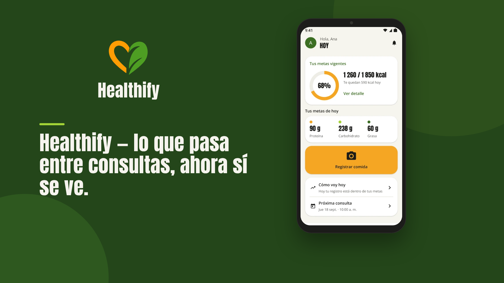
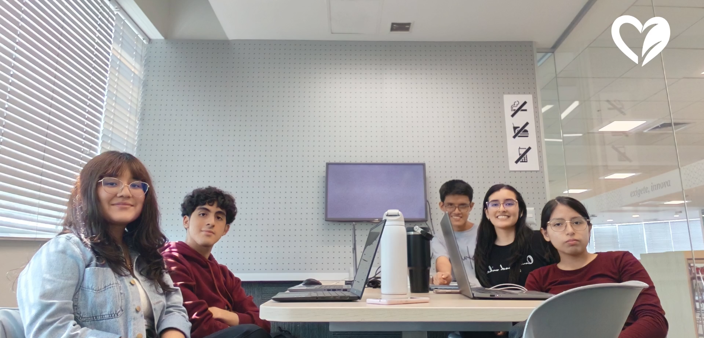

# Conclusiones
 
## Conclusiones y Recomendaciones
 
### Conclusiones

#### Sobre el Problem Statement y los resultados obtenidos

El Problem Statement ubicó la brecha del tratamiento nutricional en el periodo entre consultas: el nutricionista ya tiene dónde guardar la evaluación, el diagnóstico y el plan, pero no recibe información continua, organizada y confiable sobre lo que el paciente come mientras no lo ve. Las entrevistas de descubrimiento lo confirmaron. Willyan diseña el plan y registra las medidas en Nutrimind; Tatiana reparte la información entre la historia clínica, un Excel por paciente y WhatsApp. Ninguno de los dos registra lo que el paciente come entre consultas: Willyan lo reconstruye con una nueva entrevista y Tatiana dedica cerca de un tercio de la cita a preguntarlo día por día. Del lado del paciente, ambas entrevistadas guardan su plan en WhatsApp y tienen sus medidas repartidas entre fotos del celular, el chat y lo que conserva el nutricionista. Una de ellas lo resumió así: el plan está en WhatsApp, las medidas en un bloc de notas y lo que come cada día, solo en su memoria.

Healthify responde hoy a ese problema con cuatro productos en uso. El landing page está publicado en https://landing.healthify.lat, en español e inglés. El backend expone los seis bounded contexts en https://platform.healthify.lat (versión 1.6.0). La app Android (versión 2.1.0) atiende al paciente y al nutricionista, y la app Flutter (versión 1.3.1) le da al nutricionista una herramienta propia para la consulta. Las dos apps se distribuyen firmadas por Firebase App Distribution y como APK en los releases de GitHub. En el primer sprint el Product Owner aceptó 45 de las 55 historias comprometidas; en el segundo aceptó las 26 historias del sprint (106 Story Points), entre ellas las diez que habían quedado pendientes.

Los principios que el modelo de dominio fijó como respuesta al Problem Statement ya son comportamiento del sistema. El diario del paciente no se borra. La estimación de una foto queda como propuesta hasta que el paciente la confirma o la ajusta. Las comidas y los autopesajes registrados sin conexión se encolan con su identificador y su hora local, y se sincronizan sin duplicarse. La foto viaja sin metadatos EXIF. Las señales automáticas terminan en la bandeja del nutricionista, y la propuesta de ajuste del plan solo cambia algo cuando el profesional la acepta o la edita. WhatsApp sigue siendo el competidor real del periodo entre consultas, porque ambos segmentos ya lo usan como canal de seguimiento.

---

#### Sobre los Assumptions y el comportamiento real de los segmentos

Se asumió que el primer segmento estaría formado por pacientes adultos de Lima y Loreto en tratamiento activo para bajar de peso. Las entrevistas confirmaron la edad (pacientes de 19 y 52 años) y la geografía (una paciente en Iquitos y otra en Lima; los nutricionistas atienden en Barranca e Iquitos), y ampliaron la motivación: la paciente de Iquitos llegó al tratamiento tras un examen ocupacional con triglicéridos y glucosa elevados. El segmento incluye, por tanto, a pacientes con riesgo metabólico. La presencia de usuarios en Loreto justificó el diseño offline-first, que la app Android ya implementa con su cola de sincronización.

Se asumió que el paciente buscaría registrar su alimentación con poco tiempo y esfuerzo. Una paciente envía todos los días fotos de sus tres comidas a su nutricionista; la otra abandonó Fitia porque tenía que buscar cada alimento e ingresar las cantidades a mano. Los dos casos llevan a lo mismo: el esfuerzo de registro decide si el paciente sigue o abandona. Por eso la app ofrece el registro por foto como flujo principal y deja el registro manual por catálogo, con alimentos locales, como alternativa.

Se asumió que el paciente querría ver la evolución de su peso. Las pacientes se pesan cada una o dos semanas, y lo hacen en casa, sin supervisión. El equipo separó en el modelo el `Self Weigh In` del paciente de la `Clinical Measurement` del nutricionista y muestra el peso como una `Weight Trend`. En la app, esa tendencia es un promedio móvil de los autopesajes que siguieron el protocolo, y la pantalla explica por qué algunos registros quedan fuera de la línea.

Se asumió que el nutricionista necesita información continua entre consultas y que valoraría una herramienta que no sustituya su criterio. Willyan individualiza cada plan y deriva al endocrinólogo cuando lo considera necesario. Tatiana, ante un paciente que no progresa, revisa primero la adherencia real y luego lo deriva para descartar problemas hormonales, y dijo que una alerta temprana le ahorraría esperar a la siguiente cita. El producto respeta esa forma de trabajar: ningún algoritmo modifica un plan, y cada señal se convierte en un ítem de revisión que espera una decisión humana.

Se asumió que Healthify se diferenciaría por centrarse en el periodo entre consultas. Ninguna de las herramientas observadas cubre de forma estructurada el registro del paciente en ese periodo. El riesgo de duplicidad con Nutrimind creció, sin embargo, porque el producto ya incluye la consulta guiada y la publicación del plan dentro de Healthify. Los supuestos sobre el acceso gratuito y los resultados de negocio (retención, adopción recurrente y crecimiento de usuarios activos) siguen sin validar: requieren usuarios reales durante varias semanas.

Del contraste entre supuestos y comportamiento salieron dos aprendizajes que no estaban previstos. El primero viene de las entrevistas: ambas pacientes valoraron declarar una comida fuera del plan sin justificarse. El equipo modeló el `Off Plan Entry` sin detalle obligatorio, prohibió en el Ubiquitous Language términos como *cheat*, *fail* o *violation* y, en la pregunta «¿Esta comida estaba en tu plan?», la app sugiere una respuesta calculada a partir del plan y del diario, que el paciente puede cambiar. El segundo salió de la implementación: el día del paciente tiene que contarse con su calendario. En el primer sprint el cumplimiento se evaluaba con la fecha UTC, y una comida registrada de noche en Lima caía en el día siguiente; el segundo sprint corrigió el cálculo y reparó los días ya evaluados.

---

#### Sobre los Hypothesis Statements

La Hypothesis Statement 1 planteó que el paciente usaría Healthify de forma recurrente si pudiera registrar su alimentación por foto o a mano de manera sencilla. Ambas pacientes dijeron que usarían a diario un registro por foto con confirmación, siempre que no falle y no las obligue a escribir datos. La app ya implementa ese flujo: el servidor analiza la foto con Gemini, devuelve una estimación con su nivel de confianza y una sugerencia sobre si la comida encaja en el plan, y el paciente confirma o ajusta. Tras las sesiones de validación se explicó en el diario qué significa una confirmación pendiente y se rotuló el botón de registro. Con la IA activa en producción, el flujo principal ya está disponible para los pacientes. La hipótesis sigue validada solo de forma cualitativa: es la más riesgosa del Lean UX Canvas, y lo que una paciente dice que hará no garantiza lo que hará durante semanas de registro.

La Hypothesis Statement 2 sostuvo que el paciente seguiría usando la app si pudiera registrar su peso y ver su evolución. La tendencia de peso está implementada, y tras las sesiones de validación se aclaró la pestaña de peso. La frecuencia de pesaje semanal o quincenal sigue indicando que el peso no basta para sostener el uso diario. La hipótesis queda parcialmente validada y su efecto debe medirse junto con el registro de comidas.

La Hypothesis Statement 3 afirmó que los nutricionistas incorporarían Healthify a su seguimiento si tuvieran información continua y organizada sobre la alimentación y el peso de sus pacientes. Tatiana dijo que lo que más le gustaría cambiar es tener toda la información del paciente en un solo lugar. El producto ya le ofrece al nutricionista el expediente unificado, el monitoreo de cada paciente y una cartera agrupada por acción pendiente, en Android y en Flutter. La hipótesis sigue validada de forma cualitativa, con evidencia de dos profesionales; falta comprobar que el nutricionista abra el expediente antes de cada consulta.

La Hypothesis Statement 4 propuso que los nutricionistas usarían indicadores derivados de la alimentación y del peso para ajustar el tratamiento, sin ajustes automáticos. Tatiana valoró mucho una alerta de inconsistencia, sobre todo para los pacientes que ve cada uno o tres meses. La bandeja de revisión, con la evidencia de cada señal, la señal de consistencia y la propuesta de ajuste que el nutricionista acepta o edita, ya está construida. La hipótesis queda parcialmente validada: falta ver si los nutricionistas resuelven los ítems de la bandeja y si esas resoluciones cambian sus decisiones.

La Hypothesis Statement 5 planteó que los nutricionistas relacionarían mejor lo ocurrido entre consultas con el plan si pudieran registrarlo y ajustarlo dentro de Healthify. Es la hipótesis con más riesgo. Las conclusiones anteriores recomendaban empezar `Nutritional Care` con una versión mínima, limitada a publicar las metas vigentes. El equipo construyó la versión completa: la consulta guiada en cuatro pasos (evaluación, diagnóstico, propuesta de metas calculadas y publicación del plan) y el ajuste del plan entre consultas. Al paciente solo le llegan las metas vigentes (`Active Targets`), que confirma al recibirlas. Con esto Healthify sirve al caso de Tatiana, que registra sus ajustes en WhatsApp y a veces pierde el hilo de lo último que indicó. Para Willyan, que ya registra el plan en Nutrimind, la consulta guiada puede sentirse como trabajo duplicado, y eso todavía no se ha probado.

La Hypothesis Statement 6 sostuvo que la adopción dependería de un vínculo digital entre paciente y nutricionista con funciones diferenciadas. Ambas pacientes mantienen una relación uno a uno con su nutricionista y quieren centralizar la información del tratamiento. El producto ya cubre el ciclo del vínculo: invitación por código QR, consentimiento, revocación, cambio de nutricionista y alta al terminar el tratamiento. La hipótesis queda parcialmente validada, porque el flujo de invitación todavía no se ha usado durante una consulta real.

---

#### Sobre los criterios de éxito del Lean UX

El Problem Statement definió tres criterios de éxito: que los pacientes registren su alimentación con frecuencia entre consultas, que los nutricionistas consulten esa información antes de la siguiente cita y que la usen para sustentar sus decisiones de seguimiento y ajuste. El Lean UX Canvas añadió tres resultados comerciales: una tasa sostenida de retención de pacientes, una proporción creciente de nutricionistas que usan la plataforma de forma recurrente y un aumento progresivo de usuarios activos.

Ninguno de estos criterios se ha cumplido todavía, porque las apps recién se distribuyen y ningún paciente ha completado con ellas un periodo entre consultas. Lo que cambió es que el producto ya puede medirlos. El modelo del Design Level EventStorming tiene veinticuatro agregados, ochenta y nueve comandos y noventa y seis eventos de dominio, y el backend implementa ochenta y dos de esos eventos. La frecuencia de registro se puede medir con `Meal Logged` y `Daily Compliance Computed`; la consulta del nutricionista, con el acceso al expediente y a los read models del diario; y el uso de la información para decidir, con `Review Item Resolved` y `Nutrition Plan Adjusted`. El siguiente paso del roadmap es poner esas mediciones a trabajar con usuarios reales.

---

### Recomendaciones

Se recomienda empezar por un piloto de entre siete y catorce días, la ventana mínima de evaluación definida en el modelo, con nutricionistas y pacientes reales usando las apps que ya se distribuyen por Firebase. Con el reconocimiento por foto activo, el piloto puede probar directamente la Hypothesis Statement 1. Conviene seguir el costo por análisis de Gemini durante el piloto y ajustar a ese costo la cuota por función que ya aplica el backend, porque el uso diario de varios pacientes multiplica las llamadas al modelo. Durante el piloto se recomienda medir el tiempo promedio por registro, la proporción de estimaciones confirmadas sin ajuste, la proporción de días con al menos un registro, la proporción de ítems de la bandeja que el nutricionista resuelve y los motivos de abandono. Esos datos reemplazarían la intención declarada en las entrevistas por comportamiento observado.

Se recomienda probar la consulta guiada con nutricionistas que ya usan otra herramienta clínica, como Willyan con Nutrimind, antes de seguir ampliando `Nutritional Care`. Si el piloto muestra que registrar el plan en Healthify les resulta trabajo duplicado, la alternativa es importar el plan, o al menos las metas vigentes, desde la herramienta que ya usan. Al mismo tiempo, conviene ampliar la muestra de ambos segmentos con pacientes hombres y con nutricionistas de práctica exclusivamente privada, porque cuatro entrevistas no alcanzan para generalizar.

Se recomienda cerrar lo que el producto deja pendiente para salir a usuarios. Los testimonios del landing page son un borrador que falta confirmar con sus autoras. El backend, además, no tiene un flujo de integración continua que ejecute sus 1472 pruebas en cada pull request, como ya ocurre en las dos apps.

En cuanto al modelo de negocio, se recomienda validar el acceso gratuito con nutricionistas, preguntando qué funciones profesionales estarían dispuestos a pagar, sin crear barreras para el paciente. El índice de consistencia debería mostrarse a los nutricionistas solo cuando el piloto confirme que les sirve y existan suficientes días de datos para que la señal sea confiable. Después del piloto, la cobertura puede ampliarse a otras regiones del Perú con conectividad intermitente, donde el diseño offline-first ya está probado en la app.

Healthify trata datos de salud, que la Ley N.º 29733 de Protección de Datos Personales considera datos sensibles. El producto ya pide aceptar los términos al crear la cuenta, publica una política de privacidad en el landing page, permite revocar el consentimiento, exportar los datos del paciente y apagar las funciones de IA, y seudonimiza lo que envía al modelo. Antes del piloto se recomienda que un abogado revise los términos y la política, e inscribir el banco de datos personales ante la Autoridad Nacional de Protección de Datos Personales. En cada iteración, el equipo debería mantener las dos decisiones que las entrevistas mostraron como más valiosas: la app no juzga ni penaliza al paciente, y la decisión clínica es siempre del nutricionista.

## Video App Validation

### Descripción General

En esta sección, el equipo documenta la evaluación de la aplicación a través de la prueba de usuarios. Para llevar a cabo este proceso, se utiliza Firebase App Distribution, permitiendo la distribución y prueba de la aplicación en distintos dispositivos antes de su lanzamiento.

Las pruebas se realizaron con usuarios representativos de los segmentos objetivo (profesionales de la nutrición y pacientes en tratamiento), validando los flujos clave del ecosistema como la vinculación mediante código QR, el registro de ingesta asistido por IA, la consulta clínica guiada y el seguimiento de adherencia.

---

### Distribución de la Aplicación (Firebase App Distribution)

Para facilitar la instalación y evaluación en dispositivos móviles antes del lanzamiento, se habilitaron los siguientes enlaces de distribución:

<strong>Tabla 291</strong> <em>Enlaces de distribución de la aplicación en Firebase App Distribution</em>

| Plataforma / Build | Enlace de Distribución |
| --- | --- |
| **Healthify App Android** | [Descargar vía Firebase App Distribution](https://appdistribution.firebase.dev/i/1dec518f210ca662) |
| **Healthify App Flutter** | [Descargar vía Firebase App Distribution](https://appdistribution.firebase.dev/i/ff7af63bc7988299) |

---

### Información del Video

<strong>Tabla 292</strong> <em>Información del video de validación de la aplicación</em>

| Atributo | Contenido |
| --- | --- |
| **Duración** | 12:10 |
| **Link** | [Link del Video de Validación](https://upcedupe-my.sharepoint.com/:v:/g/personal/u202411669_upc_edu_pe/IQCnNkCaYT30S6gZMsa5J7AmAVF4NkGrnCEyjn200FyN5Hk?nav=eyJyZWZlcnJhbEluZm8iOnsicmVmZXJyYWxBcHAiOiJTdHJlYW1XZWJBcHAiLCJyZWZlcnJhbFZpZXciOiJTaGFyZURpYWxvZy1MaW5rIiwicmVmZXJyYWxBcHBQbGF0Zm9ybSI6IldlYiIsInJlZmVycmFsTW9kZSI6InZpZXcifX0%3D&e=mqTC43) |

---

### Resumen del Video

El video documenta dos sesiones de prueba de usabilidad con usuarios representativos de los roles clave del ecosistema:

* **Validación con Nutricionista (Tatiana Mozambite):** Se evaluó el flujo profesional desde la Landing Page hasta la gestión clínica. La especialista destacó la practicidad de la vinculación inmediata mediante código QR (con vigencia de 24 horas) y el ahorro significativo de tiempo al llegar a la consulta conociendo el registro de comidas del paciente, reduciendo la dependencia de su memoria. Asimismo, validó positivamente la consulta estructurada en 4 pasos (medición, diagnóstico, metas calculadas y restricciones) y la bandeja de alertas interconsulta, valorando que la IA brinde soporte analítico manteniendo siempre la decisión médica final en el profesional.
* **Validación con Paciente (Larissa Ramírez):** Se evaluó la interacción del paciente en la aplicación móvil. La usuaria resaltó la rapidez y comodidad del registro fotográfico con reconocimiento automático de porciones e IA, así como la facilidad para ajustar gramajes. Resaltó especialmente el enfoque *"sin culpa"* (*no-guilt*), al no recibir advertencias punitivas en color rojo tras ingerir alimentos fuera del plan, y la visualización del progreso orientada a la tendencia histórica en vez del peso diario.

---

## Video About the product

### Descripción General

Esta sección presenta el Video About-the-Product de **Healthify**, un producto concebido por NutriSync para cerrar la brecha de comunicación y datos clínicos que existe entre una cita nutricional y la siguiente. El video está dirigido a nutricionistas profesionales que buscan visibilidad objetiva de la adherencia de sus pacientes y a personas en tratamiento que necesitan registrar su día a día de forma ágil y sin sentimientos de culpa.

El tono de la comunicación es directo, empático y centrado en la evidencia clínica, transmitiendo accesibilidad tanto en la plataforma web como en la aplicación móvil nativa para Android.

---

### Información del Video

<strong>Tabla 293</strong> <em>Información del video About the Product</em>

| Atributo | Contenido |
| --- | --- |
| **Duración** | 1:52 |
| **Link** | [Link de about the product](https://upcedupe-my.sharepoint.com/:v:/g/personal/u202417857_upc_edu_pe/IQDHbsYeCvSMRI13NliYkRkLAfnA016SqeyYvBMisFAYgEM?nav=eyJyZWZlcnJhbEluZm8iOnsicmVmZXJyYWxBcHAiOiJPbmVEcml2ZUZvckJ1c2luZXNzIiwicmVmZXJyYWxBcHBQbGF0Zm9ybSI6IldlYiIsInJlZmVycmFsTW9kZSI6InZpZXciLCJyZWZlcnJhbFZpZXciOiJNeUZpbGVzTGlua0NvcHkifX0&e=yd8QDV) |
| **Captura del Video** |  |

---

### Resumen del Video

El video introduce el problema cotidiano de los tratamientos nutricionales: entre cita y cita transcurren semanas, y los datos de consumo se dispersan en recuerdos vagos, mensajes de chat u hojas sueltas, provocando que hasta un tercio de cada consulta se gaste simplemente reconstruyendo lo ingerido. Frente a esto, se presenta el valor diferencial de Healthify bajo el lema: *"Lo que pasa entre consultas, ahora sí se ve"*.

A lo largo del video se exhiben las funcionalidades principales del ecosistema:

* **Vinculación inmediata por código QR:** El paciente enlaza su cuenta escaneando el código provisto por el especialista en consulta, otorgando de inmediato su consentimiento informado para compartir registros.
* **Registro de comidas con foto e IA:** El usuario fotografía su plato; el sistema estima automáticamente los alimentos y el gramaje de las porciones mostrando su índice de certeza, permitiendo confirmación o ajuste rápido.
* **Registro "Sin culpa" fuera de plan:** Si el paciente consume un alimento no contemplado en su dieta, puede marcarlo con un solo toque sin recibir advertencias en rojo ni tener que dar explicaciones punitivas.
* **Autopesaje y análisis de tendencia:** La aplicación evalúa la curva de tendencia histórica en lugar de enfocarse en las variaciones puntuales del peso diario.
* **Operatividad offline:** La plataforma almacena registros de manera local y encola la sincronización para operar sin necesidad de conexión a internet.
* **Asistencia con IA ("La IA sugiere, tú decides"):** Provisión de resúmenes semanales de evolución y sugerencias de platos balanceados.
* **Consulta clínica guiada en 4 pasos:** El nutricionista dispone de una herramienta que optimiza la atención en medición antropométrica, diagnóstico asistido por IA, cálculo automático de metas calóricas/macros y publicación del plan.
* **Bandeja de revisión interconsulta:** Permite al nutricionista recibir señales de desviaciones calóricas y adherencia del paciente entre visitas, bajo la regla estricta de que *"la IA propone y el nutricionista decide"*, impidiendo que un algoritmo altere prescripciones médicas de forma autónoma.

El video culmina indicando que, en esta etapa, el servicio es completamente gratuito para pacientes y nutricionistas a través de `landing.healthify.lat` y la aplicación para Android.

---

### Testimonios de Usuarios

El video incorpora los testimonios de dos usuarias que formaron parte del proceso de validación clínica de la plataforma:

> "Llego a la consulta sabiendo de lo que comió el paciente cada día, ya no dependo de lo que recuerde."
> **Tatiana Mozombite, Nutricionista – Iquitos**

> "Lo que más me gustó fue la rapidez, que con una foto ya registró todo y que no me hace sentir mal cuando como algo fuera de mi plan de nutrición."
> **Larisa Ramírez, Paciente en tratamiento – Lima**

---

## Video About the team

### Descripción General

Esta sección presenta el Video About-the-Team de Healthify, desarrollado por la startup NutriSync. En este material, el equipo expone los aspectos clave del proceso de investigación, diseño y desarrollo de software: desde la identificación de la brecha de comunicación entre consultas nutricionales y la división de liderazgos técnicos por Bounded Contexts, hasta el crecimiento profesional y las lecciones aprendidas durante los sprints de trabajo colaborativo.

---

### Información del Video

<strong>Tabla 294</strong> <em>Información del video About the Team</em>

| Atributo | Contenido |
| --- | --- |
| **Duración** | 9:47 |
| **Microsoft Stream** | [Link de about the team](https://upcedupe-my.sharepoint.com/:v:/g/personal/u202417857_upc_edu_pe/IQBt-TjwWeUXRp1ADIwTa_j9Aad_-tXMXTpCCruSw-TbP6M?nav=eyJyZWZlcnJhbEluZm8iOnsicmVmZXJyYWxBcHAiOiJPbmVEcml2ZUZvckJ1c2luZXNzIiwicmVmZXJyYWxBcHBQbGF0Zm9ybSI6IldlYiIsInJlZmVycmFsTW9kZSI6InZpZXciLCJyZWZlcnJhbFZpZXciOiJNeUZpbGVzTGlua0NvcHkifX0&e=3F8Ehb) |
| **Captura del Video** |  |

---

### Pauta de Secuencias de Contenido

<strong>Tabla 295</strong> <em>Pauta de secuencias de contenido del video About the Team</em>

| Sección | Inicio (hh:mm:ss) |
| --- | --- |
| Introducción y problema de la consulta nutricional | 00:00:00 |
| Needfinding e investigación de usuarios | 00:00:53 |
| Diseño UX, hipótesis Lean y backlog ágil | 00:01:49 |
| Sprint 1 y desarrollo tecnológico integral | 00:02:35 |
| Evolución tras TB1 y aprendizajes de equipo | 00:03:22 |
| Testimonio – Olenka Priscilla Del Aguila Del Aguila | 00:04:34 |
| Testimonio – Angela Milagros Espinoza Cruz | 00:05:37 |
| Testimonio – Joel Fernando Mora Rivera | 00:06:40 |
| Testimonio – Rose Almendra Vergaray Calderon | 00:07:41 |
| Testimonio – Angel Martin Villarreal Bazan | 00:08:44 |

---

### Resumen del Video

El video comienza abordando la problemática central que da origen a Healthify: el vacío de información que ocurre entre una cita nutricional y la siguiente, donde el nutricionista desconoce lo que su paciente realmente consumió durante semanas. Ante este reto, el equipo de NutriSync adoptó un modelo de liderazgo distribuido donde cada integrante asumió la responsabilidad directa sobre un Bounded Context del backend, un módulo de la app móvil y una sección de la landing page, trabajando bajo GitFlow con ramas por funcionalidad y revisiones obligatorias mediante Pull Requests.

En la fase inicial de Needfinding, el equipo entrevistó a dos nutricionistas (William y Tatiana) y a dos pacientes (Evelyn en Lima y Larisa en Iquitos). Descubrieron que los especialistas invertían hasta un tercio de cada cita intentando reconstruir las comidas del paciente, mientras que los usuarios abandonaban soluciones convencionales por lo tedioso que resultaba el registro manual. Estos hallazgos se plasmaron en User Personas, Journey Maps, Empathy Maps y un Event Storming en Miro, consolidando un Lenguaje Ubicuo con términos como "vínculo de cuidado", "autopesaje" e "índice de consistencia", delimitando seis Bounded Contexts con foco nuclear en *Intake & Body Response* y *Monitoring & Adherence*.

La etapa de diseño integró hipótesis formuladas bajo Lean UX, User Stories redactadas con criterios de aceptación en Gherkin, Impact Maps y la priorización del Product Backlog. El prototipado en Figma y el sistema de diseño se rigieron bajo el principio transversal de "registrar sin culpa": la app no penaliza con colores rojos ni exige explicaciones cuando una comida queda fuera del plan.

Durante el Sprint 1, el equipo abordó 276 Story Points distribuidos de forma simultánea en la landing page bilingüe, la app móvil nativa en Android (Kotlin con Jetpack Compose y almacenamiento local) y el backend en .NET 10 bajo Domain-Driven Design (DDD) y CQRS con seis Bounded Contexts desacoplados mediante fachadas ACL y eventos, documentados en Swagger y contenerizados con Docker. Se superaron bloqueos técnicos significativos, como la transición de ML Kit hacia la API de Gemini para la estimación de porciones mediante fotos, la migración a MySQL 8 y ajustes de último momento en el despliegue con GitHub Actions. En los sprints posteriores a la TB1, se implementaron la exportación de expedientes, recuperación de contraseñas por correo, el calendario clínico, el descarte de consultas y recomendaciones alimentarias impulsadas por IA sobre el catálogo propio.

---

### Presentación de Integrantes

**Olenka Priscilla Del Aguila Del Aguila (U202411669):**

* Condujo tres de las cuatro entrevistas a profundidad con nutricionistas y pacientes durante el Needfinding.
* Documentó el Capítulo 4 del informe técnico, detallando la configuración de entornos, control de versiones, guías de estilo y evidencias del Sprint 1.
* En la Landing Page, implementó la sección Hero y la sección del problema incorporando un carrusel bilingüe accesible (español e inglés).
* En el backend, lideró los Bounded Contexts de *Identity & Access Management (IAM)* y *Care Relationship*, implementando autenticación JWT, rotación de refresh tokens, bloqueo temporal de cuentas y consentimiento informado paciente-nutricionista.
* En la app Android, desarrolló la sección de datos cifrados, la vinculación mediante código QR y el flujo de consentimiento.

**Angela Milagros Espinoza Cruz (U202415495):**

* Lideró la fase de Needfinding elaborando User Personas, User Task Matrix, Empathy Maps, Journey Maps y el análisis competitivo.
* Lideró el Capítulo 3 del informe, abarcando desde la guía de estilo y arquitectura de información hasta wireframes, mockups, wireflows, user flows y el prototipo final en Figma.
* En la Landing Page, programó las páginas institucionales de "Nosotros" y "Contacto".
* En el backend, lideró el Bounded Context de *Monitoring & Adherence*, desarrollando el cálculo de ventanas de evaluación, desviaciones, índice de consistencia, tareas en segundo plano (background jobs) y Read Models para el expediente del paciente.
* En la app Android, implementó la navegación entre roles (paciente y nutricionista), la persistencia local con Room y el flujo integral de consulta guiada.

**Joel Fernando Mora Rivera (U20241B227):**

* Diseñó la arquitectura de software integral siguiendo el modelo C4 (diagramas de contexto, contenedores, componentes y despliegue) y el generador de Bounded Context Canvas.
* En la Landing Page, programó las secciones de funciones dedicadas tanto al paciente como al nutricionista.
* En el backend, lideró los Bounded Contexts de *Food Catalog* e *Intake & Body Response*, integrando proveedores de datos nutricionales externos (USDA y Open Food Facts), la sincronización sin duplicados offline y el cálculo de la tendencia de peso.
* En la app Android, implementó el catálogo de alimentos con caché local, la visualización del progreso diario, la agenda y consultas del paciente, e integró la generación de ideas de comidas mediante IA.

**Rose Almendra Vergaray Calderon (U20241D159):**

* Lideró el Capítulo 1 del informe, redactando la descripción de la startup, análisis 5W2H, el marco Lean UX y la caracterización de los segmentos objetivo.
* Especificó los requerimientos ágiles mediante User Stories con criterios de aceptación en sintaxis Gherkin, Impact Maps y la gestión del Product Backlog.
* En la Landing Page, desarrolló la sección "Cómo funciona", el módulo de preguntas frecuentes con filtros dinámicos y la página de Términos y Condiciones.
* En el backend, lideró el Bounded Context de *Nutritional Care*, abarcando la consulta guiada, diagnóstico clínico, cálculo automatizado de metas, versionado de planes y la bandeja de revisión con sugerencias de ajuste por IA.
* En la app Android, desarrolló el diario nutricional, el registro de alimentos (por foto y manual), el registro de autopesaje y la cola de sincronización sin conexión.

**Angel Martin Villarreal Bazan (U202417857):**

* Asumió la estructuración del repositorio del informe técnico, la coordinación de entregables entre los miembros y la planificación integral del Sprint 1.
* En la Landing Page, diseñó la estructura base del proyecto, el sistema de diseño visual y el motor de traducción e internacionalización entre español e inglés.
* En el backend, desarrolló la plataforma base en .NET 10 (núcleo compartido, middleware de excepciones, límites de solicitudes/rate limiting), el módulo de IA con Gemini (control de consentimientos y validación de respuestas) y la integración continua/despliegue con Docker y GitHub Actions.
* En la app Android, estructuró la capa de red, inyección de dependencias, el sistema de sincronización, el design system de Healthify y gestionó la integración de código hacia las ramas develop y main.